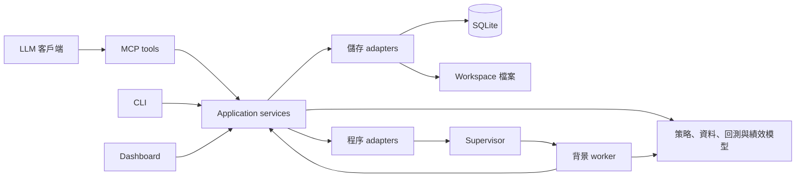
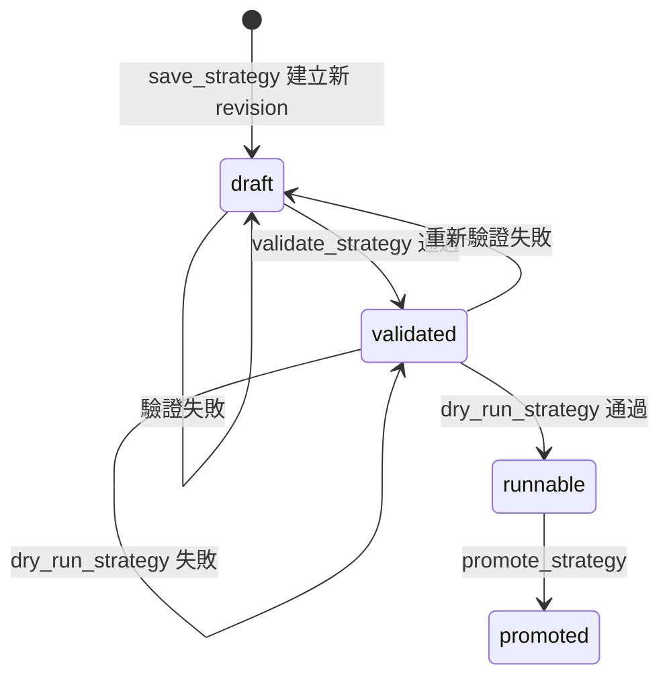
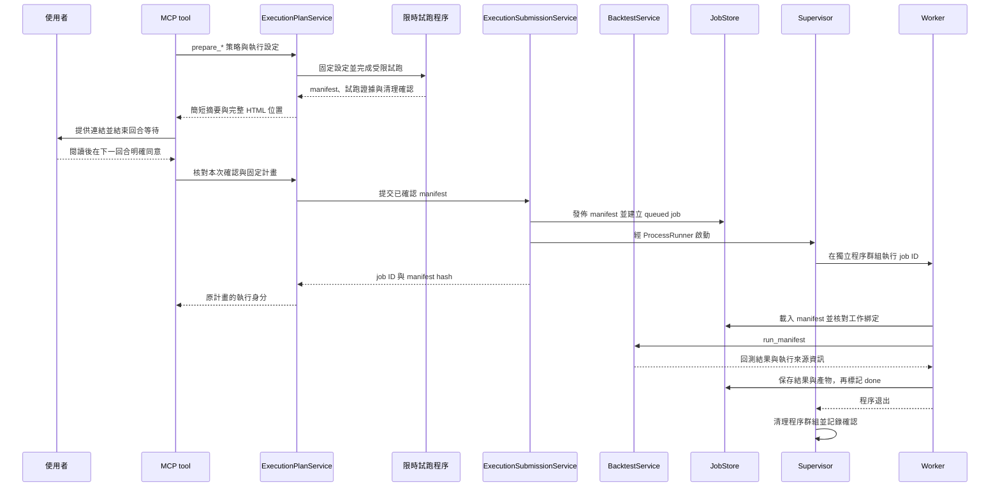
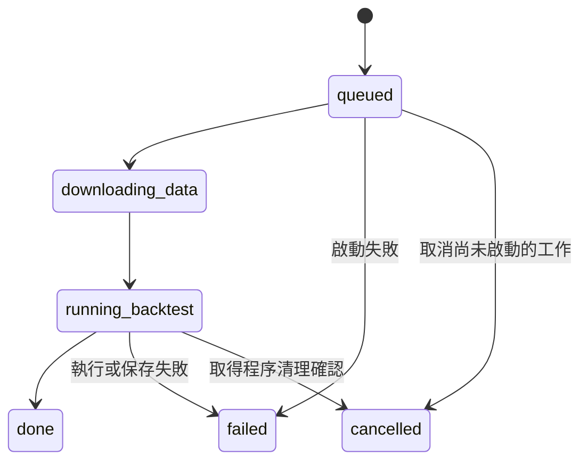

# 系統架構

TradingDev 讓 LLM 透過標準 MCP 協助使用者建立、驗證與研究交易策略，
提供歷史回測、參數最佳化及結果追蹤，不提供真實下單。
MCP 是主要產品介面；CLI 與 dashboard 共用 application services 的執行與查詢能力。
模型供應商的呼叫與設定留在客戶端整合層，後端不依賴特定 LLM。

本文件說明目前的責任分工、核心概念、執行流程及保證範圍。
操作與資料格式各有以下文件，避免在架構總覽重複維護欄位與版本清單。

| 文件 | 負責內容 |
| ---- | -------- |
| [README](README.md) | 安裝、設定、工具使用與使用者升級說明 |
| [策略契約](docs/strategy_contract.md) | 策略 Python／YAML、驗證規則、revision 與執行資格 |
| [執行產物契約](docs/run_artifacts.md) | Manifest、SQLite、檔案格式、指標範圍與查詢契約 |
| [開發指南](docs/development.md) | 開發環境、品質檢查、測試及 Git／PR 流程 |
| [代理開發政策](AGENTS.md) | 代理修改 repository 時遵循的政策 |

## 系統邊界與模組責任

以下是主要呼叫關係。Application services 協調策略、資料與執行；
MCP tools 負責協定轉換，CLI 負責同步執行入口，dashboard 負責已保存結果的呈現。

| 位置 | 目前責任 |
| ---- | -------- |
| `mcp/server.py`、`mcp/tools/` | 組裝 services、註冊工具、驗證協定輸入與輸出 |
| `mcp/workers/` | 背景工作入口、狀態更新及流程協調；最佳化 worker 直接協調搜尋與樣本外測試 |
| `app/` | 策略生命週期、設定固定、限時試跑、確認計畫、工作提交、ML 研究、結果保存與查詢；`contracts/` 定義回覆 DTO |
| `domain/strategies/` | 策略介面、來源探索與載入、參數解析、訊號契約及 bundled strategies |
| `domain/execution.py`、`domain/randomness.py` | 執行規格與完整性檢查、每次執行的亂數 context |
| `domain/execution_plan.py`、`domain/preflight.py` | 確認內容與執行身分綁定、限時試跑請求及覆蓋證據 |
| `domain/presentation/`、`adapters/presentation/` | 固定文件內容與章節、白話欄位投影，以及共用文字／HTML 呈現 |
| `domain/backtest/`、`domain/validation/`、`domain/optimization/` | 回測引擎、walk-forward、參數搜尋與績效計算整合 |
| `domain/performance/` | 指標定義、適用條件、最佳化方向與具型別的績效產物模型 |
| `domain/statistics/` | 與引擎無關的推論統計：期間損益與報酬、Sharpe 區間與多重比較校正、配對比較、參數平原、損益兩平與買進持有基準；目前未接入 services，見[引擎無關的統計分析](#引擎無關的統計分析) |
| `domain/data/`、`domain/indicators/`、`domain/ml/` | 行情與特徵資料處理、技術指標、模型及訓練邏輯 |
| `adapters/storage/`、`adapters/execution/` | SQLite、revision／manifest／績效檔案保存，以及程序啟動與監督 |
| `adapters/cli/`、`adapters/dashboard/` | 終端機與視覺化入口 |
| `shared/` | 路徑解析、JSON 正規化、記錄與平行執行等共用工具 |

這是目前實作的責任分組，尚未形成全面的依賴反轉。
Application services 直接使用具體的儲存與程序 adapters；`domain/data` 內的
crawlers、loader 與 DataManager 仍執行網路及檔案 I/O，StrategyLoader 也會
讀取、載入策略檔案。`domain/ml/registry` 的模型、特徵快取與排行榜 stores
也執行檔案 I/O；ML dataset store 位於 `adapters/storage`。
最佳化的完整流程仍由 worker 協調，尚未全部收斂到 app。
修改這些模組時，不能假設 domain 全部都是無副作用的純計算。

`mcp.server.create_server()` 是 MCP 的組裝入口，讓 services 共用 workspace
與 SQLite store。匯入 server 模組不建立 runtime 檔案；建立 server 時才組裝執行資源。
背景 worker 使用相同 Python interpreter，並明確繼承解析後的 workspace 與資料根目錄。
Bundled 策略隨 Git／套件發佈；生成策略、行情與執行結果存於使用者 workspace。

### Repository 開發工具與研究原型

產品程式位於 `src/tradingdev/`；repository 的開發工具、測試與研究原型分開管理：

| 位置 | 目前責任 |
| ---- | -------- |
| `scripts/`、`.githooks/` | Shell 操作與 Git hook 入口，選定 repository 與 interpreter 後呼叫 Python 模組；`scripts/` 另有一個獨立 Python 腳本，用於執行結果驗證 |
| `tooling/quality.py` | 共用品質檢查與格式化，涵蓋 `src/`、`tests/`、`tooling/`、`research/` |
| `tooling/git/` | 候選 snapshot／合併 tree 的建立與驗證，以及 hook、本機 full、PR 檢查與分支清理流程 |
| `tooling/review_docs.py` | 擷取固定 Git 版本的完整證據，協調文件審查批次與判定 |
| `tooling/process_guard.py`、`tooling/codex_binary.py` | 開發工具與測試共用的程序觀測／清理及 Codex 執行檔定位 |
| `tests/` | 測試案例、fixtures、MCP 與模型測試情境 |
| `research/` | 獨立研究原型；MAE 原型直接讀取指定行情檔案，與正式 Dashboard 分開 |

`tooling` 不依賴 `tests`；測試可直接使用共用工具。Git gate 與 PR 檢查共用候選
驗證服務，文件審查使用執行檢查的 checkout 內的工具讀取候選 Git 內容，
品質檢查與離線測試則使用候選 snapshot 內的入口與程式。
`tooling/`、`research/` 不隨產品 wheel 發佈，也不屬於產品 application services。
操作入口與檢查流程見[開發指南](docs/development.md)，研究原型用法見
[開發指南的 MAE 研究原型](docs/development.md#mae-研究原型)。

## 核心概念與身分

| 概念 | 意義與責任 |
| ---- | ---------- |
| Strategy revision | 一份生成策略的固定程式與基礎設定，由 StrategyService 管理狀態與驗證證據 |
| Execution manifest | 一次執行的固定請求，綁定策略身分、有效設定、建構子參數及可選的最佳化規格 |
| Execution plan | 通過短試跑的固定 manifest、使用者確認文件與證據，附有效期限及獨立確認狀態 |
| Job | 背景工作的進度、程序身分與控制紀錄，由 JobService／OptimizationService 提交，透過 JobStore 保存 |
| Run | 一次已保存的執行結果，記錄策略、設定與資料來源資訊，由 RunService 查詢 |
| Artifact | 與執行或研究相關的檔案及其索引，由 ArtifactService 提供探索與讀取 |
| ML dataset | 已保存的特徵與標籤版本，身分包含建置資訊、特徵程式與資料內容 |
| Model artifact | 已訓練模型的序列化內容、特徵契約及有效參數，由獨立模型 store 保存 |

一個 revision 可以提交多次工作；工作開始或結束不會把策略狀態改成 running 或 done。
參數實驗屬於工作設定：MCP 的 `parameters` 覆寫與 CLI 執行設定共用
BacktestService，在同一 revision 上固定不同參數的 manifest，避免重複保存策略程式。
Generated 策略以固定的建構子設定執行短、長訊號契約檢查，驗證與 dry-run
的基礎證據仍保留在原 revision；實驗不會更新這些證據或 current pointer。
背景回測與最佳化完成時，目前以 job ID 作為 run ID。CLI 同步執行也會保存獨立 run，
但不建立背景 job。相同設定的兩次執行可以留下不同結果，不會因設定相同而覆寫前次 run。

Manifest 保留 revision 綁定的身分與非參數宣告，以及該次執行的參數。
未提供 MCP `parameters` 或傳入 `null` 時，`config.strategy.parameters` 保留
輸入設定的參數映射，建構子預設值另外展開至 `strategy_execution`；明確提供映射
（包括 `{}`）時，則將合併後、包含預設值的完整實驗參數寫入 `config.strategy.parameters`，
取代這份執行快照中的基礎參數宣告。CLI 使用其執行 YAML 的參數映射。
原 revision 的 YAML 與證據均不改寫；worker 使用已固定的設定，不能因目前程式
新增預設值而重新解釋舊請求。完整格式與版本規則見
[Execution Manifest](docs/run_artifacts.md#execution-manifest)。

## 從策略建立到結果查詢

### 建立與驗證策略

每次 `save_strategy` 都建立新的 revision，即使程式與 YAML 相同也有新身分。
程式與基礎設定固定不變，metadata 則記錄該 revision 的狀態與驗證證據；
current pointer 指向最新保存的 revision。保存新版本不會撤銷舊版本的證據，
也不會讓新版本繼承舊版本的執行資格。

`StrategyCleanupService` 提供舊草稿的預覽與明確指定版本清理。儲存 adapter
檢查所有 job、run 與遺留 manifest 的引用；身分不明或資料損壞時停止清理。
current、非 draft 及被引用版本均保留。保存、驗證、狀態更新與清理共用每個策略的
lifecycle lock，避免檢查與刪除交錯；鎖檔位於 revision 目錄之外且不刪除。
清理每次重新確認資格與檔案完整性，檔案刪除不具跨版本或目錄內的交易原子性。

上圖描述成功保存後的生成策略 revision。保存被拒絕時不會建立 revision；
bundled 策略由 Git 管理並以 promoted 身分提供，沒有生成策略的 revision ID。
舊的平面生成策略檔案可供讀取與重新保存，其舊狀態不能授權執行。

Bundled catalog 從註冊 YAML 讀取訓練需求宣告，不為探索能力匯入或執行策略。
`StrategyCapabilities` 由同一宣告提供探索回覆及共用執行模式檢查；生成與舊格式策略
維持未知，不由 `fit()` 方法或生命週期狀態猜測能力。支援模式不是模型已訓練或目前
設定可執行的證明，設定前提與回覆欄位見[訓練契約](docs/strategy_contract.md#training-before-scoring)。

`StrategyService` 先做靜態政策及共用品質檢查，再透過 `SignalContractChecker`
檢查完整執行設定與訊號契約。驗證與 dry-run 共用 checker，使用不同長度的測試資料。
固定設定欄位拒絕未知名稱；策略參數保留明確的動態結構。成功解析的設定會以
`effective_config` 回傳，供 LLM 在提交前核對，資料目錄預設值則在提交時解析。
Repository 與生成策略共用 `pyproject.toml` 的 Ruff／strict Mypy 政策，
安裝後也使用隨 wheel 收錄的同一份設定。

所有驗證證據都綁定所選 revision。`BacktestService.prepare_execution()` 經由
`StrategyService.resolve_executable()` 檢查狀態、驗證證據與程式／基礎設定完整性；
worker 執行時再次檢查資格。指定 revision 不存在時不會退回 current，
省略 revision 時則在該操作開始時選定 current。詳細狀態與覆寫規則見
[策略生命週期](docs/strategy_contract.md#lifecycle)。

### 準備、確認與執行回測

一般回測與 walk-forward 共用 BacktestService、JobStore 與背景回測 worker。
MCP 先以 `prepare_backtest`、`prepare_walk_forward` 或 `prepare_optimization`
準備執行計畫：套用交易對、期間等請求設定，再解析資料位置與策略建構子參數，形成 manifest。
ExecutionPlanService 經 PreflightService 完成受限試跑，確認程序已停止並清理臨時內容後，
才發佈白話文字與 HTML 確認文件。準備不建立正式 job 或 run；失敗回傳結構化錯誤。

JobService、OptimizationService 與 CLI 共用的 BacktestService 在資料載入前，依
註冊策略的能力拒絕無法完成必要訓練的模式；呼叫端的 YAML 宣告不能覆寫註冊能力。
`strategy_requires_training` 的模式與設定指引經 preflight worker、PreflightService
及 ExecutionPlanService 保留，MCP adapter 再映射為 `next_tool`。這個回覆不會建立
可執行計畫，也不免除後續試跑與使用者確認。

JobService 與 OptimizationService 將準備和提交分開：prepare 方法只回傳
PreparedExecution，包含固定 manifest 與原始設定來源；ExecutionSubmissionService
共用建立 job、啟動 worker 與啟動失敗紀錄。提交已準備的內容時不重新解析 YAML，
也不重新選取 current revision；application service 的 start 方法仍組合這兩個步驟，
但 MCP 不暴露直接啟動工具。原本的 MCP `start_backtest`、`start_walk_forward`、
`start_optimization` 與 `confirm_optimization` 已移除。

PreflightService 將設定準備、策略匯入、生成策略訊號契約、受限行情取得、實際引擎執行
與結果序列化放入受監督的子程序；預設總預算為 60 秒，程序清理另計。
一般回測試跑一段行情，walk-forward 試跑一組訓練／測試分段，最佳化試跑第一組候選的
訓練與保留測試區間。每個區間須達到請求宣告的最低歷史資料需求，且受總 K 線筆數預算限制。
試跑用本次設定的行情資料管道，不以人工資料替代失敗的資料取得；離線測試可替代 provider，
不能因此宣稱已驗證真實外部資料。零交易仍可準備成功，但必須指出成交與交易成本路徑未覆蓋。
短樣本不保證完整期間、所有分段或所有候選一定成功，也不是完整 Python sandbox。

DataService 透過 application 層的 market_sample 協調受限取樣；storage adapter
負責分批讀取 Parquet，將無時區時間視為 UTC，與一般行情載入保持一致。
取樣以有限日曆區間逐段尋找有效 K 線，跳過休市空窗，直到達到筆數預算或請求結束日；
每段先以請求期間限制長度，再建立時間差，避免月線等長週期溢位。
特徵快取只投影時間戳與所需欄位，分批篩選實際樣本的時間戳；保留既有精確合併與
前後填補語義，合併前先計算重複鍵造成的筆數，超過預算即拒絕。
取樣不改寫原行情或特徵快取。
所有 crawler 都提供獨立的 `fetch_sample(..., max_rows=...)`，在來源請求與解析階段
限制資料量，支援包含終點及單一時間戳的區間；一般 `fetch()` 保留完整資料載入用途。
新增資料來源也必須實作此取樣介面，不能先完整載入後再截斷。
Binance Vision 取樣優先日檔，缺檔時才以月檔補取；下載串流寫入有記憶體門檻的暫存檔，
單一 CSV 以每批最多 1024 列完整掃描，只保留最早的所需 K 線；達到預算後不再讀後續日期檔。
每個壓縮檔下載上限 16 MiB，單次 `fetch_sample` 累計上限 32 MiB，
ZIP 宣告的 CSV 解壓大小上限 128 MiB；超限即回報失敗。
串流取樣 HTTP 拒絕重新導向及額外內容壓縮，避免用戶端在串流檢查前先緩衝或解壓回覆。
這仍需要完整下載選中的壓縮檔，不能把行數預算解讀為等比例的網路流量上限。
受監督子程序的標準暫存環境也指向本次受管理目錄，涵蓋第三方模型建立的臨時檔案。

確認計畫保存不可變 manifest、試跑證據及呈現內容；計畫摘要共同綁定這些資料。
模型提供策略名稱、摘要與每個參數的白話名稱／說明／單位，後端提供全部有效數值、
必備章節及實際檢查結果。參數說明必須完整對應固定建構子與搜尋候選的各個葉節點，
包括巢狀設定及內建策略的訓練設定；遺漏時回傳可供模型補齊的欄位路徑。
搜尋候選先套用與策略載入相同的純參數合併函數，再呈現完整有效值；巢狀映射未指定的
欄位保留原值，空映射不清除既有映射，清單與其他值則整體取代。
這些說明隨計畫保存，不改寫策略 revision 的 YAML。使用者可用自然語言要求調整，
不必閱讀程式、內部變數或設定檔。完整文字與 HTML 共讀同一份具型別的確認文件，
核心章節不可省略；技術身分與檔案位置放在獨立資訊區。工具回覆只提供後端產生的
`confirmation_summary` 與 HTML 位置，完整文字保留在計畫產物，不重貼到對話。

助手提供簡短摘要與可點的 HTML 連結後結束回合，等待使用者閱讀並在後續回合明確回覆。
`submit_execution_decision(plan_id, decision)` 接受 `approve`、`decline` 或 `revise`；
只有明確同意才提交原計畫，拒絕與修改要求都取消計畫。修改要求回傳
`confirmation_adjustment_requested`，助手收集修改內容、重新準備與試跑，再等待新確認。
提問、沉默、模糊回覆與最初的回測請求都不是對尚未閱讀計畫的同意。
原 `request_execution_confirmation` 與 MCP 原生表單路徑已移除，不保留相容轉接。

Streamable HTTP 使用 SSE 串流回覆；stdio 使用雙向通道。對話確認不要求
elicitation capability，也不維持等待使用者五分鐘的工具呼叫。

伺服器信任助手如實轉交使用者的對話決策，無法獨立證明人類同意；模型可讀的
token 或原話也不能提供這種證明。計畫在對話等待期間保持 ready，預設一小時有效。
提交時再次核對設定、策略完整性與資格；內部 reservation 防止並行提交競爭，
重複提交已成功計畫回傳原 job，不重複執行。修改程式或有效設定須重新準備、試跑及確認。
提交使用固定的計畫 ID 作為 job ID。若 worker 已啟動但最後的計畫狀態寫入失敗，
回覆仍提供原 job 與警告；計畫查詢保留 submitting 及該 job ID。
重新要求確認時，只有相同 manifest 且保存完整 worker 控制身分的既有 job，
才能補寫 submitted 並回傳原工作，不能重新啟動。只有 queued 紀錄但缺少控制身分，
或程序啟動失敗時，會提供既有 job ID 供查詢，不宣稱已成功啟動。

背景回測 job 的正常狀態序列如下，與前面的策略狀態獨立。

圖中顯示主要路徑；其他非終止階段也可能失敗或被取消，狀態查詢還會核對程序身分，
將已失聯的工作記為失敗。目前 worker 在呼叫 `run_manifest()` 前就標記
running_backtest，因此狀態名稱不能作為資料下載已完成的證明。
done 表示結果保存成功；程序清理由 supervisor 在 worker 退出後完成，兩者各有證據。

`DataService` 依資料需求選擇 crawler、取得行情快取並合併特徵資料，供策略產生訊號。
`create_backtest_engine()` 依模式建立引擎：signal 模式使用 VectorBT portfolio，
volume 模式使用專案的逐筆模擬與帳本。Walk-forward 由 WalkForwardValidator
依序執行各 fold 的訓練與評估。專案內的技術指標集中於 TA-Lib facade，模型與統計特徵位於
`domain/ml`；訊號、暖機期及資料使用規則由策略契約定義。

CLI 直接同步呼叫 BacktestService，再交 ArtifactService 保存結果；
CLI 命令本身是明確的執行請求，不使用 MCP 的確認互動。
它共用策略資格檢查、manifest 與績效模型，但不經 supervisor 或背景 job 狀態流程。

### 最佳化執行

OptimizationService 在準備時固定搜尋參數、訓練／測試期間、指標方向與第一組估時計算時限，
並檢查候選參數結構。搜尋之外的有效設定保持固定。最佳化使用自己的訓練／測試切分，
不能同時套用 walk-forward 設定；候選檢查也不代表所有策略建構與執行一定成功。

MCP 的最佳化與其他回測共用前述計畫與確認流程，正式 worker 不再等待第二次確認。
使用者接受後，worker 才下載正式資料並執行完整搜尋；短試跑證據不取代正式 trial 結果。
worker 依 manifest 記錄的最大化或最小化方向選出參數，再進行樣本外測試，
保存各 trial 與選定參數的測試結果。
第一組正式訓練計算用於估時，受 manifest 的試跑時限約束；其餘候選及保留區間測試
不受此時限限制。這與確認前涵蓋整個準備程序的 60 秒預算不同。

不可計算的指標不參與排名，沒有可排名候選時工作失敗。
使用者操作範例見 [README](README.md#使用樣本外驗證與最佳化)。

### 保存與查詢結果

背景 worker 透過 JobStore 保存結果，CLI 透過 ArtifactService 保存；
兩條路徑共用 manifest 與績效儲存 adapters。SQLite 保存工作、run、artifact 索引與
數值指標；filesystem 保存 revision、資料快取及執行產物。

Backtest／walk-forward 另存 PipelineResult，供 dashboard 載入呈現；
optimization 保存完整 trial 與樣本外績效產物，不產生該 pickle。
CLI 的 pipeline pickle 位於資料快取目錄，manifest 與績效 JSON 則位於 run 目錄。
讀取既有結果使用保存的 artifact 路徑，不用目前 YAML 或資料重新推算查找鍵；
結果快取也不提供自動重用先前回測的行為。

RunService 提供 run 與指標查詢，ArtifactService 提供檔案探索與讀取。
Dashboard 透過這兩個 services 取得已保存結果。檔案清單、資料表與保存位置見
[執行產物契約](docs/run_artifacts.md)。

## ML 訊號研究

`mcp/tools/ml.py` 將工具請求交給 `MLService`，回覆由 `app/contracts/ml.py`
驗證。這是同步研究流程，沒有 execution plan、背景 worker 或 backtest run；
資料集、模型及排行榜使用自己的 stores，未登錄於 SQLite 的 run／artifact 索引。
既有回測 CLI 與 dashboard 沒有對應的 ML 研究入口。

`get_ml_contract` 從特徵、模型及驗證 registry 組裝可選項，讓助手選擇已登錄實作。
`processor_types` 是 domain 前處理元件的探索資訊；目前 dataset／training 工具
沒有 processor pipeline 參數，也不會依該清單自動正規化資料。

`build_dataset` 透過 `DataService.load_cached` 讀取行情；缺年度檔或指定區間無資料時失敗，
不走下載或替換年度快取的路徑，也不檢查每根 K 線是否齊全。
特徵 registry 建立保留原列的矩陣，feature cache
依商品、頻率、行情內容及特徵程式身分重用計算。Service 再建立未來報酬與方向標籤、
排除不完整列，交 `MLDatasetStore` 發佈不可覆寫的內容版本。
`build_panel` 先逐商品計算特徵及標籤，再由 `domain/ml/calendar.py` 對齊共同日期，
並回報缺值、丟棄與向前補值情形。標籤始終來自各商品原本的行情。

`MLService.train_model` 委派 `app/ml_training.py` 的 `MLTrainingService`，
解析有效參數、分折評分並發佈最終 artifact；estimator 只接收宣告特徵與 target。
最終模型訓練全部列，選填 validation 另建折模型。Walk-forward 依過去訓練；
purged K-fold 使用測試區間外資料，首末折僅一側、中間折可有兩側，是回顧交叉驗證。
`domain/ml/validation/temporal.py` 以共享 timestamp 分折，保持同日期各商品的
訓練／測試角色一致，再以來源行情保留的 label start/end 排除跨邊界的標籤資訊。
含向前補值觀測的 panel 不接受折間驗證，須改用原始共同日期或丟棄缺值。
驗證檢查的範圍及訊號評估語意見 [ML 研究契約](docs/strategy_contract.md#ml-research-contract)。

`MLService.predict` 載入驗證過的 dataset、核對模型 blob hash 與特徵欄位順序，
再載入 pickle 產生完整訊號；MCP `predict` 經 `predict_page` 只回傳指定預覽頁。
它不判斷資料是否曾用於訓練或選參。MCP `evaluate_signal` 以 model／dataset ID
呼叫 `evaluate_prediction`，由後端對完整資料產生訊號並核對資料列、報酬、horizon
及非重疊標籤區間，拒絕 panel。Python `MLService.evaluate_signal` 保留陣列計算入口；
提供 dataset ID 時仍須符合完整資料集契約。指定記錄才將有限指標交 leaderboard store
保存；舊紀錄或 Python 呼叫端宣告的 model ID 並不證明訊號來源。
簡化報酬與分層統計由 domain 計算，不等同完整交易引擎。
`leaderboard` 使用 domain 指標目錄決定排序方向，預設拒絕混合測量條件，
並提供候選數與多重比較限制。MCP 在完整候選集合完成比較與排序後分頁，拒絕時
只回傳有限 context 示例及修復指引。這些排名不提供獲利、樣本外來源或執行安全的證明。

特徵快取可淘汰，dataset 版本則不隨快取清理而消失。Leaderboard 僅在 `record` 的
讀取、更新與原子發佈期間持跨程序鎖；`entries` 不加鎖，讀取完整的新檔或舊檔。
模型 pickle 需要可信的工作區；hash 只檢查內容一致性，不是 sandbox。格式、身分與重記語意集中在
[ML 研究產物](docs/run_artifacts.md#ml-research-artifacts)。

## 績效計算與對話摘要

績效處理分成計算、保存與呈現三個責任。摘要欄位只控制回覆大小，不決定後端留下哪些指標。

| 元件 | 責任 |
| ---- | ---- |
| `domain/backtest/metrics.py` | 統一時間、淨值與交易紀錄，整合第三方統計，記錄計算設定與不可用原因 |
| `QuantStats` | 報酬與風險統計；日報酬統計與已平倉交易統計分開 |
| `vectorbt` | 兩種引擎的已平倉交易統計；signal 引擎另使用其 portfolio 模擬 |
| `domain/performance/catalog.py` | 指標 ID、定義、單位、適用模式、摘要選擇及最佳化方向 |
| `domain/performance/sampling.py` | 日級觀測需求與 K 棒頻率判斷，供績效計算及最佳化提交共用 |
| `domain/performance/artifacts.py` | 各結果範圍的績效與原始觀察值模型，保存當次定義與計算來源 |
| `adapters/storage/performance.py` | 發佈與驗證績效 JSON、觀察值 JSON 及其儲存身分 |
| `RunService`／`JobService` | 提供一般摘要、指標探索資訊與所需的詳細查詢 |

專案負責成交、費用與滑價的記帳語意，以及引擎資料到統計套件的轉換。
年化採觀察到的 UTC 日報酬與明確指定的年化頻率，不從 K 棒頻率猜測交易日數。
日級指標只接受宣告為日線或更細的資料，不用日期缺口推斷 K 棒頻率。
粗於日頻或無法辨識的頻率，年化、日回撤與日／月損益指標保留為不可用；
仍保存逐根 K 棒的觀察值、總報酬、總損益與交易統計。最佳化提交共用此判斷，
在建立工作前拒絕不適用的目標。
Volume 模式沒有初始資金基準，不產生虛構的資金報酬率。
無法計算或不適用的數值保留原因，不以零代替。

Sharpe 的無風險利率與 Sortino 的目標報酬先按設定轉為每期報酬並扣除，
再交給 QuantStats，保留負利率與兩種不同門檻的語意。QuantStats 的價格自動判別
無法辨識部分高報酬序列，且回撤介面需要時間索引；這些特例以原有數學定義計算，
在 `metadata.calculation_fallbacks` 記錄指標、實際來源與原因，不新增推測日期。
交易勝率與交易盈虧比仍來自 VectorBT，不能以 QuantStats 的獲利日比例或日報酬
盈虧比替代。

完整指標連同套件版本、計算設定與定義快照一起保存。一般 run／job 回覆只挑摘要，
LLM 可先探索指標目錄與該 run 的可用範圍，再查詢未出現在摘要的指標。
詳細查詢驗證已保存的 JSON 產物，不載入 pickle 或重新執行策略。
目前目錄負責探索；歷史結果的解讀使用執行時保存的定義。

Walk-forward 保存每個 fold 的訓練／測試結果；其摘要是各 fold 的統計分布，
不是整段期間重新計算的報酬。最佳化分別保存各 trial 與選定參數的樣本外測試。
比較 run 時會指出定義、套件、設定、範圍與資金基準差異，避免直接排名不可比的結果。
具體 scope 與數值契約見 [績效範圍與來源](docs/run_artifacts.md#performance-scopes-and-provenance)。

### 引擎無關的統計分析

`domain/statistics/` 回答引擎指標之外的推論問題：結果的不確定性有多大、
兩個策略的差異是否顯著、在多次嘗試中選出的 Sharpe 是否只是運氣、最佳參數是否
落在穩定的區域。各模組回答的問題、彼此的依賴與閱讀順序寫在
`src/tradingdev/domain/statistics/__init__.py` 的模組說明。它與上述績效計算的關係如下：

- **輸入**：只讀呼叫端傳入的權益曲線、時間戳、交易紀錄、報酬序列或 trial 列，
  不讀取 run、manifest、績效 JSON 或快取，也不寫入任何檔案。
- **與引擎 metrics**：不讀 `metrics` 字典，而是從原始輸出重新計算，因此可用來交叉
  檢查引擎回報值。慣例並不完全相同：期間損益的第一期以權益曲線第一個值為基準，
  而引擎以初始資金為基準；`summarize_performance` 的標準差用 `ddof=1`，引擎的
  期間損益標準差用 `ddof=0`；Sharpe 不扣無風險利率。兩者不能直接混用或比較。
- **與 catalog**：不註冊指標 ID，也不屬於 run 保存的績效產物。平原分析需要的
  最佳化方向由呼叫端依 catalog 的 `optimization_direction` 傳入，模組不自行推斷。
- **與 MCP／報告服務**：目前沒有 application service、MCP 工具或報告引用這個套件，
  模型與使用者都看不到這些結果。現有使用端只有 `scripts/validate_run.py`（見
  [開發指南](docs/development.md#執行結果驗證腳本)）。接入 ML 排行榜前
  需要的前提整理在 [統計與排行榜整合](docs/statistics_leaderboard_integration.md)，
  其中部分契約尚待與排行榜負責人議定。

## 一致性、程序管理與保證範圍

### 歷史查詢與報告組裝

`TradeHistoryService` 從驗證過的 performance／observations JSON 與歷史 manifest
提供參數子集查找、交易及權益分頁。參數查找按 scalar scope 展開，合併當次固定設定與
optimization trial overrides，不使用目前策略或重新模擬；不完整的舊參數明確標示。
聚合 fold summary 不虛構交易序列。缺失、損毀與查找的部分成功皆有結構化回覆。

Signal 引擎同時保留 VectorBT 原生 order attempts 與帳戶序列，型別位於
`domain/backtest/execution_records.py`，與配對交易分開；啟用 logs 但不更動成交或
倉位計算設定。成交資料核對 native orders 及現金／持倉守恆，保存為 observations
的 optional 欄位。`get_run_executions` 與 `get_run_account_history` 共用歷史服務
提供篩選與分頁，明確區別已記錄空序列、舊結果未記錄及 volume 不適用。
帳戶採 generic accounting，成交前後按委託參考價估值，逐根帳戶則按收盤價估值；
不將此資料描述為交易所錢包或保證金。

`ReportService` 共用此讀取路徑，提供章節目錄、建議範本與純文字評語介面。
MCP、report CLI 與 dashboard 使用同一服務；HTML／SVG／Bokeh renderer 與不可覆寫的
報告發佈位於 `adapters/reporting`。前端 LLM 選擇章節、順序並撰寫評價，
後端呈現保存結果、表格、圖表與來源身分。選取單組詳情章節時，單一離線 HTML 提供兩層導覽：
總覽列出全部 run／scope 的參數、期間、角色與主要績效，連到可返回總覽的單組詳情；
未選總覽時改用結果清單；未選任何單組詳情時，總覽、來源與限制直接在主畫面呈現，
不產生空的詳情連結。不把最佳化所有訓練組合誤作獨立測試結果。選取 `metrics` 時，QuantStats adapter
另以保存的報酬及設定生成原生完整 HTML，保留月報酬、回撤期間與滾動分析。
這是可追溯的衍生分析，不覆寫歷史指標；保存值與原生報告的統計口徑各自標明。
原生詳表直接輸出於主 HTML，純文字讀取不依賴 JavaScript；完整圖表透過隔離的
iframe 按選取範圍載入，也可下載含來源證據的獨立 HTML。
建議範本不強制，明確空章節清單亦有效；
不宣稱未選章節已呈現。章節選擇決定可見內容，不裁減載入或內嵌資料；
即使清單為空，HTML 仍內嵌已載入 run 的完整 scope、觀察值與執行設定。
LLM 評語標記並跳脫，不能注入 HTML 或替換數值。

`ledger` 章節以保存的 execution records 與 account history 產生統一核對資料，
按 K 線順序將委託事件置於收盤估值前，保留各自來源身分與估值基準。
不推算缺失的原始委託或將收盤列當作成交；配對交易 `trades` 是附加損益檢視。
同一核對欄位與資料供 Bokeh 狀態篩選／欄位勾選、無 JavaScript 靜態 HTML，
以及全精度 CSV／JSON 下載使用。Bokeh 程式完整內嵌，不使用 CDN。
原始觀測值與 MCP 的逐次執行／逐根帳戶查詢保持分離且不改寫。
報告 schema 2 移除 `executions`、`account_history` 章節 ID，不保留轉接別名。

報告章節、標題與建議範本集中於 domain/presentation；application service 與
HTML renderer 使用同一份目錄。adapters/presentation 提供文件外殼、文字與 JSON
跳脫及值格式化，報告特有的圖表與表格留在 adapters/reporting。
提供 LLM 的策略程式／YAML 範例仍屬於策略契約，不與使用者文件範本混用。

報告內容、章節、評語與範本版本共同決定內容身分；HTML 與 manifest 保存為
registered artifacts，重試時核對檔案及登錄完整性。報告是離線文件，不含 CDN，
衍生分析的套件版本、設定、輸入雜湊及原生 HTML 也參與內容身分。
QuantStats 繪圖以程序內鎖及局部樣式隔離，固定 SVG 身分並移除產生時間；
暫存輸出與新增圖形在成功及例外路徑都清除，不關閉呼叫端原有圖形。
報表在非互動式 Agg 後端繪製，以支援 MCP 的執行緒呼叫；結束時恢復呼叫端
已選定的繪圖後端，尚未選定後端的程序則保留 Agg。
選取核對章節時，完整事件資料供本機表格篩選、排序、欄位選擇及 CSV／JSON 匯出；
畫面篩選與兩位小數顯示不裁減或捨入下載資料。
完整性核對不代表封存全部外部執行環境。

### 設定與儲存一致性

Generated 策略執行時必須維持 revision 綁定的策略身分與非參數宣告；一般執行可
調整 `strategy.parameters`，市場、期間與成本可在策略宣告之外覆寫。
最佳化準備先將 `parameters` 覆寫合併至含建構子預設值的有效基礎參數，再固定於
manifest；搜尋候選只覆寫各自指定的欄位，未搜尋的參數保留該次捕捉的基礎值。
提交時固定有效預設值與絕對資料路徑，worker 以 manifest 作為執行設定來源，
也不追蹤稍後的 current pointer；
它仍會讀取所選 revision 的基礎設定，以檢查內容完整性與宣告一致性。
執行產物中的 `config.yaml` 是 manifest 的檢視副本，不是另一份可修改工作內容的設定。

Manifest 檔案以不可覆寫的方式原子發佈，SQLite job 紀錄保存預期摘要。
載入與保存結果時核對內容及 job 綁定，防止混用不同工作的規格。
檔案發佈與資料庫寫入仍是分開的操作，不構成跨資源交易。
Manifest 的 hash 用於完整性檢查，不能防禦同時控制資料庫與檔案的寫入者。

### MCP 回覆契約

`mcp/prompts.py` 提供依任務階段編排的啟動指引，保留契約探索、執行同意、報告交付
及證據保存規則。策略詳細規則由 `get_strategy_contract` 的 core、configuration、
example 章節提供，每個回覆列出可讀章節；ML 研究解讀集中在 `get_ml_contract`，
資料來源能力由 crawler registry 經 `list_data_sources` 提供，報告章節由
`get_report_sections` 提供。工具描述與輸入 schema 保留呼叫前需要的條件與參數說明，
不另載入整份研究手冊。這些入口都是標準 MCP tools，不依賴客戶端能讀取伺服器檔案
或自動載入 resource。

`tooling/context_budget.py` 量測實際註冊的 instructions 與工具投影；Local 測試記錄
序列化 request 的大小及峰值。這些開發量測不改變產品工具內容，也不推測其他客戶端
如何選工具、壓縮歷史或預留輸出，使用方式見[開發指南](docs/development.md#量測模型上下文)。

MCP 使用 StrictMCPServer 拒絕未知頂層參數，避免拼錯名稱卻套用預設值；
`app/contracts` 的 DTO 再檢查 service 回覆，讓協定輸出可被工具 schema 驗證。
預期的應用失敗使用穩定 code 或診斷；參數錯誤、非預期例外與回覆契約錯誤則使用
MCP error。動態策略參數與指標映射有明確的 JSON 邊界，不受固定欄位白名單截斷。

每個工具提供 `outputSchema`。客戶端須依 `tools/list` 的 schema 讀取
`structuredContent`：單一物件回覆直接位於根層；清單與成功／失敗聯集回覆
放在 `structuredContent.result`。舊自訂客戶端若直接從根層讀取 `success`、
`job_id` 等欄位，須依目前 schema 調整；此回覆格式不會遷移或改寫工作區資料。

會隨工作區成長的五項探索清單由 application services 篩選、排序並投影為共用
`Page[T]`，MCP 回傳 `items` 與續頁資訊；內部 Python 全量查詢保留原用途。
策略、執行與 artifact 清單只傳識別摘要，詳細 metadata、指標與原始碼由單筆查詢取得。
這限制每次傳回的筆數及欄位，不限制後端儲存量，也不提供跨寫入的一致快照；
欄位、篩選與排序見[探索分頁契約](docs/run_artifacts.md#discovery-pages)。

預期的操作失敗保留 `success: false` 或空 `job_id` 等工具語意，並提供穩定的
`code`；驗證失敗的 `diagnostics` 包含 `code`、`phase` 與 `fix`。
`get_job_status` 的 `status: not_found` 表示查無工作，`status: failed` 則表示
找到已失敗的工作。參數格式錯誤、未預期的例外或無效回覆使用 MCP
`isError: true`；客戶端不能只依 `isError` 判斷應用操作是否成功。
內部例外或回覆 DTO 驗證失敗只向客戶端提供通用的工具執行錯誤，
完整原因留在 server 日誌；輸入參數驗證與明確的 `ToolError` 仍提供可修正的訊息。

SDK 的 Python 模型使用 snake_case 屬性，MCP JSON wire 欄位維持 camelCase；
模型客戶端序列化 SDK 回覆時須使用別名，避免遺失 `structuredContent` 等欄位。
同步工具由 SDK 在線程中執行；application services 不持有跨呼叫共用的 SQLite
connection，每次儲存操作各自建立連線。
模型 store 以逐 ID writer lock、不可變 blob 與原子 metadata 發布支援並發讀取；
預測使用同一次讀取且已驗證雜湊的 bytes，避免重新訓練期間讀到部分寫入內容。

工具同時標註唯讀、破壞性、冪等及外部互動提示。這些標註描述實際副作用，
不提供授權或隔離保證。例如 `get_job_status` 可能更新失去 worker 的工作狀態，
`ensure_data` 可能下載資料並替換不完整快取；策略驗證與 dry-run 會執行生成 Python。
`destructiveHint: false` 表示不覆寫或刪除既有內容；會替換狀態或驗證證據的工具
也標示為 `true`，不只限於刪除檔案。

### 程序控制與清理

ProcessRunner 先核對 supervisor 身分，才允許建立 worker 的獨立程序群組。
Supervisor 負責正常退出、失敗與取消後的群組清理；控制請求使用唯一 launch 身分，
不直接向資料庫內的數字 PID 發送終止訊號。
執行中的 job 必須取得清理確認後才能標記 cancelled；證據缺失或清理失敗會回報錯誤。
尚未啟動程序的 queued job 可直接取消。

目前監督機制依賴 POSIX process groups 與 `waitid(WNOWAIT)`，
以尚未回收的直屬 child 維持程序身分，避免檢查與終止之間的 PID／群組重用。
MCP 計畫準備時的策略模組載入、建構與訊號契約檢查在受監督的 preflight 子程序內執行。
獨立策略驗證、dry-run，以及直接 application-service／CLI 路徑在呼叫端程序內執行的
策略程式不受這項監督涵蓋；外部強殺 supervisor 或後代自行脫離 session 也不在
清理保證內。控制檔案與狀態證據見 [執行產物契約](docs/run_artifacts.md#workspace-layout)。

### 可重現性與策略執行安全

頂層 `random_seed` 是執行種子的唯一來源。每次驗證、dry-run、回測與最佳化評估
在建構策略前建立獨立的 Python／NumPy 亂數 context，結束或失敗時還原外層 context。
Walk-forward 依固定 fold 順序共用該次執行的亂數串流；平行 trial 各自建立 context。
策略透過 `domain.randomness` 取得產生器或種子，第三方模型的 seed 需明確傳入。
這不會覆寫全域亂數狀態，也不會控制任意第三方產生器。

直接 ML 研究不使用策略 execution manifest；`train_model` 使用所選模型的
`random_state` 參數及其他有效設定，並將它們記入 model artifact。
這與策略執行的頂層 `random_seed` 是兩個入口，不能互相推斷。

Manifest 固定請求；來源 hash、資料指紋與套件版本提供追蹤依據。
它們不等於封存完整行情、Python 依賴與執行環境，因此不承諾跨環境完全重現。
無法依目前契約執行的舊 manifest 必須重新提交，既有結果可依保存內容讀取；
缺少績效來源產物時明確回報不可用，不猜測來源或自動重算。

策略驗證與 dry-run 會執行生成 Python。提交時會載入策略模組、解析建構子設定，
並在建立 job、啟動 worker 前，以 80 與 240 筆 fixture 建構生成策略、執行訊號檢查；
未提供參數覆寫的提交也會執行這些檢查。MCP 準備請求在受監督的 preflight 子程序內
完成這些步驟，納入準備時限；直接呼叫 application service 或 CLI 時仍在呼叫端程序內
執行，不會自動套用 MCP 準備時限。獨立的策略驗證與 dry-run 工具不屬於 preflight。
最佳化提交另檢查候選參數結構；worker 評估生成策略候選時再以該組參數執行訊號契約檢查。
靜態政策檢查、workspace 路徑與背景程序監督都不是完整 sandbox；
實際安全模型見 [策略安全模型](docs/strategy_contract.md#security-model)。
