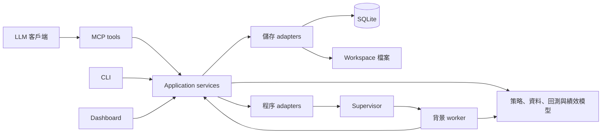
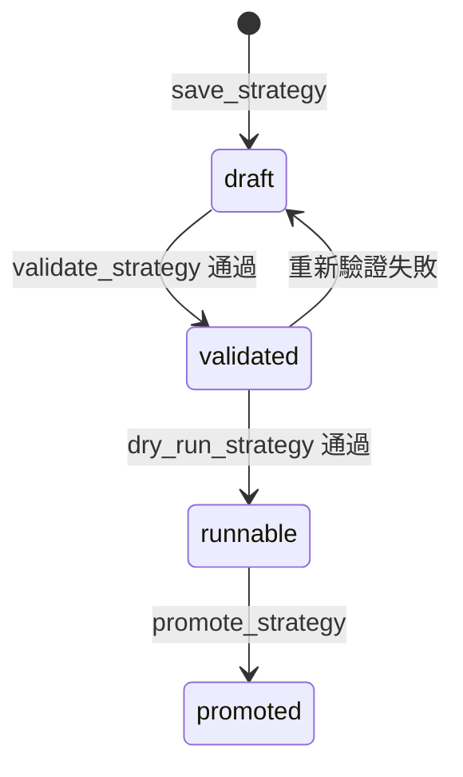
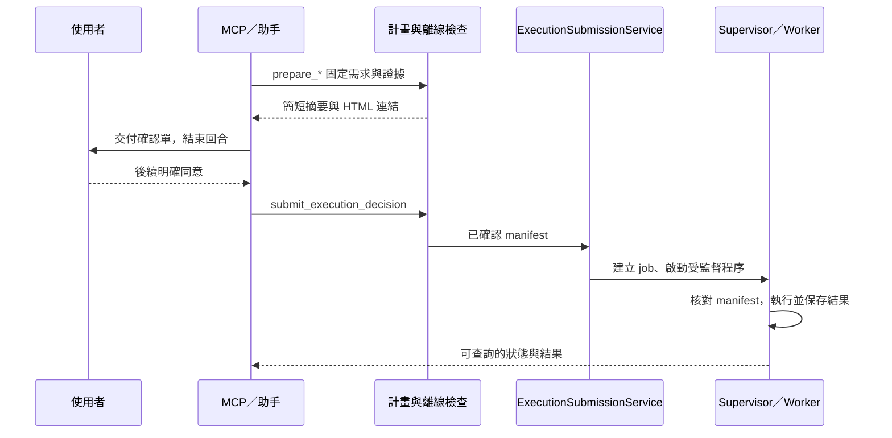

# 系統架構

TradingDev 讓 LLM 透過標準 MCP 協助使用者建立、驗證與研究交易策略，
提供歷史回測、參數最佳化及結果追蹤，不提供真實下單。
MCP 是主要產品介面；CLI 與 dashboard 共用 application services 的執行與查詢能力。
模型供應商的呼叫與設定留在客戶端整合層，後端不依賴特定 LLM。

本文件說明目前的責任分工、核心概念、執行流程及保證範圍。
操作與資料格式各有以下文件，避免在架構總覽重複維護欄位與版本清單。

| 文件 | 負責內容 |
| ---- | -------- |
| [README](README.md) | 安裝、設定、工具使用與使用者升級說明 |
| [策略契約](docs/strategy_contract.md) | 策略 Python／YAML、驗證規則、revision 與執行資格 |
| [執行產物契約](docs/run_artifacts.md) | Workspace、Manifest、SQLite 與歷史查詢入口 |
| [ML 研究](docs/ml_research.md) | 資料、模型、驗證解讀與獨立保存契約 |
| [執行計畫](docs/execution_plans.md) | 確認文件、使用者決策與提交狀態 |
| [績效產物](docs/performance_artifacts.md)、[報告](docs/reports.md) | 指標與觀察值、離線呈現及匯出契約 |
| [開發指南](docs/development.md) | 開發環境、品質檢查、測試及 Git／PR 流程 |
| [代理開發政策](AGENTS.md) | 代理修改 repository 時遵循的政策 |

## 系統邊界與模組責任

以下是主要呼叫關係。Application services 協調策略、資料與執行；
MCP tools 負責協定轉換，CLI 負責同步執行入口，dashboard 負責已保存結果的呈現。

| 位置 | 目前責任 |
| ---- | -------- |
| `mcp/server.py`、`mcp/tools/` | 組裝 services、註冊工具、驗證協定輸入與輸出 |
| `mcp/workers/` | 背景工作入口、狀態更新及流程協調；最佳化 worker 直接協調搜尋與樣本外測試 |
| `app/` | 策略生命週期、研究需求解析、設定固定、限時程式檢查、確認計畫、工作提交、ML 研究、結果保存與查詢；`contracts/` 定義輸入與回覆 DTO |
| `domain/research.py`、`domain/research_policy.py` | 研究選擇與來源模型、共用模擬本金／成本及年化政策 |
| `domain/strategies/` | 策略介面、來源探索與載入、參數解析、訊號契約及 bundled strategies |
| `domain/execution.py`、`domain/randomness.py` | 執行規格與完整性檢查、每次執行的亂數 context |
| `domain/execution_plan.py`、`domain/preflight.py` | 確認內容與執行身分綁定、限時離線檢查請求及驗證證據 |
| `domain/presentation/`、`adapters/presentation/` | 固定文件內容與章節、白話欄位投影，以及共用文字／HTML 呈現 |
| `domain/backtest/`、`domain/validation/`、`domain/optimization/` | 回測引擎、walk-forward、參數搜尋與績效計算整合 |
| `domain/performance/` | 指標定義、適用條件、最佳化方向與具型別的績效產物模型 |
| `domain/statistics/` | 與引擎無關的推論統計：期間損益與報酬、Sharpe 區間與多重比較校正、配對比較、參數平原、損益兩平與同一標的、不計成本的買進持有對照（產品保存的正式基準見下一列）；目前未接入 services，見[引擎無關的統計分析](#引擎無關的統計分析) |
| `domain/benchmark.py`、`app/benchmark_service.py` | 依資產類別固定的基準定義、買進持有計算與基準行情取得 |
| `domain/data/`、`domain/indicators/`、`domain/ml/` | 行情與特徵資料處理、技術指標、模型及訓練邏輯 |
| `adapters/storage/`、`adapters/execution/` | SQLite、revision／manifest／績效檔案保存，以及程序啟動與監督 |
| `adapters/cli/`、`adapters/dashboard/` | 終端機與視覺化入口 |
| `shared/` | 路徑解析、JSON 正規化、記錄與平行執行等共用工具 |

這是目前實作的責任分組，尚未形成全面的依賴反轉。
Application services 直接使用具體的儲存與程序 adapters；`domain/data` 內的
crawlers 與 loader 仍執行網路及檔案 I/O，StrategyLoader 也會
讀取、載入策略檔案。`domain/ml/registry` 的模型、特徵快取與排行榜 stores
也執行檔案 I/O；ML dataset store 位於 `adapters/storage`。
最佳化的完整流程仍由 worker 協調，尚未全部收斂到 app。
修改這些模組時，不能假設 domain 全部都是無副作用的純計算。

`mcp.server.create_server()` 是 MCP 的組裝入口，讓 services 共用 workspace
與 SQLite store。匯入 server 模組不建立 runtime 檔案；建立 server 時才組裝執行資源。
背景 worker 使用相同 Python interpreter，並明確繼承解析後的 workspace 與資料根目錄。
Bundled 策略隨 Git／套件發佈；生成策略、行情與執行結果存於使用者 workspace。

### Repository 開發工具與研究原型

產品程式位於 `src/tradingdev/`；repository 的開發工具、測試與研究原型分開管理：

| 位置 | 目前責任 |
| ---- | -------- |
| `scripts/`、`.githooks/` | Shell 操作與 Git hook 入口，選定 repository 與 interpreter 後呼叫 Python 模組 |
| `tooling/quality.py` | 共用品質檢查與格式化，涵蓋 `src/`、`tests/`、`tooling/`、`research/` |
| `tooling/git/` | 候選 snapshot／合併 tree 的建立與驗證，以及 hook、本機 full、PR 檢查與分支清理流程 |
| `tooling/review_evidence.py` | 擷取固定 Git 版本的完整來源、diff 與內容身分 |
| `tooling/review_scope.py`、`tooling/review_plan.py` | 固定責任範圍、文件原文章節、完整變更涵蓋與有容量上限的審查規劃 |
| `tooling/review_docs.py`、`tooling/review_options.py` | 共用操作參數，協調模型批次、共同期限、清理與判定 |
| `tooling/process_guard.py`、`tooling/codex_binary.py` | 開發工具與測試共用的程序觀測／清理及 Codex 執行檔定位 |
| `tests/` | 測試案例、fixtures、MCP 與模型測試情境 |
| `research/` | 獨立研究原型；MAE 原型直接讀取指定行情檔案，與正式 Dashboard 分開 |

`tooling` 不依賴 `tests`；測試可直接使用共用工具。Git gate 與 PR 檢查共用候選
驗證服務，文件審查使用執行檢查的 checkout 內的工具讀取候選 Git 內容，
品質檢查與離線測試則使用候選 snapshot 內的入口與程式。
`tooling/`、`research/` 不隨產品 wheel 發佈，也不屬於產品 application services。
操作入口與檢查流程見[開發指南](docs/development.md)，研究原型用法見
[開發指南的 MAE 研究原型](docs/development.md#mae-研究原型)。

## 核心概念與身分

| 概念 | 意義與責任 |
| ---- | ---------- |
| Strategy revision | StrategyService 管理的固定程式、基礎設定、狀態與驗證證據 |
| Execution manifest | 一次執行的策略身分、有效設定、建構子參數與可選搜尋規格 |
| Execution plan | 固定 manifest、離線檢查證據及確認文件，另有期限與提交狀態 |
| Job | JobStore 保存的背景進度、程序身分與控制紀錄 |
| Run | RunService 查詢的一次已保存執行結果 |
| Artifact | ArtifactService 探索與讀取的檔案及索引 |
| ML dataset／model | 獨立 stores 管理的資料版本與訓練模型，不能當作 run ID |

同一 revision 可用不同參數執行多次，每次固定自己的 manifest，保留獨立結果。
實驗不改寫 revision 的程式、YAML、驗證證據或 current pointer；worker 使用已捕捉的
建構子值，不因後續預設值變更重新解釋請求。設定覆寫與完整性規則見
[Execution Manifest](docs/run_artifacts.md#execution-manifest)。

單次背景回測與最佳化以 job ID 作為 run ID；固定比較由父 job 管理各候選 run，
沒有父工作的合併資金績效。CLI 同步執行保存 run，但不建立背景 job。
策略、工作與結果的狀態各自獨立。

## 從策略建立到結果查詢

### 研究需求與有效設定

模型取得使用者的策略構想、標的、期間與 K 棒頻率，缺項須追問。
`app/research.py` 共用解析邏輯，供策略保存與計畫準備使用；`ResearchSpec` 與
共用政策負責研究選擇、模擬預設及來源，作者 YAML 負責策略、資料來源、特徵與執行設定。
後端檢查完整性與版本綁定，不能證明輸入來自真人。

明示的有效值優先，零成本保留；僅可繼承明確選定的 generated revision，不能從
內建範例補日期。政策不適用時須釐清。解析結果隨有效設定保存，worker 不重新套用
更新後的政策。CLI 使用完整 YAML；直接 Python override helpers 移除失效來源標籤。

Walk-forward 設定的替換、模式與 UTC 日期包含關係由 schema／準備服務檢查；
正式資料能否形成有效分折，留待授權後執行。輸入與保存契約分別見
[研究輸入](docs/strategy_contract.md#research-inputs-and-simulation-policy)、
[Walk-forward 設定](docs/strategy_contract.md#strategy-walk-forward-settings)及
[研究設定來源](docs/run_artifacts.md#research-settings-and-provenance)。

### 建立與驗證策略

StrategyService 將新建與修訂分開，修訂在 lifecycle lock 內核對預期版本。
成功保存建立不可變 revision；metadata 記錄該版本證據，current 指向最新保存版本。
命名可自動產生，不能覆寫既有 namespace；新版本不繼承舊版本的執行資格。

驗證先做靜態政策與共用 Ruff／Mypy 檢查，再由 StrategyContractService 透過具期限的
worker 執行 SignalContractChecker，在合成資料上檢查匯入、建構子、設定與訊號；
dry-run 使用較長 fixture。回覆綁定原請求，確認 supervisor 持有的程序群組清理後才保存證據；
異常退出、逾時及清理失敗皆不授予執行資格。實際執行也套用共用訊號框架檢查，
防止缺列、索引錯位、輸入修改或無效訊號進入引擎。檢查不證明沒有前視或符合自然語言構想。

BacktestService 在提交及執行時重新核對資格與來源完整性。明選 revision 不存在時
不退回 current；省略時於操作開始選定一次。Bundled 策略由 Git 管理，能力由註冊宣告
提供；generated／legacy 能力維持未知，不由 `fit()` 或狀態猜測。

StrategyCleanupService 共用 lifecycle lock，僅在明確授權後清理無引用的非 current
草稿；損壞或不明引用阻止清理。刪除不是跨檔案交易。狀態、參數實驗、舊格式復原與
清理回覆見[策略生命週期](docs/strategy_contract.md#lifecycle)。

### 準備、確認與執行回測

ResearchPreparationService 解析研究需求與已保存的研究說明，固定 manifest。
ExecutionPlanService 經 PreflightService 在受監督的子程序檢查程式與設定，確認
程序清理後才發布摘要與 HTML。準備不建立正式 job、不載入真實行情、不訓練或回測；
合成訊號檢查的適用範圍與未驗證項目隨收據保存。

模型提供白話規則與參數說明，後端提供有效值、執行假設及檢查證據；兩者共同固定於
確認文件。助手交付摘要與 HTML 連結，結束回合等待後續明確決策。
`submit_execution_decision` 只在同意時提交原計畫；拒絕或修改要求取消計畫。
修改需重新準備、檢查與確認。最初請求、提問或沉默不構成同意。

伺服器信任助手如實轉交決策，不能證明人類已閱讀或同意。提交仍檢查期限、來源、
設定與執行政策，並以 reservation 防止重複啟動。確認不依賴 MCP elicitation；
完整狀態、重試與啟動後寫入失敗的恢復規則見[執行計畫契約](docs/execution_plans.md)。

JobService 與 OptimizationService 共用 ExecutionSubmissionService；提交使用已準備
內容，不重新讀 YAML 或選 current。DataService 供應行情與特徵，BacktestService 協調
訊號與引擎：signal 使用 VectorBT，volume 使用逐筆模擬帳本，walk-forward 逐折訓練與評估。
工作狀態名稱不證明下載已完成；done 表示結果保存成功，程序清理由 supervisor 另行確認。

固定比較由 ComparisonService 使用一份不可變行情快照，逐組重新解碼並建立獨立策略、
引擎、資金與亂數串流。ComparisonStore 保存全部候選帳本，RunPublisher 核對父子身分
後發布成功結果；失敗與未執行組別不被省略。此流程限普通回測，不提供全域 Python 狀態隔離。
範圍與恢復規則見[固定比較證據](docs/run_artifacts.md#fixed-comparison-evidence)。

CLI 直接同步呼叫 BacktestService，再透過 ArtifactService 保存；命令本身是明確執行
請求，不使用 MCP 對話確認或背景 supervisor，但共用策略資格、manifest 與績效模型。

### 最佳化執行

OptimizationService 固定搜尋候選、訓練／測試期間、指標方向與第一組估時計算時限。
使用者同意後 worker 才取得行情、搜尋並執行選定參數的樣本外測試，不在 worker 內再等一次確認。
不可用的目標不參與排名；沒有有效候選則失敗。

最佳化使用自己的日期切分，不能同時套用 walk-forward；固定參數比較不授權擴大搜尋。
候選合併、期間與計算時限見[Execution Manifest](docs/run_artifacts.md#execution-manifest)，
使用方式見[README](README.md#使用樣本外驗證與最佳化)。

### 保存與查詢結果

JobStore 委派 RunPublisher 發布結果後更新工作狀態；固定比較另由父工作保存候選帳本。
CLI 透過 ArtifactService 保存，均共用儲存 adapters。SQLite 保存索引與摘要，
檔案系統保存 revision、快取與完整產物；發佈與狀態更新是不同操作。

RunService 查詢 run 與指標，ArtifactService 探索與讀取檔案。Dashboard 使用已保存的
PipelineResult；最佳化沒有此 pickle。讀取依保存路徑，不用目前 YAML 重建查找鍵，
也不自動重用以前的回測。格式與查詢入口見[執行產物契約](docs/run_artifacts.md)。

### 行情快取

`app/data_manager.py` 協調年度查詢及更新，`domain/data/cache.py` 定義共用身分、
成功查詢證據與重用政策，`adapters/storage/data_cache.py` 負責鎖、不可變版本與
原子發布。DataService 的正式載入、只讀載入、可用性、檢查與取樣使用相同身分；
不同來源、市場及原始代號不共用價格。保留舊版本讓讀取端不受更新影響，
失敗只清除尚未發布的檔案。格式及限制見
[Market Data Cache](docs/run_artifacts.md#market-data-cache)。

`app/dvol_data.py` 管理未指定本機路徑的 DVOL，以精確 UTC 區間建立獨立查詢身分，
共用上述儲存與重用政策。準備執行時固定資料目錄，仍保留自動查詢模式；
取樣取得的少量特徵不發布為完整研究期間的查詢證據。

### 獨立行情取樣

DataService 的受限取樣與確認前檢查分開。Application 層協調日曆窗口，storage
adapter 分批讀 Parquet；crawler 的 `fetch_sample` 在請求與解析階段限制資料量，
不能先完整載入再截斷。特徵只投影所需欄位，合併前檢查筆數膨脹，不改寫來源快取。

一般載入與取樣均精確對齊時間戳，只沿用較早的有效特徵；開頭缺值保持未知，
不能用較晚觀測回填。

行數限制不等於網路流量等比例縮減；Binance Vision 仍需下載選中的壓縮檔。
下載、解壓與列數各有獨立上限，超量失敗。完整取樣及來源限制見
[Bounded Historical Sampling](docs/run_artifacts.md#bounded-historical-sampling)。

## ML 訊號研究

`mcp/tools/ml.py` 透過 MLService 與 MLTrainingService 協調已登錄特徵、資料集、
模型與評估，`app/contracts/ml.py` 驗證回覆。這是同步研究介面，沒有 execution plan、
背景 backtest run，亦未接入回測 CLI／Dashboard；資料集、模型與排行榜 stores 不使用
SQLite 的 run／artifact 索引。

Dataset 建置只讀既有行情，feature cache 重用特徵計算，MLDatasetStore 發布不可變
內容版本。訓練保存全部列擬合的最終模型；分折驗證另建模型，不能把其分數當成最終模型的
樣本外證明。Predict 核對特徵順序與模型 bytes 後產生完整訊號，MCP 只傳預覽頁；
evaluate 在完整單商品資料上驗證對齊與持有區間，簡化無成本統計不等同完整交易回測。

Leaderboard 保存候選參數、訊號指紋與評估條件，依 domain 指標目錄排序；不可用值保留
`null` 與座標。跨參數軸比較是明確 opt-in，跨 horizon 的原始行情一致性仍未受保證。
特徵快取可淘汰，資料版本與模型有自己的保存規則。輸入、驗證解讀、身分、鎖與保存限制
集中於[ML 研究契約](docs/ml_research.md)，避免在此重列欄位與演算法。

`app/report_ml.py` 依明示候選 ID 讀取當前排行榜，交 `domain/ml/report.py` 投影並計算
完整排名；保留缺值、評估座標及警語，不重新預測或訓練。`ReportService` 將選取內容固定
於獨立 ML 報告，或附加到 run／固定比較報告；MCP 與 report CLI 共用此路徑。
HTML 的 ML 章節與回測證據分開呈現，不推定模型與 run 的來源關聯。排行榜後續替換不改變
已發布報告；未選取 ML 時不加入 ML 區塊。新產生報告採用包含研究解讀與診斷的
模板 24，報告身分會隨內容與模板更新；已保存報告不改寫。
這些報告另行登錄為 SQLite artifacts；選取、呈現與保存契約見[報告文件](docs/reports.md)。

## 績效計算與對話摘要

`DiagnosticService` 透過 domain 的 `DiagnosticProvider` 介面讀取已驗證的 scope 與
原始觀察值。初期 `MaverickDiagnostics` 僅移植適用的規則式建議，不引入上游 server、
行情與資料庫服務；來源版本與 MIT 授權隨 adapter 保存。後端提供指標證據與限制，
外部 LLM 提供結論、觀察、假說與下一步，報告核對結果引用並保存兩者。這個介面
保留後續分析完整交易與行情的空間，不以初期彙總指標限制自研診斷輸入。

| 元件 | 責任 |
| ---- | ---- |
| `domain/backtest/metrics.py` | 對齊引擎觀察值、整合統計套件、記錄不可用原因 |
| `domain/performance/catalog.py`、`sampling.py` | 指標定義、單位、最佳化方向與取樣適用性 |
| `domain/performance/artifacts.py`、`adapters/storage/performance.py` | 具型別的結果範圍、定義快照與觀察值保存／核驗 |
| `domain/benchmark.py`、`app/benchmark_service.py` | 資產類別對應的固定基準、買進持有計算與基準行情取得；報告只讀已保存基準 |
| RunService／JobService | 摘要、探索與詳細查詢；摘要大小不決定保存哪些指標 |

QuantStats 提供報酬／風險統計，VectorBT 提供已平倉交易統計，專案負責成本記帳與資料轉換。
不可用值保留原因，不能以零代替。解讀使用當次保存的定義、單位與設定；詳細查詢不重跑策略
或載入 pickle。Walk-forward 摘要是分折分布，最佳化區分 trial 與樣本外結果。
完整取樣、年化、數值及比較限制見[績效產物契約](docs/performance_artifacts.md)。

### 診斷擴充與替換

`domain/diagnostics.py` 定義 `DiagnosticProvider.diagnose(DiagnosticContext)`。
`DiagnosticContext` 保留原生 `PerformanceScope` 與 `ScopeObservations`（可缺少），
包含保存的交易、權益與帳戶觀察值；不把資料壓成 Maverick 專用輸入。
`DiagnosticService` 的預設 providers 是共同組裝點，MCP 查詢與 ReportService
都經此服務。要替換初期 adapter，可實作相同 Protocol 並在此更換預設組合；
測試也可直接注入 provider tuple。不是把 Maverick 套件當成 domain 基類。

深度診斷應保留 provider／版本、證據、不可用原因與限制，先加入可重現的離線測試。
目前 evidence 是具單位的數值指標；若需時間區段、交易索引或情境分類，應擴充正式
證據模型並同步更新 HTML、工具 schema 與測試，而非把新事實藏在 LLM 文字中。
行情型態／波動診斷若需要 OHLCV，須另以固定資料身分載入並驗證對齊後加入 context；
目前 context 沒有承諾原始行情。資料不足回報 unavailable，不由 provider 隱式抓取行情或回測。
規則或契約改變須更新 provider／報告版本；既有報告及封存保持原樣。

### 研究筆記與可攜封存

對話端 LLM 負責 `ResearchNoteDraft`：目前需求、階段摘要、報告引用與後續研究。
後端 `ResearchNoteService` 供 MCP 與 CLI 共用，`ResearchNoteStore` 在 SQLite
保存目前版本，以 expected_version 防止覆寫其他編輯。筆記不替代不可變的
ResearchEvidence、execution manifest 或執行確認；追加需求不會改動已執行設定。

`ResearchArchiveStore` 核對所選版本與指定 HTML 附件的登錄、路徑及 SHA-256，產生
固定 HTML／JSON／報告 ZIP。附件限所引用的研究報告與執行確認 HTML，
不遍歷打包整個工作區。
`adapters/reporting/notebook.py` 負責閱讀頁，儲存層負責原子發佈與失敗清理。
HTTP 的自訂下載 route 使用每個 server instance 的短期簽章能力網址，
驗證後才交付同一份 ZIP bytes；重新取得舊封存的網址只讀保存 ZIP，不依賴目前筆記或來源報告。
stdio 回傳本機路徑，不假設客戶端能下載。
未來可替換 storage／delivery adapter，但應保留版本衝突、來源完整性、容量限制及
獨立閱讀的契約；不需把聊天供應商或逐字紀錄依賴加進 domain。
欄位與限制見[報告與筆記契約](docs/reports.md#research-notebooks-and-archives)。

### 引擎無關的統計分析

`domain/statistics/` 回答引擎指標之外的推論問題：結果的不確定性有多大、
兩個策略的差異是否顯著、在多次嘗試中選出的 Sharpe 是否只是運氣、最佳參數是否
落在穩定的區域。各模組回答的問題、彼此的依賴與閱讀順序寫在
`src/tradingdev/domain/statistics/__init__.py` 的模組說明。它與上述績效計算的關係如下：

- **輸入**：只讀呼叫端傳入的權益曲線、時間戳、交易紀錄、報酬序列或 trial 列，
  不讀取 run、manifest、績效 JSON 或快取，也不寫入任何檔案。
- **與引擎 metrics**：不讀 `metrics` 字典，而是從原始輸出重新計算，因此可用來交叉
  檢查引擎回報值。慣例並不完全相同：期間損益的第一期以權益曲線第一個值為基準，
  而引擎以初始資金為基準；`summarize_performance` 的標準差用 `ddof=1`，引擎的
  期間損益標準差用 `ddof=0`；Sharpe 不扣無風險利率。兩者不能直接混用或比較。
- **與 catalog**：不註冊指標 ID，也不屬於 run 保存的績效產物。平原分析需要的
  最佳化方向由呼叫端依 catalog 的 `optimization_direction` 傳入，模組不自行推斷。
- **與 MCP／報告服務**：目前沒有 application service、MCP 工具或報告引用這個套件，
  模型與使用者都看不到這些結果；目前只有測試呼叫它。
  [統計與排行榜整合](docs/statistics_leaderboard_integration.md) 記錄的是對較早
  主線的整合分析；排行榜之後已加入參數欄位、`None` 指標與參數軸排名，其中「尚缺」
  的清單已經過時，待該文件改寫。
- **與產品基準**：`statistics/benchmark.py` 是同一標的、不計成本的研究對照；
  run 保存並在報告呈現的正式基準由 `domain/benchmark.py` 定義（依資產類別固定標的、
  以該次 run 的手續費與滑價買進一次後持有）。兩者回答不同問題，數值不能互換；成本規則是否統一尚待決定。

## 一致性、程序管理與保證範圍

### 歷史查詢與報告組裝

TradeHistoryService 從已核驗 JSON 與 manifest 提供參數、交易、委託及帳戶查詢，
保留 scope、來源與分頁身分；不能用配對交易補造缺失委託，或將聚合 fold 變成權益序列。
Signal 的原生 order attempts 與帳戶紀錄由共用執行記錄模型保存，使用 generic accounting，
不宣稱是交易所錢包、保證金或資金費率帳本。

ReportService 組裝已保存資料；domain/presentation 定義章節與範本，
adapters/presentation 提供共用文件外殼，adapters/reporting 負責 HTML／圖表與不可覆寫發佈。
MCP、report CLI 及 Dashboard 共用此服務。模型只供應評語與選擇，不替換計算值。
QuantStats 原生報告是可追溯衍生分析，不能覆寫歷史指標。

報告以總覽連到各結果明細，固定比較保留所有候選與失敗原因。可選章節只控制畫面，
不裁減 HTML 內嵌資料；分享時須考慮完整設定、交易紀錄及選取的 ML 證據。最終回覆須交付報告連結、
所選結果與明細操作方式，失敗時沿用保存結果重試報告。互動、完整精度、匯出、
版本與發佈完整性集中於[報告契約](docs/reports.md)。

### 設定與儲存一致性

Manifest 是 worker 的執行設定來源，`config.yaml` 僅為檢視副本；所選 revision 的
基礎設定仍用來核對完整性。非參數策略宣告必須與 revision 相符，參數實驗各自固定有效值。

不可覆寫檔案與 SQLite 紀錄共同綁定身分，但兩者不是跨資源交易。Hash 檢查內容一致性，
不能防禦同時控制檔案與資料庫的寫入者。忙碌標記、失敗恢復與歷史缺證據的處理見
[執行產物](docs/run_artifacts.md)及[績效發佈契約](docs/performance_artifacts.md)。

### MCP 回覆契約

`mcp/prompts.py` 保留階段流程、契約探索、授權與成果交付；詳細契約由標準 MCP tools
按需提供。Schema、模擬政策、指標及靜態規則取自正式定義，不整份載入 Markdown，
也不假設客戶端可讀 server 檔案或自動載入 resources。量測與機械檢查入口見
[開發指南](docs/development.md#量測模型上下文)。

StrictMCPServer 拒絕未知頂層參數，application DTO 驗證回覆；動態策略參數仍保有
明確 JSON 邊界。客戶端按 `tools/list` 的 `outputSchema` 讀取 `structuredContent`：
單一物件在根層，清單及成功／失敗聯集在 `result`。SDK 序列化須保留 wire 別名。

預期應用失敗有穩定 code／diagnostics；參數錯誤、未預期例外與無效回覆使用 MCP error。
`isError` 不能單獨判斷應用是否成功；未預期內部原因留在 server 日誌。
可成長的探索清單以 Page 回傳摘要，詳細內容另查；分頁不提供跨寫入的一致快照。
欄位與排序見[探索分頁](docs/run_artifacts.md#discovery-pages)。

同步工具由 SDK 在線程執行，SQLite connection 不跨 service 呼叫共用。
工具唯讀／破壞性／冪等標註描述副作用，不能當成授權或隔離保證；例如狀態查詢可能
更新失聯 job，而驗證會執行 Python。模型 store 的並發與可信 pickle 邊界見
[ML 產物契約](docs/ml_research.md#trained-models)。

### 程序控制與清理

ProcessRunner 先核對 supervisor 身分，再建立 worker 程序群組。Supervisor 負責
正常退出、失敗與取消後的清理；控制使用唯一 launch 身分，不直接信任資料庫中的數字 PID。
執行中的 job 取得清理確認後才能標記 cancelled；尚未啟動的 queued job 可直接取消。

監督依賴 POSIX process groups 與 `waitid(WNOWAIT)`，以尚未回收的直屬 child 維持身分。
策略 validate／dry-run（含直接 StrategyService 呼叫）及 MCP preflight 受此監督；
直接 Python API／CLI 的執行設定捕捉不因此受到監督。外部強殺 supervisor 或後代
自行脫離 session 不在清理保證內。
控制檔案與證據見[Workspace Layout](docs/run_artifacts.md#workspace-layout)。

### 可重現性與策略執行安全

策略 YAML 頂層 `random_seed` 建立執行內的 Python／NumPy 亂數 context；walk-forward
按 fold 順序共用該次串流，trial 各自獨立。策略須使用 domain.randomness，第三方種子須
明確傳入；不控制任意全域 RNG。獨立 ML 訓練另用模型的 `random_state`，不能互相推斷。

Manifest、來源 hash、資料指紋及版本提供追蹤，沒有封存全部依賴與執行環境，不承諾
跨環境完全重現。舊結果缺少證據時明確回報，不能猜測或自動重算。
靜態驗證、workspace 路徑與程序監督都不是完整 sandbox；生成 Python 的匯入、建構
與訊號檢查仍會執行程式。適用路徑及限制見[策略安全模型](docs/strategy_contract.md#security-model)。
