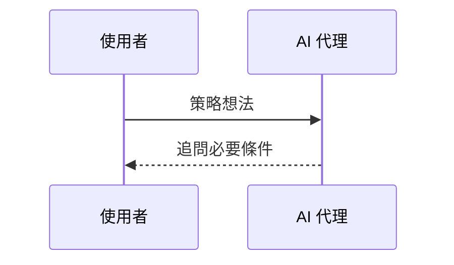

# TradingDev 簡報編輯指南

簡報內容維護在 [slides.md](slides.md)，版型維護在 [theme.css](theme.css)；
`index.html` 是本機預覽或發布時產生的瀏覽器版本，不納入 Git。
本文件面向簡報編輯者，說明內容與版型維護、預覽、打包及日常發布。

## 編輯與預覽

首次使用先依[開發指南](../../development.md#簡報的編輯與輸出)初始化環境與 Marp 工具鏈，
再用 VS Code 開啟整個 repository 資料夾。

1. 開啟命令選擇區，執行 **Tasks: Run Task → slides: watch**。
2. 編輯並儲存 `slides.md` 或 `theme.css`，工作會自動更新同目錄的 `index.html`。
3. 用瀏覽器開啟 `index.html`；每次儲存後重新整理瀏覽器查看結果。
4. 結束時執行 **Tasks: Terminate Task → slides: watch**。

編譯訊息可在 `slides: watch` 的專用終端機查看。只需單次輸出時，執行
**Tasks: Run Task → slides: build**。自動啟動監看、命令列操作與本機 HTTP
預覽方式見[開發指南](../../development.md#簡報的編輯與輸出)。
提交 `slides.md`、`theme.css` 與必要資源；本機產生的 `index.html` 由 Git 忽略。

瀏覽器版內含樣式與播放程式，與圖片及案例檔案一起保存即可離線開啟。使用左右方向鍵換頁，`F` 切換全螢幕，
`P` 開啟講者模式；講者模式須允許新視窗，本機檔案模式有通訊限制時改用 HTTP 預覽。

## 圖片、證據與離線分享

簡報來源及 HTML 以相對路徑引用 `assets/` 的圖片；可查閱的研究成果保存在
`evidence/`。分享完整簡報時，請將 `index.html`、`assets/` 與 `evidence/`
一起複製並保留相對位置；單獨複製 HTML 會缺少圖片、對話、報告與研究包。

可用下列命令檢查並建立可分享的資料夾及 ZIP；輸出位置必須尚未存在：

```bash
scripts/presentations.sh package --output /absolute/path/to/tradingdev-talk
```

分享產生的 `tradingdev-talk.zip`，完整解壓後開啟資料夾中的 `index.html`。
外部網站參考連結仍需要網路。更新 `assets/` 的圖片後，重新整理瀏覽器即可看到變化；
重新打包或發布前須再執行檢查。圖片支援 JPEG、PNG、GIF 與 WebP，不依賴遠端圖片服務。

## 頁面版型與撰寫方式

循序圖可直接寫在 `mermaid` 程式碼區塊中，由建置流程轉成內嵌 SVG，無須另外維護圖片檔：

````markdown

````

目前支援 `sequenceDiagram`；圖表的設定與配色由建置工具統一管理，不接受圖內設定指令或
YAML frontmatter。語法錯誤會使建置失敗，保留上一次成功的 HTML。圖表過長時請拆頁，
並用瀏覽器確認文字大小與內容是否完整；原始碼預覽不等於建置後的投影片。
建置端的 Chrome 需求見[開發指南](../../development.md#簡報的編輯與輸出)。
SVG 連同使用到的中文字型內嵌在 HTML，觀看端不需要安裝 Mermaid 或連線下載圖表資源。

`slides.md` 只保存頁面內容、Marp 設定與對話核對標記，不撰寫講稿。

- **章首頁**使用 `chapter`：深色底、章節編號與主題說明。
- **一般內容頁**沿用淺色底與固定的標題起始位置，頁首與標題之間保留一致間距，
  依內容使用表格、列表或引言；內容較密時可搭配 `compact`。封面與章首頁維持垂直置中。
- **寬幅循序圖**（例如六個參與者）使用 `<!-- _class: compact diagram-wide -->`，
  放大縮放後的標籤與箭頭，並保留參與者方框和第一則訊息的間距；仍須預覽確認沒有溢出。
- **實際對話頁**使用 `case-dialogue`，標題與一般內容頁對齊，下方內容依原文長度
  彈性排版。保留原文、順序與跨頁標記，維持同一段會話的連續性。
  下方搭配截圖時加上 `case-preview`；文字較多時可加 `case-preview-compact` 縮小截圖，
  兩張並排則加 `case-preview-pair`。保留原圖比例、圖名與完整內容連結。

頁首用 `header` 標示「章節編號　章節名稱」；案例頁另以 `_header` 標示
「章節編號　章節名稱　／　案例名稱」，不加入對話輪次。對話標題保留「實際對話」前綴；
截圖圖名使用文件或圖表的名稱。

簡報自寫文字統一稱為「AI 代理」，依工作內容區分策略研究與後端改進；研究成果的
下載包稱為「研究分享包」，包含對話與工具紀錄的另一份封存則稱為「案例證據包」。
平行項目使用「粗體短語＋一句說明」，有先後順序的流程才使用編號；引用原文維持原貌。
補充文字保留會影響操作與結果解讀的限制，直接說明尚未完成或待驗證的項目。
新增或移動頁面時，同步核對閱讀路線及其他 `index.html#頁碼` 連結。

## 檢查與發布

1. 完成編輯後執行 `scripts/presentations.sh build`，產生本機預覽 `index.html`。
2. 執行 `scripts/check-presentations.sh`，在臨時目錄建置並檢查 HTML、頁碼、連結及離線資源。
3. 用瀏覽器確認標題位置、文字是否溢出、圖片、章節跳轉與完整內容連結；自動檢查不取代視覺確認。
4. 依[Git／PR 流程](../../development.md#從開發到合併)提交來源及必要資源，取得發布授權後合併。
5. 網站已連接 Cloudflare 時，確認建置記錄的分支與 commit，再開啟
   [正式簡報](https://slides.klwang.tw/tradingdev/)核對內容。分支預覽網址須加上 `/tradingdev/`。

Cloudflare 以鎖定的工具鏈編譯已提交的 Markdown、主題及 Mermaid，
再將產生的 HTML、圖片與案例證據一起發布。原始碼更新會觸發建置，無須提交 HTML。
分支預覽與主線正式部署分別確認；本機檢查通過不代表網站已更新。

## 相關文件

- [編輯環境與命令列預覽](../../development.md#簡報的編輯與輸出)：初始化 Marp、執行監看與本機 HTTP 預覽。
- [網站發布設定](../../development.md#簡報網站發布設定)：供管理者設定 Cloudflare、共用網域或 GitHub Pages，以及排查發布連線。
