<!--
marp: true
theme: tradingdev
size: 16:9
paginate: true
lang: zh-Hant
title: TradingDev｜能學習策略開發經驗、自我演進的研究後端
description: 產品介紹、使用場景、分類比較與後續開發方向
-->

<!-- _class: cover -->

# 自動整合多人研究成果而演進的量化交易策略開發 MCP 服務

能學習策略開發經驗、自我演進的研究後端

**永豐 x CCNS** 合作專案

<!--
_footer: |-
  GitHub: [TradingDev](https://github.com/Kuan-Lun/tradingdev)\
  簡報網址：[slides.klwang.tw/tradingdev/](https://slides.klwang.tw/tradingdev/)
-->

---

<!-- _class: compact -->

## 參與成員

- **王冠倫** 國立臺灣大學資訊工程學系 博士候選人
  - 實驗室：計算理論暨金融計算實驗室 (呂育道 教授)
- xxx
  - xxx
- xxx
  - xxx
- **黃如君** 永豐銀行專案經理

---

<!-- _class: compact -->

## 閱讀路線

| 章節 | 主題 | 內容 |
| --- | --- | --- |
| 01 | [開發動機與專案定位](index.html#3) | 工具比較、工程回饋與使用情境 |
| 02 | [策略研究](index.html#10) | 角色分工、運算安排與策略實驗 |
| 03 | [後續開發方向](index.html#26) | 可獨立指定的開發目標 |

<!-- _footer: "點選章名跳轉。方向鍵換頁，P 開啟講者模式。" -->

---

<!-- header: "01　開發動機與專案定位" -->
<!-- _class: chapter -->
<!-- _header: "" -->

## 01　開發動機與專案定位

研究背景、必要能力與本專案的研發定位。

---

<!-- _class: compact -->

## 開發動機與必要能力

王冠倫是臺大資工計算理論暨金融計算實驗室的一員，許多成員的研究與金融交易相關。

> **建立共用研究後端，支援成員開發各自的交易策略。**

- **實驗基礎**：在同一後端執行回測，保存可重現的設定與結果。
- **策略與模型**：支援成員建構、修改與驗證不同的量化方法。
- **策略分析與修正**：檢查策略問題，分析實驗結果，協助下一輪修正。
- **後端改進**：透過提示詞，讓 AI 代理依研究經驗提出並驗證後端改進。

<!-- _footer: "開發目標，尚未全部完成。" -->

---

<!-- _class: compact -->

## 現成工具與本專案的整合方向

| 現成工具 | 已提供的基礎 |
| --- | --- |
| VectorBT、Backtrader | 回測計算與可擴充的策略框架 |
| VectorBT PRO MCP | AI 程式研究與按需研究指引 |
| QuantConnect | 研究代理、診斷、專案記憶與共用程式庫 |

**本專案提供 AI 輔助策略開發與研究的共用後端，
並支援將研究中的共通檢查與元件整合回後端，供後續策略使用。**

<!-- _footer: "來源：[VectorBT](https://vectorbt.dev/)、[Backtrader](https://www.backtrader.com/docu/)、[VBT PRO MCP](https://vectorbt.pro/features/ai/mcp-server/)、[QC Agents](https://www.quantconnect.com/docs/v2/ai-assistance/agents)、[程式庫](https://www.quantconnect.com/docs/v2/local-platform/projects/shared-libraries) · 查核 2026-10-31" -->

---

<!-- _class: compact -->

## 為何需要自行開發 TradingDev

**自行維護 TradingDev，讓研究經驗能回饋下一次開發。**

- **案例與證據**：連結問題、修正依據與適用條件。
- **修改與驗證**：AI 代理提出檢查或元件，經跨策略測試與審查整合。
- **追蹤與評估**：保留改進版本，檢查後續研究是否減少重複錯誤。

這需要掌握**研究證據、檢查規則與版本更新流程**。

---

## 一次修正如何幫助其他研究

1. 成員 A 發現資料時間對齊錯誤，保留可重現案例。
2. 人員提示 AI 代理，提出共用檢查與測試。
3. 其他策略通過回歸驗證，審查後更新 TradingDev。
4. 成員 B 開發不同策略時，提早攔下同類錯誤。

*情境示意；減少重複錯誤的效果尚待實測。*

---

## 目前已建立的研究基礎

> TradingDev 透過 MCP，讓 AI 代理運用研究指引建立與修正策略，
> 依據檢查與實驗結果，提出可追問的分析。

- **策略實驗**：建立與修正策略，完成檢查與歷史回測。
- **ML 訊號**：提供已登錄模型的訓練、預測與評估。
- **證據保存**：連結策略版本、有效設定與實驗結果。
- **結果分析與研究筆記**：提供診斷提示、報告解讀與可續讀的研究筆記。

已建立 [軟體需求規格（SRS）](https://github.com/Kuan-Lun/tradingdev/blob/main/docs/requirements.md)，整理產品需求與驗收條件。

<!-- _footer: "現況依據：[TradingDev 使用說明](https://github.com/Kuan-Lun/tradingdev/blob/cd95d6091bbc2a46c6a58cdb326aa5df730519c4/README.md)與[架構](https://github.com/Kuan-Lun/tradingdev/blob/cd95d6091bbc2a46c6a58cdb326aa5df730519c4/ARCHITECTURE.md)" -->

---

<!-- _class: compact -->

## TradingDev 的使用情境

| 情境 | 如何使用 |
| --- | --- |
| 個人研究 | 沿用自己的 AI 代理，提出策略並追問實驗結果 |
| 教學 | 用相同題目與資料，比較規則、成本及驗證方法 |
| 研究團隊 | 沿用團隊資料與實驗格式，累積共用檢查 |
| 公司產品 | 將策略實驗接進既有 AI 網站，安排模型與收費 |

*使用情境示意；教學與團隊可先採獨立環境。
多人權限、策略隔離與集中資源管理仍待開發。*

---

<!-- header: "02　策略研究" -->
<!-- _class: chapter -->
<!-- _header: "" -->

## 02　策略研究

一個交易想法如何成為可檢查、可追問的實驗。

---

## 使用者、AI 代理與 TradingDev

| 角色 | 負責的事 |
| --- | --- |
| 使用者 | 提出目標、釐清規則、確認實驗 |
| AI 代理 | 依研究指引理解需求、撰寫與修正策略、解讀結果 |
| TradingDev | 研究流程指引、策略契約與檢查、實驗計算與證據 |

TradingDev 透過 **MCP 協定**，提供研究指引與工具給 Codex 等 AI 代理。

可直接使用既有客戶端，也可整合進自己的應用。

---

## TradingDev 提供的研究流程指引

1. **釐清構想**：確認交易想法、標的、期間與 K 棒頻率。
2. **開發與修復**：依策略契約撰寫，根據檢查結果修正。
3. **確認實驗**：閱讀設定，決定是否正式執行。
4. **解讀證據**：依回測與診斷比較修改差異，區分觀察、假說及限制。
5. **延續研究**：提出下一步，依需要保存研究筆記。

<!-- _footer: "來源：[執行確認流程](https://github.com/Kuan-Lun/tradingdev/blob/35d709d4ac9ed8c9d3a71a3e24cd98996bf3a1e6/README.md#完成第一次回測)" -->

---

<!-- _class: compact -->

## 開發經驗的整合與驗證

由人員選定研究案例，啟動 research-feedback Skill，讓能存取 TradingDev 原始碼的開發 AI 代理整合與驗證後端改進。

1. **挑選共通問題**：比較案例與既有元件，確認可共用範圍、保留策略假設。
2. **定義契約並整合**：明確輸入、輸出與適用條件，提供共用檢查或元件的使用入口。
3. **驗證使用端**：固定資料與設定，檢查其他策略、正常情境及既有行為。
4. **審查與版本更新**：完成獨立審查，記錄行為變更與版本，再依流程更新服務。

*跨研究採用，以及減少重複錯誤與人工工時的成效，仍待驗證。*

---

<!-- _class: compact -->

## 對話與運算的部署

對話可留在筆電，回測交給另一台主機。

| 可自行安排的部分 | 整合者的選擇 |
| --- | --- |
| 對話與模型 | 沿用個人使用的 AI 代理，或由公司提供模型及互動流程 |
| 資料與運算 | 提供自己的行情與主機，安排快取政策 |
| 研究規則與輸出 | 維護策略契約、檢查與報告呈現方式 |

*跨設備連線須設定網路轉送與存取控制。集中排程及多人隔離仍待開發。*

---

## 依研究目的選擇模式

| 模式 | 主要回答的問題 |
| --- | --- |
| **signal：資金表現** | 給定一筆起始資金，資產、報酬與回撤如何變化？ |
| **volume：交易量與成本** | 按指定交易規模運作，累計成交量、成本與金額損益如何變化？ |

*volume 不設定起始本金，金額損益不能解讀為本金報酬率。*

---

<!-- _class: compact -->
<!-- _header: "02　策略研究　／　0050 均線策略案例" -->

## 0050 均線策略：實際研究流程

> 「我想用均線來買賣 0050，可以幫我看看嗎？」

**研究條件**：0050 日 K，2024/1/1 至 7/1。

**案例內容**：在同一段會話中釐清需求、確認方案、比較結果，再討論改善與整理分享。

**研究成果**：[研究筆記](evidence/0050-taiex/cases/01-ma-discussion/notebook/index.html)、[下載研究分享包](evidence/0050-taiex/cases/01-ma-discussion/research.zip)

**過程與證據**：[完整對話](evidence/0050-taiex/cases/01-ma-discussion/conversation/index.html)、[案例總覽](evidence/0050-taiex/index.html)、[下載完整案例證據包](evidence/0050-taiex/natural-case-evidence.zip)

*下載包完整解壓後可離線閱讀；研究筆記為摘要，逐字內容由完整對話查閱。*

<!-- _footer: "真實模型回覆與 MCP 紀錄；示範操作者由 AI 代理依委託擔任。Codex CLI · gpt-6.1-sol / medium · 產品版本 4c8a665。" -->

---

<!-- _class: case-dialogue case-transcript case-options case-with-input -->
<!-- _header: "02　策略研究　／　0050 均線策略案例" -->

## 實際對話：從模糊構想開始

<!-- dialogue-message: turn-1/0 -->

操作者輸入

<!-- dialogue-text-start -->

> 我想用均線來買賣 0050，可以幫我看看嗎？

<!-- dialogue-text-end -->

<!-- dialogue-message: turn-1/1 -->

gpt-6.1-sol｜該輪最終回覆

<!-- dialogue-text-start -->

> 可以。我建議先研究「均線判斷趨勢」的方式：
>
> - **買進並持有**：短期均線高於長期均線。
> - **賣出轉空手**：短期均線低於長期均線，不做空。
>
> 這種方法可能跟上較長的漲勢，但盤整時容易反覆買賣，成本也會影響成果；目前還不能判斷是否適合 0050。
>
> 先請你選兩件事：
>
> 1\. **回測期間**：想看哪段時間？例如 2020～2025 年。
> 2\. **K 線週期**：想用日線還是週線？若偏向波段操作，我建議先從日線開始。
>
> 確認後，我會提出少量均線組合與完整回測方案供你檢視。資料可使用 Yahoo Finance 的 `0050.TW`，實際歷史涵蓋範圍仍待確認。

<!-- dialogue-text-end -->

<!-- _footer: "CLI 實際對話原文；操作者由 AI 代理依委託擔任。[本輪完整對話與工具紀錄](evidence/0050-taiex/cases/01-ma-discussion/conversation/index.html#turn-1)" -->

---

<!-- _class: case-dialogue case-transcript case-options case-with-input case-preview -->
<!-- _header: "02　策略研究　／　0050 均線策略案例" -->

## 實際對話：選定期間與日 K

<!-- dialogue-message: turn-2/0 -->

操作者輸入

<!-- dialogue-text-start -->

> 先看 2024 年 1 月 1 日到 7 月 1 日，用日 K。

<!-- dialogue-text-end -->

<!-- dialogue-message: turn-2/1 -->

gpt-6.1-sol｜該輪最終回覆（節錄；確認單由連結續讀）

<!-- dialogue-text-start -->

> 已備妥三組均線比較方案。下列 UTC 起訖時間對應台灣時間 **2024/1/1 至 7/1 全天**。請閱讀確認單，再回覆「同意」、拒絕或修改要求；TradingDev 要求確認方案後才執行歷史回測。
>
> [閱讀確認單](evidence/0050-taiex/cases/01-ma-discussion/confirmation.html)

<!-- dialogue-text-end -->

[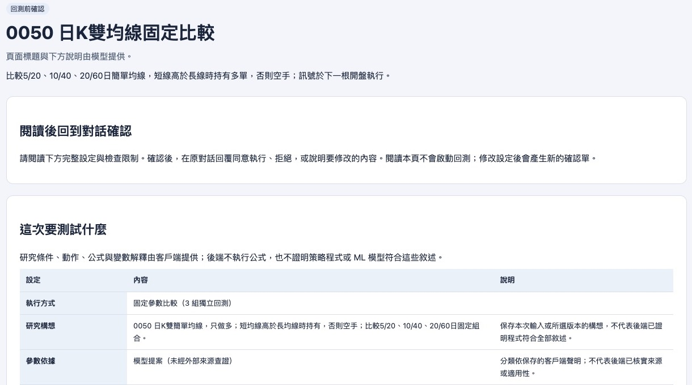](evidence/0050-taiex/cases/01-ma-discussion/confirmation.html)

[回測確認單｜開啟完整內容](evidence/0050-taiex/cases/01-ma-discussion/confirmation.html)

<!-- _footer: "CLI 實際對話原文；操作者由 AI 代理依委託擔任。[本輪完整對話與工具紀錄](evidence/0050-taiex/cases/01-ma-discussion/conversation/index.html#turn-2)" -->

---

<!-- _class: case-dialogue case-transcript case-options case-with-input -->
<!-- _header: "02　策略研究　／　0050 均線策略案例" -->

## 實際對話：閱讀後同意執行（1/2）

<!-- dialogue-message: turn-3/0 -->

操作者輸入

<!-- dialogue-text-start -->

> 我同意

<!-- dialogue-text-end -->

<!-- dialogue-message: turn-3/1 -->

gpt-6.1-sol｜該輪最終回覆

<!-- dialogue-text-start -->

> 回測完成。0050 在 **2024/1/1～7/1、日 K** 的結果如下，已含方案中的模擬手續費與滑價：
>
> | 均線組合 | 區間報酬 | 最大回撤 | 已平倉筆數 |
> | --- | ---: | ---: | ---: |
> | 5／20 日 | 28.02% | 8.16% | 1 |
> | 10／40 日 | 16.96% | 7.84% | 1 |
> | 20／60 日 | 16.50% | 7.84% | 0 |
>
> **5／20 日在這段期間報酬最高，但樣本太少，還不能認定長期最好。** 三組期末都仍持倉，報酬包含未實現損益；長均線暖機也占用了較多觀察期間。模擬成本尚未另計證交稅。
>
> [閱讀完整回測報告](evidence/0050-taiex/cases/01-ma-discussion/earlier-reports/dca6bf24d022a15c2e10f306db5c2119b85a688b0d38fdb935a0b14d255fe55c.html)

<!-- dialogue-text-end -->

<!-- _footer: "CLI 實際對話原文；操作者由 AI 代理依委託擔任。[本輪完整對話與工具紀錄](evidence/0050-taiex/cases/01-ma-discussion/conversation/index.html#turn-3)" -->

---

<!-- _class: case-dialogue case-transcript case-options case-preview case-preview-pair -->
<!-- _header: "02　策略研究　／　0050 均線策略案例" -->

## 實際對話：閱讀後同意執行（2/2）

<!-- dialogue-message: turn-3/1 -->

gpt-6.1-sol｜該輪最終回覆

<!-- dialogue-text-start -->

> 點選總覽表格或結果清單中的結果列，可進入該組參數的詳情；再以「返回」或「切換結果」查看其他組。已選取的詳情章節：設定與資料覆蓋、績效分析與保存指標、基準比較（Benchmark）、權益與回撤、委託、成交與帳戶核對、配對交易損益。所有內容保存在同一份離線 HTML。
>
> 比較工作：`7c67128548d24541b68ab39faf778075`；分析範圍：全部三組的 `full`。

<!-- dialogue-text-end -->

[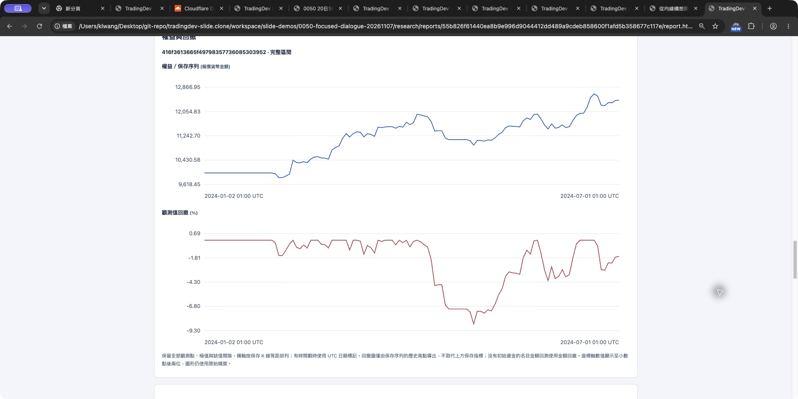](evidence/0050-taiex/cases/01-ma-discussion/report.html#result-0-0) [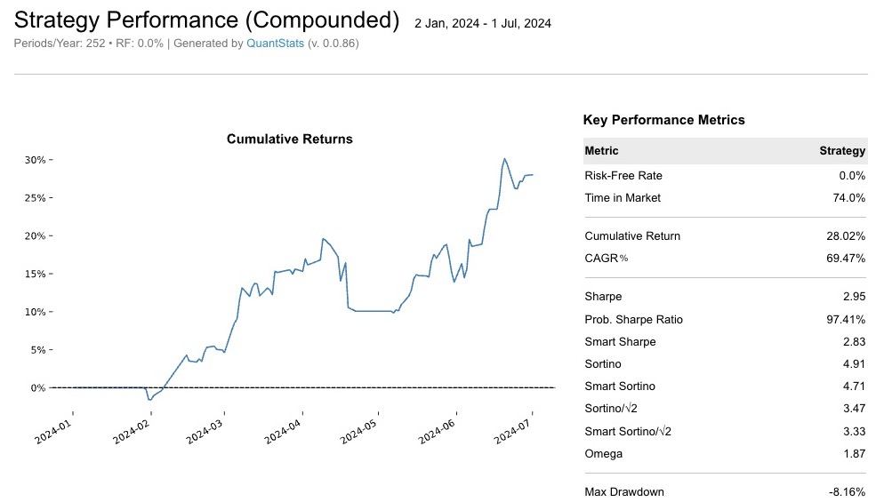](evidence/0050-taiex/cases/01-ma-discussion/report.html#result-0-0)

[權益與回撤｜5／20 日均線](evidence/0050-taiex/cases/01-ma-discussion/report.html#result-0-0) [QuantStats 績效分析｜5／20 日均線](evidence/0050-taiex/cases/01-ma-discussion/report.html#result-0-0)

<!-- _footer: "CLI 實際對話原文；操作者由 AI 代理依委託擔任。[本輪完整對話與工具紀錄](evidence/0050-taiex/cases/01-ma-discussion/conversation/index.html#turn-3)" -->

---

<!-- _class: case-dialogue case-transcript case-options case-with-input -->
<!-- _header: "02　策略研究　／　0050 均線策略案例" -->

## 實際對話：詢問台股大盤比較（1/2）

<!-- dialogue-message: turn-4/0 -->

操作者輸入

<!-- dialogue-text-start -->

> 這三組策略跟台股大盤相比，表現如何？

<!-- dialogue-text-end -->

<!-- dialogue-message: turn-4/1 -->

gpt-6.1-sol｜該輪最終回覆

<!-- dialogue-text-start -->

> **這段期間三組都落後台股大盤，最大回撤也較大。** 以台股加權指數（`^TWII`）為基準，實際比較期間為 2024/1/2～7/1，共 118 根日 K。
>
> | 策略／基準 | 區間報酬 | 與大盤差距 | 最大回撤 |
> | --- | ---: | ---: | ---: |
> | 台股大盤基準 | 29.01% | — | 6.66% |
> | 5／20 日均線 | 28.02% | −0.99 個百分點 | 8.16% |
> | 10／40 日均線 | 16.96% | −12.05 個百分點 | 7.84% |
> | 20／60 日均線 | 16.50% | −12.51 個百分點 | 7.84% |
>
> 5／20 日最接近大盤，但本次沒有展現較低回撤的優勢。另兩組暖機較長、較晚開始交易，也會影響比較結果，不能直接推論長期表現。

<!-- dialogue-text-end -->

<!-- _footer: "CLI 實際對話原文；操作者由 AI 代理依委託擔任。[本輪完整對話與工具紀錄](evidence/0050-taiex/cases/01-ma-discussion/conversation/index.html#turn-4)" -->

---

<!-- _class: case-dialogue case-transcript case-options case-preview case-preview-compact -->
<!-- _header: "02　策略研究　／　0050 均線策略案例" -->

## 實際對話：詢問台股大盤比較（2/2）

<!-- dialogue-message: turn-4/1 -->

gpt-6.1-sol｜該輪最終回覆

<!-- dialogue-text-start -->

> 大盤基準採首根收盤買進、期末估值，套用相同模擬費率與滑價；使用的是**不含股利的價格指數**。要進一步判斷均線擇時有沒有價值，還應比較「0050 本身買入持有」。
>
> [閱讀完整比較報告](evidence/0050-taiex/cases/01-ma-discussion/report.html)
>
> 點選總覽表格或結果清單中的結果列，可進入該組參數的詳情；再以「返回」或「切換結果」查看其他組。已選取的詳情章節：設定與資料覆蓋、績效分析與保存指標、基準比較（Benchmark）、權益與回撤、委託、成交與帳戶核對、配對交易損益。所有內容保存在同一份離線 HTML。
>
> 比較工作：`7c67128548d24541b68ab39faf778075`；範圍：三組 `full`。

<!-- dialogue-text-end -->

[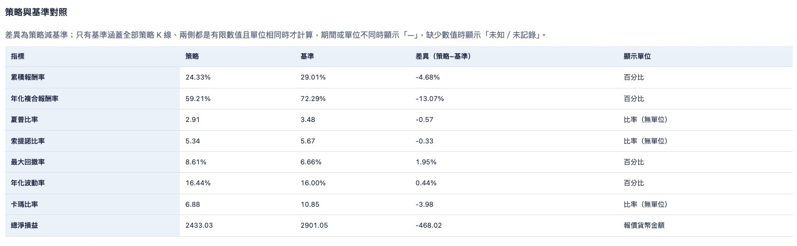](evidence/0050-taiex/cases/01-ma-discussion/report.html#result-0-0)

[台股大盤比較｜5／20 日均線](evidence/0050-taiex/cases/01-ma-discussion/report.html#result-0-0) · [基準資料](evidence/0050-taiex/cases/01-ma-discussion/benchmark.json)

<!-- _footer: "CLI 實際對話原文；操作者由 AI 代理依委託擔任。[本輪完整對話與工具紀錄](evidence/0050-taiex/cases/01-ma-discussion/conversation/index.html#turn-4)" -->

---

<!-- _class: case-dialogue case-transcript case-options case-with-input -->
<!-- _header: "02　策略研究　／　0050 均線策略案例" -->

## 實際對話：討論改善方向（1/2）

<!-- dialogue-message: turn-5/0 -->

操作者輸入

<!-- dialogue-text-start -->

> 如果要改善這個策略，你會怎麼建議？

<!-- dialogue-text-end -->

<!-- dialogue-message: turn-5/1 -->

gpt-6.1-sol｜該輪最終回覆

<!-- dialogue-text-start -->

> 我會優先改善「驗證方式與風險控制」，目前還不急著調出另一組均線。這次只有半年資料、各組僅 0～1 筆已平倉交易，證據還太少。
>
> 建議依序做：
>
> 1\. **先比較 0050 買入持有**
> 目前比較的是加權指數。加入 0050 本身的基準，才能看出均線進出的貢獻。
>
> 2\. **統一暖機，再拉長測試期間**
> 在評估開始前提供足夠資料計算均線，讓三組從同一天開始比較；再涵蓋上漲、下跌與盤整期間，保留一段資料做樣本外驗證。

<!-- dialogue-text-end -->

<!-- _footer: "CLI 實際對話原文；操作者由 AI 代理依委託擔任。[本輪完整對話與工具紀錄](evidence/0050-taiex/cases/01-ma-discussion/conversation/index.html#turn-5)" -->

---

<!-- _class: case-dialogue case-transcript case-options -->
<!-- _header: "02　策略研究　／　0050 均線策略案例" -->

## 實際對話：討論改善方向（2/2）

<!-- dialogue-message: turn-5/1 -->

gpt-6.1-sol｜該輪最終回覆

<!-- dialogue-text-start -->

> 3\. **一次只測一種規則改善**
> 我會先測「短均線連續兩天低於長均線才賣出」，觀察能否減少短暫跌破造成的反覆交易。代價是出場較慢，可能承受更大跌幅，效果仍待驗證。
>
> 4\. **補齊實際交易成本**
> 納入證交稅、券商最低手續費與整股限制，確認改善後的收益是否留得住。
>
> **我會先保留 5／20 日作為研究起點，再與加入兩天出場確認的版本比較。** 它只是本次最接近大盤的組合，尚未證明長期較好；評估時應同時看報酬、回撤與交易次數。以上尚未執行新回測。

<!-- dialogue-text-end -->

<!-- _footer: "CLI 實際對話原文；操作者由 AI 代理依委託擔任。[本輪完整對話與工具紀錄](evidence/0050-taiex/cases/01-ma-discussion/conversation/index.html#turn-5)" -->

---

<!-- _class: case-dialogue case-transcript case-options case-with-input -->
<!-- _header: "02　策略研究　／　0050 均線策略案例" -->

## 實際對話：整理研究與分享

<!-- dialogue-message: turn-6/0 -->

操作者輸入

<!-- dialogue-text-start -->

> 幫我把這次的研究整理好，讓我能分享給別人。

<!-- dialogue-text-end -->

<!-- dialogue-message: turn-6/1 -->

gpt-6.1-sol｜該輪最終回覆

<!-- dialogue-text-start -->

> 已整理成**第 1 版研究分享包**，包含研究設定、三組回測、大盤比較、完整報告，以及尚未驗證的改善建議。
>
> [下載研究分享包 ZIP](evidence/0050-taiex/cases/01-ma-discussion/research.zip)
>
> 將整份 ZIP 分享給對方，**完整解壓後開啟 `index.html`**；保留 `reports/` 資料夾即可離線閱讀完整報告。
>
> 摘要已清楚標示主要結論：這段期間三組均落後大盤，且交易樣本少，不能據此認定長期優劣。

<!-- dialogue-text-end -->

<!-- _footer: "CLI 實際對話原文；操作者由 AI 代理依委託擔任。[本輪完整對話與工具紀錄](evidence/0050-taiex/cases/01-ma-discussion/conversation/index.html#turn-6)" -->

---

<!-- header: "03　後續開發方向" -->
<!-- _class: chapter -->
<!-- _header: "" -->

## 03　後續開發方向

以現有成果為基礎，安排下一階段的開發與驗證。

---

<!-- _class: compact -->

## 目前提供與後續擴充

| 已提供 | 後續方向 |
| --- | --- |
| 固定參數批次執行、歷史結果比較與排序 | 依跨實驗證據選擇下一個實驗 |
| 規則式診斷、AI 解讀與研究建議 | 市場情境與波動敏感度診斷 |
| 研究筆記、報告引用、續讀與匯出 | 跨研究自動檢索與假說追蹤 |
| 各次回測獨立記錄設定、成本與結果 | 多策略組合與資金配置 |
| 工程回饋 Skill 與 TradingDev 整合基礎 | 跨研究採用與成效驗證 |
| HTTP／Docker 部署、策略及實驗編號 | 多人權限與策略隔離 |

*後續項目尚未完成，開發時程未定。*

<!-- _footer: "現況查核：2026-11-05／[TradingDev 7e7a997](https://github.com/Kuan-Lun/tradingdev/tree/7e7a997c67a6e9765b124c80286ddc75f8b506d7)" -->

---

<!-- header: "03　後續開發方向" -->

## 依使用場合決定優先序

| 使用場合 | 優先處理 |
| --- | --- |
| 個人反覆研究 | 進階診斷、實驗引導與跨研究檢索 |
| 團隊共享開發經驗 | 共用元件採用與工程回饋成效驗證 |
| 多個策略一起評估 | 組合分析與配置模型 |
| 對外提供多人服務 | 身分、權限與執行隔離 |

對話介面、模型路由與計費可留在整合層。
真實下單維持目前產品邊界之外。

---

<!-- header: "01　系統架構" -->
<!-- _class: chapter -->
<!-- _header: "" -->

## 01　系統架構

TradingDev 提供 AI 可呼叫的策略研究後端，支援歷史回測、參數研究與結果追蹤。

<!--
TradingDev 的產品介面以標準 MCP 為主，後端不綁定特定 LLM 供應商。產品範圍不包含真實下單。
來源：https://github.com/Kuan-Lun/tradingdev/blob/9e502ce/ARCHITECTURE.md
-->

---

<!-- _class: compact -->

## 系統模組與責任

| 模組 | 主要責任 |
| --- | --- |
| MCP 工具 | 接收 AI 客戶端的請求，檢查輸入並整理回覆 |
| Application services | 協調策略、資料、執行計畫、工作與結果查詢 |
| Domain | 定義策略、行情、回測、驗證、績效、排名與 ML 研究邏輯 |
| Adapters | 連接檔案、SQLite、外部資料、程序、報告、CLI 與 Dashboard |
| Workspace | 保存策略版本、行情快取、工作索引及完整研究產物 |

<!--
Application services 負責跨領域流程；MCP、CLI 與 Dashboard 以不同方式使用這些能力。SQLite 保存索引和摘要，檔案系統保存 revision、快取與完整產物。
來源：https://github.com/Kuan-Lun/tradingdev/blob/9e502ce/ARCHITECTURE.md
-->

---

## 外部訊號流程：使用者、AI 與 TradingDev

<!-- _class: compact -->

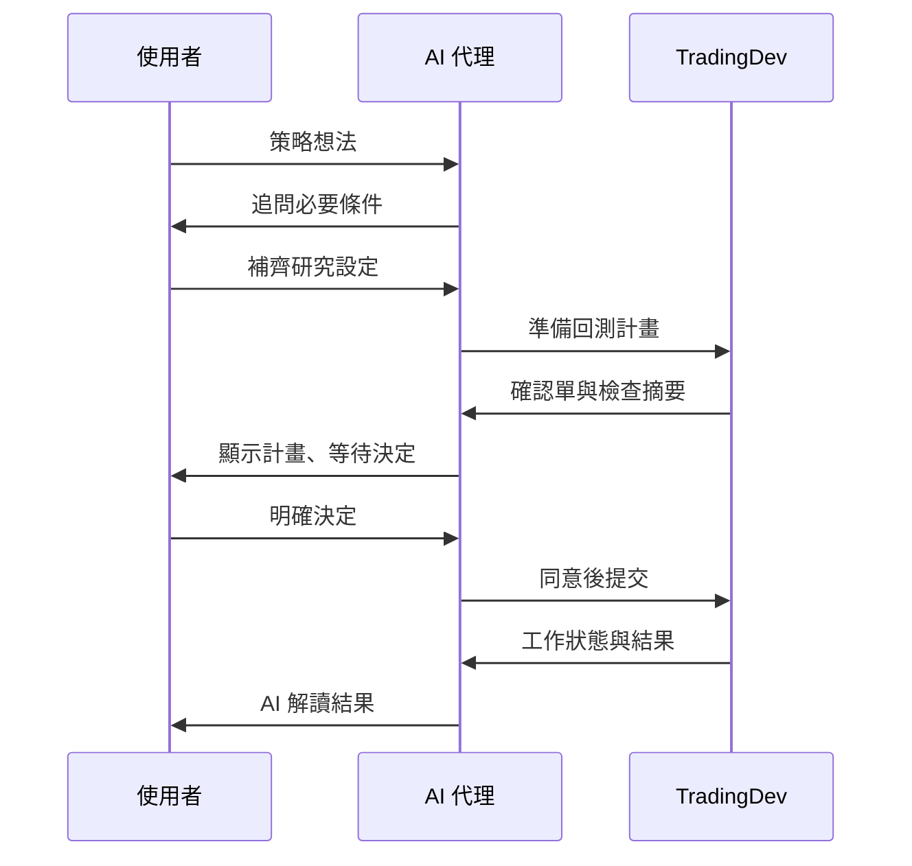

準備前會補齊標的、期間、K 棒頻率等必要條件；計畫經同意後才執行。

<!--
準備工作會追問缺少的研究輸入；準備本身不執行正式回測。只有後續明確同意才會提交計畫。
來源：https://github.com/Kuan-Lun/tradingdev/blob/9e502ce/ARCHITECTURE.md
來源：https://github.com/Kuan-Lun/tradingdev/blob/9e502ce/docs/execution_plans.md
-->

---

## 內部訊號流程：TradingDev 的主要模組

<!-- _class: compact diagram-wide -->

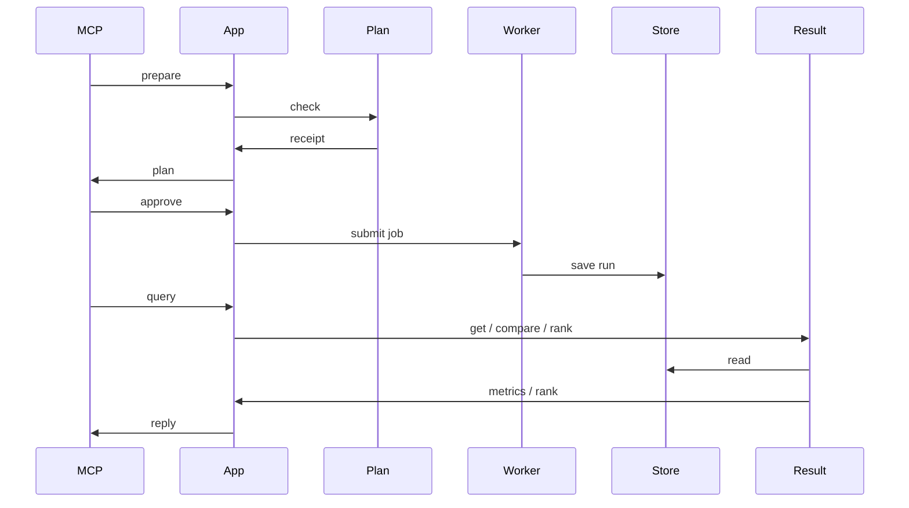

Plan 代表 ExecutionPlan／Preflight；Worker 使用資料與回測模組；Result 代表 Run、Ranking 與 Report services。

<!--
這是目前主線的概念流程。正式名稱可在 src/tradingdev/app、mcp/tools、mcp/workers 與 adapters 中查閱。準備與執行是不同階段；preflight 不下載正式歷史行情，也不產生績效結果。
來源：https://github.com/Kuan-Lun/tradingdev/blob/9e502ce/ARCHITECTURE.md
來源：https://github.com/Kuan-Lun/tradingdev/blob/9e502ce/src/tradingdev/mcp/server.py
-->

---

<!-- _class: compact -->

## MCP 工具覆蓋研究流程

| 工具群 | 研究用途 |
| --- | --- |
| Strategy | 建立、修訂、查詢與驗證策略 |
| Execution | 準備回測、固定比較、Walk-forward 或最佳化計畫 |
| Data 與 Jobs | 檢查資料、查詢工作狀態及管理執行流程 |
| Runs 與 Artifacts | 查詢指標、交易紀錄、報告及已保存的產物 |
| ML 與研究紀錄 | 建立資料集、訓練與評估訊號，保存研究筆記 |

<!--
MCP server 在建立服務時註冊 strategy、data、execution、jobs、runs、history、artifacts、research notes、feature requests 與 ML 等工具。這是按責任分組的簡報版，而非完整工具目錄。
來源：https://github.com/Kuan-Lun/tradingdev/blob/9e502ce/src/tradingdev/mcp/server.py
來源：https://github.com/Kuan-Lun/tradingdev/tree/9e502ce/src/tradingdev/mcp/tools
-->

---

## Application services 協調工作

**Application services 接住用戶需求，組合 Domain 與 Adapters。**

- `StrategyService` 管理策略版本與資格
- `ExecutionPlanService` 準備確認計畫
- `JobService` 與 `OptimizationService` 提交背景工作
- `BacktestService` 協調策略訊號、行情與回測引擎
- `RunService`、`ReportService` 與 `RankingService` 提供結果服務

<!--
MCP tools 主要負責協定與資料轉換；工作流程及狀態轉移由 application 層服務協調。部分流程仍由 worker 負責協調，例如最佳化搜尋與樣本外測試。
來源：https://github.com/Kuan-Lun/tradingdev/blob/9e502ce/ARCHITECTURE.md
-->

---

<!-- header: "02　策略研究" -->
<!-- _class: chapter -->
<!-- _header: "" -->

## 02　策略研究流程

每次正式執行都先固定策略、研究條件與有效設定。

<!--
策略版本、執行 manifest、計畫、工作、run 與 artifact 各自有身分和責任，不能把它們當成同一筆資料。
來源：https://github.com/Kuan-Lun/tradingdev/blob/9e502ce/ARCHITECTURE.md
-->

---

<!-- _class: compact -->

## 研究輸入先補齊

| 輸入 | 均線策略案例 |
| --- | --- |
| 策略構想 | 短均線高於長均線時買進 |
| 標的與資料來源 | 交易標的及其行情來源 |
| 回測期間與 K 棒頻率 | 起訖日期、日線或其他頻率 |
| 策略細節 | 快慢均線長度、出場規則與持倉方式 |
| 模擬假設 | 本金、交易成本與適用的年化政策 |

<!--
模型須取得策略構想、標的、期間與 K 棒頻率；缺項要追問。有效的本金、成本及年化假設由共用政策處理，不能從範例或其他市場暗中猜值。
來源：https://github.com/Kuan-Lun/tradingdev/blob/9e502ce/AGENTS.md
來源：https://github.com/Kuan-Lun/tradingdev/blob/9e502ce/docs/strategy_contract.md
-->

---

<!-- _class: statement -->

## StrategyService 管理策略版本

> **每次修訂都建立新的 revision，並重新取得執行資格。**

`draft` → `validated` → `runnable` → `promoted`

<!--
建立與修訂分開處理。revision 保存固定程式及基礎設定；修改版本不會沿用舊版執行資格，已保存的執行結果不會因後續策略變更而重新解讀。
來源：https://github.com/Kuan-Lun/tradingdev/blob/9e502ce/ARCHITECTURE.md
來源：https://github.com/Kuan-Lun/tradingdev/blob/9e502ce/docs/strategy_contract.md
-->

---

<!-- _class: compact -->

## 策略驗證檢查什麼

- 靜態品質檢查與策略設定檢查
- 訊號資料形狀、索引對齊及 `-1 / 0 / 1` 值域
- 生成策略的合成資料驗證與 dry-run
- 正式回測再次檢查策略資格及訊號契約

**這些檢查不會證明程式完全符合自然語言構想，也不能單靠合成資料證明沒有前視偏誤。**

<!--
generated strategy 的合成資料檢查涵蓋固定 fixture 和訊號契約；它不代表真實行情可用、策略暖機充分或交易語意正確。
來源：https://github.com/Kuan-Lun/tradingdev/blob/9e502ce/docs/strategy_contract.md
來源：https://github.com/Kuan-Lun/tradingdev/blob/9e502ce/docs/execution_plans.md
-->

---

## Execution plan 與確認

**準備計畫。**

固定研究條件、策略 revision、有效參數及檢查證據，產生可閱讀的確認文件。

**使用者決策。**

同意後才提交原計畫；修改或拒絕時不啟動該工作。

<!--
Preflight 是離線準備：不下載正式行情、不執行回測或訓練、不產生績效。修改要求需要重新準備與檢查，最初請求或沉默不代表同意。
來源：https://github.com/Kuan-Lun/tradingdev/blob/9e502ce/docs/execution_plans.md
-->

---

<!-- _class: compact -->

## 行情資料與快取

| 區塊 | 功能 |
| --- | --- |
| DataService | 依研究設定取得、檢查與取樣行情或特徵資料 |
| Data identity | 以來源、市場與標的等條件區分資料集 |
| Cache | 保存已取得行情，讓相同查詢可重用 |
| FeatureData | 對齊時間戳與特徵欄位，檢查合併結果 |

<!--
行情報告會保留資料身分與檢查結果。缺值不會被當成零回報，特徵不會用未來觀測回填過去資料；快取發布採不可變版本與原子更新。
來源：https://github.com/Kuan-Lun/tradingdev/blob/9e502ce/ARCHITECTURE.md
來源：https://github.com/Kuan-Lun/tradingdev/blob/9e502ce/docs/run_artifacts.md
-->

---

## Background jobs 與 workers

- 背景 job 保存進度、程序身分及控制狀態
- Supervisor 啟動 worker 並確認程序清理
- Worker 使用已固定的 manifest 執行並保存成果
- `done` 代表結果已保存；不等於所有程序狀態都相同

<!--
CLI 同步回測與 MCP 背景 job 的入口不同，但都使用共用的策略資格、manifest 與績效模型。Job 與 Run 分開描述：一個是執行流程，一個是保存結果。
來源：https://github.com/Kuan-Lun/tradingdev/blob/9e502ce/ARCHITECTURE.md
來源：https://github.com/Kuan-Lun/tradingdev/blob/9e502ce/src/tradingdev/app/job_service.py
-->

---

<!-- _class: compact -->

## 回測引擎有不同執行模式

| 模式 | 執行方式 | 結果解讀 |
| --- | --- | --- |
| Signal | VectorBT 計算策略訊號與資產曲線 | 可計算報酬與風險指標 |
| Volume | 以模擬帳本記錄金額型損益與交易 | 沒有本金報酬基準時，不提供年化報酬或 Sharpe 等指標 |

交易成本依已固定的設定套用；交易統計、報酬指標與其適用條件會分開保存。

<!--
Signal 與 volume 模式採不同的引擎和指標基礎。volume mode 無初始本金報酬基準，應以金額 PnL 及回撤解讀，不把缺失報酬當作零。
來源：https://github.com/Kuan-Lun/tradingdev/blob/9e502ce/src/tradingdev/domain/backtest/engines.py
來源：https://github.com/Kuan-Lun/tradingdev/blob/9e502ce/docs/performance_artifacts.md
-->

---

<!-- _class: compact -->

## Walk-forward、固定比較與最佳化

| 方法 | 問題 | 執行方式 |
| --- | --- | --- |
| Walk-forward | 規則在不同時間區段如何表現？ | 依序訓練並測試多個時間 fold |
| 固定比較 | 已指定的候選策略誰表現較好？ | 在共用行情快照上獨立執行候選 |
| 最佳化 | 哪些參數值得進一步評估？ | 搜尋訓練區間候選，再測試選定參數 |

這些方法回答不同問題，不能把最佳化結果直接當成樣本外保證。

<!--
最佳化使用自己的日期切分，不同時套用 walk-forward。固定比較由父工作保存候選帳本，失敗或未執行的候選不會被默默省略。
來源：https://github.com/Kuan-Lun/tradingdev/blob/9e502ce/ARCHITECTURE.md
來源：https://github.com/Kuan-Lun/tradingdev/blob/9e502ce/docs/run_artifacts.md
-->

---

## ML 訊號研究

**資料集 → 特徵 → 模型 → 訊號評估 → 候選排名。**

- 保存獨立版本的資料集、特徵快取與模型
- 評估 IC、命中率、換手率及簡化持有期報酬
- `record=true` 才會將候選寫入 ML leaderboard

<!--
ML 研究是同步的獨立介面，不會自動建立一般 backtest run，也尚未接入回測 Dashboard 或 CLI。簡化持有期統計不等同包含完整交易成本的交易回測。
來源：https://github.com/Kuan-Lun/tradingdev/blob/9e502ce/docs/ml_research.md
來源：https://github.com/Kuan-Lun/tradingdev/blob/9e502ce/src/tradingdev/mcp/tools/ml.py
-->

---

<!-- header: "03　結果與分析" -->
<!-- _class: chapter -->
<!-- _header: "" -->

## 03　結果與分析

回測結果保留設定來源、指標定義與查詢入口，供後續比較與報告使用。

<!--
保存的 performance artifacts 是計算結果的快照；歷史查詢不會用今日的 metric catalog 重新計算舊 run。
來源：https://github.com/Kuan-Lun/tradingdev/blob/9e502ce/docs/performance_artifacts.md
-->

---

<!-- _class: compact -->

## 一次研究包含多種身分

| 身分 | 說明 |
| --- | --- |
| Strategy revision | 固定的策略程式、設定與驗證證據 |
| Manifest | 一次執行使用的策略與有效設定 |
| Job | 背景工作進度與程序控制紀錄 |
| Run | 一次已保存的回測結果 |
| Artifact | 結果檔案、索引及可讀取內容 |

<!--
一次 revision 可執行多次；每次執行都有自己的 manifest 與結果。ML dataset、model 和 ML leaderboard 有獨立身分，不可當成一般 run ID。
來源：https://github.com/Kuan-Lun/tradingdev/blob/9e502ce/ARCHITECTURE.md
來源：https://github.com/Kuan-Lun/tradingdev/blob/9e502ce/docs/run_artifacts.md
-->

---

<!-- _class: compact -->

## 主線已保存的績效指標

- 報酬與風險：總報酬、年化報酬、Sharpe、Sortino、Calmar、波動度與回撤
- 交易結果：交易數、勝率、profit factor、期望值與未平倉交易
- 期間觀察：日／月損益與統計，適用時才計算

**每個數字都應連同單位、資料頻率、成本及可用條件一起解讀。**

<!--
主線以 QuantStats 計算新 run 的報酬／風險統計，保留 VectorBT 的 closed-trade 統計。年化、daily drawdown 與日／月 PnL 需要每日或更細的宣告頻率；歷史指標會保留原始定義與 provider。
來源：https://github.com/Kuan-Lun/tradingdev/blob/9e502ce/docs/performance_artifacts.md
來源：https://github.com/Kuan-Lun/tradingdev/blob/9e502ce/src/tradingdev/domain/performance/catalog.py
-->

---

<!-- _class: compact -->

## `compare_runs` 與 `leaderboard` 做不同工作

| 能力 | 主要用途 | 候選來源 |
| --- | --- | --- |
| `compare_runs` | 並列查看至少兩個 run／scope 的指標與差異 | 已保存的回測結果 |
| `leaderboard` | 依指標宣告的方向替候選排序 | 已保存的 run scope 或 ML 訊號評估 |

排行榜是可用的 MCP 工具；`compare_runs` 不是尚未使用的改名預留名稱。

<!--
RankingService 依 metric 前綴分派 run 與 signal 候選，兩者共用排序規則但使用不同資料模型。MCP leaderboard 工具已接上 RankingService；compare_runs 由 RunService 提供。
來源：https://github.com/Kuan-Lun/tradingdev/blob/9e502ce/ARCHITECTURE.md
來源：https://github.com/Kuan-Lun/tradingdev/blob/9e502ce/src/tradingdev/app/ranking_service.py
來源：https://github.com/Kuan-Lun/tradingdev/blob/9e502ce/src/tradingdev/app/run_service.py
-->

---

<!-- _class: compact -->

## 報告、Dashboard 與 CLI

| 入口 | 主要用途 |
| --- | --- |
| MCP | 讓 AI 查詢策略、執行狀態、回測結果及排行榜 |
| Dashboard | 顯示已保存回測結果的圖表與報告 |
| CLI | 直接執行設定檔回測，或從已保存 run 產生報告 |
| ReportService | 組裝 HTML、比較與可選的 ML 研究章節 |

不同入口共享核心資料與服務；操作方式依入口而異。

<!--
CLI 的直接回測是同步入口，不使用 MCP 計畫確認或背景 supervisor。Dashboard 讀取已保存的 PipelineResult；回測報告透過 ReportService 組裝。
來源：https://github.com/Kuan-Lun/tradingdev/blob/9e502ce/ARCHITECTURE.md
來源：https://github.com/Kuan-Lun/tradingdev/blob/9e502ce/README.md
-->

---

## 研究紀錄與可追溯性

- 研究說明與執行假設會綁定到計畫及 manifest
- Run 保存策略、參數、行情與績效產物的身分資訊
- 研究筆記、報告與 artifact 可由後續對話查詢

<!--
來源與設定會隨成果保存，避免只留下聊天結論。研究筆記與報告是獨立產物，不會覆寫已保存的 run 或 ML leaderboard 歷史內容。
來源：https://github.com/Kuan-Lun/tradingdev/blob/9e502ce/src/tradingdev/app/research_note_service.py
來源：https://github.com/Kuan-Lun/tradingdev/blob/9e502ce/docs/run_artifacts.md
來源：https://github.com/Kuan-Lun/tradingdev/blob/9e502ce/docs/reports.md
-->

---

<!-- header: "04　現況與邊界" -->
<!-- _class: chapter -->
<!-- _header: "" -->

## 04　現況與邊界

回測績效與排行榜使用已保存的結果；統計 API 提供獨立計算，尚未接入結果查詢。

---

<!-- _class: compact -->

## 績效管線與獨立統計 API

| 範圍 | 已提供的內容與限制 |
| --- | --- |
| 績效管線 | 一般 run performance、年化報酬、Sharpe、日／月損益及 run leaderboard |
| 獨立統計 API | `domain/statistics` 例如提供期間分析、原始資料績效摘要及 Sharpe 推論 |
| 整合邊界 | 統計 API 尚未接入績效發布或 MCP 結果查詢，並非排行榜新增欄位 |

<!-- _footer: "模組責任與統計慣例見 ARCHITECTURE.md 的績效計算與對話摘要。" -->

---

<!-- _class: compact -->

## 架構保證與限制

- TradingDev 研究歷史資料，不提供真實下單
- Preflight 驗證設定與訊號契約，不預測真實績效
- 生成程式的隔離執行不等於完整安全 sandbox
- 指標受資料頻率、成本假設及可用觀察值限制

<!--
策略檢查不能證明任意 Python 完全符合文字描述或不存在前視偏誤。生成程式的 Linux 執行單元是程序邊界，不應描述為完整安全沙箱。缺少的資料或不可用指標須保留原因，不能改成零。
來源：https://github.com/Kuan-Lun/tradingdev/blob/9e502ce/ARCHITECTURE.md
來源：https://github.com/Kuan-Lun/tradingdev/blob/9e502ce/docs/strategy_contract.md
來源：https://github.com/Kuan-Lun/tradingdev/blob/9e502ce/docs/performance_artifacts.md
-->

---

<!-- _class: closing -->
<!-- _header: "" -->

## TradingDev 的核心設計

把策略構想轉成可檢查、可執行、可追溯的研究流程，
讓每次結果都能回到它使用的策略版本、設定與資料來源。

<!--
以明確輸入、確認計畫、固定 manifest 及保存的 artifacts 支援重現和後續比較；這不代表策略結果已被證明有效。
來源：https://github.com/Kuan-Lun/tradingdev/blob/9e502ce/ARCHITECTURE.md
-->

---

<!--
style: |
  /* Layouts used only by the architecture and case analysis slides. */
  section.architecture-dense { font-size: 19px; line-height: 1.42; padding: 58px 60px 58px; }
  section.architecture-dense header { top: 24px; font-size: 15px; }
  section.architecture-dense footer { bottom: 20px; font-size: 13px; }
  section.architecture-dense h2 { font-size: 32px; margin: 0 0 12px; }
  section.architecture-dense h3 { font-size: 22px; margin: 8px 0 4px; }
  section.architecture-dense p, section.architecture-dense ul, section.architecture-dense ol { margin: 6px 0; }
  section.architecture-dense li { margin: 2px 0; }
  section.architecture-dense table { font-size: 16px; line-height: 1.3; margin: 6px 0; }
  section.architecture-dense table th, section.architecture-dense table td { padding: 5px 9px; }
  section.architecture-dense blockquote { margin: 8px 0; padding: 4px 0 4px 18px; }
  section.architecture-dense img { display: block; margin: 4px auto; }
  section.architecture-mid { font-size: 22px; line-height: 1.45; padding: 62px 64px 60px; }
  section.architecture-mid header { top: 26px; font-size: 16px; }
  section.architecture-mid footer { bottom: 22px; font-size: 14px; }
  section.architecture-mid h2 { font-size: 36px; margin: 0 0 16px; }
  section.architecture-mid h3 { font-size: 25px; margin: 10px 0 6px; }
  section.architecture-mid p, section.architecture-mid ul, section.architecture-mid ol { margin: 8px 0; }
  section.architecture-mid li { margin: 4px 0; }
  section.architecture-mid table { font-size: 19px; line-height: 1.35; margin: 8px 0; }
  section.architecture-mid table th, section.architecture-mid table td { padding: 7px 11px; }
  section.architecture-mid blockquote { margin: 10px 0; padding: 6px 0 6px 20px; }
  section.architecture-dense blockquote, section.architecture-mid blockquote { font-size: 0.95em; }
  section.architecture-diagram h2 { font-size: 36px; margin-bottom: 16px; }
  section.architecture-diagram .mermaid-diagram > svg { height: 430px; }
  section.architecture-diagram footer { font-size: 13px; }
  section.architecture-diagram .mermaid-diagram .note { fill: #e5eeea !important; stroke: #a7bfba !important; }
-->
<!-- _class: chapter -->
<!-- _header: "" -->

## 架構與功能分析

研究條件、工具流程與實作案例

- **許竣鈞**　國立成功大學經濟學系雙主修資訊工程學系 學士班
- **Morten Weng**　應屆 University of Bergen 博士畢業

<!-- _footer: "分析基準：TradingDev f328b8f（2026-11-09）" -->

---

<!--
_class: architecture-mid
_header: 研究條件與有效設定
_footer: 來源：docs/strategy_contract.md 的 Research Inputs and Simulation Policy、domain/research_policy.py
-->

## 四個選擇由使用者決定，其餘由政策補齊並凍結

**ResearchSpec 必填**：① 策略構想　② 標的　③ 期間（起訖兩欄）　④ K 棒頻率
缺項要追問，不從範例或可用資料推測；資料來源與市場類型也要明確選定。

**未填時的共用政策（research-v1）**，這些是模擬假設，不是交易所現行費率：

| 項目 | 預設 |
|---|---|
| 本金 | 10,000（報價幣別，signal 模式） |
| 手續費率 | 0.0006 |
| 滑價率 | 0.0005 |
| 年化 | 只有純加密貨幣來源才推定 365；Yahoo 等需明示 |

> **優先序：** 明示值（含 0 成本）→ 明確選定的 revision → 共用政策；解析結果連同來源凍結，worker 不重套新政策。

<!--
【名詞加註】ResearchSpec＝研究條件的輸入格式；有效設定＝實際拿去執行的完整設定；報價幣別＝計價用的貨幣，如 USDT；年化＝把日報酬換算成一年；revision＝策略的固定版本；凍結＝寫進設定後不再改。

save_strategy 和四個 prepare 工具都要求 research 參數。新研究用 kind: "new"，給齊策略構想、標的、起訖日期和 K 棒頻率；日期一律換成 UTC。後端只檢查完整性與版本綁定，不能證明這些選擇真的來自使用者本人。

沒填的本金與成本由共用政策補上，明示的數字優先，包括 0 成本。年化的 market 政策只在所選來源登錄的資產類別全是加密貨幣時推定 365；Yahoo Finance 這種混合來源，即使代號是加密貨幣，也要明示倍數或選 unavailable。

kind: "inherit_selected_revision" 只能從明確選定的不可變 generated revision 繼承，內建策略或「目前版本」都不能拿來繼承。解析後的值和來源（request、project_default、selected_revision）一起凍結在設定裡，之後政策改版也不會回頭改寫已準備的設定。最佳化另有訓練／測試日期，研究期間必須剛好等於 train_start 到 test_end，不符就拒絕，不會自動延伸。
-->

---

<!--
_class: architecture-mid
_header: 停損、停利與熔斷
_footer: 來源：docs/strategy_contract.md 的 Signal and Execution Semantics 與 volume 停損、熔斷說明
-->

## 引擎的停損另有規則：跳空越過門檻就以開盤價成交

| 規則 | signal 模式 | volume 模式 |
|---|---|---|
| 參考價 | 進場那根的收盤價 | 進場價 |
| 檢查範圍 | 之後每根的開盤到收盤，不看最高、最低 | 當根的最高價與最低價 |
| 成交價 | 跳空越過門檻用開盤價，否則用門檻價 | 門檻價 |
| 同時觸發 | 停損優先於停利與一般訊號 | 停損優先於停利 |
| 設為 0 | 零距離門檻，不是關閉 | 關閉 |
| 停損後再進場 | 要等訊號狀態改變 | re_entry_after_sl 決定是否當根收盤再進場 |
| 成本 | 停損單不計出場滑價，仍計手續費 | 每次進出都計手續費與滑價 |

- **volume 的月虧損熔斷**：monthly_max_loss：每個 UTC 月的累計損益達門檻，就在收盤平倉並暫停到下個月；出場成本可能讓虧損超過門檻
- **兩種模式共通**：進場那根不檢查停損；都沒有完整的保證金、強平或資金費率模型；是歷史模擬假設，不是交易所成交保證

<!--
【名詞加註】停損＝虧到設定幅度就出場；停利＝賺到設定幅度就出場；門檻價＝成本乘上 (1 ± 幅度) 的價格；跳空＝開盤價直接越過昨天收盤附近的價位；滑價＝實際成交價比預期差的部分；熔斷＝虧損達上限就暫停交易。

這頁是 YAML 裡 stop_loss、take_profit 設定在回測引擎中的行為，和策略程式自己用訊號出場是兩回事。signal 模式（VectorBT）以進場那根的收盤價為基準，之後只檢查每根開盤到收盤的區間；開盤就已越過門檻時以開盤價成交，否則以門檻價成交。停損單採固定的 stoplimit 政策，不計出場滑價，但仍計手續費。停損後要等訊號狀態改變才會再進場。

volume 模式的停損看當根最高價和最低價，以門檻價成交；設為 0 代表關閉（signal 模式設 0 是零距離門檻）。re_entry_after_sl 為 true 時，停損那根若訊號仍非 0，會在收盤再進場（熔斷未觸發時）；為 false 則要等訊號改變。monthly_max_loss 以 UTC 月份計算累計損益，包含已付成本與未實現變動；達門檻就在收盤平倉、暫停到下一個有資料的月份。它不是保證的虧損上限，沒有時間戳時無法使用。

對照實例二：AI 代理說明它的停損是「收盤價判斷、隔天開盤成交」，這是策略自己用訊號出場的語意，不是引擎的 stop_loss。如果改用引擎的停損設定，跳空時以開盤價成交、沒跳空時以門檻價成交，實際虧損和那頁的數字會不同。
-->

---

<!--
_class: architecture-mid
_header: 行情資料層
_footer: 來源：ARCHITECTURE.md「行情快取」「獨立行情取樣」、docs/run_artifacts.md 的 Market Data Cache
-->

## 同一個資料身分，載入、取樣與檢查共用

| Binance Vision | Binance API | Yahoo Finance | 特徵資料 |
|---|---|---|---|
| 加密貨幣，歷史壓縮檔 | 加密貨幣 | 股票、ETF、期貨、指數、外匯 | DVOL 取自 Deribit；資金費率等用本機 Parquet |

**依 UTC 年度查詢** → **鎖住該身分與年度** → **寫入不可變版本** → **原子替換年度憑證**

- **資料身分**：來源＋市場類型＋原始代號＋頻率；不同來源不共用價格
- **重用條件**：查詢時間晚於區間結束 7 天以上才重用；近期區間每次重抓
- **時間對齊**：只沿用較早的有效特徵；開頭缺值保持未知，不回填
- **受限取樣**：確認前的取樣在請求階段就限量；下載、解壓與列數各有上限

<!--
【名詞加註】資料身分＝判斷兩份行情是不是同一份的鍵；不可變版本（generation）＝某次下載後固定的檔案；憑證（receipt）＝記錄成功查詢範圍與時間的年度檔；原子替換＝一次換掉，讀的人不會讀到一半；Parquet＝欄式資料檔；DVOL＝Deribit 的比特幣波動率指數；回填＝用後面的資料補前面。

app/data_manager.py 協調年度查詢與更新，domain/data/cache.py 定義身分與重用政策，adapters/storage/data_cache.py 負責鎖、不可變版本與原子發布。正式載入、只讀載入、可用性、檢查和取樣都用同一個身分，所以不會把不同來源的價格混在一起。

正式回測按年度取資料，即使只跑一個月也可能下載整年。更新失敗會保留原本可讀的版本；更新成功也保留舊版本，目前不自動淘汰，反覆更新會增加磁碟用量。快取存在或檢查通過，都不保證每根 K 棒齊全，也不排除來源日後修正。

時間對齊精確到時間戳，只能沿用較早的有效特徵；開頭沒有資料就保持未知，策略要自己處理。Binance Vision 的取樣即使只要少量列數，仍要下載選中的壓縮檔，所以下載、解壓與列數各自設上限，超量就失敗。
-->

---

<!--
_class: architecture-mid
_header: MCP 回覆契約
_footer: 來源：ARCHITECTURE.md「MCP 回覆契約」；分頁欄位見 docs/run_artifacts.md 的 Discovery Pages
-->

## 回覆有固定形狀，失敗分成兩種

**形狀：**

- StrictMCPServer 拒絕未知的頂層參數
- 客戶端依 tools/list 的 outputSchema 讀 structuredContent
- 單一物件放根層；清單與成功／失敗聯集放在 result
- 可成長的清單分頁回摘要，細節另外查

**失敗：**

- **預期的應用失敗**：回傳穩定的 code 與 diagnostics，例如 strategy_requires_training
- **MCP error**：參數錯誤、未預期例外、無效回覆；內部原因只留在 server 日誌
- 只看 isError 不能判斷應用是否成功

> **標註不是授權：** 工具的唯讀、破壞性、冪等標註只描述副作用。狀態查詢可能更新失聯的 job，驗證會執行 Python。

<!--
【名詞加註】outputSchema＝工具宣告的回覆格式；structuredContent＝MCP 回覆裡的結構化資料；聯集＝成功或失敗兩種形狀擇一；DTO＝在各層間傳遞的資料格式；冪等＝重複呼叫結果相同；分頁＝清單分批回傳。

上一頁是 AI 代理照什麼順序用工具，這頁是每個工具回什麼。mcp/prompts.py 的常駐指引只放階段流程、契約探索、授權與成果交付；詳細契約由工具按需提供，例如 get_strategy_contract，不整份載入 Markdown，也不假設客戶端讀得到 server 的檔案或會自動載入 resources。

StrictMCPServer 拒絕未知參數，回覆由 application DTO 驗證，動態的策略參數仍保有明確的 JSON 邊界。預期內的失敗有穩定的 code 和 diagnostics，讓 AI 代理知道下一步該做什麼；真的出錯才用 MCP error，內部細節只寫在 server 日誌。

分頁不提供跨寫入的一致快照，這是已知限制頁列出的限制之一。同步工具由 SDK 在執行緒裡跑，SQLite 連線不跨 service 呼叫共用。
-->

---

<!--
_class: architecture-dense
_header: 實例一：0050 均線策略 · 實際對話：詢問台股大盤比較（1/2）
_footer: CLI 實際對話原文；操作者由 AI 代理依委託擔任。上游介紹簡報 0050 均線策略案例（Codex CLI · gpt-6.1-sol，產品版本 4c8a665）
-->

## 三組均線都落後台股大盤，最大回撤也較大

**操作者輸入：**

> 「這三組策略跟台股大盤相比，表現如何？」

**gpt-6.1-sol｜該輪最終回覆：**

**這段期間三組都落後台股大盤，最大回撤也較大。** 以台股加權指數（`^TWII`）為基準，實際比較期間為 2024/1/2～7/1，共 118 根日 K。

| 策略／基準 | 區間報酬 | 與大盤差距 | 最大回撤 |
|---|---:|---:|---:|
| **台股大盤基準** | 29.01% | — | 6.66% |
| 5／20 日均線 | 28.02% | −0.99 個百分點 | 8.16% |
| 10／40 日均線 | 16.96% | −12.05 個百分點 | 7.84% |
| 20／60 日均線 | 16.50% | −12.51 個百分點 | 7.84% |

5／20 日最接近大盤，但本次沒有展現較低回撤的優勢。另兩組暖機較長、較晚開始交易，也會影響比較結果，不能直接推論長期表現。

<!--
【名詞加註】台股加權指數（^TWII）＝台股大盤的價格指數；區間報酬＝這段期間的累積報酬；百分點＝兩個百分比相減的差；最大回撤＝從高點跌到低點的最大幅度；暖機＝均線需要足夠天數才算得出來，算出來之前不交易。

這是上游介紹簡報的 0050 均線策略案例，也是這份簡報的實例一：操作者說想用均線買賣 0050，AI 代理提出 5／20、10／40、20／60 三組均線，操作者閱讀確認單同意後才回測（2024/1/1～7/1、日 K）。這一輪接著問「跟台股大盤相比如何」。AI 代理用回測附帶的 ^TWII 基準回答，三組都落後大盤，最接近的 5／20 也少了約 1 個百分點，而且最大回撤比大盤深。

AI 代理也主動提醒比較的限制：10／40、20／60 的均線需要較長暖機，開始交易的日子比較晚，三組不是從同一天起跑；期間只有半年，不能推論長期表現。這和後面實例二、三遇到的問題是同一類：樣本短、比較條件不完全一致時，結論要保守。
-->

---

<!--
_class: architecture-dense
_header: 實例一：0050 均線策略 · 實際對話：詢問台股大盤比較（2/2）
_footer: CLI 實際對話原文；操作者由 AI 代理依委託擔任。上游介紹簡報 0050 均線策略案例（Codex CLI · gpt-6.1-sol，產品版本 4c8a665）；右表取自該案例報告的基準比較章節
-->

## 大盤基準不含股利；要判斷擇時價值，還要比 0050 買入持有

**gpt-6.1-sol｜該輪最終回覆：**

大盤基準採首根收盤買進、期末估值，套用相同模擬費率與滑價；使用的是**不含股利的價格指數**。要進一步判斷均線擇時有沒有價值，還應比較「0050 本身買入持有」。完整比較報告是一份離線 HTML，詳情章節包含設定與資料覆蓋、績效分析與保存指標、基準比較、權益與回撤、委託、成交與帳戶核對、配對交易損益。比較工作：`7c671285…f778075`；範圍：三組 `full`

**報告中的基準比較：5／20 日均線：**

| 指標 | 5／20 日均線 | ^TWII | 差異 |
|---|---:|---:|---:|
| 累積報酬率 | 28.02% | 29.01% | −0.99% |
| 年化複合報酬率 | 69.47% | 72.29% | −2.82% |
| 夏普比率 | 2.95 | 3.48 | −0.54 |
| 索提諾比率 | 4.91 | 5.67 | −0.76 |
| 最大回撤率 | 8.16% | 6.66% | 1.50% |
| 年化波動率 | 18.49% | 16.00% | 2.50% |
| 卡瑪比率 | 8.51 | 10.85 | −2.34 |
| 總淨損益 | 2,801.86 | 2,901.05 | −99.19 |

<!--
【名詞加註】價格指數＝只算價格漲跌、不含股利的指數；期末估值＝最後一天以收盤價計算持倉價值；擇時＝靠進出場時點賺錢；索提諾比率＝只計下跌波動的 Sharpe；卡瑪比率＝年化報酬除以最大回撤；報價貨幣金額＝以標的報價幣別計的金額。

同一輪回覆的後半段說明基準怎麼算：^TWII 在首根 K 棒收盤買進、期末以收盤估值，套用和策略相同的費率與滑價；它是價格指數，不含股利。AI 代理因此建議下一步加比「0050 本身買入持有」，才分得出均線進出的貢獻。

右表是報告中 5／20 組的基準比較章節。因為基準完整涵蓋策略的每根 K 棒，報告直接算出差異：報酬、Sharpe、索提諾、卡瑪比率都略低於大盤，回撤與波動都比較高。對照實例三：那次 ^TWII 少一根 K 棒，報告就不算差異、只顯示「—」，同一套規則在兩個案例裡給出不同的呈現。

這個案例在產品版本 4c8a665 執行，早於 #218，所以報告寫的是「期末不強制平倉、以最後一根收盤估值」；在現在的 main 上，策略剩餘部位會在期末依收盤平倉並計入出場成本。
-->

---

<!--
_class: compact architecture-diagram
_header: 附檔 · 對話觸發的工具流程 ↔ 實例一
_footer: 順序圖與附檔說明取自 MCP 工具導覽（UC-02 頁、案例總表頁）；對照依實例一的回覆內容，投影片未列出實際工具呼叫紀錄
-->

## UC-02：比較與樣本外研究的準備

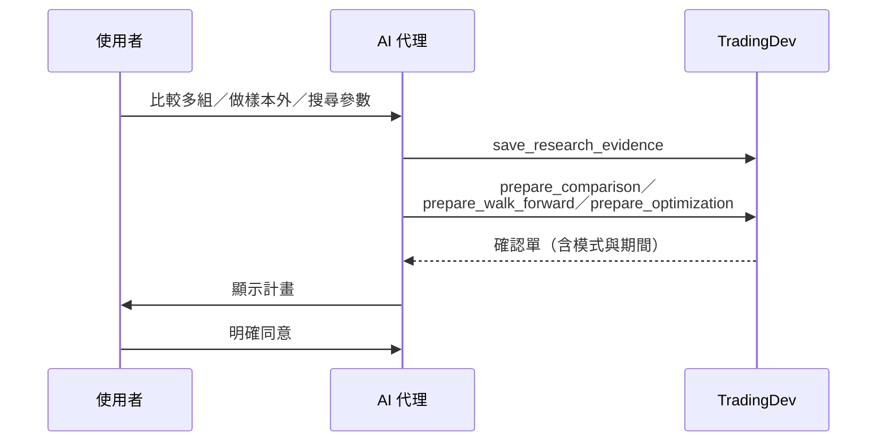

---

<!--
_class: compact architecture-diagram
_header: 附檔 · 對話觸發的工具流程 ↔ 實例一
_footer: 順序圖與附檔說明取自 MCP 工具導覽（UC-02 頁、案例總表頁）；對照依實例一的回覆內容，投影片未列出實際工具呼叫紀錄
-->

## UC-02：同意後執行與取得報告

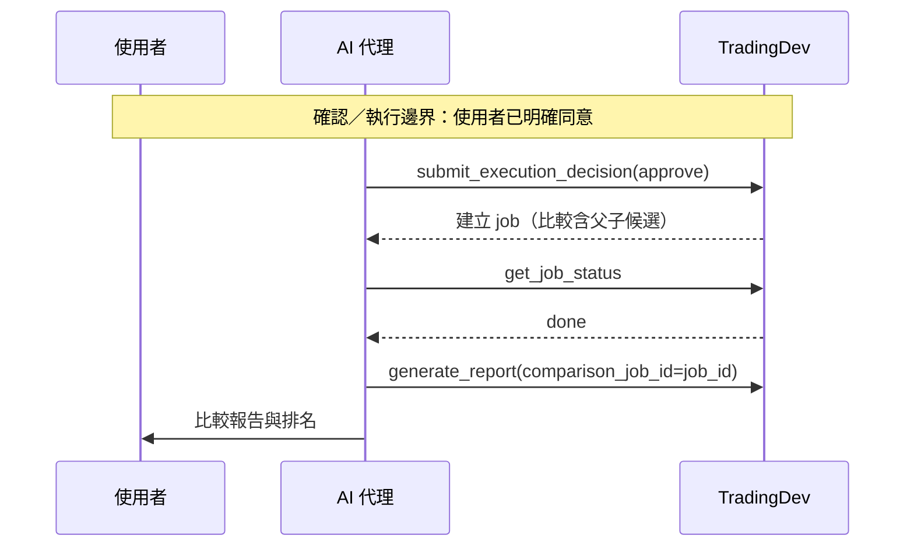

---

<!--
_class: architecture-mid
_header: 附檔 · 對話觸發的工具流程 ↔ 實例一
_footer: 順序圖與附檔說明取自 MCP 工具導覽（UC-02 頁、案例總表頁）；對照依實例一的回覆內容，投影片未列出實際工具呼叫紀錄
-->

## UC-02 與 0050 均線案例的對照

**附檔說明：** 三種 prepare_* 回答不同問題；最佳化結果不直接等同樣本外保證。

- ✓ 三組均線一起比較＝「比較多組」，產生比較 job（三組 full）
- ✓ 閱讀確認單、回覆同意後才回測＝「同意 → submit」
- ✓ 報告可切換三組＝「比較報告與排名」
- ✓ 問大盤比較沒有新確認單，只讀已完成結果
- △ 只做比較、沒做 walk-forward，還不是樣本外證據

<!--
【名詞加註】UC-02＝附檔定義的「比較與樣本外研究」使用案例；比較 job＝一次跑多組固定參數的背景工作，父 job 管理各組候選；樣本外＝沒參與挑選的資料；確認單＝回測前交給使用者決定的計畫。

這頁把附檔的 UC-02 順序圖放在實例一的大盤比較之後，只用附檔的內容檢查實際操作。附檔說 UC-02 有三個入口：比較多組、做樣本外（walk-forward）、搜尋參數（最佳化），三者都要先 save_research_evidence、準備確認單，使用者同意後才 submit 建立 job，完成後用 generate_report(comparison_job_id) 產生比較報告與排名。

實例一的 5／20、10／40、20／60 三組均線就是「比較多組」：上一頁的回覆列出比較工作識別碼與「範圍：三組 full」，報告也能在三組之間切換，對應圖上的比較 job 與比較報告。回測前操作者先閱讀確認單、回覆同意，符合同意後才 submit 的順序。這一輪問大盤比較時，AI 代理沒有再準備確認單，只用已完成的比較結果作答，符合附檔總表說的「先唯讀確認、再明確同意後寫入」。

附檔也提醒三種 prepare_* 回答不同問題：這次只用了比較，沒有 walk-forward，所以三組的優劣還不是樣本外證據。下一頁 AI 代理建議拉長期間、保留一段資料做樣本外驗證，和這個提醒一致。對照是依回覆內容推得，投影片沒有列出實際的工具呼叫紀錄。
-->

---

<!--
_class: architecture-mid
_header: 實例一：0050 均線策略 · 實際對話：討論改善方向（1/2）
_footer: CLI 實際對話原文；操作者由 AI 代理依委託擔任。上游介紹簡報 0050 均線策略案例（Codex CLI · gpt-6.1-sol，產品版本 4c8a665）
-->

## 先改善驗證方式與風險控制，不急著換另一組均線

**操作者輸入：**

> 「如果要改善這個策略，你會怎麼建議？」

**gpt-6.1-sol｜該輪最終回覆：**

我會優先改善「驗證方式與風險控制」，目前還不急著調出另一組均線。這次只有半年資料、各組僅 0～1 筆已平倉交易，證據還太少。建議依序做：

1. **先比較 0050 買入持有**：目前比較的是加權指數。加入 0050 本身的基準，才能看出均線進出的貢獻。
2. **統一暖機，再拉長測試期間**：在評估開始前提供足夠資料計算均線，讓三組從同一天開始比較；再涵蓋上漲、下跌與盤整期間，保留一段資料做樣本外驗證。

<!--
【名詞加註】已平倉交易＝買賣都完成的交易；暖機＝均線算得出來前的準備期；樣本外驗證＝用沒參與挑選的資料測試；盤整＝價格在區間內上下震盪。

操作者問怎麼改善，AI 代理沒有直接再調一組均線，而是先處理證據不足：半年資料、每組只有 0 到 1 筆已平倉交易，任何參數差異都可能是運氣。前兩步都是在改善比較的公平性：先加 0050 本身的買入持有當基準，分出均線進出的貢獻；再讓三組從同一天開始，並拉長期間、涵蓋不同市況，保留一段資料做樣本外驗證。

這兩點在 main 上都有對應：診斷規則的 few_trades 會在交易少於 20 筆時提醒樣本不足；walk-forward 可以把資料分段，用沒參與挑選的部分驗證。
-->

---

<!--
_class: architecture-mid
_header: 實例一：0050 均線策略 · 實際對話：討論改善方向（2/2）
_footer: CLI 實際對話原文；操作者由 AI 代理依委託擔任。上游介紹簡報 0050 均線策略案例（Codex CLI · gpt-6.1-sol，產品版本 4c8a665）
-->

## 一次只測一種改善，補齊實際成本；以上尚未執行新回測

**gpt-6.1-sol｜該輪最終回覆：**

3\. **一次只測一種規則改善**：我會先測「短均線連續兩天低於長均線才賣出」，觀察能否減少短暫跌破造成的反覆交易。代價是出場較慢，可能承受更大跌幅，效果仍待驗證。

4\. **補齊實際交易成本**：納入證交稅、券商最低手續費與整股限制，確認改善後的收益是否留得住。

**我會先保留 5／20 日作為研究起點，再與加入兩天出場確認的版本比較。** 它只是本次最接近大盤的組合，尚未證明長期較好；評估時應同時看報酬、回撤與交易次數。以上尚未執行新回測。

<!--
【名詞加註】反覆交易（whipsaw）＝價格在均線附近來回穿越，造成頻繁買賣；證交稅＝台股賣出時課的稅；最低手續費＝券商每筆交易至少收的金額；整股＝以 1,000 股為一張的交易單位。

後兩步是規則與成本。第三步一次只改一件事：先測「連續兩天跌破才賣」，看能不能減少假跌破造成的反覆進出，同時承認代價是出場變慢。第四步補上回測簡化掉的成本：證交稅、最低手續費與整股限制。

這和實例三看到的情況一致：實例三的成本把手續費與證交稅簡化成每邊 0.29%，成交數量也是小數股，沒有模擬整張交易。最後 AI 代理明確說「以上尚未執行新回測」，把建議和已驗證的結果分開。
-->

---

<!--
_class: compact architecture-diagram
_header: 附檔 · 對話觸發的工具流程 ↔ 實例一
_footer: 順序圖與附檔說明取自 MCP 工具導覽（UC-01（1/2）、UC-01（2/2）頁）；對照依實例一的回覆內容，投影片未列出實際工具呼叫紀錄
-->

## UC-01：準備確認單與等待決定

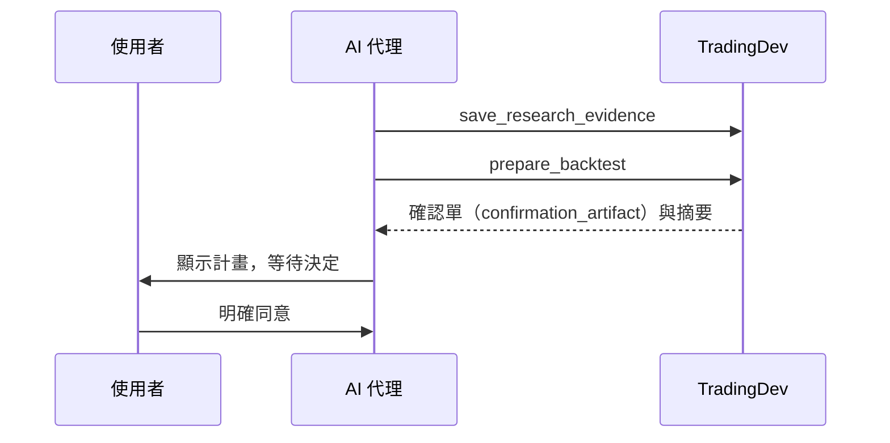

---

<!--
_class: compact architecture-diagram
_header: 附檔 · 對話觸發的工具流程 ↔ 實例一
_footer: 順序圖與附檔說明取自 MCP 工具導覽（UC-01（1/2）、UC-01（2/2）頁）；對照依實例一的回覆內容，投影片未列出實際工具呼叫紀錄
-->

## UC-01：同意後提交與查詢

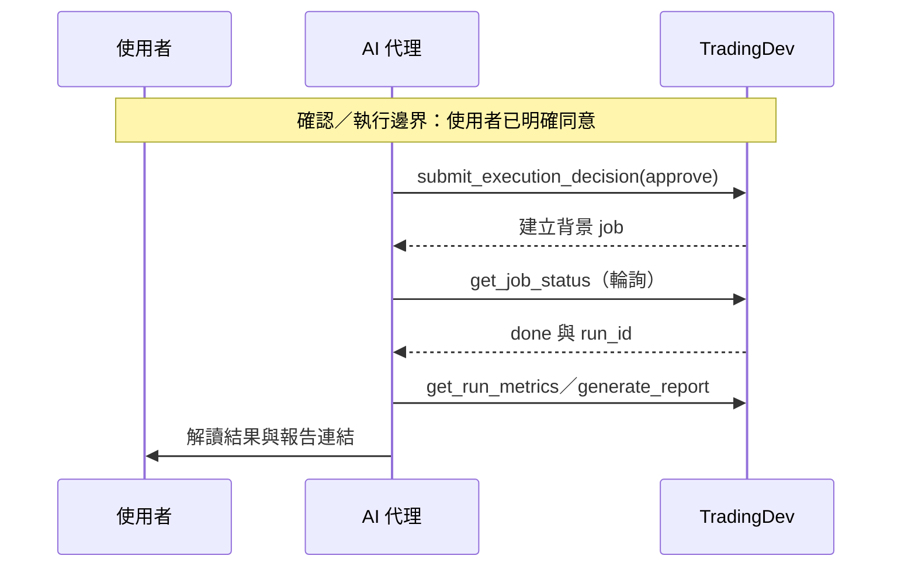

---

<!--
_class: architecture-mid
_header: 附檔 · 對話觸發的工具流程 ↔ 實例一
_footer: 順序圖與附檔說明取自 MCP 工具導覽（UC-01（1/2）、UC-01（2/2）頁）；對照依實例一的回覆內容，投影片未列出實際工具呼叫紀錄
-->

## UC-01 與 0050 均線案例的對照

**附檔說明：** 準備本身不執行回測；只有使用者明確同意後才提交並建立背景工作。

- ✓ 操作者只問建議，沒有「明確同意」，就不會 submit
- ✓ AI 明說「以上尚未執行新回測」，沒越過確認邊界
- → 要測兩天出場：先 save_strategy 存新 revision 並驗證，再 prepare_backtest
- → 要和 5／20 並列比較，改走 UC-02 的 prepare_comparison

<!--
【名詞加註】UC-01＝附檔定義的「從構想到回測」使用案例；revision＝每次 save_strategy 產生的策略版本；確認／執行邊界＝圖上的虛線，線以上是準備，線以下是執行；背景 job＝伺服器在背景跑的回測工作。

為什麼這一頁接 UC-01（2/2）：上一頁 AI 代理提出四個改善方向，最後一句是「以上尚未執行新回測」。附檔這頁的重點正好是準備和執行的分界：prepare_backtest 只產生確認單，不會執行回測；只有使用者明確同意，才 submit 並建立背景工作。操作者這一輪只是問建議，沒有任何同意，所以 AI 代理不該、也沒有啟動新的回測，和附檔一致。

如果之後真的要測「短均線連續兩天低於長均線才賣出」，依附檔要分兩段：規則改了就是新的策略，先照 UC-01（1/2）用 save_strategy 存成新 revision，並 validate、dry_run、promote；附檔說驗證與執行都綁定這個 revision_id。接著才照這頁準備確認單、等明確同意後執行。若要把新版和 5／20 放在一起比，則是前一個 UC-02 的 prepare_comparison。

這頁選 UC-01（2/2）而不是（1/2），是因為上一頁要檢查的是「有沒有在沒同意的情況下執行」；（1/2）講的是策略怎麼建立與驗證，可以在講稿口頭帶過。
-->

---

<!--
_class: architecture-mid
_header: 實例一：0050 均線策略 · 實際對話：整理研究與分享
_footer: CLI 實際對話原文；操作者由 AI 代理依委託擔任。上游介紹簡報 0050 均線策略案例（Codex CLI · gpt-6.1-sol，產品版本 4c8a665）
-->

## 整理成研究分享包，完整解壓後就能離線閱讀

**操作者輸入：**

> 「幫我把這次的研究整理好，讓我能分享給別人。」

**gpt-6.1-sol｜該輪最終回覆：**

已整理成**第 1 版研究分享包**，包含研究設定、三組回測、大盤比較、完整報告，以及尚未驗證的改善建議。將整份 ZIP 分享給對方，**完整解壓後開啟 `index.html`**；保留 `reports/` 資料夾即可離線閱讀完整報告。摘要已清楚標示主要結論：這段期間三組均落後大盤，且交易樣本少，不能據此認定長期優劣。

<!--
【名詞加註】研究分享包＝把研究筆記、報告和附件打包成的 ZIP；離線閱讀＝不用連網、不用伺服器就能打開；研究筆記＝研究的摘要，不是逐字紀錄。

最後一輪，操作者請 AI 代理把研究整理好分享出去。AI 代理把研究設定、三組回測、大盤比較、完整報告和尚未驗證的改善建議整理成第 1 版研究分享包，並說明收件人要完整解壓、保留 reports 資料夾，再開啟 index.html。

背後的工具流程是 save_research_note 保存筆記、export_research_note 匯出 ZIP，HTTP 模式再用 get_artifact_download 簽發短效下載連結；匯出前會核對附件路徑與 SHA-256，遺失或變更就拒絕。摘要裡保留了主要結論和它的限制：三組都落後大盤、交易樣本少，不能認定長期優劣。
-->

---

<!--
_class: compact architecture-diagram
_header: 附檔 · 對話觸發的工具流程 ↔ 實例一
_footer: 順序圖與附檔說明取自 MCP 工具導覽（UC-05 頁）；對照依實例一的回覆內容，投影片未列出實際工具呼叫紀錄
-->

## UC-05：保存與分享研究

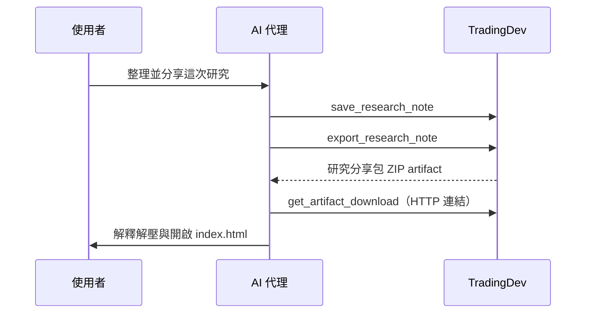

---

<!--
_class: architecture-mid
_header: 附檔 · 對話觸發的工具流程 ↔ 實例一
_footer: 順序圖與附檔說明取自 MCP 工具導覽（UC-05 頁）；對照依實例一的回覆內容，投影片未列出實際工具呼叫紀錄
-->

## UC-05 與 0050 均線案例的對照

**附檔說明：** 研究筆記為摘要，非逐字紀錄；分享包完整解壓後離線可讀。

- ✓ 「整理好、分享給別人」＝整理並分享這次研究
- ✓ 第 1 版研究分享包 ZIP＝save_research_note → export_research_note
- ✓ 下載連結＝get_artifact_download（HTTP 連結）
- ✓ 完整解壓、開啟 index.html＝最後一步與「離線可讀」
- ✓ 「摘要已標示主要結論」＝筆記為摘要，非逐字紀錄

<!--
【名詞加註】UC-05＝附檔定義的「保存與分享」使用案例；研究筆記＝研究的摘要，不是逐字紀錄；研究分享包＝匯出的 ZIP；HTTP 連結＝透過網路下載的連結。

這頁把附檔的 UC-05 放在實例一最後一輪之後。附檔的流程是：使用者要求整理並分享，AI 代理先 save_research_note 保存筆記，再 export_research_note 匯出研究分享包 ZIP，用 get_artifact_download 取得 HTTP 下載連結，最後說明怎麼解壓、開啟 index.html。

上一頁的回覆每一段都對得上：操作者的要求就是「整理並分享這次研究」；回覆交出第 1 版研究分享包 ZIP 與下載連結；說明完整解壓後開啟 index.html、保留 reports 資料夾；摘要標出主要結論與限制。附檔的說明「研究筆記為摘要，非逐字紀錄；分享包完整解壓後離線可讀」也和回覆一致。五個環節都對應，是三個對照裡最完整的一個。

同樣要說明：這是依回覆內容對照，投影片沒有列出實際呼叫了哪些工具；要完全確認，需要看該案例的工具紀錄。
-->

---

<!--
_class: closing
_header: MCP 工具導覽 · 小結
_footer: 來源：MCP 工具導覽簡報結語；數字依 main f328b8f 的 mcp/tools
-->

## TradingDev 的工具設計

把工具分成 **11 群、52 個 MCP 工具**，對應從構想到分享的 **三個分期、九個研究階段**；AI 代理依對話觸發對應工具，先以唯讀確認、再於明確同意後執行。

<!--
【名詞加註】分期＝以確認回測參數為界的執行前、執行中、執行後；研究階段＝需求釐清、策略建立與驗證、資料準備、執行準備與確認、執行監控、結果查詢與分析、報告與交付、保存與分享，加上獨立的 ML 訊號研究，共九個；唯讀＝只查詢、不改變伺服器狀態。

這頁是 MCP 工具導覽簡報的結語，放在實例一與 UC 流程對照之後，收束 MCP 這一節。52 個工具依程式模組分成 11 群；依研究流程看，它們分屬執行前、執行中、執行後三個分期，加上獨立的 ML 軌道，共九個研究階段。AI 代理依對話內容觸發對應的工具，節奏都一樣：先用唯讀工具確認條件與現況，需要執行時交付確認單，等使用者明確同意才提交。數字在 main f328b8f 上逐一核對過：52 個工具中 29 個唯讀、23 個會改變狀態。
-->

---

<!--
_class: architecture-mid
_header: ML 研究與排名
_footer: 來源：docs/ml_research.md、docs/run_artifacts.md（main f328b8f）
-->

## ML 訓練不偷看答案，排名只比能比的

**ML 訓練：多檔一起學：**

- 幾檔股票排成同一張表一起訓練
- 驗證時，碰到測試期答案的資料一律剔除
- 日期對不齊時，不拿未來的資料補洞
- 驗證分數只供參考，最後保存的模型用全部資料重訓

**排名：只比能比的：**

- ML 訊號和回測結果用同一套規則排名
- 算不出的數字不當 0，條件不同不混排
- 越大越好或越小越好事先定好，同分同名次
- 只有一個候選時會註明：單一筆不能證明比較好

> **要記得：** ML 評估是不含交易成本的簡化統計，排名靠前不代表已經是能交易的策略。

<!--
【名詞加註】多標的資料（panel）＝多檔股票、多個日期排成一張表；標籤＝模型要預測的未來結果；排除重疊（purge）＝訓練資料若用到測試期才知道的答案就剔除；排名規則＝依指標方向排序，同分同名次。

這頁合併原本的「ML 多標的驗證」與「比較與排名」兩頁，只保留觀念。

ML 訓練：build_panel 讓幾檔股票各自算特徵與標籤，再依日期排成同一張表，開頭缺的資料不會拿未來的值補。驗證時，只要某天的標籤期間碰到測試區間，那一天所有股票都從訓練資料剔除，必要時再多留一段間隔，避免模型偷看到答案。最後保存的模型用全部資料訓練，和驗證時的模型不同。

排名：ML 訊號評估和已保存的回測結果共用同一個排名核心，指標越大越好或越小越好由指標目錄事先定義。完全沒記錄、或有記錄但算不出來的值都列出原因，不當成 0；不同比較條件的候選預設不放在一起排。台股的比較基準固定為加權指數買進持有，不含股利。同分的候選名次相同（例如 1、1、3）；只有一個候選時，回覆會註明單一筆不能證明它比其他選擇好。

最下面一句是提醒：ML 的評估是在單一標的資料上的簡化統計，沒有計入手續費與滑價，也不會自動變成交易策略；要拿來交易，仍要寫成策略、經過確認與完整回測。
-->

---

<!--
_class: architecture-mid
_header: 診斷規則
_footer: 來源：adapters/reporting/maverick_diagnostics.py；由 get_run_diagnostics 查詢
-->

## 六條固定門檻，只提示該查什麼，不下結論

| 規則 | 觸發條件 | 建議的下一步 |
|---|---|---|
| `drawdown` | 最大回撤 > 25% | 查回撤期間的交易，先和原版比較一種明確的出場或風控變體 |
| `win_rate` | 勝率 < 45% | 先看虧損的進場與盈虧大小；勝率本身不代表能否獲利 |
| `few_trades` | 交易數 < 20 | 檢查資料涵蓋與訊號條件，再用更大的授權樣本或敏感度實驗 |
| `many_trades` | 交易數 > 200 | 先看周轉與成本；交易次數多不等於過度交易 |
| `profit_factor` | 獲利因子 < 1.2 | 看虧損大小與出場，在相同成本與期間下比較一種出場變體 |
| `sharpe` | Sharpe < 1.0 | 先看報酬波動與曝險；這條規則沒有量測波動敏感度 |

- **不評估的情況**：volume 模式不評估回撤與 Sharpe；彙總 scope 要回到原始結果；指標缺值標為不可用；風險報酬比與 Kelly 不在保存的指標內
- **回覆自帶的限制**：固定門檻不是使用者的風險上限；次數不依樣本長度調整；沒有觸發不代表策略安全；建議的實驗未經測試，也不授權執行

<!--
【名詞加註】最大回撤＝從高點跌到低點的最大幅度；勝率＝賺錢交易的比例；獲利因子（profit factor）＝總獲利除以總虧損；周轉＝買賣的頻繁程度；scope＝一次 run 裡的一段結果；Kelly＝依勝率與盈虧比估算下注比例的公式。

診斷是可替換的擴充點，這頁是目前預設的 MaverickDiagnostics 實際檢查什麼。它從開源專案移植規則式建議，是可替換的初始實作，不是產品的研究政策。每條規則讀取這個 scope 已保存的指標，超過門檻就回報觀察、證據（指標名稱、數值、單位）和一句建議的下一步檢查。

不評估的情況會列出原因：volume 模式沒有本金報酬基準，所以回撤和 Sharpe 標為 requires_portfolio_return_mode；walk-forward 等彙總 scope 要回到原始結果；指標缺值標為 metric_unavailable；風險報酬比與 Kelly 標為不在保存的指標契約內。

每次回覆都附上限制：門檻是固定的經驗值，不是使用者自訂的風險上限；只用已平倉交易的指標，次數不依樣本長度正規化；不做市場情境、波動敏感度或樣本外穩健性診斷；沒有觸發任何規則不代表策略安全或良好；建議的實驗未經測試，也不代表授權執行。實例二中聯電、國巨被標出的 few_trades，就是這張表的第三條。
-->

---

<!--
_class: compact
_header: 報告與研究紀錄
_footer: 模型只供應評語與選擇，不替換計算值
-->

## 結果、筆記與對話都能離線閱讀與分享

- **HTML 報告**：ReportService 供 MCP、report CLI、Dashboard 共用；總覽連到各結果明細，固定比較保留失敗原因；發佈後不改寫
- **研究筆記與封存**：LLM 寫草稿，後端以版本號防覆寫；封存 ZIP 核對附件路徑與 SHA-256
- **對話紀錄**：不綁供應商的回合模型；tradingdev-codex 驅動 Codex app-server 並保存可見事件，不含私有推理

HTTP 模式用短效簽章網址下載，簽發與下載都核對檔案；stdio 模式回傳本機路徑。

<!--
【名詞加註】SHA-256＝檔案指紋，用來確認沒被改過；簽章網址＝帶驗證碼、會過期的下載連結；stdio／HTTP＝本機直連與網路連線；app-server＝Codex 提供的背景服務；私有推理＝模型內部思考，不保存。

報告的分工：domain/presentation 定義章節與範本，adapters/presentation 提供文件外殼，adapters/reporting 負責 HTML、圖表和不可覆寫的發佈。新產生的報告用模板 24。可選章節只控制畫面，不裁減 HTML 內嵌資料，所以分享前要留意裡面有完整設定和交易紀錄。
-->

---

<!--
_class: compact
_header: 安全與可重現性
_footer: 細節見 docs/strategy_contract.md 的 Security Model
-->

## 生成的程式碼永遠不進主機程序

- **容器隔離**：Linux 容器：無主機掛載、無外部網路、有資源上限；以有界資料協定交換 DataFrame
- **程序監督**：Supervisor 管 worker 程序群組；控制用唯一 launch 身分，不信任資料庫裡的 PID
- **可追蹤**：manifest、來源 hash、資料指紋、image ID、random_seed 亂數 context

> **不承諾：** 跨環境完全重現；強殺 supervisor 時，主機 worker 的清理證據可能缺失。

<!--
【名詞加註】容器＝隔離沙盒；主機掛載＝讓容器讀寫主機檔案（已關閉）；程序群組＝一組可一起管理的程序；PID＝程序編號；hash／資料指紋＝內容指紋；image ID＝容器環境版本；random seed＝固定亂數讓結果可重現。

所有入口共用 StrategyFactory 的 context-managed 生命週期，主程式不反序列化 worker 提供的 Python 物件。DockerRuntime 清理時核對 daemon 身分、owner 和 container ID，確認清理後才移除歸屬紀錄；沒確認就保留控制目錄，可以之後 recover_abandoned。可信主機依賴、硬體和任意全域 RNG 沒有全部封存，所以不承諾跨環境重現。
-->

---

<!--
_class: architecture-mid
_header: 防呆機制
_footer: 來源：src/tradingdev/mcp/prompts.py、docs/strategy_contract.md、docs/run_artifacts.md（main f328b8f）
-->

## 容易出錯的地方，系統先擋一下

| 容易出錯的地方 | 系統怎麼擋 |
|---|---|
| **條件沒講清楚** | 先追問標的、期間、K 棒頻率，不自己猜 |
| **還沒同意就開跑** | 先交確認單；沒有明確同意不執行，改了設定要重新確認 |
| **程式或設定被換掉** | 每次執行都綁定固定版本，事後查得到用的是哪一版 |
| **策略程式寫錯** | 開跑前先用假資料試跑，不合格直接擋下 |
| **算不出來就填 0** | 標成「不可用」並寫明原因 |
| **拿不能比的數字比** | 金額、標的或期間不同時，報告標明不可比 |

<!--
【名詞加註】確認單＝回測前伺服器產生的計畫頁；固定版本＝策略的 revision 加上這次執行的完整設定清單（manifest）；假資料試跑＝用合成行情檢查策略輸出格式；不可用＝指標算不出來時保留的狀態與原因。

這頁把散在各處的防呆整理成六個常見錯誤。

一，研究條件缺項時，AI 代理要回頭問使用者，不從範例或可用資料推測。二，prepare 工具只產生確認單，沒有使用者明確同意不會執行；沉默或追問都不算同意，改了程式或設定就要重新檢查、重新確認。三，每次執行都綁定策略的固定版本和完整設定，連沒寫出來的預設參數都寫進設定，之後改了也不影響已提交的實驗。四，開跑前用合成資料檢查策略輸出的格式和訊號，不合格的策略進不了回測引擎；需要訓練的策略只能跑 walk-forward，其他模式會先被拒絕。五，指標算不出來時標成不可用並寫明原因，不會用 0 代替。六，比較結果時，投入金額、標的或期間不同的數字會標成不可比，基準期間對不上也不算超額報酬。

這些防呆擋的是常見的操作錯誤，不證明策略做的就是使用者說的那件事。
-->

---

<!--
_class: architecture-mid
_header: 容器安全
_footer: 來源：ARCHITECTURE.md「程序控制與清理」「容器執行 adapter」、docs/strategy_contract.md 的 Security Model
-->

## AI 寫的策略程式，只在隔離的容器裡跑

- **主機（可信）**：取得行情、回測引擎、保存結果、內建策略
- **容器（AI 生成的策略）**：讀不到主機檔案 · 連不上網路 · 用量有上限 · 沒有管理權限
- **兩邊只傳純資料**：主機傳行情資料進去，容器傳回交易訊號

| 送進去前 | 執行中 | 用完之後 |
|---|---|---|
| 核對程式內容的指紋，確認是同一份 | 只交換表格資料，格式不對就直接失敗 | 移除容器，確認清乾淨才算結束 |

> **限制：** 這是隔離執行，不等於完整的安全沙箱。

<!--
【名詞加註】容器＝把程式關在裡面執行的隔離環境；主機＝執行 TradingDev 本身的電腦；指紋（hash）＝由內容算出的識別碼，內容一改就不同；沙箱＝能完全擋住惡意程式的安全環境。

這頁用白話說明上一頁的「容器隔離」。TradingDev 只把 AI 代理寫的策略程式放進 Linux 容器；取行情、回測引擎、保存結果和內建策略都在主機上，屬於可信的部分。容器有四道牆：不掛載主機檔案、不能連外網、資源用量有上限、以沒有特權的使用者執行。

兩邊只交換純資料：主機把行情表格傳進去，容器傳回帶有交易訊號的表格；主機不會把容器回傳的內容當成程式物件還原，格式不支援就直接失敗，不會轉成字串或截斷。送進容器前，主機會核對策略原始碼的指紋；每次用完都移除容器並確認清理，清理不確定時保留紀錄，之後可以重試。取消執行中的工作也要等清理確認。

上游文件明白寫出限制：這是程序層級的隔離，不應描述為完整的安全沙箱；強行終止監督程序時，清理證據可能缺失。
-->

---

<!--
_class: architecture-mid
_header: 現況與邊界
_footer: 來源：上游介紹簡報「績效管線與獨立統計 API」；模組責任與統計慣例見 ARCHITECTURE.md 的績效計算與對話摘要
-->

## 回測績效與排行榜用已保存的結果；統計 API 獨立計算，尚未接入查詢

| 範圍 | 已提供的內容與限制 |
|---|---|
| **績效管線** | 一般 run performance、年化報酬、Sharpe、日／月損益及 run leaderboard |
| **獨立統計 API** | `domain/statistics`：期間分析、原始資料績效摘要、損益兩平、參數高原與 Sharpe 推論 |
| **整合邊界** | 統計 API 尚未接入績效發布或 MCP 結果查詢，並非排行榜新增欄位 |

- **AI 代理透過 MCP 拿得到**：已保存的 run 指標、比較結果與排行榜：get_run_metrics、compare_runs、leaderboard
- **目前要在平台外處理**：Sharpe 區間、PSR／DSR、參數高原；實例二、三需要時都只能自己算或略過

<!--
【名詞加註】績效管線＝回測完成後計算並保存指標的流程；run leaderboard＝依已保存的回測指標排名；統計 API＝可以單獨呼叫的統計函式；PSR／DSR＝考慮樣本長度與搜尋次數後的 Sharpe 機率；參數高原＝參數微調後表現仍穩定的區域。

這頁取自上游介紹簡報的「現況與邊界」。回測績效和排行榜讀的都是已保存的結果：每次 run 的年化報酬、Sharpe、日月損益，以及依這些指標排名的 run leaderboard。domain/statistics 另外提供獨立的統計計算，包括期間分析、原始資料績效摘要與 Sharpe 推論，但它還沒有接入績效發布或 MCP 的結果查詢，也不是排行榜新增的欄位。

對 AI 代理來說，差別很實際：透過 MCP 只拿得到已保存的指標、比較與排名；Sharpe 區間、PSR／DSR、參數高原這些統計目前無法透過工具取得。實例二、三遇到這類問題時，都只能在平台外自己計算或略過。
-->

---

<!--
_class: architecture-mid
_header: 工具語意與邊界
_footer: 來源：上游介紹簡報「架構保證與限制」、MCP 工具導覽「工具能做的與不能保證的」；ARCHITECTURE.md、docs/strategy_contract.md
-->

## 工具能做的與不能保證的

| 能做的 | 不能保證的 |
|---|---|
| 研究歷史資料：回測、walk-forward、最佳化與結果追蹤 | **不提供真實下單** |
| Preflight（`prepare_*`）驗證設定與訊號契約，只做合成檢查 | **不預測真實績效、不下載正式行情** |
| 生成程式在 Linux 容器中隔離執行 | **不等於完整安全 sandbox** |
| 確認單交給使用者決定 | **初始請求不代表同意；只有明確同意才提交執行** |
| 指標依資料頻率、成本假設與可用觀察值計算 | **缺失值不是零，也不重建歷史** |

> **檢查的極限：** 策略檢查不能證明任意 Python 完全符合文字描述，也不能證明沒有前視偏誤。

<!--
【名詞加註】Preflight＝執行前的設定與程式檢查，由 prepare_* 觸發；合成檢查＝用人工產生的行情試跑；sandbox＝能完全隔絕惡意程式的安全沙箱；前視偏誤＝策略偷看到未來資料。

這頁合併上游介紹簡報的「架構保證與限制」和 MCP 工具導覽的「工具能做的與不能保證的」，兩份列的是同一組邊界，左欄是能做的，右欄是不能保證的。

TradingDev 只研究歷史資料，不下真實的單。prepare_* 的檢查只在合成資料上驗證設定與訊號契約，不下載正式行情，也不預測績效。生成程式的 Linux 執行單元是程序邊界，不應描述為完整的安全沙箱。確認單的初始請求不等於同意，只有使用者明確同意才會提交。指標受資料頻率、成本假設與可用觀察值限制，缺少的資料或不可用的指標要保留原因，不能改成零，也不會用現在的設定重建過去的結果。

最下面一句是上游講者備註的重點：程式檢查只能擋住格式和契約錯誤，證明不了策略做的就是文字描述的那件事。
-->

---

<!--
_class: compact
_header: 已知限制
_footer: 來源：ARCHITECTURE.md；修改這些模組時不能假設 domain 無副作用
-->

## 文件承認的六項架構債

| 限制 | 說明 |
|---|---|
| 沒有全面依賴反轉 | app services 直接使用具體的儲存與程序 adapters |
| domain 不全是純計算 | crawlers 會連網路，ML registry 會寫檔案 |
| 最佳化在 worker 協調 | 完整流程尚未收斂到 app 層 |
| ML 與排名未接 CLI | ML 不進回測 CLI／Dashboard；RankingService 只有 MCP |
| 不是跨資源交易 | 檔案與 SQLite 共同綁定身分，但不一起提交 |
| 分頁沒有一致快照 | 跨寫入翻頁可能看到變動中的清單 |

<!--
【名詞加註】依賴反轉＝上層不綁死具體做法；副作用＝會連網路或寫檔改變外界；跨資源交易＝檔案與資料庫一起成功或一起失敗（目前沒有）；一致快照＝翻頁期間資料不變。

這六項都直接出自 ARCHITECTURE.md，不是我推測的。最需要注意的是前兩項：改 domain 程式時不能假設它沒有副作用。Hash 檢查內容一致性，但不能防禦同時控制檔案與資料庫的寫入者。
-->

---

<!--
_class: architecture-mid
_header: 工程回饋（上游規劃）
_footer: 來源：上游介紹簡報「開發經驗的整合與驗證」；.agents/skills/research-feedback/SKILL.md、docs/development.md
-->

## 工程回饋：開發經驗的整合與驗證

由人員選定研究案例，啟動 `research-feedback` Skill，讓能存取 TradingDev 原始碼的開發 AI 代理整合與驗證後端改進。

1. **挑選共通問題**：比較案例與既有元件，確認可共用範圍、保留策略假設。
2. **定義契約並整合**：明確輸入、輸出與適用條件，提供共用檢查或元件的使用入口。
3. **驗證使用端**：固定資料與設定，檢查其他策略、正常情境及既有行為。
4. **審查與版本更新**：完成獨立審查，記錄行為變更與版本，再依流程更新服務。

*跨研究採用，以及減少重複錯誤與人工工時的成效，仍待驗證。*

<!--
【名詞加註】Skill＝寫給 AI 代理的一份操作流程；research-feedback＝上游 repository 裡的工程回饋流程；開發 AI 代理＝能讀寫 TradingDev 原始碼的 AI，不是做研究的那個代理；契約＝明確的輸入、輸出與適用條件；共用元件＝多個策略都能用的檢查或功能。

這頁取自上游介紹簡報。一般研究時，AI 代理只能透過 MCP 使用 TradingDev，碰不到原始碼；但研究中反覆遇到的問題，可能值得做成後端的共用功能。research-feedback Skill（位在 .agents/skills/research-feedback/）就是這條回饋路徑：由人員選定研究案例，交給能存取原始碼的開發 AI 代理，依四步把經驗變成後端改進。

四步的重點是不把單一策略的假設寫死進後端：先比較案例與既有元件，確認哪些能共用；再定義明確的契約並整合；接著用固定的資料與設定驗證其他策略和既有行為沒被破壞；最後經過獨立審查、記錄版本再更新服務。上游也明說，跨研究採用與減少重複錯誤、人工工時的成效還沒驗證，所以下一頁的後續方向表把它列為「跨研究採用與成效驗證」。
-->

---

<!--
_class: architecture-mid
_header: 後續開發方向（上游規劃）
_footer: 現況查核：2026-11-05／TradingDev 7e7a997（上游介紹簡報「後續開發方向」）
-->

## 案例需求與後續擴充

| 已提供 | 後續方向 |
|---|---|
| 固定參數批次執行、歷史結果比較與排序 | 依跨實驗證據選擇下一個實驗 |
| 規則式診斷、AI 解讀與研究建議 | 市場情境與波動敏感度診斷 |
| 研究筆記、報告引用、續讀與匯出 | 跨研究自動檢索與假說追蹤 |
| 各次回測獨立記錄設定、成本與結果 | **多策略組合與資金配置** |
| 工程回饋 Skill 與 TradingDev 整合基礎 | 跨研究採用與成效驗證 |
| HTTP／Docker 部署、策略及實驗編號 | 多人權限與策略隔離 |

後續項目尚未完成，開發時程未定。實例二、三在平台外計算的持股比例，對應的就是「多策略組合與資金配置」。

<!--
【名詞加註】批次執行＝一次送出多組固定參數；跨實驗證據＝綜合多次實驗的結果；工程回饋 Skill＝由人員選定研究案例後，讓開發 AI 代理整合與驗證後端改進的流程；資金配置＝決定資金怎麼分給多個策略或標的。

這張表取自上游介紹簡報的「後續開發方向」，左欄每一項都是 main 上已經有的功能，右欄是對應的後續方向。後續項目都還沒完成，上游也沒有承諾時程。

和這份簡報的實例最相關的是第四列：TradingDev 目前每次回測只處理一個標的，各自記錄設定、成本與結果；實例二、三的持股比例、再平衡與組合 Sharpe 都是 AI 代理在平台外算的，正好落在「多策略組合與資金配置」這個後續方向。規則式診斷那一列也一樣：診斷規則頁的回覆自己寫明沒有市場情境與波動敏感度診斷。
-->

---

<!--
_class: architecture-mid
_header: 後續開發方向（上游規劃）
_footer: 來源：上游介紹簡報「依使用場合決定優先序」
-->

## 開發優先序與使用場合

| 使用場合 | 優先處理 |
|---|---|
| 個人反覆研究 | 進階診斷、實驗引導與跨研究檢索 |
| 團隊共享開發經驗 | 共用元件採用與工程回饋成效驗證 |
| 多個策略一起評估 | 組合分析與配置模型 |
| 對外提供多人服務 | 身分、權限與執行隔離 |

- **整合層**：對話介面、模型路由與計費可留在整合層
- **產品邊界**：真實下單維持目前產品邊界之外

<!--
【名詞加註】整合層＝後端之外、接使用者與模型的那一層，例如聊天介面；模型路由＝決定由哪個 AI 模型回答；執行隔離＝不同使用者的策略互不干擾。

這頁也取自上游介紹簡報。後續方向不是一次全做，而是看 TradingDev 用在哪種場合：個人反覆研究，優先需要進階診斷、實驗引導與跨研究檢索；團隊共享開發經驗，要先驗證共用元件與工程回饋的成效；多個策略一起評估，需要組合分析與配置模型；對外提供多人服務，則要先有身分、權限與執行隔離。

兩條邊界維持不變：對話介面、模型路由和計費可以留在整合層，後端不必處理；真實下單維持在產品邊界之外，這也和定位頁「只做歷史研究」一致。
-->

---

<!--
_class: compact
_header: 心得
_footer: 許竣鈞｜國立成功大學經濟學系雙主修資訊工程學系 學士班
-->

## 我的心得（許竣鈞）

### 「補說明」而不是「改演算法」

這次專案讓我學到，理論和程式碼對不上的時候，常常該做的是補充說明而不是改演算法。例如 deflated Sharpe ratio 在理論上該用「有效試驗數」，但格點搜尋的試驗彼此高度相關，有效數要靠報酬相關性分群才估得出來，超出這次的範圍。所以程式用實際的試驗數，並在文件裡寫明這是刻意偏保守的設計選擇、而不是已經證實的性質——把限制說清楚，而不是假裝它不存在。

也感謝學長能在我卡住check full and pytest，只能直接提出PR時，能幫我進行程式碼檢測，還有對於我的PR提出修改建議，也謝謝PM在每次會議時的主持，不會讓我們的方向跑掉。

總而言之，有幸能夠透過這次專案，把課堂上的理論與實務上的操作進行對接，也感謝PM 與學長們的鼎力支持，才能完整的完成這次合作。

<!--
許竣鈞的心得，內容依本人提供的原文。

重點是「補說明」而不是「改演算法」：遇到理論和實作對不上的地方，例如用區間方法計算 Sharpe 時，即使區塊長度完全正確，百分位法對這個統計量仍會低覆蓋，處理方式不是換掉演算法，而是在說明裡補上「宣稱 95% 的區間，實際覆蓋率可能只有 92–93%」這類限制，讓使用者知道結果該怎麼解讀。

另外感謝學長在本機 check full 與 pytest 卡住、只能直接提出 PR 時幫忙做程式碼檢測，也感謝 PM 主持每次會議，讓方向不跑掉。
-->

---

<!--
_class: compact
_header: 心得
_footer: Morten Weng｜應屆 University of Bergen 博士畢業
-->

## 我的心得（Morten Weng）

### Validation 永遠不能外包給 AI

這次專案讓我學到軟體測試很重要，尤其在關於ai程式的驗收，例如檢查每一個 Import（AI 會幻覺出不存在的套件），還有預期結果 (Expected values) 絕對不能來自當前程式的輸出．

最重要的是 **Validation（驗證系統是否做對的事）永遠不能外包給 AI**．

感謝永豐黃如君以及兩位隊友們的幫助讓我得以完成這個有意義的專案．

<!--
Morten Weng 的心得，內容依本人提供的原文。

重點是驗收 AI 寫的程式：每一個 import 都要確認套件真的存在，因為 AI 可能幻覺出不存在的套件；測試裡的預期結果不能拿目前程式的輸出當答案，否則測試只會證明程式和自己一致。最重要的是，判斷系統有沒有做對的事（Validation），不能交給 AI 代勞。

另外感謝永豐黃如君與兩位隊友的協助。
-->

---

<!--
_class: architecture-mid
_header: 保存設計
_footer: 來源：docs/run_artifacts.md 的 Workspace Layout、SQLite Tables、Run Publication
-->

## SQLite 存索引，檔案存內容，兩者以身分綁定

**SQLite：索引與摘要**：核心表 jobs、runs、artifacts、job events；執行計畫與研究筆記各有自己的表；單次回測、walk-forward、最佳化的 job ID 就是 run ID；固定比較由父 job 管理各候選 run。

| workspace 位置 | 保存內容 |
|---|---|
| `generated_strategies/` | 不可變的 strategy.py、config.yaml、metadata |
| `runs/<run_id>/` | 一次執行的 manifest 與完整結果 |
| `comparisons/<job_id>/` | 固定比較的共用設定、帳本與行情快照 |
| `execution_plans/` | 確認單文字、HTML 與核准鎖 |
| `reports/`、`research_archives/` | HTML 報告與研究 ZIP |
| `ml_datasets/`、`models/` 等 | 獨立的 ML stores，不用 run 索引 |

> **發布前核對：** RunPublisher 確認 job、revision、manifest、來源與績效身分後才登錄結果。檔案與 SQLite 不是同一個交易，hash 只檢查內容一致。

<!--
【名詞加註】索引＝方便查找的目錄；manifest＝一次執行的完整設定清單；不可變＝寫入後不再修改；交易（transaction）＝多個寫入一起成功或一起失敗；hash＝內容指紋。

保存分兩層：SQLite 只放索引和摘要，完整內容放在 workspace 檔案裡，兩邊用 job、run、revision、manifest 的身分互相綁定。Manifest 是 worker 的執行設定來源，config.yaml 只是檢視副本。查詢依保存的路徑讀取，不會用現在的 YAML 重建查找鍵，也不會自動重用以前的回測。

RunPublisher 發布前會核對擁有的 job、策略與 revision、實際執行的 manifest、設定、來源和績效身分；固定比較的子 run 還要對上父工作的 bundle 和帳本。發布有鎖、回滾和重試，但檔案和資料庫不是同一個交易，所以 hash 只能檢查內容一致，不能防禦同時控制兩邊的寫入者，這也是已知限制頁列出的限制之一。

實務上要保留研究時，要同時保留資料庫和檔案，不能只留 run ID；紀錄裡有絕對路徑，搬移 workspace 不會自動更新。
-->

---

<!--
_class: architecture-mid
_header: 模組責任
_footer: 另有 adapters/cli、clients（Codex app-server）、dashboard 與 shared/ 共用工具
-->

## src/tradingdev 的主要套件

| 位置 | 責任 |
|---|---|
| mcp/server.py、tools/、workers/ | 組裝 services、註冊工具；背景工作入口與最佳化流程協調 |
| app/（47 檔）＋ contracts/ | 策略生命週期、計畫與提交、ML 研究、結果查詢；DTO 定義 |
| domain/strategies/ | 策略介面、來源載入、參數解析、訊號契約、6 個內建策略 |
| domain/backtest、validation、optimization | 回測引擎、walk-forward、參數搜尋 |
| domain/performance、statistics | 指標目錄與方向；獨立統計：期間換算、損益兩平、績效摘要、參數高原、Sharpe 推論 |
| domain/ml/（7 個子套件） | 特徵、模型、逐棒重訓、驗證、registry、排行榜 |
| domain/data、indicators | 行情抓取與快取、技術指標 |
| adapters/storage、execution | SQLite 與檔案保存；程序啟動、監督、容器執行 |
| adapters/reporting、presentation | HTML 報告、圖表、確認單與對話匯出 |

<!--
【名詞加註】套件＝放在同一資料夾的一組程式；DTO＝在各層間傳遞的資料格式；registry＝登錄與保存模型的地方；crawler＝下載行情的程式；技術指標＝如 KD、均線等由價格算出的數值。

這張表把 ARCHITECTURE.md 的責任表濃縮成九列。app 是最大的套件，有 47 個檔案。domain/ml 下有 evaluation、features、models、preprocessing、registry、rolling_gen、validation 七個子套件。statistics 在 main f328b8f 上有 periods、breakeven、performance、plateau、sharpe 五個模組，都是獨立計算，不讀取 runs，也還沒接入績效發布或 MCP 查詢。
-->

---

<!--
_class: architecture-mid
_header: 實例二：台股四檔持股比例 · 對話
_footer: 操作者輸入照原文引用；AI 代理的步驟依其回覆整理
-->

## 兩輪提問：先找最佳比例，再追問為什麼是 0%

**操作者 · 第 1 輪：**

> 「透過此專案，在本金3000萬的情況下，持有期間五年，每次交易本金的30%，於超過成本價的20%賣出，低於月均價的10%買入，在台積電、聯發科、聯電與國巨之間找到最佳持股比例　一組只加停損、不限持有天數，另一組把持有上限放寬到 60～120 個交易日，再考慮一組交易準則是波動超過本金5%時就賣出，於價格低於周均價的5%買入，持有期間不超過14天，把這三組找到各自最佳持有比例」

**AI 代理**：用 4 個選擇題釐清條件 → 4 份固定比較，共 28 次回測 → 平台外算比例，附 4 份報告

**操作者 · 第 2 輪：**

> 「分析聯電/國巨為甚麼都是0/0在各組選擇上，只能透過伺服器內的功能計算」

**AI 代理**：只用伺服器的比較指標、交易明細與診斷解釋原因 → **不重算比例；伺服器給不出的部分直接標明**

<!--
【名詞加註】固定比較＝同一檔、同一段資料一次跑多組固定參數；持股比例＝總資金分給四檔的比例；平台外＝AI 代理自己計算，不是 TradingDev 伺服器的功能。

這是使用者實際操作的對話，操作者的兩則輸入照原文引用。第 1 輪一次給了共同條件和三組規則；AI 代理沒有直接開跑，先用四個選擇題確認意思不明確的條件（下一頁），再為四檔各開一份固定比較，共 28 次回測，最後回報三組各自的最佳比例和每檔一份 HTML 報告。比例是把四檔每日權益合併後在平台外算的。

第 2 輪操作者加了限制「只能透過伺服器內的功能計算」，所以 AI 代理沒有重算比例，只用伺服器的比較指標、逐筆交易和診斷解釋原因；跨股票相關係數、單純買進持有報酬這些伺服器沒提供的部分，它直接說明無法只靠伺服器驗證。這個限制剛好測出伺服器現在能回答什麼、不能回答什麼，統計解讀頁會整理。

提醒：提供的對話只有這兩則輸入。依伺服器流程，固定比較在提交前必須交付確認單並取得明確同意，這一步是否有發生需向操作者確認。
-->

---

<!--
_class: architecture-mid
_header: 實例二：台股四檔持股比例 · 研究條件
_footer: 來源：使用者實際操作的對話紀錄與伺服器回傳結果（2026-11）
-->

## 四檔股票、三組規則，先釐清條件再回測

**共同條件**：本金 3,000 萬，2021-11～2026-10 共五年；每次交易投入本金的 30%；收盤低於月均價 10% 買入，高於成本 20% 賣出；台積電、聯發科、聯電、國巨；每組各自找出最佳持股比例。

| 組別 | 規則 | 比較 |
|---|---|---|
| 第一組 | 加停損，不限持有天數 | 停損 10%、15%、20% |
| 第二組 | 不停損，設持有上限 | 60、90、120 個交易日 |
| 第三組 | 低於周均價 5% 買；相對成本 ±5% 賣 | 最多持有 10 個交易日 |

**AI 代理先問了四個會直接改變結果的問題，四題都選建議答案：**

| 「波動超過 5% 就賣」 | 「不超過 14 天」 | 第一組停損幅度 | 第二組要不要停損 |
|---|---|---|---|
| 股價相對成本 ±5%，隔天開盤賣出 | 10 個交易日；周均價用 5 日收盤均線 | 10%、15%、20% 都比較，和上一輪相同 | 不停損，只看持有上限的效果 |

<!--
【名詞加註】月均價＝最近一個月的平均收盤價；周均價＝這裡用 5 日收盤均線；成本＝買進價格；停損＝虧到一定幅度就賣；持有上限＝買進後最多持有幾個交易日就賣；持股比例＝總資金分給四檔的比例。

這是使用者實際跑過的第二個案例，前一輪已經有「第一版」規則：跌破月均價 10% 買、高於成本 20% 賣、不停損、不限天數。這一輪要比較三種改法，並為每組找出四檔的最佳持股比例。

AI 代理沒有直接開跑，而是先用選擇題確認四個意思不明確的條件，因為每一個都會直接改變結果。例如「波動超過本金 5%」有三種讀法：股價相對成本 ±5%、部位損益達總本金 ±5%（每筆 900 萬，等於股價相對成本 ±16.7%）、只有上漲 5% 才賣。使用者四題都選了建議答案。這對應研究條件頁的原則：缺的條件要追問，不從範例推測。

截圖沒有記錄這次執行的產品版本；後面交易明細頁會說明為什麼這會影響期末部位的計算。
-->

---

<!--
_class: architecture-dense
_header: 實例二 · 用到的伺服器功能
_footer: 工具名稱取自 main f328b8f 的 mcp/tools；查詢步驟依各項結果所需資料對應
-->

## 4 份固定比較、28 次回測，指標與報告都由伺服器產生

| 1 準備 | 2 確認 | 3 執行 | 4 查詢 | 5 報告 |
|---|---|---|---|---|
| 沿用第一版策略只換參數；每檔一份 prepare_comparison，含 7 組參數 | 交付確認單後停下，同意才 submit_execution_decision | 4 個 job；每檔 7 組共用同一份行情快照，共 28 個 run | `compare_runs`、`get_run_metrics`、`get_run_trades`、`get_run_equity`、`get_run_diagnostics` | generate_report：每檔一份離線 HTML，約 93～98 MB |

**伺服器內計算：**

- 單檔 Sharpe、總報酬、最大回撤、年化報酬與波動
- 逐筆進出場價格與損益
- few_trades 診斷：已平倉交易少於 20 筆
- 比較報告的總覽表與各組切換

**平台外由 AI 代理計算：**

- 持股比例：四檔每日權益依權重合併，取組合 Sharpe 最大
- 前後半各自重算比例，檢查穩定度
- 加入條件的相關係數推論（伺服器沒有跨股票相關係數）

<!--
【名詞加註】固定比較＝同一檔、同一段資料，一次跑多組固定參數；行情快照＝核准後保存的那一份資料，所有組別共用；權益曲線＝帳戶每天的總價值；組合 Sharpe＝把四檔合起來後的報酬風險比。

prepare_comparison 一次可以準備 1 到 8 組固定參數，只限同一個標的的普通回測，所以四檔各開一份比較，每份 7 組（第一組 3 種停損、第二組 3 種持有上限、第三組 1 種），合計 28 次回測。每組參數都要有說明和研究證據（save_research_evidence），確認單交付後要等使用者同意。

回測完成後，指標類數字（Sharpe、總報酬、最大回撤、年化報酬和波動）來自已保存的 run 指標，compare_runs 會順便檢查各組指標定義是否相容；逐筆交易和跳空虧損來自 get_run_trades；few_trades 是 MaverickDiagnostics 的規則式診斷，門檻是已平倉交易少於 20 筆。報告由 generate_report(comparison_job_id=…) 產生，總覽表可以點進每一組看設定、績效、權益與回撤、成交和每筆損益。

第 2 輪操作者限定只能用伺服器內的功能，AI 代理說明數字來自「比較回測指標、讀取交易明細、伺服器診斷」，並且沒有重算比例；但對話沒有附完整的工具呼叫紀錄，這頁的查詢工具是依每項結果需要的資料對應的。持股比例需要四檔的每日權益，最可能來自 get_run_equity。

重點是右下框：持股比例、穩定度、相關係數都不是伺服器功能。TradingDev 目前沒有多標的組合或資金配置，上游把它列為後續方向。
-->

---

<!--
_class: architecture-mid
_header: 實例二 · 結果
_footer: 本金 3,000 萬；以組合 Sharpe 最大為準；比例在平台外計算，單檔指標來自伺服器
-->

## 最佳比例都落在台積電與聯發科，聯電與國巨為 0%

| 規則 | 台積電／聯發科／聯電／國巨 | Sharpe | 5 年總報酬 | 最大回撤 |
|---|---|---|---|---|
| 參考：第一版（不停損、不限天數） | 65／35／0／0 | 0.96 | 25.4% | −8.3% |
| **第一組：停損 20%** | **65／35／0／0** | **0.95** | **23.5%** | **−6.8%** |
| 第一組：停損 10% | 70／30／0／0 | 0.93 | 20.2% | −6.2% |
| 第一組：停損 15% | 55／45／0／0 | 0.55 | 12.8% | −7.1% |
| 第二組：上限 120 日 | 55／45／0／0 | 0.84 | 22.7% | −7.5% |
| 第二組：上限 60 日 | 70／30／0／0 | 0.72 | 16.7% | −7.7% |
| 第二組：上限 90 日 | 60／40／0／0 | 0.64 | 15.2% | −7.3% |
| 第三組：周線短線，10 日 | 0／100／0／0 | −0.17 | −4.7% | −14.0% |

- **第一組**：停損 20% 與 10% 接近第一版，回撤較小；15% 反而最差
- **第二組**：都比第一版差；上限越寬越接近，上一輪 20 日上限明顯太短
- **第三組**：四檔全虧；每次買賣約 0.7% 成本吃掉 ±5% 的空間

<!--
【名詞加註】最大回撤＝從高點跌到低點的最大跌幅；停損觸發＝虧損達設定幅度而賣出；路徑相依＝結果取決於過程中先發生什麼，不只看參數大小。

表格是 AI 代理把四檔每日權益依權重合併後，選組合 Sharpe 最大的比例。第一組停損 20% 的 Sharpe 0.95 和第一版 0.96 幾乎一樣，但最大回撤從 −8.3% 降到 −6.8%；停損 20% 在台積電從來沒有觸發過。停損 10% 回撤最小，但報酬也少一些。

停損 15% 比 10% 和 20% 都差，原因是停損後要等股價回到月均線 90% 以下才會重新買進，不同停損點會讓後面的買點不同，所以結果不會隨停損幅度依序變好或變差。這種不連續正是參數高原分析要偵測的現象（見統計解讀頁）。

第三組的最佳比例是「全買聯發科」，只是因為設定上不能保留現金，只好選虧最少的一檔，不代表這組有獲利機會。

要注意：表中 0.96 與 0.95 這種差距，沒有區間或配對比較就不能說哪個比較好；這些規則和比例都是在同一段歷史上挑出來的。
-->

---

<!--
_class: architecture-mid
_header: 實例二 · 第 2 輪：為什麼聯電、國巨是 0%
_footer: 單檔指標來自伺服器的回測指標；加入條件為 AI 代理在平台外推論，伺服器不提供跨股票相關係數
-->

## 單檔 Sharpe 每組墊底，加進組合只會拉低 Sharpe

| 單檔 Sharpe | 台積電 | 聯發科 | 聯電 | 國巨 |
|---|---|---|---|---|
| 第一版 | 0.79 | 0.80 | **0.10** | **0.07** |
| 第一組 停損 10% | 0.80 | 0.73 | **−0.23** | **0.10** |
| 第一組 停損 15% | 0.40 | 0.50 | **−0.29** | **−0.16** |
| 第一組 停損 20% | 0.79 | 0.75 | **−0.21** | **−0.41** |
| 第二組 上限 60 日 | 0.64 | 0.58 | **−0.24** | **−0.12** |
| 第二組 上限 90 日 | 0.50 | 0.56 | **−0.43** | **−0.32** |
| 第二組 上限 120 日 | 0.62 | 0.76 | **−0.51** | **−0.24** |
| 第三組 周線短線 | −0.44 | −0.17 | **−0.22** | **−0.26** |

- **風險相近，報酬接近零**：第一版年化報酬／波動：聯電 0.47%／8.30%、國巨 0.23%／8.48%；聯發科 6.58%／8.36%、台積電 3.59%／4.61%
- **加入組合的條件**：`SR個股 ＞ ρ × SR組合`，只做多、追求組合 Sharpe 時才成立。Sharpe 為負就幾乎不可能；國巨停損 10% 是 0.10，相關係數要低於約 0.125 才有幫助

<!--
【名詞加註】Sharpe＝報酬除以波動，越高代表承擔同樣風險賺得越多；年化＝換算成一年；相關係數 ρ＝兩條報酬一起漲跌的程度，1 是完全同步；組合＝四檔按比例合起來的帳戶。

這頁和下一頁回答第 2 輪的提問，操作者要求只能用伺服器內的功能計算，所以 AI 代理沒有重算比例，只用伺服器的指標與交易明細解釋。前兩組 6 種規則裡，聯電全部是負值，國巨只有一次是正的（停損 10% 的 0.10）。以第一版為例，聯電和國巨的波動和聯發科差不多，報酬卻接近 0，等於承擔差不多的風險卻沒有報酬。

為什麼最佳化會把它們設成 0%：只做多、以 Sharpe 最大化挑比例時，加一點某檔股票能提高組合 Sharpe 的條件是「它自己的 Sharpe 大於它和組合的相關係數乘上組合 Sharpe」。Sharpe 為負時，除非和組合呈負相關，否則加多少都會拉低組合；前兩組 6 種規則中有 11 個是這種情況。唯一的正值是國巨停損 10% 的 0.10，同組台積電是 0.80，所以相關係數要低於約 0.10 ÷ 0.80 ≈ 0.125 才有幫助。

這個條件只能在平台外推論：伺服器沒有提供跨股票的相關係數，也沒有計算這兩檔單純買進持有的報酬。這個結論只說明「這套規則在這段期間」不適合這兩檔，不代表股票本身不好。
-->

---

<!--
_class: architecture-mid
_header: 實例二 · 第 2 輪：交易明細與診斷
_footer: 交易資料來自伺服器回傳的逐筆進出場價；實際虧損由 AI 代理以進出場價換算
-->

## 獲利只靠一兩筆，跳空讓停損擋不住

`few_trades`：伺服器診斷，已平倉交易少於 20 筆

- **聯電（第一版）**：只有 1 筆已平倉：2022-02 買進，持有 963 根 K 棒才到 +20%，淨賺約 262 萬。2026-07 約 141 元買進，期末 111.5 元，帳面淨虧約 191 萬
- **國巨（第一版）**：2 筆已平倉合計淨賺約 443 萬；2026-07 約 915 元買進，期末 502 元，帳面淨虧約 409 萬
- **勝率 100% 的陷阱**：報告只算已平倉交易，期末還沒賣的大額虧損不在勝率裡

**設定的停損 vs 實際虧損**（收盤判斷、隔天開盤成交，跳空下跌時虧損超過設定）

| 交易 | 停損 | 實際 |
|---|---|---|
| 聯電 2022-02 | 10% | 約 −13.5% |
| 聯電 2026-07 | 10% | 約 −18.5% |
| 聯電 2026-10 | 10% | 約 −18.0% |
| 國巨 2024-08→2025-04 | 20% | 約 −30.1% |
| 國巨 2026-07 | 20% | 約 −27.6% |

<!--
【名詞加註】已平倉＝買賣都完成的交易；帳面淨虧＝還沒賣、以期末價格估的虧損；K 棒＝一根代表一天的價格；跳空＝今天開盤價和昨天收盤價差很大；勝率＝賺錢交易占已平倉交易的比例。

伺服器的 few_trades 診斷在已平倉交易少於 20 筆時提醒：這兩檔的結論受少數幾筆交易左右。聯電第一版只有 1 筆已平倉交易，國巨 2 筆，都賺錢，所以報告勝率是 100%；但兩檔最大的虧損都來自 2026-07 才進場、到期末還沒賣的部位。回測如果結束在 2026 年 6 月，結果會很不一樣。

另一個問題是「跌破月線 10%」這個買點在這兩檔常出現在連續下跌中。例如聯電 2022 年在 54.6、44.1、38.8 元一路被觸發三次，前兩次都停損出場；台積電和聯發科跌破後大多會反彈。

停損用收盤價判斷、隔天開盤才成交，這是策略契約頁「訊號延後一根、下一根開盤執行」的語意，所以跳空下跌時實際虧損會超過設定。

版本提醒：截圖顯示期末部位沒有平倉、勝率只算已平倉交易，看起來是 #218 之前的規則。11/9 合併的 #218 之後，每段回測結束時剩餘部位會依最後收盤平倉並計入出場成本，用新版重跑時，這些未實現虧損會進入交易紀錄，勝率與交易數都會改變。實際版本需向操作者確認。
-->

---

<!--
_class: architecture-mid
_header: 實例二 · 統計解讀
_footer: AI 代理建議的下一步：用前段資料挑規則與比例，再用後段資料驗證
-->

## 這次的統計限制，main 上已有哪些功能可以處理

| 樣本小 | 選擇偏誤 | 參數不連續 | 穩定度 |
|---|---|---|---|
| 每檔每組 1～25 筆交易，伺服器已標 few_trades | 28 次回測再搜權重，都在同一段歷史挑最佳 | 停損 15% 比 10% 和 20% 都差 | 前後半重算，只有停損 20% 維持 70/30、75/25 |

| 這個案例需要 | main 上的對應功能 | AI 代理能否透過 MCP 使用 |
|---|---|---|
| 0.95 這個 Sharpe 有多不確定 | sharpe_interval_outcome 區間 | 獨立計算，未接 MCP |
| 修正多次搜尋的選擇偏誤 | PSR／DSR | 獨立計算，未接 MCP |
| 參數是否落在穩定區 | 參數高原 | 獨立計算，未接 MCP |
| 和大盤比較 | 依資產類別固定的基準（台股 ^TWII） | 可以：回測附帶基準 |
| 用沒參與挑選的資料驗證 | walk-forward（prepare_walk_forward） | 可以：只驗規則，比例不在內 |
| 持股比例與相關係數 | 上游列為後續方向 | 平台外計算 |

<!--
【名詞加註】選擇偏誤＝在很多組裡挑最好的一組，它的好成績有一部分是運氣；bootstrap＝反覆重抽樣本估計不確定性；PSR／DSR＝考慮樣本長度與搜尋次數後的 Sharpe 機率；參數高原＝參數微調後表現仍穩定的區域；walk-forward＝分段訓練、分段測試。

這個案例的結論本身有用：想優先控制回撤，可以考慮第一組停損 20% 或 10%，比例約台積電 65～70%、聯發科 30～35%。但這張表也說明哪些統計問題 main 上已經有工具、哪些還沒有。

第一，Sharpe 0.95 有多不確定，可以用 sharpe_interval_outcome 的 stationary block bootstrap 區間估計；但它給的是單一策略的區間，兩組區間重疊不等於做過差異檢定，所以 0.96 和 0.95 誰比較好仍無法判斷。第二，規則和比例都在同一段歷史上挑出來，DSR 可以把搜尋次數納入，但搜尋次數要由呼叫端提供。第三，停損 15% 比兩側都差，代表參數不在穩定區，參數高原分析可以量化這件事。

這三項都已經在 main 的 domain/statistics 裡，但目前是獨立計算，不讀取 runs，也沒有接上 MCP，所以 AI 代理在這次研究裡用不到，只能在平台外自己算或略過。可以直接透過 MCP 使用的，是每次回測附帶的固定基準，和 walk-forward 的分段驗證。持股比例與相關係數 main 上沒有對應功能，上游介紹簡報把「多策略組合與資金配置」列為後續方向。
-->

---

<!--
_class: architecture-mid
_header: 實例三：測試 1、2 重現 · 實作產出
_footer: 共同設定：Yahoo 日 K、2021-11-09～2026-11-06、本金 3,000 萬、手續費 0.29%、滑價 0.05%、年化 252 日
-->

## 24 次引擎回測，比例組合在平台外試算

- **測試 1｜鴻海 2317.TW**：跌破月線買、+20% 停利；四個計畫只改每筆投入金額（A／B／C 固定名目，D 全額複利），共 4 次回測
- **測試 2｜台積電、鴻海、聯發科、0050**：5 種出場 × 4 檔共 20 次回測；再試算 286 種比例 × 5 = 1,430 組，每年再平衡

| 步驟 | 這次的實作 |
|---|---|
| 策略 | 依會議截圖重寫成生成策略，保存成固定 revision |
| 證據 | 記錄參數來源：20 日與 +20% 為使用者提供，60／120 日為模型提案 |
| 準備與確認 | 每個計畫一張確認單，附確認前程式檢查；同意後才提交 |
| 結果 | 指標取自各 run 的 result.json；每日權益供平台外合併 |
| 報告 | 測試 1 四計畫、測試 2 原版四檔各一份離線報告：配對交易、大盤基準、可比性標記 |
| 平台外(AI 代理自行計算) | 對齊交易曆、1,430 組比例、每年再平衡與成本、組合 Sharpe |

<!--
【名詞加註】生成策略＝AI 代理寫、存在 workspace 的策略程式；revision＝策略的固定版本；名目金額＝每次下單投入的金額；全額複利＝每次用全部可用資金，賺的錢繼續投入；再平衡＝定期把各檔比例調回目標值。

這組是使用者實作時的實際產出，用來重現會議截圖中的兩個測試。測試 1 只用鴻海一檔，四個計畫的策略、資料和成本完全相同，只改 backtest.position_size：A、B、C 每次新倉用固定金額，D 不指定金額、用全部可用資金並讓獲利再投入。測試 2 用台積電、鴻海、聯發科、0050 四檔，每檔跑 5 種出場設定：原版不停損、停損 −10%、停損 −15%、最長持有 60 日、最長持有 120 日。

伺服器內完成的是策略保存、參數來源紀錄、24 張確認單與程式檢查、回測執行、結果保存與兩份離線報告（測試 1 的四個投入金額計畫、測試 2 的原版四檔）。停損是引擎的 backtest.stop_loss 設定，每個計畫各自覆寫，所以 20 次回測都是單次回測的計畫。比例組合、每年再平衡與組合 Sharpe 則由 AI 代理拿各 run 的每日權益在平台外計算，因為引擎一次只回測一檔。

手續費 0.29% 是把台股手續費 0.1425% 與賣出證交稅 0.3% 簡化成每邊平均；年化 252 日由使用者明示。工具對應是依產出檔案與確認單內容整理，例如確認單上的研究證據識別碼，以及報告說「數值取自各 run 已保存的 result.json」。
-->

---

<!--
_class: architecture-mid
_header: 實例三 · 確認單實例
_footer: 來源：測試 2「台積電、最長持有 60 日」的回測前確認單（計畫 c8765879…）
-->

## 確認單分清楚：哪些由後端固定，哪些由模型提供

| 區塊 | 這張確認單寫了什麼 |
|---|---|
| 構想與規則 | 公式、變數、暖機與狀態轉移；標明由模型提供，後端不證明符合 |
| 參數來源 | 20 日與 +20%：使用者提供；60／120 日：模型提案，未經查證 |
| 執行語意 | 訊號延後一根、開盤成交；停利 20%；期末依收盤強制平倉 |
| 成本與年化 | 手續費 0.29%、滑價 0.05%；年化 252 日為明示設定 |
| 確認前檢查 | 5 項通過；合成資料 80 與 240 根；約 26 秒 |
| 技術識別 | 確認計畫、內容摘要、策略 revision、研究證據摘要 |

**確認單自己寫出的限制**：停損用引擎設定，持有上限在策略碼內計數，出場語意不對稱；比例組合與再平衡在專案外計算，有事後挑選偏差；費率簡化，Yahoo 價格未還原股利；沒有對方原始碼，是重寫不是逐筆重播。

> **閱讀確認單不會啟動回測：** 要回到對話明確同意；改了程式或設定就要重新檢查、重新確認。

<!--
【名詞加註】確認單＝回測前由伺服器產生的 HTML 頁，列出這次會怎麼跑；暖機＝指標還算不出來的前幾根 K 棒；狀態轉移＝空手與持倉之間怎麼切換；合成資料＝人工產生的測試行情；內容摘要（digest）＝整份設定的指紋，用來確認執行的就是這個版本。

這是實際產生的確認單，對應 prepare_backtest。頁面把來源分得很清楚：研究構想、規則、公式與變數說明都標註「由模型提供」，後端不執行公式，也不證明策略程式符合敘述；參數值、執行設定與程式檢查結果則由後端固定。參數來源也逐項記錄：月線 20 日與停利 20% 來自使用者提供的會議截圖，最長持有 60／120 日是模型提出的候選值，明確標為未經驗證。

執行語意段落和停損規則頁一致：停利以進場棒收盤為基準、只看開盤到收盤區間、跳空以開盤價出場、停損停利採 stoplimit 不計出場滑價；資料結束時剩餘部位以最後收盤強制平倉，代表這次是在 #218 之後的版本執行。確認前檢查包含設定解析、執行模式與訓練需求、參數綁定、合成資料訊號契約、設定序列化五項。

限制段落是 AI 代理和後端一起寫出的提醒，其中「停損由引擎處理、持有上限在策略碼內以收盤 K 棒計數」正是停損規則頁講的差異；這也是後面停損組結果要分開解讀的原因。
-->

---

<!--
_class: architecture-dense
_header: 實例三 · 測試 2 各出場的最佳比例
_footer: 每種出場各從 286 種比例（10% 一格）選 Sharpe 最高者；比例與組合指標在平台外計算
-->

## 三種不停損設定幾乎打平，兩組停損明顯較差

| 出場設定 | 最佳比例 台／鴻／聯／0050 | Sharpe | 五年獲利 | 年化 | 最大回撤 |
|---|---|---|---|---|---|
| 原版（無停損） | 40／10／0／50 | 1.033 | 4,710 萬 | 21.7% | 37.0% |
| 停損 −10% | 40／0／0／60 | 0.699 | 1,429 萬 | 8.4% | 18.8% |
| 停損 −15% | 100／0／0／0 | 0.816 | 2,933 萬 | 15.2% | 26.2% |
| 持有上限 60 日 | 50／0／0／50 | 1.036 | 5,596 萬 | 24.5% | 38.4% |
| **持有上限 120 日** | **0／0／0／100** | **1.040** | **4,728 萬** | **21.8%** | **36.8%** |

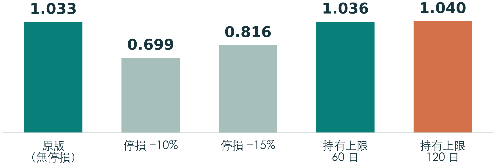

- **前幾名差距很小**：1,430 組中 23 組與最佳相差不到 0.02；截圖的 10/20/0/70 在原版排第 29（0.987）
- **只看獲利**：持有 60 日全押台積電賺 6,861 萬，但回撤 43.1%、Sharpe 1.006

<!--
【名詞加註】比例 台／鴻／聯／0050＝四檔各分多少資金，以 10% 為一格，共 286 種組合；Sharpe＝報酬除以波動；最大回撤＝從高點跌到低點的最大幅度。

表格是 AI 代理在平台外把四檔各自的每日權益依比例合併、每年再平衡後，依組合 Sharpe 選出的最佳比例。整體最佳是最長持有 120 日、100% 0050，Sharpe 1.040；原版 1.033、持有 60 日 1.036 幾乎相同。兩組停損明顯較差：停損 −10% 只有 0.699，停損 −15% 為 0.816。

我用附上的完整 1,430 列結果重新統計：和最佳值相差不到 0.02 的組合有 23 組，相差不到 0.05 的有 68 組；會議截圖中的原版最佳 10/20/0/70，在這次原版的 286 組裡排第 29，Sharpe 0.987。所以「最佳比例」不穩定，前幾名之間的差距遠小於估計誤差。

只看總獲利，最高是持有 60 日、100% 台積電：五年賺 6,861 萬（228.7%），比最佳 Sharpe 組合多約 2,133 萬，但最大回撤升到 43.1%。這和截圖「全押台積電多賺、但回撤升高」的方向一致，絕對數字不同屬預期，因為策略是依截圖描述重寫的。

最佳比例都是從同一段五年歷史挑出來的，有事後挑選偏差；這正是 DSR 這類修正要處理的問題，但它目前沒有接上 MCP。
-->

---

<!--
_class: architecture-mid
_header: 實例三 · 20 次引擎回測
_footer: 數值取自各 run 已保存的 result.json（get_run_metrics）；2021-11-09～2026-11-06
-->

## 單檔差異很大，停損讓鴻海與聯發科轉為虧損

| Sharpe／交易數 | 原版 | 停損 −10% | 停損 −15% | 持有 60 日 | 持有 120 日 |
|---|---|---|---|---|---|
| 台積電 | 0.967／7 | 0.640／7 | 0.816／7 | **1.006／19** | 0.905／12 |
| 鴻海 | 0.630／6 | −0.113／6 | −0.016／6 | 0.480／20 | 0.493／13 |
| 聯發科 | 0.377／5 | **−1.071／5** | **−1.341／5** | 0.356／19 | 0.506／14 |
| 0050 | 0.956／7 | 0.645／7 | 0.216／7 | 0.990／19 | **1.040／13** |

- **停損傷害最大的是聯發科**：兩組停損各 5 筆交易全虧，勝率 0%；原版同樣 5 筆、勝率 80%
- **持有上限增加交易數**：原版 5–7 筆；上限 60 日增為 19–20 筆，結果仍依標的而異
- **樣本仍然太小**：依診斷規則門檻（交易數 < 20），20 次中有 19 次會被標 few_trades

<!--
【名詞加註】run＝一次已保存的回測結果；交易數＝這次回測的交易筆數；勝率＝賺錢交易的比例；few_trades＝伺服器診斷規則之一，交易數少於 20 筆時提醒樣本不足。

這張表是 20 次引擎回測各自的 Sharpe 與交易數，都是伺服器保存的指標，不是平台外計算。台積電和 0050 在各種出場設定下大多為正；鴻海兩組停損轉為小幅虧損；聯發科兩組停損各 5 筆交易全部虧損，Sharpe 為 −1.071 與 −1.341，原版同樣 5 筆卻有 80% 勝率。這說明停損在急跌後反彈的標的上，會把原本會回來的部位先砍掉。

持有上限讓交易數變多：原版只有 5–7 筆，持有 60 日增加到 19–20 筆，因為部位到期就出場、之後再等下一次跌破月線。但交易多不代表結果較好，鴻海和聯發科的持有上限版本仍不如台積電與 0050。

依診斷規則頁的門檻，交易數少於 20 就會觸發 few_trades；這 20 次回測只有鴻海持有 60 日剛好 20 筆，其餘 19 次都在門檻以下。這是依表中交易數與規則門檻推算，實際診斷結果要用 get_run_diagnostics 查詢。單檔只有 5–20 筆交易，任何最佳比例都不具統計穩健性。
-->

---

<!--
_class: architecture-mid
_header: 實例三 · 整體最佳組合
_footer: 曲線由附檔最佳組合權益.npy 重繪；Sharpe 為日報酬平均 ÷ 標準差 × √252
-->

## 五年獲利 4,728 萬，但第一年先虧 26%

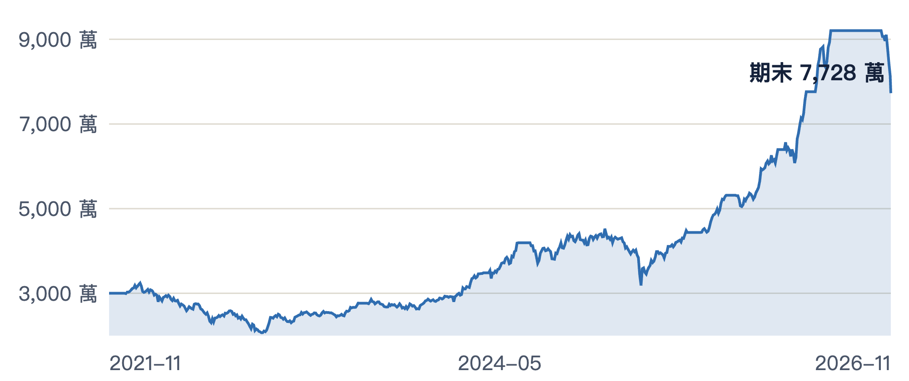

| 年度起 | 2021-11 | 2022-11 | 2023-11 | 2024-11 | 2025-11 |
|---|---|---|---|---|---|
| 損益 | **−786 萬** | 535 萬 | 1,659 萬 | 936 萬 | 2,383 萬 |
| 報酬 | **−26.2%** | 24.2% | 60.4% | 21.2% | 44.6% |

持有上限 120 日、100% 0050：Sharpe 1.040、年化 21.8%、最大回撤 36.8%

> **平台外的算法：** 四檔交易曆取聯集 1,212 根（交集 1,211 根檢查差異 < 0.001）；權益除以 3,000 萬合併；每年調回比例，成本 Σ|Δ權重| × 價值 × 0.29%

<!--
【名詞加註】權益曲線＝帳戶每天的總價值；交易曆＝有成交資料的日期；聯集／交集＝取所有標的出現過的日期，或只取共同日期；再平衡＝把比例調回目標值。

這張曲線是由附檔的權益數列重繪的，我重算過：起點 3,000 萬、終點約 7,728 萬，Sharpe 1.040、最大回撤 36.84%、年化 21.74%，和報告一致。整體最佳其實就是 0050 單檔、持有上限 120 日的結果，因為比例是 100% 0050，再平衡成本為 0。

逐年來看，第一年（2021-11 起）虧 786 萬、−26.2%，之後四年轉正，最後一年賺 2,383 萬。對投資人來說，這代表最佳組合的前提是能撐過第一年超過四分之一的虧損。

方法都在平台外：四檔日 K 的交易日不完全相同，0050 多一根 2025-08-01，主結果用聯集 1,212 根、缺棒時該帳戶權益維持不變，另用交集 1,211 根做敏感度檢查，最佳組合與 Sharpe 差異小於 0.001。每檔權益除以 3,000 萬成為單位權益後依比例合併；每滿一年調回目標比例，共 4 次，成本以調整金額乘 0.29% 概算、買賣兩側都計。這些都不是引擎模擬，伺服器提供的是各檔的每日權益（get_run_equity）。
-->

---

<!--
_class: architecture-dense
_header: 實例三 · 測試 1 投入金額（本金皆 3,000 萬）
_footer: 測試 1 引擎報告（SHA-256 02b24d1f…）；圖為計畫 A（藍）與 D（橘）的回撤；四個計畫只改 backtest.position_size
-->

## 投入金額放大報酬，也放大回撤，Sharpe 幾乎不動

| 計畫 | 每筆投入 | 總損益 | 總報酬 | 年化 | 最大回撤 | Sharpe | 會議截圖（參考） |
|---|---|---|---|---|---|---|---|
| **A** | 1,000 萬 | 780 萬 | 26.01% | 4.93% | 14.03% | 0.635 | 909 萬／+30% |
| **B** | 2,000 萬 | 1,561 萬 | 52.02% | 9.11% | 24.07% | 0.660 | 1,818 萬／+61% |
| **C** | 2,900 萬 | 2,263 萬 | 75.43% | 12.41% | 30.94% | 0.676 | 2,635 萬／+88% |
| **D** | 全額複利 | 2,986 萬 | 99.52% | 15.46% | 48.86% | 0.630 | 3,661 萬／+122% |

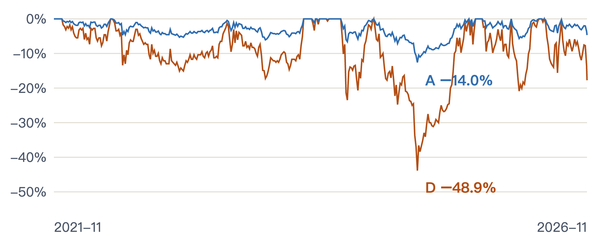

- **A、B、C 損益正好 1 : 2 : 2.9**：六筆進出場完全相同，固定名目不複利，損益和每筆投入同比例；Sharpe 只在 0.630–0.676 之間
- **唯一一筆虧損是期末強制平倉**：2026-06-11 以 260.13 買進，回測最後一天以 224.39 平倉並扣出場費；A 淨虧 143 萬、D 淨虧 994 萬

<!--
【名詞加註】名目金額＝每次下單投入的金額；全額複利＝每次用全部可用資金，賺的錢繼續投入；回撤＝權益從前高往下掉的幅度；position_size＝回測設定中每次開倉的固定金額，不設定就用全部可用資金；期末強制平倉＝回測資料結束時，以最後一根收盤價把還沒賣的部位賣掉並計入出場成本。

測試 1 用鴻海重現會議截圖中的「跌破月線買、+20% 停利」。四個計畫的本金都是 3,000 萬，策略、資料、成本完全相同，只改 backtest.position_size：A、B、C 每次新倉固定投入 1,000、2,000、2,900 萬，D 不指定金額，用當時可用資金全額投入、獲利再投入。表中數字取自測試 1 的引擎報告。

四個計畫都是同樣 6 筆交易、勝率 83.33%。A、B、C 不複利，每筆損益只和投入金額成正比，所以總損益正好 1 : 2 : 2.9；報酬率跟著放大，但 Sharpe 只在 0.630 到 0.676 之間，代表承擔的風險也同比例放大。回撤從 A 的 14.03% 一路擴大到 D 的 48.86%；圖上兩條曲線形狀相同、低點在同一天，差別只在曝險大小。計畫 D 的 48.86% 和測試 2 鴻海「原版」的最大回撤相同，因為兩者是同一組設定，兩份產出可以互相核對。

六筆中唯一虧損的是最後一筆：2026-06-11 以 260.13 買進，直到資料結束都沒碰到 +20%，引擎在 2026-11-06 以收盤 224.39 強制平倉並計入出場手續費。這筆讓 A 淨虧約 143 萬、D 淨虧約 994 萬。

最右欄是使用者提供的會議截圖數字，不是引擎計算。報告內的 LLM 評語整理了對照：交易筆數、D 的回撤量級、金額愈大報酬與回撤同步放大，這些結構一致；但金額系統性偏低。可能原因是出場語意不同（引擎以進場棒收盤 +20% 為門檻、跳空才以開盤出場，截圖描述是隔天開盤賣出），以及成本把手續費和證交稅簡化成每邊 0.29%。另外報告中的成交數量是小數股（例如 38,461.54 股），引擎沒有模擬台股整張交易單位。這次是依截圖文字重寫策略，不是重播對方原始程式，所以只能說結構一致，不能當成驗證對方結果。
-->

---

<!--
_class: architecture-mid
_header: 實例三 · generate_report 離線報告
_footer: 測試 2 引擎報告（SHA-256 ee399c18…）；基準 tw_equity_taiex_buy_and_hold：首根收盤買進、套用同樣成本、價格指數不含股利
-->

## 報告附上大盤基準，也標出哪些數字不能直接比

| 原版策略 | 累積報酬 | 年化 | 最大回撤 | Sharpe |
|---|---|---|---|---|
| 台積電 2330 | **187.29%** | 24.56% | 45.68% | **0.97** |
| 鴻海 2317 | 99.52% | 15.46% | 48.86% | 0.63 |
| 聯發科 2454 | 40.58% | 7.34% | 54.37% | 0.38 |
| 元大台灣50 0050 | **139.23%** | 19.88% | 36.38% | **0.96** |
| **^TWII 買進持有** | **124.80%** | **18.38%** | **31.63%** | **0.88** |

**對照大盤：** 只有台積電、0050 的報酬與 Sharpe 高於 ^TWII 買進持有；四檔的最大回撤都比大盤深

- **期間差一根 K 棒，就不算超額報酬**：^TWII 只對齊 1210／1211 根（0050 為 1211／1212），報告保留兩邊數值，差異欄顯示「—」
- **金額指標標為不可比**：`compare_runs` 的 `metric_compatibility`：投入金額或標的不同時，總損益、回撤金額不可比；報酬率、Sharpe 仍可比
- **LLM 評語不算計算結果**：觀察、原因假說與截圖對照都標為「非計算結果」，後端不驗證結論，也不當成回測證據

<!--
【名詞加註】基準＝拿來比較的參考投資方式；買進持有＝第一天買進、一路持有到期末；超額報酬＝策略報酬減去基準報酬；對齊＝策略和基準在同一天都有價格的 K 棒；comparable＝可以直接比較；LLM 評語＝AI 代理寫進報告的文字解讀。

這頁用的是兩份 generate_report 產生的離線 HTML：測試 1 是鴻海四個投入金額計畫，測試 2 是原版策略在四檔的結果。報告只讀已保存的 JSON 產物，不重跑策略，每份都附 SHA-256 方便核對是否被改過。

表格取自測試 2 報告。台股標的統一用台股加權指數 ^TWII 買進持有當基準，套用和回測相同的手續費與滑價。同一段期間，大盤累積報酬 124.80%、Sharpe 0.88、最大回撤 31.63%。原版策略只有台積電和 0050 的報酬與 Sharpe 高過大盤；鴻海、聯發科都比較低，而且四檔的最大回撤全部比大盤深。

報告有三個防止誤讀的設計。第一，基準行情少了一根 K 棒，比較期間不完全相同，所以報告保留兩邊數值，但不計算差異或超額報酬，表上那一欄是「—」，上面「高於大盤」是我直接看兩欄數字的判斷。第二，比較結果時，金額類指標要求標的、初始資金、position_size 都相同才可比：測試 1 因為投入金額不同、測試 2 因為標的不同，總損益和回撤金額都被標成不可比，報酬率、回撤率、Sharpe 則可以比。第三，LLM 整理的觀察、假說、下一步建議，以及和會議截圖的對照，都明確標成非計算結果，後端不驗證。
-->

---

<!-- _class: references -->

## 參考資料

- [README：安裝與使用流程](https://github.com/Kuan-Lun/tradingdev/blob/9e502ce/README.md)
- [系統架構](https://github.com/Kuan-Lun/tradingdev/blob/9e502ce/ARCHITECTURE.md)
- [策略契約與驗證](https://github.com/Kuan-Lun/tradingdev/blob/9e502ce/docs/strategy_contract.md)
- [執行計畫](https://github.com/Kuan-Lun/tradingdev/blob/9e502ce/docs/execution_plans.md)
- [執行產物與績效指標](https://github.com/Kuan-Lun/tradingdev/blob/9e502ce/docs/run_artifacts.md) · [Performance artifacts](https://github.com/Kuan-Lun/tradingdev/blob/9e502ce/docs/performance_artifacts.md)
- [ML research](https://github.com/Kuan-Lun/tradingdev/blob/9e502ce/docs/ml_research.md) · [統計研究背景：PR #38](https://github.com/Kuan-Lun/tradingdev/pull/38)

---

## 王冠倫的心得 (1/2)

- 合作專案為完善原已發布的 TradingDev
  - 經由定期會議可以讓我確認從前制定的暫時方案是否正確、業界比較常見的做法或特殊考量
- 了解挑選 LLM 模型的性質
  - 本專案開發期間會需要多次使用 LLM 來模擬使用者操作來完成整合測試，使用高階模型會錯估成功率 (使用者的 AI 代理模型品質不可控)
  - 由提示詞驅動的文件檢查需要分流以此避免 Token 過度消耗
  - 設定 AI 審查工具自動調用的參附資料範圍以此增加審查品質與降低 Token 消耗

---

## 王冠倫的心得 (2/2)

- 學習新的 AI 自動開發流程：
  - ISO/IEC/IEEE 29148:2018 確保了需求層級
    - 「規格」可以由無 MCP 伺服器時的本地思考過程抽取
    - 「需求」可以轉化成開發提示詞
    - 「驗收」可以由有無 MCP 伺服器運行時的執行差異做為基準
  - 自動發布 Issue -> 喚醒 LLM 開發後發布 PR -> 排序檢查後集中合併

<!--
投影片版型參考 docs/talks/tradingdev-introduction/theme.css。本檔使用同一 Marp theme 名稱及 cover、chapter、compact、statement、closing、references class。
-->
