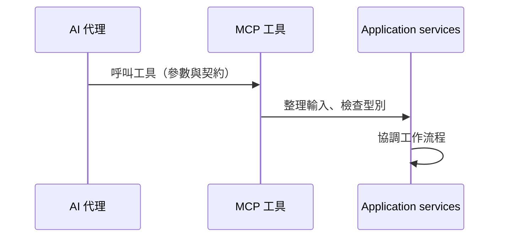
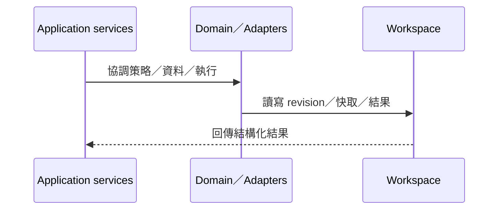
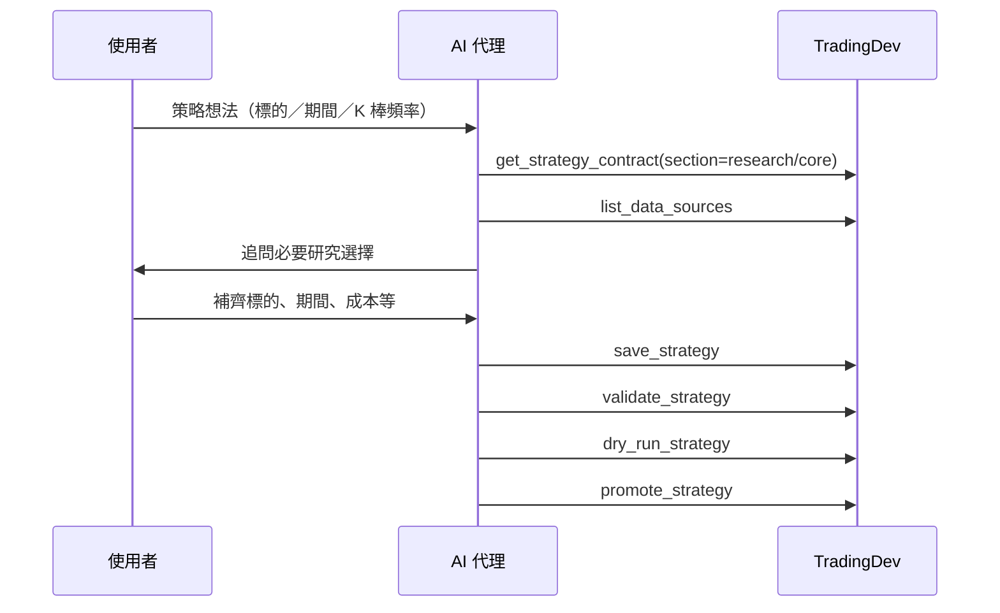
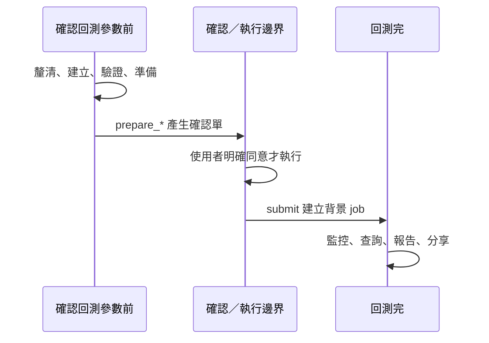
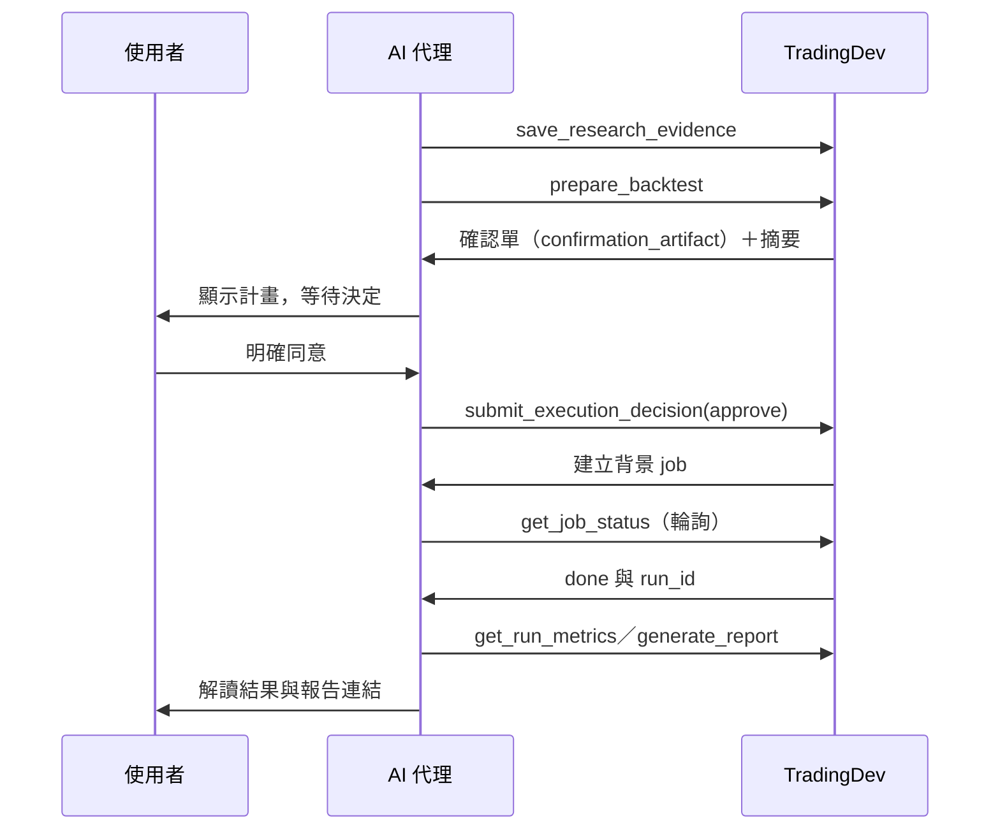
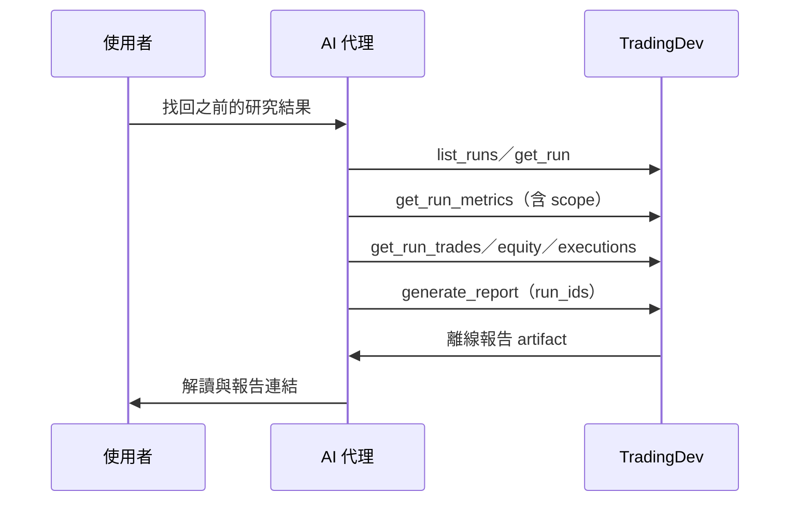
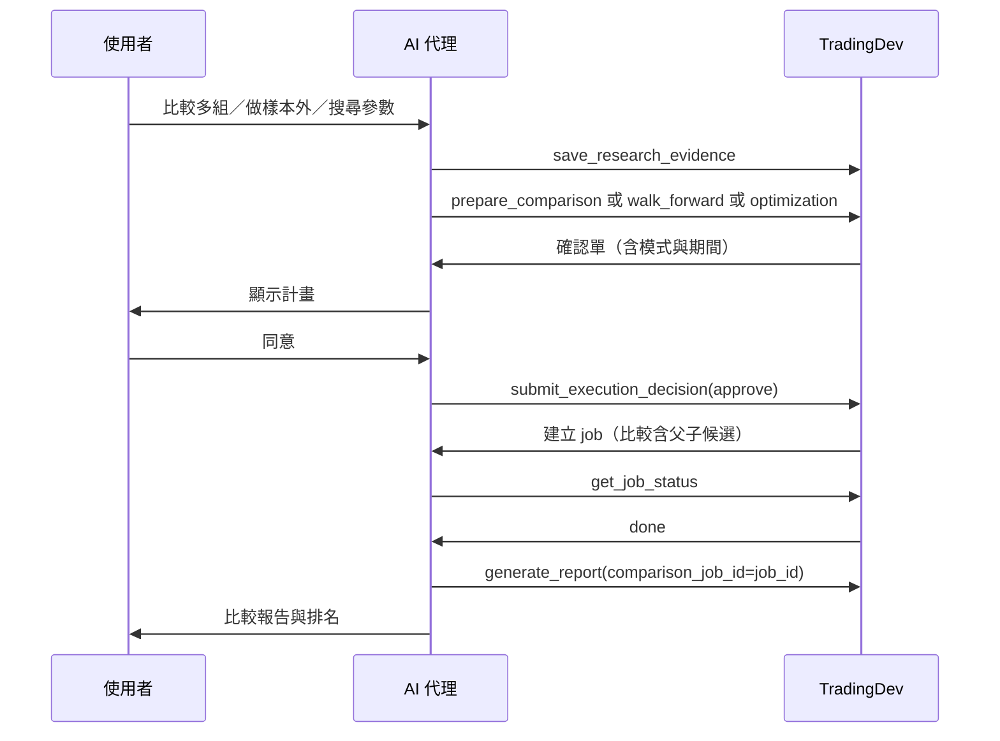
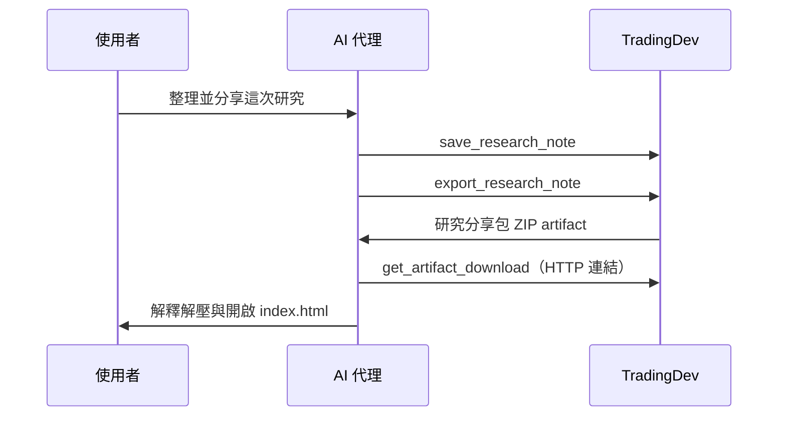

<!--
marp: true
theme: tradingdev
size: 16:9
paginate: true
lang: zh-Hant
title: TradingDev｜能學習策略開發經驗、自我演進的研究後端
description: 產品介紹、使用場景、分類比較與後續開發方向
-->

<!-- _class: cover -->

# 自動整合多人研究成果而演進的量化交易策略開發 MCP 服務

能學習策略開發經驗、自我演進的研究後端

**永豐 x CCNS** 合作專案

<!--
_footer: |-
  GitHub: [TradingDev](https://github.com/Kuan-Lun/tradingdev)\
  簡報網址：[slides.klwang.tw/tradingdev/](https://slides.klwang.tw/tradingdev/)
-->

---

<!-- _class: compact -->

## 參與成員

- **王冠倫** 國立臺灣大學資訊工程學系 博士候選人
  - 實驗室：計算理論暨金融計算實驗室 (呂育道 教授)
- xxx
  - xxx
- xxx
  - xxx
- **黃如君** 永豐銀行專案經理

---

<!-- _class: compact -->

## 閱讀路線

| 章節 | 主題 | 內容 |
| --- | --- | --- |
| 01 | [開發動機與專案定位](index.html#4) | 工具比較、工程回饋與使用情境 |
| 02 | [策略研究](index.html#11) | 角色分工、運算安排與策略實驗 |
| 03 | [後續開發方向](index.html#49) | 可獨立指定的開發目標 |
| 04 | [工具語意與邊界](index.html#52) | 註解語意、產品限制 |

<!-- _footer: "點選章名跳轉。方向鍵換頁，P 開啟講者模式。" -->

---

<!-- header: "01　開發動機與專案定位" -->
<!-- _class: chapter -->
<!-- _header: "" -->

## 01　開發動機與專案定位

研究背景、必要能力與本專案的研發定位。

---

<!-- _class: compact -->

## 開發動機與必要能力

王冠倫是臺大資工計算理論暨金融計算實驗室的一員，許多成員的研究與金融交易相關。

> **建立共用研究後端，支援成員開發各自的交易策略。**

- **實驗基礎**：在同一後端執行回測，保存可重現的設定與結果。
- **策略與模型**：支援成員建構、修改與驗證不同的量化方法。
- **策略分析與修正**：檢查策略問題，分析實驗結果，協助下一輪修正。
- **後端改進**：透過提示詞，讓 AI 代理依研究經驗提出並驗證後端改進。

<!-- _footer: "開發目標，尚未全部完成。" -->

---

<!-- _class: compact -->

## 現成工具與本專案的整合方向

| 現成工具 | 已提供的基礎 |
| --- | --- |
| VectorBT、Backtrader | 回測計算與可擴充的策略框架 |
| VectorBT PRO MCP | AI 程式研究與按需研究指引 |
| QuantConnect | 研究代理、診斷、專案記憶與共用程式庫 |

**本專案提供 AI 輔助策略開發與研究的共用後端，
並支援將研究中的共通檢查與元件整合回後端，供後續策略使用。**

<!-- _footer: "來源：[VectorBT](https://vectorbt.dev/)、[Backtrader](https://www.backtrader.com/docu/)、[VBT PRO MCP](https://vectorbt.pro/features/ai/mcp-server/)、[QC Agents](https://www.quantconnect.com/docs/v2/ai-assistance/agents)、[程式庫](https://www.quantconnect.com/docs/v2/local-platform/projects/shared-libraries) · 查核 2026-10-31" -->

---

<!-- _class: compact -->

## 為何需要自行開發 TradingDev

**自行維護 TradingDev，讓研究經驗能回饋下一次開發。**

- **案例與證據**：連結問題、修正依據與適用條件。
- **修改與驗證**：AI 代理提出檢查或元件，經跨策略測試與審查整合。
- **追蹤與評估**：保留改進版本，檢查後續研究是否減少重複錯誤。

這需要掌握**研究證據、檢查規則與版本更新流程**。

---

## 一次修正如何幫助其他研究

1. 成員 A 發現資料時間對齊錯誤，保留可重現案例。
2. 人員提示 AI 代理，提出共用檢查與測試。
3. 其他策略通過回歸驗證，審查後更新 TradingDev。
4. 成員 B 開發不同策略時，提早攔下同類錯誤。

*情境示意；減少重複錯誤的效果尚待實測。*

---

## 目前已建立的研究基礎

> TradingDev 透過 MCP，讓 AI 代理運用研究指引建立與修正策略，
> 依據檢查與實驗結果，提出可追問的分析。

- **策略實驗**：建立與修正策略，完成檢查與歷史回測。
- **ML 訊號**：提供已登錄模型的訓練、預測與評估。
- **證據保存**：連結策略版本、有效設定與實驗結果。
- **結果分析與研究筆記**：提供診斷提示、報告解讀與可續讀的研究筆記。

已建立 [軟體需求規格（SRS）](https://github.com/Kuan-Lun/tradingdev/blob/main/docs/requirements.md)，整理產品需求與驗收條件。

<!-- _footer: "現況依據：[TradingDev 使用說明](https://github.com/Kuan-Lun/tradingdev/blob/cd95d6091bbc2a46c6a58cdb326aa5df730519c4/README.md)與[架構](https://github.com/Kuan-Lun/tradingdev/blob/cd95d6091bbc2a46c6a58cdb326aa5df730519c4/ARCHITECTURE.md)" -->

---

<!-- _class: compact -->

## TradingDev 的使用情境

| 情境 | 如何使用 |
| --- | --- |
| 個人研究 | 沿用自己的 AI 代理，提出策略並追問實驗結果 |
| 教學 | 用相同題目與資料，比較規則、成本及驗證方法 |
| 研究團隊 | 沿用團隊資料與實驗格式，累積共用檢查 |
| 公司產品 | 將策略實驗接進既有 AI 網站，安排模型與收費 |

*使用情境示意；教學與團隊可先採獨立環境。
多人權限、策略隔離與集中資源管理仍待開發。*

---

<!-- header: "02　策略研究" -->
<!-- _class: chapter -->
<!-- _header: "" -->

## 02　策略研究

一個交易想法如何成為可檢查、可追問的實驗。

---

## 使用者、AI 代理與 TradingDev

| 角色 | 負責的事 |
| --- | --- |
| 使用者 | 提出目標、釐清規則、確認實驗 |
| AI 代理 | 依研究指引理解需求、撰寫與修正策略、解讀結果 |
| TradingDev | 研究流程指引、策略契約與檢查、實驗計算與證據 |

TradingDev 透過 **MCP 協定**，提供研究指引與工具給 Codex 等 AI 代理。

可直接使用既有客戶端，也可整合進自己的應用。

---

## 一次工具呼叫的內部路徑（1/2）

<!-- _class: compact diagram-short -->

MCP 工具負責協定與資料轉換；工作流程與狀態轉移由 application 層服務協調。

<!--
來源：https://github.com/Kuan-Lun/tradingdev/blob/main/ARCHITECTURE.md
來源：https://github.com/Kuan-Lun/tradingdev/blob/main/src/tradingdev/mcp/server.py
-->

---

## 一次工具呼叫的內部路徑（2/2）

<!-- _class: compact diagram-short -->

**Workspace 是獨立於程式之外的外部存放空間**（策略修訂、行情快取、執行結果），與前面各層的程式內運算層類型不同；Domain／Adapters 讀寫它，再由 MCP 回傳給 AI 代理。

<!--
來源：https://github.com/Kuan-Lun/tradingdev/blob/main/ARCHITECTURE.md
來源：https://github.com/Kuan-Lun/tradingdev/blob/main/docs/run_artifacts.md#workspace-layout
來源：https://github.com/Kuan-Lun/tradingdev/blob/main/src/tradingdev/mcp/server.py
-->

---

## TradingDev 提供的研究流程指引

1. **釐清構想**：確認交易想法、標的、期間與 K 棒頻率。
2. **開發與修復**：依策略契約撰寫，根據檢查結果修正。
3. **確認實驗**：閱讀設定，決定是否正式執行。
4. **解讀證據**：依回測與診斷比較修改差異，區分觀察、假說及限制。
5. **延續研究**：提出下一步，依需要保存研究筆記。

<!-- _footer: "來源：[執行確認流程](https://github.com/Kuan-Lun/tradingdev/blob/35d709d4ac9ed8c9d3a71a3e24cd98996bf3a1e6/README.md#完成第一次回測)" -->

---

<!-- _class: compact -->

## 開發經驗的整合與驗證

由人員選定研究案例，啟動 research-feedback Skill，讓能存取 TradingDev 原始碼的開發 AI 代理整合與驗證後端改進。

1. **挑選共通問題**：比較案例與既有元件，確認可共用範圍、保留策略假設。
2. **定義契約並整合**：明確輸入、輸出與適用條件，提供共用檢查或元件的使用入口。
3. **驗證使用端**：固定資料與設定，檢查其他策略、正常情境及既有行為。
4. **審查與版本更新**：完成獨立審查，記錄行為變更與版本，再依流程更新服務。

*跨研究採用，以及減少重複錯誤與人工工時的成效，仍待驗證。*

---

<!-- _class: compact -->

## 對話與運算的部署

對話可留在筆電，回測交給另一台主機。

| 可自行安排的部分 | 整合者的選擇 |
| --- | --- |
| 對話與模型 | 沿用個人使用的 AI 代理，或由公司提供模型及互動流程 |
| 資料與運算 | 提供自己的行情與主機，安排快取政策 |
| 研究規則與輸出 | 維護策略契約、檢查與報告呈現方式 |

*跨設備連線須設定網路轉送與存取控制。集中排程及多人隔離仍待開發。*

---

## 依研究目的選擇模式

| 模式 | 主要回答的問題 |
| --- | --- |
| **signal：資金表現** | 給定一筆起始資金，資產、報酬與回撤如何變化？ |
| **volume：交易量與成本** | 按指定交易規模運作，累計成交量、成本與金額損益如何變化？ |

*volume 不設定起始本金，金額損益不能解讀為本金報酬率。*

---

<!-- _class: compact -->
<!-- _header: "02　策略研究　／　0050 均線策略案例" -->

## 0050 均線策略：實際研究流程

> 「我想用均線來買賣 0050，可以幫我看看嗎？」

**研究條件**：0050 日 K，2024/1/1 至 7/1。

**案例內容**：在同一段會話中釐清需求、確認方案、比較結果，再討論改善與整理分享。

**研究成果**：[研究筆記](evidence/0050-taiex/cases/01-ma-discussion/notebook/index.html)、[下載研究分享包](evidence/0050-taiex/cases/01-ma-discussion/research.zip)

**過程與證據**：[完整對話](evidence/0050-taiex/cases/01-ma-discussion/conversation/index.html)、[案例總覽](evidence/0050-taiex/index.html)、[下載完整案例證據包](evidence/0050-taiex/natural-case-evidence.zip)

*下載包完整解壓後可離線閱讀；研究筆記為摘要，逐字內容由完整對話查閱。*

<!-- _footer: "真實模型回覆與 MCP 紀錄；示範操作者由 AI 代理依委託擔任。Codex CLI · gpt-6.1-sol / medium · 產品版本 4c8a665。" -->

---

<!-- _class: case-dialogue case-transcript case-options case-with-input -->
<!-- _header: "02　策略研究　／　0050 均線策略案例" -->

## 實際對話：從模糊構想開始

<!-- dialogue-message: turn-1/0 -->

操作者輸入

<!-- dialogue-text-start -->

> 我想用均線來買賣 0050，可以幫我看看嗎？

<!-- dialogue-text-end -->

<!-- dialogue-message: turn-1/1 -->

gpt-6.1-sol｜該輪最終回覆

<!-- dialogue-text-start -->

> 可以。我建議先研究「均線判斷趨勢」的方式：
>
> - **買進並持有**：短期均線高於長期均線。
> - **賣出轉空手**：短期均線低於長期均線，不做空。
>
> 這種方法可能跟上較長的漲勢，但盤整時容易反覆買賣，成本也會影響成果；目前還不能判斷是否適合 0050。
>
> 先請你選兩件事：
>
> 1\. **回測期間**：想看哪段時間？例如 2020～2025 年。
> 2\. **K 線週期**：想用日線還是週線？若偏向波段操作，我建議先從日線開始。
>
> 確認後，我會提出少量均線組合與完整回測方案供你檢視。資料可使用 Yahoo Finance 的 `0050.TW`，實際歷史涵蓋範圍仍待確認。

<!-- dialogue-text-end -->

<!-- _footer: "CLI 實際對話原文；操作者由 AI 代理依委託擔任。[本輪完整對話與工具紀錄](evidence/0050-taiex/cases/01-ma-discussion/conversation/index.html#turn-1)" -->

---

<!-- _class: compact diagram-tight -->

## UC-01（1/2）：釐清、建立與驗證策略

缺項先追問；每個 `save_strategy` 回傳 `revision_id`，驗證與執行都綁定它。

<!--
來源：[SERVER_INSTRUCTIONS 步驟 1–3](https://github.com/Kuan-Lun/tradingdev/blob/main/src/tradingdev/mcp/prompts.py)
來源：https://github.com/Kuan-Lun/tradingdev/blob/main/src/tradingdev/mcp/tools/strategy.py
-->

---

<!-- _class: case-dialogue case-transcript case-options case-with-input case-preview -->
<!-- _header: "02　策略研究　／　0050 均線策略案例" -->

## 實際對話：選定期間與日 K

<!-- dialogue-message: turn-2/0 -->

操作者輸入

<!-- dialogue-text-start -->

> 先看 2024 年 1 月 1 日到 7 月 1 日，用日 K。

<!-- dialogue-text-end -->

<!-- dialogue-message: turn-2/1 -->

gpt-6.1-sol｜該輪最終回覆（節錄；確認單由連結續讀）

<!-- dialogue-text-start -->

> 已備妥三組均線比較方案。下列 UTC 起訖時間對應台灣時間 **2024/1/1 至 7/1 全天**。請閱讀確認單，再回覆「同意」、拒絕或修改要求；TradingDev 要求確認方案後才執行歷史回測。
>
> [閱讀確認單](evidence/0050-taiex/cases/01-ma-discussion/confirmation.html)

<!-- dialogue-text-end -->

[回測確認單｜開啟完整內容](evidence/0050-taiex/cases/01-ma-discussion/confirmation.html)

<!-- _footer: "CLI 實際對話原文；操作者由 AI 代理依委託擔任。[本輪完整對話與工具紀錄](evidence/0050-taiex/cases/01-ma-discussion/conversation/index.html#turn-2)" -->

---

<!-- _class: compact diagram-slim -->

## 研究生命週期以「確認」為分界

三個分期以**確認回測參數**為界；前與後是兩個工具截然不同的世界。

分界之前只做合成檢查、不下載正式行情、不跑回測；分界之後才讀取真實結果。修改或拒絕則回到準備，需重新確認。

<!-- _footer: "來源：[SERVER_INSTRUCTIONS 步驟 4–6](https://github.com/Kuan-Lun/tradingdev/blob/main/src/tradingdev/mcp/prompts.py)" -->

---

<!-- _class: case-dialogue case-transcript case-options case-with-input -->
<!-- _header: "02　策略研究　／　0050 均線策略案例" -->

## 實際對話：閱讀後同意執行（1/2）

<!-- dialogue-message: turn-3/0 -->

操作者輸入

<!-- dialogue-text-start -->

> 我同意

<!-- dialogue-text-end -->

<!-- dialogue-message: turn-3/1 -->

gpt-6.1-sol｜該輪最終回覆

<!-- dialogue-text-start -->

> 回測完成。0050 在 **2024/1/1～7/1、日 K** 的結果如下，已含方案中的模擬手續費與滑價：
>
> | 均線組合 | 區間報酬 | 最大回撤 | 已平倉筆數 |
> | --- | ---: | ---: | ---: |
> | 5／20 日 | 28.02% | 8.16% | 1 |
> | 10／40 日 | 16.96% | 7.84% | 1 |
> | 20／60 日 | 16.50% | 7.84% | 0 |
>
> **5／20 日在這段期間報酬最高，但樣本太少，還不能認定長期最好。** 三組期末都仍持倉，報酬包含未實現損益；長均線暖機也占用了較多觀察期間。模擬成本尚未另計證交稅。
>
> [閱讀完整回測報告](evidence/0050-taiex/cases/01-ma-discussion/earlier-reports/dca6bf24d022a15c2e10f306db5c2119b85a688b0d38fdb935a0b14d255fe55c.html)

<!-- dialogue-text-end -->

<!-- _footer: "CLI 實際對話原文；操作者由 AI 代理依委託擔任。[本輪完整對話與工具紀錄](evidence/0050-taiex/cases/01-ma-discussion/conversation/index.html#turn-3)" -->

---

<!-- _class: case-dialogue case-transcript case-options case-preview case-preview-pair -->
<!-- _header: "02　策略研究　／　0050 均線策略案例" -->

## 實際對話：閱讀後同意執行（2/2）

<!-- dialogue-message: turn-3/1 -->

gpt-6.1-sol｜該輪最終回覆

<!-- dialogue-text-start -->

> 點選總覽表格或結果清單中的結果列，可進入該組參數的詳情；再以「返回」或「切換結果」查看其他組。已選取的詳情章節：設定與資料覆蓋、績效分析與保存指標、基準比較（Benchmark）、權益與回撤、委託、成交與帳戶核對、配對交易損益。所有內容保存在同一份離線 HTML。
>
> 比較工作：`7c67128548d24541b68ab39faf778075`；分析範圍：全部三組的 `full`。

<!-- dialogue-text-end -->

 

[權益與回撤｜5／20 日均線](evidence/0050-taiex/cases/01-ma-discussion/report.html#result-0-0) [QuantStats 績效分析｜5／20 日均線](evidence/0050-taiex/cases/01-ma-discussion/report.html#result-0-0)

<!-- _footer: "CLI 實際對話原文；操作者由 AI 代理依委託擔任。[本輪完整對話與工具紀錄](evidence/0050-taiex/cases/01-ma-discussion/conversation/index.html#turn-3)" -->

---

## UC-01（2/2）：準備、確認、執行與查詢

<!-- _class: compact diagram-tight -->

準備本身不執行回測；只有使用者明確同意後才提交並建立背景工作。

<!--
來源：[SERVER_INSTRUCTIONS 步驟 4–8](https://github.com/Kuan-Lun/tradingdev/blob/main/src/tradingdev/mcp/prompts.py)
來源：https://github.com/Kuan-Lun/tradingdev/blob/main/src/tradingdev/mcp/tools/execution.py
-->

---

<!-- _class: compact diagram-mid -->

## UC-03：找回歷史研究（不重跑）

以保存內容產生報告；缺少或損壞證據會明示，不悄悄重建歷史。

<!--
來源：[UC-03](https://github.com/Kuan-Lun/tradingdev/blob/main/docs/requirements.md#5-使用案例)
來源：https://github.com/Kuan-Lun/tradingdev/blob/main/src/tradingdev/mcp/tools/history.py
-->

---

<!-- _class: case-dialogue case-transcript case-options case-with-input -->
<!-- _header: "02　策略研究　／　0050 均線策略案例" -->

## 實際對話：詢問台股大盤比較（1/2）

<!-- dialogue-message: turn-4/0 -->

操作者輸入

<!-- dialogue-text-start -->

> 這三組策略跟台股大盤相比，表現如何？

<!-- dialogue-text-end -->

<!-- dialogue-message: turn-4/1 -->

gpt-6.1-sol｜該輪最終回覆

<!-- dialogue-text-start -->

> **這段期間三組都落後台股大盤，最大回撤也較大。** 以台股加權指數（`^TWII`）為基準，實際比較期間為 2024/1/2～7/1，共 118 根日 K。
>
> | 策略／基準 | 區間報酬 | 與大盤差距 | 最大回撤 |
> | --- | ---: | ---: | ---: |
> | 台股大盤基準 | 29.01% | — | 6.66% |
> | 5／20 日均線 | 28.02% | −0.99 個百分點 | 8.16% |
> | 10／40 日均線 | 16.96% | −12.05 個百分點 | 7.84% |
> | 20／60 日均線 | 16.50% | −12.51 個百分點 | 7.84% |
>
> 5／20 日最接近大盤，但本次沒有展現較低回撤的優勢。另兩組暖機較長、較晚開始交易，也會影響比較結果，不能直接推論長期表現。

<!-- dialogue-text-end -->

<!-- _footer: "CLI 實際對話原文；操作者由 AI 代理依委託擔任。[本輪完整對話與工具紀錄](evidence/0050-taiex/cases/01-ma-discussion/conversation/index.html#turn-4)" -->

---

<!-- _class: case-dialogue case-transcript case-options case-preview case-preview-compact -->
<!-- _header: "02　策略研究　／　0050 均線策略案例" -->

## 實際對話：詢問台股大盤比較（2/2）

<!-- dialogue-message: turn-4/1 -->

gpt-6.1-sol｜該輪最終回覆

<!-- dialogue-text-start -->

> 大盤基準採首根收盤買進、期末估值，套用相同模擬費率與滑價；使用的是**不含股利的價格指數**。要進一步判斷均線擇時有沒有價值，還應比較「0050 本身買入持有」。
>
> [閱讀完整比較報告](evidence/0050-taiex/cases/01-ma-discussion/report.html)
>
> 點選總覽表格或結果清單中的結果列，可進入該組參數的詳情；再以「返回」或「切換結果」查看其他組。已選取的詳情章節：設定與資料覆蓋、績效分析與保存指標、基準比較（Benchmark）、權益與回撤、委託、成交與帳戶核對、配對交易損益。所有內容保存在同一份離線 HTML。
>
> 比較工作：`7c67128548d24541b68ab39faf778075`；範圍：三組 `full`。

<!-- dialogue-text-end -->

[台股大盤比較｜5／20 日均線](evidence/0050-taiex/cases/01-ma-discussion/report.html#result-0-0) · [基準資料](evidence/0050-taiex/cases/01-ma-discussion/benchmark.json)

<!-- _footer: "CLI 實際對話原文；操作者由 AI 代理依委託擔任。[本輪完整對話與工具紀錄](evidence/0050-taiex/cases/01-ma-discussion/conversation/index.html#turn-4)" -->

---

<!-- _class: compact diagram-dense -->

## UC-02：比較、Walk-forward 與最佳化

三種 `prepare_*` 回答不同問題；最佳化結果不直接等同樣本外保證。

<!--
來源：[UC-02](https://github.com/Kuan-Lun/tradingdev/blob/main/docs/requirements.md#5-使用案例)
來源：https://github.com/Kuan-Lun/tradingdev/blob/main/src/tradingdev/mcp/tools/execution.py
-->

---

<!-- _class: case-dialogue case-transcript case-options case-with-input -->
<!-- _header: "02　策略研究　／　0050 均線策略案例" -->

## 實際對話：討論改善方向（1/2）

<!-- dialogue-message: turn-5/0 -->

操作者輸入

<!-- dialogue-text-start -->

> 如果要改善這個策略，你會怎麼建議？

<!-- dialogue-text-end -->

<!-- dialogue-message: turn-5/1 -->

gpt-6.1-sol｜該輪最終回覆

<!-- dialogue-text-start -->

> 我會優先改善「驗證方式與風險控制」，目前還不急著調出另一組均線。這次只有半年資料、各組僅 0～1 筆已平倉交易，證據還太少。
>
> 建議依序做：
>
> 1\. **先比較 0050 買入持有**
> 目前比較的是加權指數。加入 0050 本身的基準，才能看出均線進出的貢獻。
>
> 2\. **統一暖機，再拉長測試期間**
> 在評估開始前提供足夠資料計算均線，讓三組從同一天開始比較；再涵蓋上漲、下跌與盤整期間，保留一段資料做樣本外驗證。

<!-- dialogue-text-end -->

<!-- _footer: "CLI 實際對話原文；操作者由 AI 代理依委託擔任。[本輪完整對話與工具紀錄](evidence/0050-taiex/cases/01-ma-discussion/conversation/index.html#turn-5)" -->

---

<!-- _class: case-dialogue case-transcript case-options -->
<!-- _header: "02　策略研究　／　0050 均線策略案例" -->

## 實際對話：討論改善方向（2/2）

<!-- dialogue-message: turn-5/1 -->

gpt-6.1-sol｜該輪最終回覆

<!-- dialogue-text-start -->

> 3\. **一次只測一種規則改善**
> 我會先測「短均線連續兩天低於長均線才賣出」，觀察能否減少短暫跌破造成的反覆交易。代價是出場較慢，可能承受更大跌幅，效果仍待驗證。
>
> 4\. **補齊實際交易成本**
> 納入證交稅、券商最低手續費與整股限制，確認改善後的收益是否留得住。
>
> **我會先保留 5／20 日作為研究起點，再與加入兩天出場確認的版本比較。** 它只是本次最接近大盤的組合，尚未證明長期較好；評估時應同時看報酬、回撤與交易次數。以上尚未執行新回測。

<!-- dialogue-text-end -->

<!-- _footer: "CLI 實際對話原文；操作者由 AI 代理依委託擔任。[本輪完整對話與工具紀錄](evidence/0050-taiex/cases/01-ma-discussion/conversation/index.html#turn-5)" -->

---

<!-- _class: case-dialogue case-transcript case-options case-with-input -->
<!-- _header: "02　策略研究　／　0050 均線策略案例" -->

## 實際對話：整理研究與分享

<!-- dialogue-message: turn-6/0 -->

操作者輸入

<!-- dialogue-text-start -->

> 幫我把這次的研究整理好，讓我能分享給別人。

<!-- dialogue-text-end -->

<!-- dialogue-message: turn-6/1 -->

gpt-6.1-sol｜該輪最終回覆

<!-- dialogue-text-start -->

> 已整理成**第 1 版研究分享包**，包含研究設定、三組回測、大盤比較、完整報告，以及尚未驗證的改善建議。
>
> [下載研究分享包 ZIP](evidence/0050-taiex/cases/01-ma-discussion/research.zip)
>
> 將整份 ZIP 分享給對方，**完整解壓後開啟 `index.html`**；保留 `reports/` 資料夾即可離線閱讀完整報告。
>
> 摘要已清楚標示主要結論：這段期間三組均落後大盤，且交易樣本少，不能據此認定長期優劣。

<!-- dialogue-text-end -->

<!-- _footer: "CLI 實際對話原文；操作者由 AI 代理依委託擔任。[本輪完整對話與工具紀錄](evidence/0050-taiex/cases/01-ma-discussion/conversation/index.html#turn-6)" -->

---

<!-- _class: compact diagram-mid -->

## UC-05：保存與分享研究

研究筆記為摘要，非逐字紀錄；分享包完整解壓後離線可讀。

<!--
來源：[UC-05](https://github.com/Kuan-Lun/tradingdev/blob/main/docs/requirements.md#5-使用案例)
來源：https://github.com/Kuan-Lun/tradingdev/blob/main/src/tradingdev/mcp/tools/research_notes.py
-->

---

<!-- _class: compact -->

## 五個研究目的，對應不同工具群

- **把構想變成可執行策略**：`strategy` 群（建立、修訂、驗證、提升）。
- **把策略跑成可信實驗**：`execution` 與 `jobs` 群（準備、確認、執行、監控）。
- **把結果看清楚並能比較**：`runs`、`history`、`artifacts` 群（查詢、分析、報告、交付）。
- **把行情與特徵準備好**：`data` 與 `ml` 群（快取、獨立訊號研究）。
- **把研究留下來並能分享**：`research_notes`、`feature_requests`、`strategy_cleanup` 群。

**代理在每個目的下都先看再寫：先用唯讀工具確認，再用寫入工具推進。**

<!-- _footer: "來源：[SERVER_INSTRUCTIONS 九步流程](https://github.com/Kuan-Lun/tradingdev/blob/main/src/tradingdev/mcp/prompts.py)" -->

---

<!-- _class: compact -->

## 依研究目的劃分的工具群（1/2）

| 工具群 | 研究目的 | 工具數 | 讀寫 |
| --- | --- | ---: | --- |
| Strategy | 把構想寫成可檢查、可執行的策略 | 7 | 3 讀 / 4 寫 |
| Execution | 固定研究條件並產生可確認的計畫 | 8 | 1 讀 / 7 寫 |
| Data | 取得或確認行情與特徵資料 | 4 | 3 讀 / 1 寫 |
| Jobs | 追蹤與管理背景工作 | 3 | 1 讀 / 2 寫 |
| Runs | 查詢已保存的回測結果與指標 | 5 | 5 讀 |
| History | 讀取交易紀錄、診斷與組裝報告 | 8 | 7 讀 / 1 寫 |

<!-- _footer: "數量依 @mcp.tool 裝飾函式統計；讀寫以 ToolAnnotations.read_only_hint 為準。" -->

---

<!-- _class: compact -->

## 依研究目的劃分的工具群（2/2）

| 工具群 | 研究目的 | 工具數 | 讀寫 |
| --- | --- | ---: | --- |
| Artifacts | 列出與交付已保存產物 | 3 | 3 讀 |
| Research Notes | 留下可續讀的研究筆記 | 4 | 2 讀 / 2 寫 |
| Feature Requests | 記錄暫不支援的能力 | 2 | 1 讀 / 1 寫 |
| Strategy Cleanup | 預覽並清理未用草稿 | 1 | 1 寫 |
| ML | 獨立訓練與評估訊號 | 7 | 3 讀 / 4 寫 |
| **合計** | — | **52** | **29 讀 / 23 寫** |

<!-- _footer: "數量依 @mcp.tool 裝飾函式統計；讀寫以 ToolAnnotations.read_only_hint 為準。" -->

---

<!-- _class: statement -->

## 目前共 52 個 MCP 工具

> **29 個唯讀工具、23 個會建立或變更狀態的工具。**

工具依責任分成 11 群；同一群內同時有讀取與寫入，方便代理在對話中反覆查詢與遞進修改。

<!--
數量依 src/tradingdev/mcp/tools/ 各模組的 @mcp.tool 裝飾函式統計；隨版本增減。
來源：https://github.com/Kuan-Lun/tradingdev/blob/main/src/tradingdev/mcp/tools/
-->

---

<!-- _class: compact -->

## 這 52 個工具分在哪裡（1/2）

| 模組 | 工具數 | 主要責任 |
| --- | ---: | --- |
| `strategy` | 7 | 建立、修訂、查詢與驗證策略 |
| `execution` | 8 | 準備回測、比較、Walk-forward、最佳化與確認 |
| `data` | 4 | 探索、查詢與快取行情 |
| `jobs` | 3 | 查詢與管理背景工作 |
| `runs` | 5 | 查詢回測結果、指標與比較 |
| `history` | 8 | 交易紀錄、診斷與報告 |

<!-- _footer: "來源：https://github.com/Kuan-Lun/tradingdev/blob/main/src/tradingdev/mcp/tools/" -->

---

<!-- _class: compact -->

## 這 52 個工具分在哪裡（2/2）

| 模組 | 工具數 | 主要責任 |
| --- | ---: | --- |
| `artifacts` | 3 | 列出與交付已保存產物 |
| `research_notes` | 4 | 保存與匯出研究筆記 |
| `feature_requests` | 2 | 記錄未支援能力 |
| `strategy_cleanup` | 1 | 預覽與清理草稿 |
| `ml` | 7 | 獨立資料集、模型、訊號評估與排名 |

前 6 群負責「把構想與研究條件變成可執行物件」；後 5 群負責「把結果留下並可分享」。共 11 群、52 個工具。

<!-- _footer: "來源：https://github.com/Kuan-Lun/tradingdev/blob/main/src/tradingdev/mcp/tools/" -->

---

<!-- _class: compact -->

## 五個使用案例對應的工具流程（1/2）

| 案例 | 觸發的階段 | 關鍵寫入工具 |
| --- | --- | --- |
| UC-01 從構想到回測 | 釐清 → 建立 → 驗證 → 準備 → 確認 → 執行 → 查詢 | `save_strategy`、`prepare_backtest`、`submit_execution_decision` |
| UC-02 比較與樣本外研究 | 準備比較／Walk-forward／最佳化 → 確認 → 執行 | `prepare_comparison` / `walk_forward` / `optimization` |
| UC-03 找回歷史研究 | 查詢 → 報告（不重跑） | `generate_report`（run_ids） |

<!-- _footer: "來源：https://github.com/Kuan-Lun/tradingdev/blob/main/docs/requirements.md#5-使用案例" -->

---

<!-- _class: compact -->

## 五個使用案例對應的工具流程（2/2）

| 案例 | 觸發的階段 | 關鍵寫入工具 |
| --- | --- | --- |
| UC-04 獨立 ML 訊號研究 | 合約 → 資料 → 資料集 → 訓練 → 評估 → 排名 | `build_dataset`、`train_model`、`evaluate_signal` |
| UC-05 保存與分享 | 筆記 → 匯出 → 交付 | `save_research_note`、`export_research_note` |

五個案例都遵循「先唯讀確認、再明確同意後寫入」；UC-03 不重跑回測，UC-04 走獨立 ML 軌道。

<!-- _footer: "來源：https://github.com/Kuan-Lun/tradingdev/blob/main/docs/requirements.md#5-使用案例" -->

---

<!-- _class: compact stage-tbl -->

## 分期與階段：執行前（1/2）

| 分期 | 研究階段 | 主要工具 |
| --- | --- | --- |
| 執行前 | 需求釐清 | `get_strategy_contract`、`list_data_sources`、`list_strategies`、`get_strategy` |
| 執行前 | 策略建立與驗證 | `save_strategy`、`validate_strategy`、`dry_run_strategy`、`promote_strategy` |

取得確認回測參數前，代理交錯呼叫多個階段；**只做合成檢查，不下載正式行情、不跑回測**。

`get_strategy_contract`、`list_data_sources`、`get_artifact`(_download) 為跨鄰近階段重複呼叫的參考與交付工具；其餘工具依主要階段歸屬，各階段不會完全重疊。

<!-- _footer: "來源：[requirements.md 使用案例](https://github.com/Kuan-Lun/tradingdev/blob/main/docs/requirements.md#5-使用案例) · [SERVER_INSTRUCTIONS](https://github.com/Kuan-Lun/tradingdev/blob/main/src/tradingdev/mcp/prompts.py)" -->

---

<!-- _class: compact stage-tbl -->

## 分期與階段：執行前（2/2）

| 分期 | 研究階段 | 主要工具 |
| --- | --- | --- |
| 執行前 | 資料準備 | `list_available_data`、`inspect_dataset`、`ensure_data` |
| 執行前 | 執行準備與確認 | `save_research_evidence`、`prepare_backtest` / `comparison` / `walk_forward` / `optimization`、`get_execution_plan`、`submit_execution_decision`、`cancel_execution_plan` |

這一階段以 `prepare_*` 產生確認單，等待使用者明確同意；**準備本身不執行回測**。

<!-- _footer: "來源：[requirements.md 使用案例](https://github.com/Kuan-Lun/tradingdev/blob/main/docs/requirements.md#5-使用案例) · [SERVER_INSTRUCTIONS](https://github.com/Kuan-Lun/tradingdev/blob/main/src/tradingdev/mcp/prompts.py)" -->

---

<!-- _class: compact stage-tbl -->

## 分期與階段：執行中／後（1/2）

| 分期 | 研究階段 | 主要工具 |
| --- | --- | --- |
| 執行中 | 執行監控 | `get_job_status`、`list_jobs`、`cancel_job` |
| 執行後 | 結果查詢與分析 | `list_runs`、`get_run`、`get_run_metrics`、`get_metric_catalog`、`compare_runs`、`find_runs`、`get_run_trades` / `equity` / `executions` / `account_history`、`get_run_diagnostics` |

確認後才讀取真實結果；此分期的工具多為唯讀，與執行前以寫入為主明顯不同。

<!-- _footer: "來源：[requirements.md 使用案例](https://github.com/Kuan-Lun/tradingdev/blob/main/docs/requirements.md#5-使用案例) · [SERVER_INSTRUCTIONS](https://github.com/Kuan-Lun/tradingdev/blob/main/src/tradingdev/mcp/prompts.py)" -->

---

<!-- _class: compact stage-tbl -->

## 分期與階段：執行後（2/2）與獨立軌道

| 分期 | 研究階段 | 主要工具 |
| --- | --- | --- |
| 執行後 | 報告與交付 | `get_report_sections`、`generate_report`、`list_artifacts`、`get_artifact`(_download) |
| 執行後 | 保存與分享 | `save_research_note`、`get_research_notes`、`export_research_note`、`get_research_archive`、`record_feature_request`、`list_feature_requests`、`cleanup_strategy_drafts` |
| 獨立軌道 | ML 訊號研究 | `get_ml_contract`、`build_dataset` / `build_panel`、`train_model`、`predict`、`evaluate_signal`、`leaderboard` |

<!-- _footer: "來源：[requirements.md 使用案例](https://github.com/Kuan-Lun/tradingdev/blob/main/docs/requirements.md#5-使用案例) · [SERVER_INSTRUCTIONS](https://github.com/Kuan-Lun/tradingdev/blob/main/src/tradingdev/mcp/prompts.py)" -->

---

<!-- _class: compact -->

## 確認前：代理在執行前交錯呼叫多群工具

以 UC-01「從構想到回測」為例，代理在**確認回測參數之前**依序穿過多個階段：

1. **釐清**：`get_strategy_contract`、`list_data_sources` 確認選擇與能力。
2. **建立與驗證**：`save_strategy` → `validate_strategy` → `dry_run_strategy` → `promote_strategy`。
3. **準備與確認**：`save_research_evidence` → `prepare_backtest` → `get_execution_plan`。
4. **執行與監控**：`submit_execution_decision` → `get_job_status`。
5. **查詢與報告**：`get_run_metrics` → `generate_report` → `get_artifact_download`。

**寫入工具一律在前一步的唯讀確認之後才呼叫。**

<!-- _footer: "來源：[UC-01 正常流程](https://github.com/Kuan-Lun/tradingdev/blob/main/docs/requirements.md#5-使用案例)" -->

---

<!-- _class: compact diagram-mid -->

## UC-04：獨立 ML 訊號研究

```mermaid
sequenceDiagram
    accTitle: UC-04 獨立 ML 訊號研究
    participant U as 使用者
    participant A as AI 代理
    participant T as TradingDev
    U->>A: 想做獨立訊號研究
    A->>T: get_ml_contract
    A->>T: ensure_data（明確下載）
    A->>T: build_dataset／build_panel
    A->>T: train_model
    A->>T: predict
    A->>T: evaluate_signal(record=true)
    A->>T: leaderboard
    A->>U: 評估與排名
```

ML 研究是同步獨立介面，不會自動轉成交易策略或建立一般回測 run。

<!--
來源：[UC-04](https://github.com/Kuan-Lun/tradingdev/blob/main/docs/requirements.md#5-使用案例)
來源：https://github.com/Kuan-Lun/tradingdev/blob/main/src/tradingdev/mcp/tools/ml.py
-->

---

<!-- header: "03　後續開發方向" -->
<!-- _class: chapter -->
<!-- _header: "" -->

## 03　後續開發方向

以現有成果為基礎，安排下一階段的開發與驗證。

---

<!-- _class: compact -->

## 目前提供與後續擴充

| 已提供 | 後續方向 |
| --- | --- |
| 固定參數批次執行、歷史結果比較與排序 | 依跨實驗證據選擇下一個實驗 |
| 規則式診斷、AI 解讀與研究建議 | 市場情境與波動敏感度診斷 |
| 研究筆記、報告引用、續讀與匯出 | 跨研究自動檢索與假說追蹤 |
| 各次回測獨立記錄設定、成本與結果 | 多策略組合與資金配置 |
| 工程回饋 Skill 與 TradingDev 整合基礎 | 跨研究採用與成效驗證 |
| HTTP／Docker 部署、策略及實驗編號 | 多人權限與策略隔離 |

*後續項目尚未完成，開發時程未定。*

<!-- _footer: "現況查核：2026-11-05／[TradingDev 7e7a997](https://github.com/Kuan-Lun/tradingdev/tree/7e7a997c67a6e9765b124c80286ddc75f8b506d7)" -->

---

<!-- header: "03　後續開發方向" -->

## 依使用場合決定優先序

| 使用場合 | 優先處理 |
| --- | --- |
| 個人反覆研究 | 進階診斷、實驗引導與跨研究檢索 |
| 團隊共享開發經驗 | 共用元件採用與工程回饋成效驗證 |
| 多個策略一起評估 | 組合分析與配置模型 |
| 對外提供多人服務 | 身分、權限與執行隔離 |

對話介面、模型路由與計費可留在整合層。
真實下單維持目前產品邊界之外。

---

<!-- header: "04　工具語意與邊界" -->
<!-- _class: chapter -->
<!-- _header: "" -->

## 04　工具語意與邊界

AI 代理能叫到哪些「種類」的工具，以及工具不能保證什麼。

<!--
註解語意來自 mcp_types.ToolAnnotations；限制來自 requirements.md 與架構文件。
-->

---

<!-- _class: compact -->

## 工具註解告訴代理「這是哪一類工具」

每個工具帶有四個 hint，協助代理決定呼叫時機與風險：

- **read_only_hint**：只讀取、不變更伺服器狀態（`list_*`、`get_*`）。
- **destructive_hint**：可能建立、覆寫或刪除（`save_strategy`、`ensure_data`、`cleanup_strategy_drafts`）。
- **idempotent_hint**：重複呼叫結果一致（`get_*`、`promote_strategy`、`generate_report`）。
- **open_world_hint**：可能執行生成程式或存取外部資料（`validate_strategy`、`ensure_data`）。

**hint 是對代理的提示，不代表後端已證明行為；權限仍由後端強制。**

<!-- _footer: "來源：https://github.com/Kuan-Lun/tradingdev/blob/main/src/tradingdev/mcp/tools/" -->

---

<!-- _class: compact -->

## 工具能做的與不能保證的

- TradingDev 研究歷史資料，**不提供真實下單**。
- 生成程式的檢查在 Linux 容器中執行，**不是完整安全 sandbox**。
- `prepare_*` 只做合成檢查，**不預測真實績效、不下載正式行情**。
- 確認單的「初始請求」不代表同意；**只有明確同意才提交執行**。
- 指標受資料頻率、成本假設限制；**缺失值不是零，也不重建歷史**。

<!--
來源：[requirements.md 限制](https://github.com/Kuan-Lun/tradingdev/blob/main/docs/requirements.md#10-限制與假設)
來源：[架構保證與限制](https://github.com/Kuan-Lun/tradingdev/blob/main/ARCHITECTURE.md)
-->

---

<!-- _class: closing -->
<!-- _header: "" -->

## TradingDev 的工具設計

把工具分成 **11 群、52 個 MCP 工具**，對應從構想到分享的 **三個分期、九個研究階段**；
AI 代理依對話觸發對應工具，先以唯讀確認、再於明確同意後執行。

<!--
以明確輸入、確認計畫、固定 manifest 及保存的 artifacts 支援重現與後續比較；
這不代表策略結果已被證明有效。
-->

---

<!-- _class: references -->

## 參考資料

- [軟體需求規格（SRS）](https://github.com/Kuan-Lun/tradingdev/blob/main/docs/requirements.md)
- [MCP server 註冊與服務組裝](https://github.com/Kuan-Lun/tradingdev/blob/main/src/tradingdev/mcp/server.py)
- [工具模組（strategy / execution / data / jobs / runs / history / artifacts / research_notes / feature_requests / strategy_cleanup / ml）](https://github.com/Kuan-Lun/tradingdev/blob/main/src/tradingdev/mcp/tools/)
- [SERVER_INSTRUCTIONS 九步工作流](https://github.com/Kuan-Lun/tradingdev/blob/main/src/tradingdev/mcp/prompts.py)
- [系統架構](https://github.com/Kuan-Lun/tradingdev/blob/main/ARCHITECTURE.md)

<!--
投影片版型參考 docs/talks/tradingdev-introduction/theme.css。本檔使用同一 Marp theme 名稱及 cover、chapter、compact、statement、closing、references class。
-->

---

## 王冠倫的心得 (1/2)

- 合作專案為完善原已發布的 TradingDev
  - 經由定期會議可以讓我確認從前制定的暫時方案是否正確、業界比較常見的做法或特殊考量
- 了解挑選 LLM 模型的性質
  - 本專案開發期間會需要多次使用 LLM 來模擬使用者操作來完成整合測試，使用高階模型會錯估成功率 (使用者的 AI 代理模型品質不可控)
  - 由提示詞驅動的文件檢查需要分流以此避免 Token 過度消耗
  - 設定 AI 審查工具自動調用的參附資料範圍以此增加審查品質與降低 Token 消耗

---

## 王冠倫的心得 (2/2)

- 學習新的 AI 自動開發流程：
  - ISO/IEC/IEEE 29148:2018 確保了需求層級
    - 「規格」可以由無 MCP 伺服器時的本地思考過程抽取
    - 「需求」可以轉化成開發提示詞
    - 「驗收」可以由有無 MCP 伺服器運行時的執行差異做為基準
  - 自動發布 Issue -> 喚醒 LLM 開發後發布 PR -> 排序檢查後集中合併

<!--
投影片版型參考 docs/talks/tradingdev-introduction/theme.css。本檔使用同一 Marp theme 名稱及 cover、chapter、compact、statement、closing、references class。
-->
