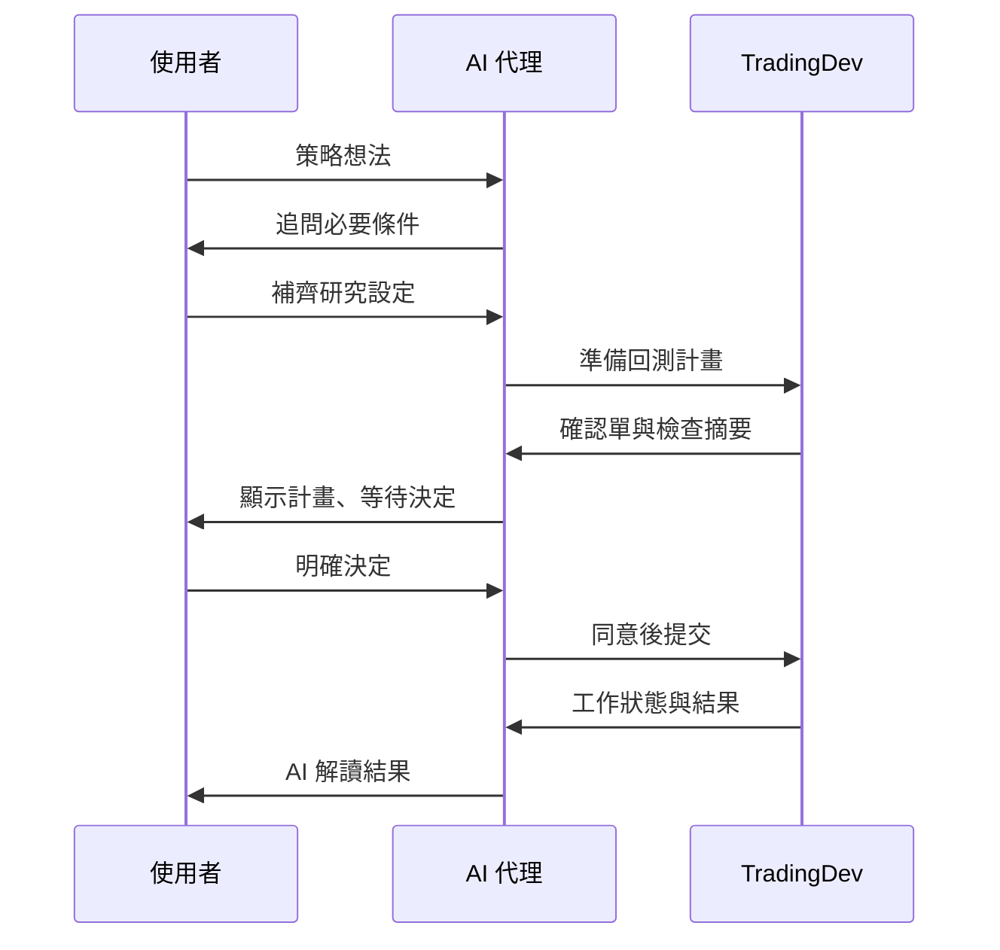
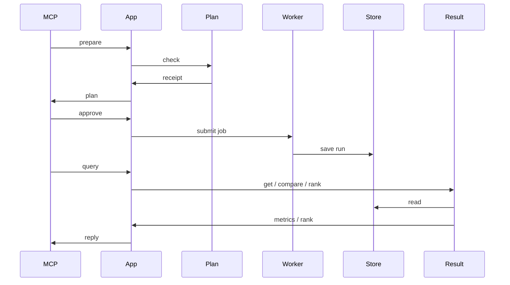

<!--
marp: true
theme: tradingdev
size: 16:9
paginate: true
lang: zh-Hant
title: TradingDev｜能學習策略開發經驗、自我演進的研究後端
description: 產品介紹、使用場景、分類比較與後續開發方向
-->

<!-- _class: cover -->

# 自動整合多人研究成果而演進的量化交易策略開發 MCP 服務

能學習策略開發經驗、自我演進的研究後端

**永豐 x CCNS** 合作專案

<!--
_footer: |-
  GitHub: [TradingDev](https://github.com/Kuan-Lun/tradingdev)\
  簡報網址：[slides.klwang.tw/tradingdev/](https://slides.klwang.tw/tradingdev/)
-->

---

<!-- _class: compact -->

## 參與成員

* **王冠倫** 國立臺灣大學資訊工程學系 博士候選人
  * 實驗室：計算理論暨金融計算實驗室 (呂育道 教授)
* xxx
  * xxx
* xxx
  * xxx
* **黃如君** 永豐銀行專案經理

---

<!-- _class: compact -->

## 閱讀路線

| 章節 | 主題 | 內容 |
| --- | --- | --- |
| 01 | [開發動機與專案定位](index.html#3) | 工具比較、工程回饋與使用情境 |
| 02 | [策略研究](index.html#10) | 角色分工、運算安排與策略實驗 |
| 03 | [後續開發方向](index.html#26) | 可獨立指定的開發目標 |

<!-- _footer: "點選章名跳轉。方向鍵換頁，P 開啟講者模式。" -->

---

<!-- header: "01　開發動機與專案定位" -->
<!-- _class: chapter -->
<!-- _header: "" -->

## 01　開發動機與專案定位

研究背景、必要能力與本專案的研發定位。

---

<!-- _class: compact -->

## 開發動機與必要能力

王冠倫是臺大資工計算理論暨金融計算實驗室的一員，許多成員的研究與金融交易相關。

> **建立共用研究後端，支援成員開發各自的交易策略。**

* **實驗基礎**：在同一後端執行回測，保存可重現的設定與結果。
* **策略與模型**：支援成員建構、修改與驗證不同的量化方法。
* **策略分析與修正**：檢查策略問題，分析實驗結果，協助下一輪修正。
* **後端改進**：透過提示詞，讓 AI 代理依研究經驗提出並驗證後端改進。

<!-- _footer: "開發目標，尚未全部完成。" -->

---

<!-- _class: compact -->

## 現成工具與本專案的整合方向

| 現成工具 | 已提供的基礎 |
| --- | --- |
| VectorBT、Backtrader | 回測計算與可擴充的策略框架 |
| VectorBT PRO MCP | AI 程式研究與按需研究指引 |
| QuantConnect | 研究代理、診斷、專案記憶與共用程式庫 |

**本專案提供 AI 輔助策略開發與研究的共用後端，
並支援將研究中的共通檢查與元件整合回後端，供後續策略使用。**

<!-- _footer: "來源：[VectorBT](https://vectorbt.dev/)、[Backtrader](https://www.backtrader.com/docu/)、[VBT PRO MCP](https://vectorbt.pro/features/ai/mcp-server/)、[QC Agents](https://www.quantconnect.com/docs/v2/ai-assistance/agents)、[程式庫](https://www.quantconnect.com/docs/v2/local-platform/projects/shared-libraries) · 查核 2026-10-31" -->

---

<!-- _class: compact -->

## 為何需要自行開發 TradingDev

**自行維護 TradingDev，讓研究經驗能回饋下一次開發。**

* **案例與證據**：連結問題、修正依據與適用條件。
* **修改與驗證**：AI 代理提出檢查或元件，經跨策略測試與審查整合。
* **追蹤與評估**：保留改進版本，檢查後續研究是否減少重複錯誤。

這需要掌握**研究證據、檢查規則與版本更新流程**。

---

## 一次修正如何幫助其他研究

1. 成員 A 發現資料時間對齊錯誤，保留可重現案例。
2. 人員提示 AI 代理，提出共用檢查與測試。
3. 其他策略通過回歸驗證，審查後更新 TradingDev。
4. 成員 B 開發不同策略時，提早攔下同類錯誤。

*情境示意；減少重複錯誤的效果尚待實測。*

---

## 目前已建立的研究基礎

> TradingDev 透過 MCP，讓 AI 代理運用研究指引建立與修正策略，
> 依據檢查與實驗結果，提出可追問的分析。

* **策略實驗**：建立與修正策略，完成檢查與歷史回測。
* **ML 訊號**：提供已登錄模型的訓練、預測與評估。
* **證據保存**：連結策略版本、有效設定與實驗結果。
* **結果分析與研究筆記**：提供診斷提示、報告解讀與可續讀的研究筆記。

已建立 [軟體需求規格（SRS）](https://github.com/Kuan-Lun/tradingdev/blob/main/docs/requirements.md)，整理產品需求與驗收條件。

<!-- _footer: "現況依據：[TradingDev 使用說明](https://github.com/Kuan-Lun/tradingdev/blob/cd95d6091bbc2a46c6a58cdb326aa5df730519c4/README.md)與[架構](https://github.com/Kuan-Lun/tradingdev/blob/cd95d6091bbc2a46c6a58cdb326aa5df730519c4/ARCHITECTURE.md)" -->

---

<!-- _class: compact -->

## TradingDev 的使用情境

| 情境 | 如何使用 |
| --- | --- |
| 個人研究 | 沿用自己的 AI 代理，提出策略並追問實驗結果 |
| 教學 | 用相同題目與資料，比較規則、成本及驗證方法 |
| 研究團隊 | 沿用團隊資料與實驗格式，累積共用檢查 |
| 公司產品 | 將策略實驗接進既有 AI 網站，安排模型與收費 |

*使用情境示意；教學與團隊可先採獨立環境。
多人權限、策略隔離與集中資源管理仍待開發。*

---

<!-- header: "02　策略研究" -->
<!-- _class: chapter -->
<!-- _header: "" -->

## 02　策略研究

一個交易想法如何成為可檢查、可追問的實驗。

---

## 使用者、AI 代理與 TradingDev

| 角色 | 負責的事 |
| --- | --- |
| 使用者 | 提出目標、釐清規則、確認實驗 |
| AI 代理 | 依研究指引理解需求、撰寫與修正策略、解讀結果 |
| TradingDev | 研究流程指引、策略契約與檢查、實驗計算與證據 |

TradingDev 透過 **MCP 協定**，提供研究指引與工具給 Codex 等 AI 代理。

可直接使用既有客戶端，也可整合進自己的應用。

---

## TradingDev 提供的研究流程指引

1. **釐清構想**：確認交易想法、標的、期間與 K 棒頻率。
2. **開發與修復**：依策略契約撰寫，根據檢查結果修正。
3. **確認實驗**：閱讀設定，決定是否正式執行。
4. **解讀證據**：依回測與診斷比較修改差異，區分觀察、假說及限制。
5. **延續研究**：提出下一步，依需要保存研究筆記。

<!-- _footer: "來源：[執行確認流程](https://github.com/Kuan-Lun/tradingdev/blob/35d709d4ac9ed8c9d3a71a3e24cd98996bf3a1e6/README.md#完成第一次回測)" -->

---

<!-- _class: compact -->

## 對話與運算的部署

對話可留在筆電，回測交給另一台主機。

| 可自行安排的部分 | 整合者的選擇 |
| --- | --- |
| 對話與模型 | 沿用個人使用的 AI 代理，或由公司提供模型及互動流程 |
| 資料與運算 | 提供自己的行情與主機，安排快取政策 |
| 研究規則與輸出 | 維護策略契約、檢查與報告呈現方式 |

*跨設備連線須設定網路轉送與存取控制。集中排程及多人隔離仍待開發。*

---

## 依研究目的選擇模式

| 模式 | 主要回答的問題 |
| --- | --- |
| **signal：資金表現** | 給定一筆起始資金，資產、報酬與回撤如何變化？ |
| **volume：交易量與成本** | 按指定交易規模運作，累計成交量、成本與金額損益如何變化？ |

*volume 不設定起始本金，金額損益不能解讀為本金報酬率。*

---

<!-- _class: compact -->
<!-- _header: "02　策略研究　／　0050 均線策略案例" -->

## 0050 均線策略：實際研究流程

> 「我想用均線來買賣 0050，可以幫我看看嗎？」

**研究條件**：0050 日 K，2024/1/1 至 7/1。

**案例內容**：在同一段會話中釐清需求、確認方案、比較結果，再討論改善與整理分享。

**研究成果**：[研究筆記](evidence/0050-taiex/cases/01-ma-discussion/notebook/index.html)、[下載研究分享包](evidence/0050-taiex/cases/01-ma-discussion/research.zip)

**過程與證據**：[完整對話](evidence/0050-taiex/cases/01-ma-discussion/conversation/index.html)、[案例總覽](evidence/0050-taiex/index.html)、[下載完整案例證據包](evidence/0050-taiex/natural-case-evidence.zip)

*下載包完整解壓後可離線閱讀；研究筆記為摘要，逐字內容由完整對話查閱。*

<!-- _footer: "真實模型回覆與 MCP 紀錄；示範操作者由 AI 代理依委託擔任。Codex CLI · gpt-6.1-sol / medium · 產品版本 4c8a665。" -->

---

<!-- _class: case-dialogue case-transcript case-options case-with-input -->
<!-- _header: "02　策略研究　／　0050 均線策略案例" -->

## 實際對話：從模糊構想開始

<!-- dialogue-message: turn-1/0 -->

操作者輸入

<!-- dialogue-text-start -->

> 我想用均線來買賣 0050，可以幫我看看嗎？

<!-- dialogue-text-end -->

<!-- dialogue-message: turn-1/1 -->

gpt-6.1-sol｜該輪最終回覆

<!-- dialogue-text-start -->

> 可以。我建議先研究「均線判斷趨勢」的方式：
>
> * **買進並持有**：短期均線高於長期均線。
> * **賣出轉空手**：短期均線低於長期均線，不做空。
>
> 這種方法可能跟上較長的漲勢，但盤整時容易反覆買賣，成本也會影響成果；目前還不能判斷是否適合 0050。
>
> 先請你選兩件事：
>
> 1\. **回測期間**：想看哪段時間？例如 2020～2025 年。
> 2\. **K 線週期**：想用日線還是週線？若偏向波段操作，我建議先從日線開始。
>
> 確認後，我會提出少量均線組合與完整回測方案供你檢視。資料可使用 Yahoo Finance 的 `0050.TW`，實際歷史涵蓋範圍仍待確認。

<!-- dialogue-text-end -->

<!-- _footer: "CLI 實際對話原文；操作者由 AI 代理依委託擔任。[本輪完整對話與工具紀錄](evidence/0050-taiex/cases/01-ma-discussion/conversation/index.html#turn-1)" -->

---

<!-- _class: case-dialogue case-transcript case-options case-with-input case-preview -->
<!-- _header: "02　策略研究　／　0050 均線策略案例" -->

## 實際對話：選定期間與日 K

<!-- dialogue-message: turn-2/0 -->

操作者輸入

<!-- dialogue-text-start -->

> 先看 2024 年 1 月 1 日到 7 月 1 日，用日 K。

<!-- dialogue-text-end -->

<!-- dialogue-message: turn-2/1 -->

gpt-6.1-sol｜該輪最終回覆（節錄；確認單由連結續讀）

<!-- dialogue-text-start -->

> 已備妥三組均線比較方案。下列 UTC 起訖時間對應台灣時間 **2024/1/1 至 7/1 全天**。請閱讀確認單，再回覆「同意」、拒絕或修改要求；TradingDev 要求確認方案後才執行歷史回測。
>
> [閱讀確認單](evidence/0050-taiex/cases/01-ma-discussion/confirmation.html)

<!-- dialogue-text-end -->

[回測確認單｜開啟完整內容](evidence/0050-taiex/cases/01-ma-discussion/confirmation.html)

<!-- _footer: "CLI 實際對話原文；操作者由 AI 代理依委託擔任。[本輪完整對話與工具紀錄](evidence/0050-taiex/cases/01-ma-discussion/conversation/index.html#turn-2)" -->

---

<!-- _class: case-dialogue case-transcript case-options case-with-input -->
<!-- _header: "02　策略研究　／　0050 均線策略案例" -->

## 實際對話：閱讀後同意執行（1/2）

<!-- dialogue-message: turn-3/0 -->

操作者輸入

<!-- dialogue-text-start -->

> 我同意

<!-- dialogue-text-end -->

<!-- dialogue-message: turn-3/1 -->

gpt-6.1-sol｜該輪最終回覆

<!-- dialogue-text-start -->

> 回測完成。0050 在 **2024/1/1～7/1、日 K** 的結果如下，已含方案中的模擬手續費與滑價：
>
> | 均線組合 | 區間報酬 | 最大回撤 | 已平倉筆數 |
> | --- | ---: | ---: | ---: |
> | 5／20 日 | 28.02% | 8.16% | 1 |
> | 10／40 日 | 16.96% | 7.84% | 1 |
> | 20／60 日 | 16.50% | 7.84% | 0 |
>
> **5／20 日在這段期間報酬最高，但樣本太少，還不能認定長期最好。** 三組期末都仍持倉，報酬包含未實現損益；長均線暖機也占用了較多觀察期間。模擬成本尚未另計證交稅。
>
> [閱讀完整回測報告](evidence/0050-taiex/cases/01-ma-discussion/earlier-reports/dca6bf24d022a15c2e10f306db5c2119b85a688b0d38fdb935a0b14d255fe55c.html)

<!-- dialogue-text-end -->

<!-- _footer: "CLI 實際對話原文；操作者由 AI 代理依委託擔任。[本輪完整對話與工具紀錄](evidence/0050-taiex/cases/01-ma-discussion/conversation/index.html#turn-3)" -->

---

<!-- _class: case-dialogue case-transcript case-options case-preview case-preview-pair -->
<!-- _header: "02　策略研究　／　0050 均線策略案例" -->

## 實際對話：閱讀後同意執行（2/2）

<!-- dialogue-message: turn-3/1 -->

gpt-6.1-sol｜該輪最終回覆

<!-- dialogue-text-start -->

> 點選總覽表格或結果清單中的結果列，可進入該組參數的詳情；再以「返回」或「切換結果」查看其他組。已選取的詳情章節：設定與資料覆蓋、績效分析與保存指標、基準比較（Benchmark）、權益與回撤、委託、成交與帳戶核對、配對交易損益。所有內容保存在同一份離線 HTML。
>
> 比較工作：`7c67128548d24541b68ab39faf778075`；分析範圍：全部三組的 `full`。

<!-- dialogue-text-end -->

 

[權益與回撤｜5／20 日均線](evidence/0050-taiex/cases/01-ma-discussion/report.html#result-0-0) [QuantStats 績效分析｜5／20 日均線](evidence/0050-taiex/cases/01-ma-discussion/report.html#result-0-0)

<!-- _footer: "CLI 實際對話原文；操作者由 AI 代理依委託擔任。[本輪完整對話與工具紀錄](evidence/0050-taiex/cases/01-ma-discussion/conversation/index.html#turn-3)" -->

---

<!-- _class: case-dialogue case-transcript case-options case-with-input -->
<!-- _header: "02　策略研究　／　0050 均線策略案例" -->

## 實際對話：詢問台股大盤比較（1/2）

<!-- dialogue-message: turn-4/0 -->

操作者輸入

<!-- dialogue-text-start -->

> 這三組策略跟台股大盤相比，表現如何？

<!-- dialogue-text-end -->

<!-- dialogue-message: turn-4/1 -->

gpt-6.1-sol｜該輪最終回覆

<!-- dialogue-text-start -->

> **這段期間三組都落後台股大盤，最大回撤也較大。** 以台股加權指數（`^TWII`）為基準，實際比較期間為 2024/1/2～7/1，共 118 根日 K。
>
> | 策略／基準 | 區間報酬 | 與大盤差距 | 最大回撤 |
> | --- | ---: | ---: | ---: |
> | 台股大盤基準 | 29.01% | — | 6.66% |
> | 5／20 日均線 | 28.02% | −0.99 個百分點 | 8.16% |
> | 10／40 日均線 | 16.96% | −12.05 個百分點 | 7.84% |
> | 20／60 日均線 | 16.50% | −12.51 個百分點 | 7.84% |
>
> 5／20 日最接近大盤，但本次沒有展現較低回撤的優勢。另兩組暖機較長、較晚開始交易，也會影響比較結果，不能直接推論長期表現。

<!-- dialogue-text-end -->

<!-- _footer: "CLI 實際對話原文；操作者由 AI 代理依委託擔任。[本輪完整對話與工具紀錄](evidence/0050-taiex/cases/01-ma-discussion/conversation/index.html#turn-4)" -->

---

<!-- _class: case-dialogue case-transcript case-options case-preview case-preview-compact -->
<!-- _header: "02　策略研究　／　0050 均線策略案例" -->

## 實際對話：詢問台股大盤比較（2/2）

<!-- dialogue-message: turn-4/1 -->

gpt-6.1-sol｜該輪最終回覆

<!-- dialogue-text-start -->

> 大盤基準採首根收盤買進、期末估值，套用相同模擬費率與滑價；使用的是**不含股利的價格指數**。要進一步判斷均線擇時有沒有價值，還應比較「0050 本身買入持有」。
>
> [閱讀完整比較報告](evidence/0050-taiex/cases/01-ma-discussion/report.html)
>
> 點選總覽表格或結果清單中的結果列，可進入該組參數的詳情；再以「返回」或「切換結果」查看其他組。已選取的詳情章節：設定與資料覆蓋、績效分析與保存指標、基準比較（Benchmark）、權益與回撤、委託、成交與帳戶核對、配對交易損益。所有內容保存在同一份離線 HTML。
>
> 比較工作：`7c67128548d24541b68ab39faf778075`；範圍：三組 `full`。

<!-- dialogue-text-end -->

[台股大盤比較｜5／20 日均線](evidence/0050-taiex/cases/01-ma-discussion/report.html#result-0-0) · [基準資料](evidence/0050-taiex/cases/01-ma-discussion/benchmark.json)

<!-- _footer: "CLI 實際對話原文；操作者由 AI 代理依委託擔任。[本輪完整對話與工具紀錄](evidence/0050-taiex/cases/01-ma-discussion/conversation/index.html#turn-4)" -->

---

<!-- _class: case-dialogue case-transcript case-options case-with-input -->
<!-- _header: "02　策略研究　／　0050 均線策略案例" -->

## 實際對話：討論改善方向（1/2）

<!-- dialogue-message: turn-5/0 -->

操作者輸入

<!-- dialogue-text-start -->

> 如果要改善這個策略，你會怎麼建議？

<!-- dialogue-text-end -->

<!-- dialogue-message: turn-5/1 -->

gpt-6.1-sol｜該輪最終回覆

<!-- dialogue-text-start -->

> 我會優先改善「驗證方式與風險控制」，目前還不急著調出另一組均線。這次只有半年資料、各組僅 0～1 筆已平倉交易，證據還太少。
>
> 建議依序做：
>
> 1\. **先比較 0050 買入持有**
> 目前比較的是加權指數。加入 0050 本身的基準，才能看出均線進出的貢獻。
>
> 2\. **統一暖機，再拉長測試期間**
> 在評估開始前提供足夠資料計算均線，讓三組從同一天開始比較；再涵蓋上漲、下跌與盤整期間，保留一段資料做樣本外驗證。

<!-- dialogue-text-end -->

<!-- _footer: "CLI 實際對話原文；操作者由 AI 代理依委託擔任。[本輪完整對話與工具紀錄](evidence/0050-taiex/cases/01-ma-discussion/conversation/index.html#turn-5)" -->

---

<!-- _class: case-dialogue case-transcript case-options -->
<!-- _header: "02　策略研究　／　0050 均線策略案例" -->

## 實際對話：討論改善方向（2/2）

<!-- dialogue-message: turn-5/1 -->

gpt-6.1-sol｜該輪最終回覆

<!-- dialogue-text-start -->

> 3\. **一次只測一種規則改善**
> 我會先測「短均線連續兩天低於長均線才賣出」，觀察能否減少短暫跌破造成的反覆交易。代價是出場較慢，可能承受更大跌幅，效果仍待驗證。
>
> 4\. **補齊實際交易成本**
> 納入證交稅、券商最低手續費與整股限制，確認改善後的收益是否留得住。
>
> **我會先保留 5／20 日作為研究起點，再與加入兩天出場確認的版本比較。** 它只是本次最接近大盤的組合，尚未證明長期較好；評估時應同時看報酬、回撤與交易次數。以上尚未執行新回測。

<!-- dialogue-text-end -->

<!-- _footer: "CLI 實際對話原文；操作者由 AI 代理依委託擔任。[本輪完整對話與工具紀錄](evidence/0050-taiex/cases/01-ma-discussion/conversation/index.html#turn-5)" -->

---

<!-- _class: case-dialogue case-transcript case-options case-with-input -->
<!-- _header: "02　策略研究　／　0050 均線策略案例" -->

## 實際對話：整理研究與分享

<!-- dialogue-message: turn-6/0 -->

操作者輸入

<!-- dialogue-text-start -->

> 幫我把這次的研究整理好，讓我能分享給別人。

<!-- dialogue-text-end -->

<!-- dialogue-message: turn-6/1 -->

gpt-6.1-sol｜該輪最終回覆

<!-- dialogue-text-start -->

> 已整理成**第 1 版研究分享包**，包含研究設定、三組回測、大盤比較、完整報告，以及尚未驗證的改善建議。
>
> [下載研究分享包 ZIP](evidence/0050-taiex/cases/01-ma-discussion/research.zip)
>
> 將整份 ZIP 分享給對方，**完整解壓後開啟 `index.html`**；保留 `reports/` 資料夾即可離線閱讀完整報告。
>
> 摘要已清楚標示主要結論：這段期間三組均落後大盤，且交易樣本少，不能據此認定長期優劣。

<!-- dialogue-text-end -->

<!-- _footer: "CLI 實際對話原文；操作者由 AI 代理依委託擔任。[本輪完整對話與工具紀錄](evidence/0050-taiex/cases/01-ma-discussion/conversation/index.html#turn-6)" -->

---

<!-- _class: compact -->

## 開發經驗的整合與驗證

由人員選定研究案例，啟動 research-feedback Skill，讓能存取 TradingDev 原始碼的開發 AI 代理整合與驗證後端改進。

1. **挑選共通問題**：比較案例與既有元件，確認可共用範圍、保留策略假設。
2. **定義契約並整合**：明確輸入、輸出與適用條件，提供共用檢查或元件的使用入口。
3. **驗證使用端**：固定資料與設定，檢查其他策略、正常情境及既有行為。
4. **審查與版本更新**：完成獨立審查，記錄行為變更與版本，再依流程更新服務。

*跨研究採用，以及減少重複錯誤與人工工時的成效，仍待驗證。*

---

<!-- header: "03　後續開發方向" -->
<!-- _class: chapter -->
<!-- _header: "" -->

## 03　後續開發方向

以現有成果為基礎，安排下一階段的開發與驗證。

---

<!-- _class: compact -->

## 目前提供與後續擴充

| 已提供 | 後續方向 |
| --- | --- |
| 固定參數批次執行、歷史結果比較與排序 | 依跨實驗證據選擇下一個實驗 |
| 規則式診斷、AI 解讀與研究建議 | 市場情境與波動敏感度診斷 |
| 研究筆記、報告引用、續讀與匯出 | 跨研究自動檢索與假說追蹤 |
| 各次回測獨立記錄設定、成本與結果 | 多策略組合與資金配置 |
| 工程回饋 Skill 與 TradingDev 整合基礎 | 跨研究採用與成效驗證 |
| HTTP／Docker 部署、策略及實驗編號 | 多人權限與策略隔離 |

*後續項目尚未完成，開發時程未定。*

<!-- _footer: "現況查核：2026-11-05／[TradingDev 7e7a997](https://github.com/Kuan-Lun/tradingdev/tree/7e7a997c67a6e9765b124c80286ddc75f8b506d7)" -->

---

<!-- header: "03　後續開發方向" -->

## 依使用場合決定優先序

| 使用場合 | 優先處理 |
| --- | --- |
| 個人反覆研究 | 進階診斷、實驗引導與跨研究檢索 |
| 團隊共享開發經驗 | 共用元件採用與工程回饋成效驗證 |
| 多個策略一起評估 | 組合分析與配置模型 |
| 對外提供多人服務 | 身分、權限與執行隔離 |

對話介面、模型路由與計費可留在整合層。
真實下單維持目前產品邊界之外。

---

<!-- header: "01　系統架構" -->
<!-- _class: chapter -->
<!-- _header: "" -->

## 01　系統架構

TradingDev 提供 AI 可呼叫的策略研究後端，支援歷史回測、參數研究與結果追蹤。

<!--
TradingDev 的產品介面以標準 MCP 為主，後端不綁定特定 LLM 供應商。產品範圍不包含真實下單。
來源：https://github.com/Kuan-Lun/tradingdev/blob/9e502ce/ARCHITECTURE.md
-->

---

<!-- _class: compact -->

## 系統模組與責任

| 模組 | 主要責任 |
| --- | --- |
| MCP 工具 | 接收 AI 客戶端的請求，檢查輸入並整理回覆 |
| Application services | 協調策略、資料、執行計畫、工作與結果查詢 |
| Domain | 定義策略、行情、回測、驗證、績效、排名與 ML 研究邏輯 |
| Adapters | 連接檔案、SQLite、外部資料、程序、報告、CLI 與 Dashboard |
| Workspace | 保存策略版本、行情快取、工作索引及完整研究產物 |

<!--
Application services 負責跨領域流程；MCP、CLI 與 Dashboard 以不同方式使用這些能力。SQLite 保存索引和摘要，檔案系統保存 revision、快取與完整產物。
來源：https://github.com/Kuan-Lun/tradingdev/blob/9e502ce/ARCHITECTURE.md
-->

---

## 外部訊號流程：使用者、AI 與 TradingDev

<!-- _class: compact -->

準備前會補齊標的、期間、K 棒頻率等必要條件；計畫經同意後才執行。

<!--
準備工作會追問缺少的研究輸入；準備本身不執行正式回測。只有後續明確同意才會提交計畫。
來源：https://github.com/Kuan-Lun/tradingdev/blob/9e502ce/ARCHITECTURE.md
來源：https://github.com/Kuan-Lun/tradingdev/blob/9e502ce/docs/execution_plans.md
-->

---

## 內部訊號流程：TradingDev 的主要模組

<!-- _class: compact diagram-wide -->

Plan 代表 ExecutionPlan／Preflight；Worker 使用資料與回測模組；Result 代表 Run、Ranking 與 Report services。

<!--
這是目前主線的概念流程。正式名稱可在 src/tradingdev/app、mcp/tools、mcp/workers 與 adapters 中查閱。準備與執行是不同階段；preflight 不下載正式歷史行情，也不產生績效結果。
來源：https://github.com/Kuan-Lun/tradingdev/blob/9e502ce/ARCHITECTURE.md
來源：https://github.com/Kuan-Lun/tradingdev/blob/9e502ce/src/tradingdev/mcp/server.py
-->

---

<!-- _class: compact -->

## MCP 工具覆蓋研究流程

| 工具群 | 研究用途 |
| --- | --- |
| Strategy | 建立、修訂、查詢與驗證策略 |
| Execution | 準備回測、固定比較、Walk-forward 或最佳化計畫 |
| Data 與 Jobs | 檢查資料、查詢工作狀態及管理執行流程 |
| Runs 與 Artifacts | 查詢指標、交易紀錄、報告及已保存的產物 |
| ML 與研究紀錄 | 建立資料集、訓練與評估訊號，保存研究筆記 |

<!--
MCP server 在建立服務時註冊 strategy、data、execution、jobs、runs、history、artifacts、research notes、feature requests 與 ML 等工具。這是按責任分組的簡報版，而非完整工具目錄。
來源：https://github.com/Kuan-Lun/tradingdev/blob/9e502ce/src/tradingdev/mcp/server.py
來源：https://github.com/Kuan-Lun/tradingdev/tree/9e502ce/src/tradingdev/mcp/tools
-->

---

## Application services 協調工作

**Application services 接住用戶需求，組合 Domain 與 Adapters。**

* `StrategyService` 管理策略版本與資格
* `ExecutionPlanService` 準備確認計畫
* `JobService` 與 `OptimizationService` 提交背景工作
* `BacktestService` 協調策略訊號、行情與回測引擎
* `RunService`、`ReportService` 與 `RankingService` 提供結果服務

<!--
MCP tools 主要負責協定與資料轉換；工作流程及狀態轉移由 application 層服務協調。部分流程仍由 worker 負責協調，例如最佳化搜尋與樣本外測試。
來源：https://github.com/Kuan-Lun/tradingdev/blob/9e502ce/ARCHITECTURE.md
-->

---

<!-- header: "02　策略研究" -->
<!-- _class: chapter -->
<!-- _header: "" -->

## 02　策略研究流程

每次正式執行都先固定策略、研究條件與有效設定。

<!--
策略版本、執行 manifest、計畫、工作、run 與 artifact 各自有身分和責任，不能把它們當成同一筆資料。
來源：https://github.com/Kuan-Lun/tradingdev/blob/9e502ce/ARCHITECTURE.md
-->

---

<!-- _class: compact -->

## 研究輸入先補齊

| 輸入 | 均線策略案例 |
| --- | --- |
| 策略構想 | 短均線高於長均線時買進 |
| 標的與資料來源 | 交易標的及其行情來源 |
| 回測期間與 K 棒頻率 | 起訖日期、日線或其他頻率 |
| 策略細節 | 快慢均線長度、出場規則與持倉方式 |
| 模擬假設 | 本金、交易成本與適用的年化政策 |

<!--
模型須取得策略構想、標的、期間與 K 棒頻率；缺項要追問。有效的本金、成本及年化假設由共用政策處理，不能從範例或其他市場暗中猜值。
來源：https://github.com/Kuan-Lun/tradingdev/blob/9e502ce/AGENTS.md
來源：https://github.com/Kuan-Lun/tradingdev/blob/9e502ce/docs/strategy_contract.md
-->

---

<!-- _class: statement -->

## StrategyService 管理策略版本

> **每次修訂都建立新的 revision，並重新取得執行資格。**

`draft` → `validated` → `runnable` → `promoted`

<!--
建立與修訂分開處理。revision 保存固定程式及基礎設定；修改版本不會沿用舊版執行資格，已保存的執行結果不會因後續策略變更而重新解讀。
來源：https://github.com/Kuan-Lun/tradingdev/blob/9e502ce/ARCHITECTURE.md
來源：https://github.com/Kuan-Lun/tradingdev/blob/9e502ce/docs/strategy_contract.md
-->

---

<!-- _class: compact -->

## 策略驗證檢查什麼

* 靜態品質檢查與策略設定檢查
* 訊號資料形狀、索引對齊及 `-1 / 0 / 1` 值域
* 生成策略的合成資料驗證與 dry-run
* 正式回測再次檢查策略資格及訊號契約

**這些檢查不會證明程式完全符合自然語言構想，也不能單靠合成資料證明沒有前視偏誤。**

<!--
generated strategy 的合成資料檢查涵蓋固定 fixture 和訊號契約；它不代表真實行情可用、策略暖機充分或交易語意正確。
來源：https://github.com/Kuan-Lun/tradingdev/blob/9e502ce/docs/strategy_contract.md
來源：https://github.com/Kuan-Lun/tradingdev/blob/9e502ce/docs/execution_plans.md
-->

---

## Execution plan 與確認

**準備計畫。**

固定研究條件、策略 revision、有效參數及檢查證據，產生可閱讀的確認文件。

**使用者決策。**

同意後才提交原計畫；修改或拒絕時不啟動該工作。

<!--
Preflight 是離線準備：不下載正式行情、不執行回測或訓練、不產生績效。修改要求需要重新準備與檢查，最初請求或沉默不代表同意。
來源：https://github.com/Kuan-Lun/tradingdev/blob/9e502ce/docs/execution_plans.md
-->

---

<!-- _class: compact -->

## 行情資料與快取

| 區塊 | 功能 |
| --- | --- |
| DataService | 依研究設定取得、檢查與取樣行情或特徵資料 |
| Data identity | 以來源、市場與標的等條件區分資料集 |
| Cache | 保存已取得行情，讓相同查詢可重用 |
| FeatureData | 對齊時間戳與特徵欄位，檢查合併結果 |

<!--
行情報告會保留資料身分與檢查結果。缺值不會被當成零回報，特徵不會用未來觀測回填過去資料；快取發布採不可變版本與原子更新。
來源：https://github.com/Kuan-Lun/tradingdev/blob/9e502ce/ARCHITECTURE.md
來源：https://github.com/Kuan-Lun/tradingdev/blob/9e502ce/docs/run_artifacts.md
-->

---

## Background jobs 與 workers

* 背景 job 保存進度、程序身分及控制狀態
* Supervisor 啟動 worker 並確認程序清理
* Worker 使用已固定的 manifest 執行並保存成果
* `done` 代表結果已保存；不等於所有程序狀態都相同

<!--
CLI 同步回測與 MCP 背景 job 的入口不同，但都使用共用的策略資格、manifest 與績效模型。Job 與 Run 分開描述：一個是執行流程，一個是保存結果。
來源：https://github.com/Kuan-Lun/tradingdev/blob/9e502ce/ARCHITECTURE.md
來源：https://github.com/Kuan-Lun/tradingdev/blob/9e502ce/src/tradingdev/app/job_service.py
-->

---

<!-- _class: compact -->

## 回測引擎有不同執行模式

| 模式 | 執行方式 | 結果解讀 |
| --- | --- | --- |
| Signal | VectorBT 計算策略訊號與資產曲線 | 可計算報酬與風險指標 |
| Volume | 以模擬帳本記錄金額型損益與交易 | 沒有本金報酬基準時，不提供年化報酬或 Sharpe 等指標 |

交易成本依已固定的設定套用；交易統計、報酬指標與其適用條件會分開保存。

<!--
Signal 與 volume 模式採不同的引擎和指標基礎。volume mode 無初始本金報酬基準，應以金額 PnL 及回撤解讀，不把缺失報酬當作零。
來源：https://github.com/Kuan-Lun/tradingdev/blob/9e502ce/src/tradingdev/domain/backtest/engines.py
來源：https://github.com/Kuan-Lun/tradingdev/blob/9e502ce/docs/performance_artifacts.md
-->

---

<!-- _class: compact -->

## Walk-forward、固定比較與最佳化

| 方法 | 問題 | 執行方式 |
| --- | --- | --- |
| Walk-forward | 規則在不同時間區段如何表現？ | 依序訓練並測試多個時間 fold |
| 固定比較 | 已指定的候選策略誰表現較好？ | 在共用行情快照上獨立執行候選 |
| 最佳化 | 哪些參數值得進一步評估？ | 搜尋訓練區間候選，再測試選定參數 |

這些方法回答不同問題，不能把最佳化結果直接當成樣本外保證。

<!--
最佳化使用自己的日期切分，不同時套用 walk-forward。固定比較由父工作保存候選帳本，失敗或未執行的候選不會被默默省略。
來源：https://github.com/Kuan-Lun/tradingdev/blob/9e502ce/ARCHITECTURE.md
來源：https://github.com/Kuan-Lun/tradingdev/blob/9e502ce/docs/run_artifacts.md
-->

---

## ML 訊號研究

**資料集 → 特徵 → 模型 → 訊號評估 → 候選排名。**

* 保存獨立版本的資料集、特徵快取與模型
* 評估 IC、命中率、換手率及簡化持有期報酬
* `record=true` 才會將候選寫入 ML leaderboard

<!--
ML 研究是同步的獨立介面，不會自動建立一般 backtest run，也尚未接入回測 Dashboard 或 CLI。簡化持有期統計不等同包含完整交易成本的交易回測。
來源：https://github.com/Kuan-Lun/tradingdev/blob/9e502ce/docs/ml_research.md
來源：https://github.com/Kuan-Lun/tradingdev/blob/9e502ce/src/tradingdev/mcp/tools/ml.py
-->

---

<!-- header: "03　結果與分析" -->
<!-- _class: chapter -->
<!-- _header: "" -->

## 03　結果與分析

回測結果保留設定來源、指標定義與查詢入口，供後續比較與報告使用。

<!--
保存的 performance artifacts 是計算結果的快照；歷史查詢不會用今日的 metric catalog 重新計算舊 run。
來源：https://github.com/Kuan-Lun/tradingdev/blob/9e502ce/docs/performance_artifacts.md
-->

---

<!-- _class: compact -->

## 一次研究包含多種身分

| 身分 | 說明 |
| --- | --- |
| Strategy revision | 固定的策略程式、設定與驗證證據 |
| Manifest | 一次執行使用的策略與有效設定 |
| Job | 背景工作進度與程序控制紀錄 |
| Run | 一次已保存的回測結果 |
| Artifact | 結果檔案、索引及可讀取內容 |

<!--
一次 revision 可執行多次；每次執行都有自己的 manifest 與結果。ML dataset、model 和 ML leaderboard 有獨立身分，不可當成一般 run ID。
來源：https://github.com/Kuan-Lun/tradingdev/blob/9e502ce/ARCHITECTURE.md
來源：https://github.com/Kuan-Lun/tradingdev/blob/9e502ce/docs/run_artifacts.md
-->

---

<!-- _class: compact -->

## 主線已保存的績效指標

* 報酬與風險：總報酬、年化報酬、Sharpe、Sortino、Calmar、波動度與回撤
* 交易結果：交易數、勝率、profit factor、期望值與未平倉交易
* 期間觀察：日／月損益與統計，適用時才計算

**每個數字都應連同單位、資料頻率、成本及可用條件一起解讀。**

<!--
主線以 QuantStats 計算新 run 的報酬／風險統計，保留 VectorBT 的 closed-trade 統計。年化、daily drawdown 與日／月 PnL 需要每日或更細的宣告頻率；歷史指標會保留原始定義與 provider。
來源：https://github.com/Kuan-Lun/tradingdev/blob/9e502ce/docs/performance_artifacts.md
來源：https://github.com/Kuan-Lun/tradingdev/blob/9e502ce/src/tradingdev/domain/performance/catalog.py
-->

---

<!-- _class: compact -->

## `compare_runs` 與 `leaderboard` 做不同工作

| 能力 | 主要用途 | 候選來源 |
| --- | --- | --- |
| `compare_runs` | 並列查看至少兩個 run／scope 的指標與差異 | 已保存的回測結果 |
| `leaderboard` | 依指標宣告的方向替候選排序 | 已保存的 run scope 或 ML 訊號評估 |

排行榜是可用的 MCP 工具；`compare_runs` 不是尚未使用的改名預留名稱。

<!--
RankingService 依 metric 前綴分派 run 與 signal 候選，兩者共用排序規則但使用不同資料模型。MCP leaderboard 工具已接上 RankingService；compare_runs 由 RunService 提供。
來源：https://github.com/Kuan-Lun/tradingdev/blob/9e502ce/ARCHITECTURE.md
來源：https://github.com/Kuan-Lun/tradingdev/blob/9e502ce/src/tradingdev/app/ranking_service.py
來源：https://github.com/Kuan-Lun/tradingdev/blob/9e502ce/src/tradingdev/app/run_service.py
-->

---

<!-- _class: compact -->

## 報告、Dashboard 與 CLI

| 入口 | 主要用途 |
| --- | --- |
| MCP | 讓 AI 查詢策略、執行狀態、回測結果及排行榜 |
| Dashboard | 顯示已保存回測結果的圖表與報告 |
| CLI | 直接執行設定檔回測，或從已保存 run 產生報告 |
| ReportService | 組裝 HTML、比較與可選的 ML 研究章節 |

不同入口共享核心資料與服務；操作方式依入口而異。

<!--
CLI 的直接回測是同步入口，不使用 MCP 計畫確認或背景 supervisor。Dashboard 讀取已保存的 PipelineResult；回測報告透過 ReportService 組裝。
來源：https://github.com/Kuan-Lun/tradingdev/blob/9e502ce/ARCHITECTURE.md
來源：https://github.com/Kuan-Lun/tradingdev/blob/9e502ce/README.md
-->

---

## 研究紀錄與可追溯性

* 研究說明與執行假設會綁定到計畫及 manifest
* Run 保存策略、參數、行情與績效產物的身分資訊
* 研究筆記、報告與 artifact 可由後續對話查詢

<!--
來源與設定會隨成果保存，避免只留下聊天結論。研究筆記與報告是獨立產物，不會覆寫已保存的 run 或 ML leaderboard 歷史內容。
來源：https://github.com/Kuan-Lun/tradingdev/blob/9e502ce/src/tradingdev/app/research_note_service.py
來源：https://github.com/Kuan-Lun/tradingdev/blob/9e502ce/docs/run_artifacts.md
來源：https://github.com/Kuan-Lun/tradingdev/blob/9e502ce/docs/reports.md
-->

---

<!-- header: "04　現況與邊界" -->
<!-- _class: chapter -->
<!-- _header: "" -->

## 04　現況與邊界

目前主線已有完整回測績效與排行榜；PR #38 的統計擴充仍是未合併項目。

<!--
main 於 2026-11-07 為 9e502ce。GitHub PR API 回報 PR #38 state=open、merged=false；其 head 為 005854fdb59a4affd528c18a745fd572dc07a5dd。
來源：https://github.com/Kuan-Lun/tradingdev/pull/38
來源：https://github.com/Kuan-Lun/tradingdev/tree/9e502ce
-->

---

<!-- _class: compact -->

## 主線績效與 PR #38 擴充

| 狀態 | 已有或新增內容 |
| --- | --- |
| 主線 `9e502ce` | 一般 run performance、年化報酬、Sharpe、日／月損益及 run leaderboard |
| PR #38，尚未合併 | 新增 `domain/statistics` 推論模組，涵蓋期間分析、Sharpe 推論、候選比較與參數平台等 |
| 整合狀態 | PR #38 沒有修改 app services 或 MCP tools，因此不能說其統計結果已接上排行榜 |

<!--
主線已有 Sharpe 與日／月損益等績效計算。PR #38 的主要差異是新增統計推論模組與相關文件／測試；PR 檔案清單沒有 app 或 mcp/tools 整合。因此本簡報不把 PR 的額外結果當成目前 leaderboard 欄位。
來源：https://github.com/Kuan-Lun/tradingdev/pull/38/files
來源：https://github.com/Kuan-Lun/tradingdev/blob/9e502ce/docs/performance_artifacts.md
來源：https://github.com/Kuan-Lun/tradingdev/blob/9e502ce/src/tradingdev/app/ranking_service.py
-->

---

<!-- _class: compact -->

## 架構保證與限制

* TradingDev 研究歷史資料，不提供真實下單
* Preflight 驗證設定與訊號契約，不預測真實績效
* 生成程式的隔離執行不等於完整安全 sandbox
* 指標受資料頻率、成本假設及可用觀察值限制

<!--
策略檢查不能證明任意 Python 完全符合文字描述或不存在前視偏誤。生成程式的 Linux 執行單元是程序邊界，不應描述為完整安全沙箱。缺少的資料或不可用指標須保留原因，不能改成零。
來源：https://github.com/Kuan-Lun/tradingdev/blob/9e502ce/ARCHITECTURE.md
來源：https://github.com/Kuan-Lun/tradingdev/blob/9e502ce/docs/strategy_contract.md
來源：https://github.com/Kuan-Lun/tradingdev/blob/9e502ce/docs/performance_artifacts.md
-->

---

<!-- _class: closing -->
<!-- _header: "" -->

## TradingDev 的核心設計

把策略構想轉成可檢查、可執行、可追溯的研究流程，
讓每次結果都能回到它使用的策略版本、設定與資料來源。

<!--
以明確輸入、確認計畫、固定 manifest 及保存的 artifacts 支援重現和後續比較；這不代表策略結果已被證明有效。
來源：https://github.com/Kuan-Lun/tradingdev/blob/9e502ce/ARCHITECTURE.md
-->

---

<!-- _class: references -->

## 參考資料

* [README：安裝與使用流程](https://github.com/Kuan-Lun/tradingdev/blob/9e502ce/README.md)
* [系統架構](https://github.com/Kuan-Lun/tradingdev/blob/9e502ce/ARCHITECTURE.md)
* [策略契約與驗證](https://github.com/Kuan-Lun/tradingdev/blob/9e502ce/docs/strategy_contract.md)
* [執行計畫](https://github.com/Kuan-Lun/tradingdev/blob/9e502ce/docs/execution_plans.md)
* [執行產物與績效指標](https://github.com/Kuan-Lun/tradingdev/blob/9e502ce/docs/run_artifacts.md) · [Performance artifacts](https://github.com/Kuan-Lun/tradingdev/blob/9e502ce/docs/performance_artifacts.md)
* [ML research](https://github.com/Kuan-Lun/tradingdev/blob/9e502ce/docs/ml_research.md) · [PR #38](https://github.com/Kuan-Lun/tradingdev/pull/38)

<!--
投影片版型參考 docs/talks/tradingdev-introduction/theme.css。本檔使用同一 Marp theme 名稱及 cover、chapter、compact、statement、closing、references class。
-->
