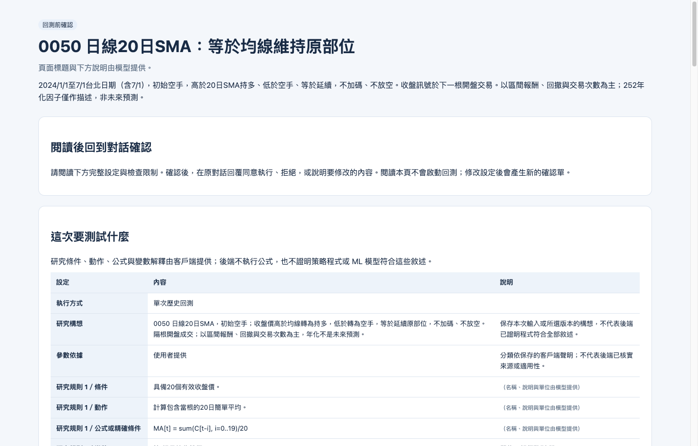
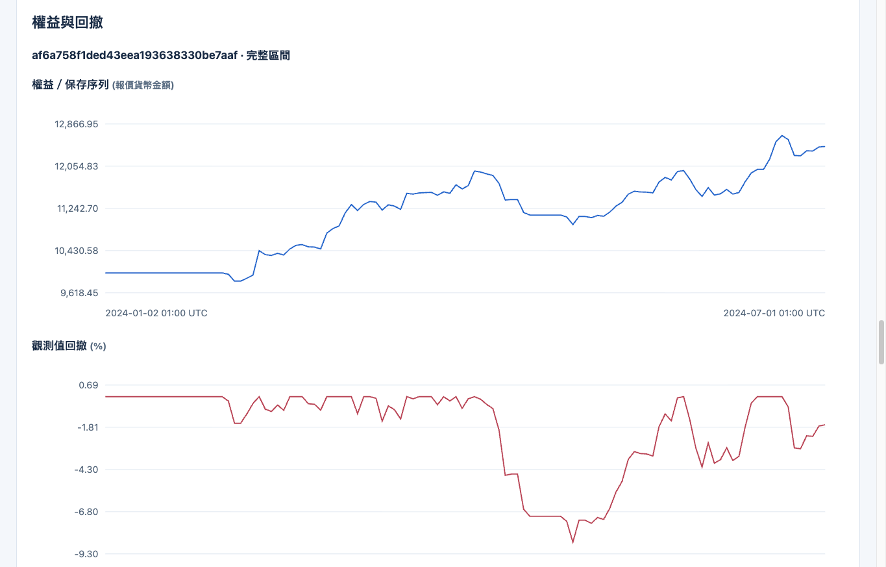
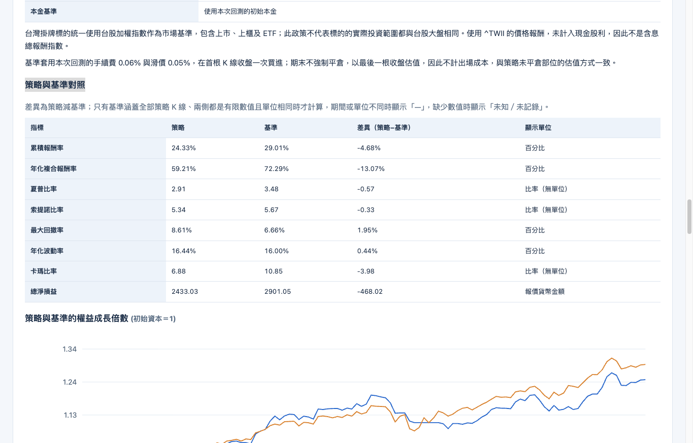
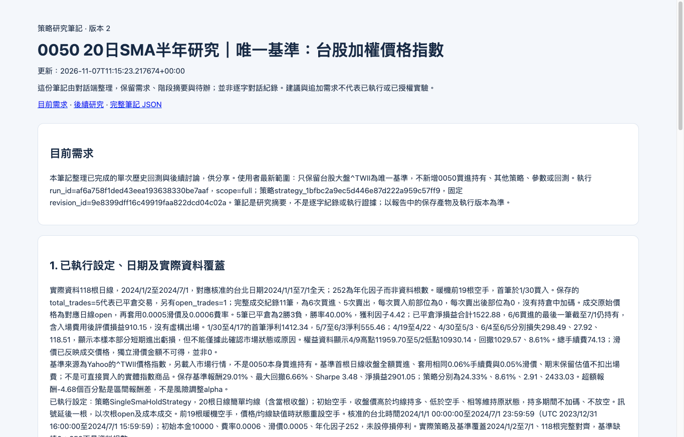

<!--
marp: true
theme: tradingdev
size: 16:9
paginate: true
lang: zh-Hant
title: TradingDev｜讓 AI 助手協助研究交易策略
description: 產品介紹、使用場景、分類比較與後續開發方向
-->

<!-- _class: cover -->

# TradingDev

讓 AI 助手協助研究交易策略

自己的想法，可檢查的實驗，可繼續追問的結果

*完整閱讀版 · 2026 年 10 月。歷史回測與策略研究。*

<!--
封面後先提供閱讀路線，再交代實驗室研究需求、第三方工具的能力範圍，以及本專案的工程回饋方式。用具體案例說明預期價值，再介紹目前基礎、使用情境與策略實驗，最後展開專用 Skill 與工程回饋的後續驗證目標。
初稿專案事實基準：d57da5c20aa7dc578dabef92bbf14d796df8adb6；執行確認與報告交付流程依對應頁面所列的新版本更新。外部資料查核：2026-10-25 至 2026-10-26。
開場的第三方能力摘要另於 2026-10-31 查核所列官方文件；「目前已建立的研究基礎」依 cd95d6091bbc2a46c6a58cdb326aa5df730519c4 更新。
來源：https://github.com/Kuan-Lun/tradingdev/blob/d57da5c20aa7dc578dabef92bbf14d796df8adb6/README.md
-->

---

<!-- _class: compact -->

## 閱讀路線

| 章節 | 主題 | 內容 |
| --- | --- | --- |
| 01 | [開發動機與專案定位](index.html#3) | 現成工具的範圍、自製理由與使用情境 |
| 02 | [策略研究](index.html#11) | 角色分工、運算安排與策略實驗 |
| 03 | [經驗如何回饋專案](index.html#50) | 開發經驗的整合與驗證 |
| 04 | [後續開發方向](index.html#53) | 可獨立指定的開發目標 |

<!-- _footer: "點選章名跳轉。方向鍵換頁，P 開啟講者模式。" -->

<!--
這是分為四章的完整閱讀版，不限定演講時間。各章可獨立閱讀，內容頁頂端會標示目前章節。開場以現成工具的能力範圍與具體案例說明自製理由，再看目前的研究分工、部署安排及實驗流程，接著展開工程回饋的驗證與後續開發目標。
-->

---

<!-- header: "01　開發動機與專案定位" -->
<!-- _class: chapter -->
<!-- _header: "" -->

## 01　開發動機與專案定位

研究背景、必要能力與本專案的研發定位。

---

## 開發動機

我是臺大資工計算理論暨金融計算實驗室的一員，

許多實驗室成員的研究與金融交易相關。

> **我希望建立共用的研究後端，**
> **支援成員開發各自的交易策略。**

<!--
我是國立臺灣大學資訊工程學系計算理論暨金融計算實驗室的一員。許多成員的研究與金融交易相關，因此希望建立共用的後端，協助大家開發自己的策略。
共用的對象是研究所需的基礎能力，各位成員仍能研究自己的策略構想。接下來先說明這個目標需要哪些能力，再看現有工具能提供什麼。
-->

---

<!-- _class: compact -->

## 共用研究後端的必要能力

**共用的實驗基礎**
在同一後端執行回測，保存可重現的設定與結果。

**多樣的策略與模型**
支援成員建構、修改與驗證不同的量化方法。

**協助改進策略的回饋**
檢查策略問題，分析實驗結果，協助下一輪修正。

**AI 協助後端迭代**
透過提示詞，讓 AI 代理依研究經驗提出並驗證後端改進。

<!-- _footer: "開發目標，尚未全部完成。" -->

<!--
共用實驗基礎需要清楚區分各自的策略、版本及結果，並保存重現實驗所需的設定與依據。多樣的策略與模型包含交易規則、統計方法及機器學習模型的建構，以及適用的訓練與驗證。
策略回饋應引用檢查與實驗證據，協助提出修改，再驗證修改是否有效。
人員可選擇策略開發案例，以提示詞啟動 AI 代理，讀取證據並提出後端改進方案及程式修改，執行測試並依結果繼續修正。通過審查後，將適合共用的檢查、元件或流程改善整合回後端，支援下一輪研究。
目前已有回測、研究紀錄與可擴充的共用元件，支援上述維護方式。工程回饋由 research-feedback Skill 引導外部開發助手執行，多人的服務身分與權限仍待開發；此流程不代表服務會自行觸發改進或不中斷更新。以下以這些需求檢視現有工具與整合責任。
-->

---

<!-- _class: compact -->

## 現成工具與本專案的整合方向

| 現成工具 | 已提供的基礎 |
| --- | --- |
| VectorBT、Backtrader | 回測計算與可擴充的策略框架 |
| VectorBT PRO MCP | AI 程式研究與按需研究指引 |
| QuantConnect | 研究代理、診斷、專案記憶與共用程式庫 |

**本專案聚焦：把跨研究案例轉成 TradingDev 的改進，
並驗證改進能否供其他策略重用。**

*下列公開文件未描述完整提供這項流程；不代表無法擴充。*

<!-- _footer: "來源：[VectorBT](https://vectorbt.dev/)、[Backtrader](https://www.backtrader.com/docu/)、[VBT PRO MCP](https://vectorbt.pro/features/ai/mcp-server/)、[QC Agents](https://www.quantconnect.com/docs/v2/ai-assistance/agents)、[程式庫](https://www.quantconnect.com/docs/v2/local-platform/projects/shared-libraries) · 查核 2026-10-31" -->

<!--
比較對準前頁要求的跨研究工程回饋。回測、策略生成、診斷、研究指引與記憶已能由第三方工具提供，單獨列出這些功能不能證明本專案的必要性。
VectorBT 與 Backtrader 的官方文件提供回測、參數研究與擴充能力。VBT PRO MCP 提供程式執行、持續 kernel 及回測、最佳化、交叉驗證等按需 skills。QuantConnect Agents 已提供研究流程、結構化診斷、組織共用 skills 與能由代理更新的專案記憶，Shared Libraries 提供跨專案程式重用。
這些頁面沒有描述完整的「彙集跨研究問題與修正證據、產生共用後端修改、跨策略回歸驗證、審查整合並評估後續效益」流程。這是依明列文件範圍作出的開發判斷，不是已證明所有產品都缺少此功能，也不能由未列出推論其無法擴充。
研究案例可能含私人內容，共用時須區分可分享證據與私人策略。實際採用仍應比較擴充現有生態與自維護服務的成本，不能僅憑這張摘要宣稱自製必然更便宜、更快或更準確。
來源：本頁連結的官方文件，查核於 2026-10-31。此處沒有進行同條件產品實測。
-->

---

<!-- _class: compact -->

## 為何需要自行開發 TradingDev

**自行維護 TradingDev，讓研究經驗能回饋下一次開發。**

- **案例與證據**：連結問題、修正依據與適用條件。
- **修改與驗證**：AI 提出檢查或元件，經跨策略測試與審查整合。
- **追蹤與評估**：保留改進版本，檢查後續研究是否減少重複錯誤。

這需要掌握**研究證據、檢查規則與版本更新流程**。

*透過 research-feedback Skill，讓開發助手依案例完成整合與驗證。*

<!--
自製的研發理由是掌握研究證據、共用檢查與更新流程，讓案例能回饋到 TradingDev 的共用能力。現成回測、記憶與程式庫可作基礎，案例如何形成改進、如何判斷適用、如何驗證及追蹤版本，則需依研究需求安排。
本專案已有策略版本、固定執行設定、檢查、結果查詢與研究筆記，以及可擴充的 domain 元件與 service 組裝點。人員可透過 research-feedback Skill 啟動外部開發助手，依選定案例進行評估、修改、測試與審查；不適合共用時可不修改。跨研究自動檢索仍待開發，也未提供服務自行觸發修改或不中斷更新。
現有工具可以繼續作為計算基礎，外部開發助手也可負責提案與程式修改。自製研究服務不要求重寫回測引擎、對話模型或整個交易平台；哪些元件需維護由具體案例決定。
來源：本專案 ARCHITECTURE.md 的策略生命週期、診斷擴充與研究筆記，以及 TODO-02、TODO-03 的後續驗證方向。
-->

---

## 一次修正如何幫助其他研究

1. 成員 A 發現資料時間對齊錯誤，保留可重現案例。
2. 人員提示 AI 代理，提出共用檢查與測試。
3. 其他策略通過回歸驗證，審查後更新 TradingDev。
4. 成員 B 開發不同策略時，提早攔下同類錯誤。

**已具備將研究經驗整合為共用能力的架構基礎，
可透過提示詞驅動 AI 代理進行整合。**

research-feedback Skill 引導案例分析、修改、驗證與審查流程。

*情境示意；減少重複錯誤的效果尚待實測。*

<!--
這是可由人員透過提示詞啟動的工程回饋示例。假設某種新資料來源的時間語意造成對齊問題，從個別修正抽出共用檢查，再驗證其他策略是否適用。示例不代表已發生的實驗室案例或目前尚未修復的產品 bug，也尚未量測減少重複錯誤的效果。
research-feedback Skill 引導外部助手固定來源、判斷共用價值、整合與驗證，仍須遵循測試及審查政策。此處說明維護流程，不表示服務已內建自主修改或熱更新機制。
預期成果包括可重現案例、問題及修正證據、適用條件、共用檢查或元件、測試及改進版本。AI 提案須經測試與審查，不代表自動發布核心程式，也不會自動分享私人策略。
能否泛化仍待實驗。後段「開發經驗的整合與驗證」說明共用能力的抽取與驗證流程；講者稿保留與既有工具、指引及記憶的對照，以及重複錯誤、誤判與人工工時等觀察方式。
-->

---

## 目前已建立的研究基礎

> TradingDev 透過 MCP，讓 AI 運用研究指引建立與修正策略，
> 依據檢查與實驗結果，提出可追問的分析。

- **策略實驗**：建立與修正策略，完成檢查與歷史回測。
- **ML 訊號**：已登錄模型的訓練、預測與評估。
- **證據保存**：連結策略版本、有效設定與實驗結果。
- **研究回饋**：診斷提示、報告解讀與可續讀的研究筆記。

<!-- _footer: "現況依據：[TradingDev 使用說明](https://github.com/Kuan-Lun/tradingdev/blob/cd95d6091bbc2a46c6a58cdb326aa5df730519c4/README.md)與[架構](https://github.com/Kuan-Lun/tradingdev/blob/cd95d6091bbc2a46c6a58cdb326aa5df730519c4/ARCHITECTURE.md)" -->

<!--
TradingDev 除了接收工具請求、執行計算和保存資料，也提供模型可讀取的研究流程指引、策略契約與診斷。使用者不必自己把一次次實驗的程式、設定和結果拼回來。
診斷先提供規則式提示，外部 LLM 的報告解讀須保留觀察依據與限制，研究建議不會自動啟動新實驗。研究筆記可保存階段摘要及引用報告，供外部開發助手透過 research-feedback Skill 讀取選定案例及改進 TradingDev；跨研究自動檢索仍待開發。
TradingDev 不內建對話模型。這些能力是 TradingDev 的現有基礎，不代表已提供多人權限或完整執行隔離。
基礎計算包含行情、技術指標、回測與參數研究，採用 VectorBT、TA-Lib、QuantStats 等套件，沒有把 Freqtrade 整合為依賴。ML 訊號研究是現有能力，並非本專案獨有，也不代表已有任意模型支援或真實下單。
ML 模型包含 XGBoost、LightGBM、CatBoost 方向模型；QuantConnect 也提供機器學習研究，支援更多常見框架。模型種類不代表較泛用。
基礎計算與 ML 來源：pyproject.toml、src/tradingdev/domain/ml/models/registry.py；https://www.quantconnect.com/docs/v2/writing-algorithms/machine-learning/popular-libraries/pytorch
研究指引來源：src/tradingdev/mcp/prompts.py 的 SERVER_INSTRUCTIONS、server.py 的 instructions 註冊，以及 tools/strategy.py 的按需契約。
-->

---

<!-- _class: compact -->

## TradingDev 的使用情境

| 情境 | 如何使用 |
| --- | --- |
| 個人研究 | 沿用自己的 AI 助手，提出策略並追問實驗結果 |
| 教學 | 用相同題目與資料，比較規則、成本及驗證方法 |
| 研究團隊 | 沿用團隊資料與實驗格式，累積共用檢查 |
| 公司產品 | 將策略實驗接進既有 AI 網站，安排模型與收費 |

*情境示意，並非已完成的多人產品。教學與團隊可先採獨立環境。
多人權限、策略隔離與集中資源管理仍待開發。*

<!--
這些是依現有能力提出的使用情境，不是已完成的客戶案例。教學重點是如何檢查假說，不是比較誰的回測收益最高。
團隊可以沿用自己的資料、實驗格式與檢查規則，再將驗證過的共用規則改進到服務中。初期可在可信環境採獨立部署；同一 server 的 workspace 不是現成的多租戶或執行安全隔離。
公司可將 TradingDev 接到既有 AI 入口，由產品入口選擇對話模型、計量 token 用量及安排收費，行情、主機與結果保存則由整合者安排。公開多人服務仍須另行開發權限、隔離與資源管理，收費上線前也須核實依賴及行情授權。
個人助手、公司模型服務及私有部署並非 TradingDev 獨有；QuantConnect Private Cloud 也有公司資料與運算的方案，不能把私有部署當作自製的唯一理由。
來源：README 的 MCP 連接方式與執行限制、ARCHITECTURE.md 的產品邊界與整合層分工。
-->

---

<!-- header: "02　策略研究" -->
<!-- _class: chapter -->
<!-- _header: "" -->

## 02　策略研究

一個交易想法如何成為可檢查、可追問的實驗。

---

<!-- header: "02　策略研究　／　02.1　研究指引與角色分工" -->
<!-- _class: subsection statement -->

## 這裡的「研究能力」

> 把交易想法寫成明確規則，用歷史資料實驗，
> 比較修改前後的差異，並檢查可能的原因。

TradingDev 透過 MCP 提供**研究流程指引與檢查規則**，
引導 AI 釐清需求、開發策略，並依實驗證據提出下一步。

<!--
研究不是泛稱投資分析。此處具體指策略程式的建立、檢查、歷史回測、參數實驗、時序驗證與結果查詢。
指引由 TradingDev 提供，推理與互動由使用者選擇的 AI 代理承擔。直接在 Codex 開發策略時，Codex 就是這個角色，不需要另建一套助手服務。實際呈現與指引採用方式由客戶端決定，不能把提示詞當成所有客戶端必然遵循的保證。
來源：src/tradingdev/mcp/prompts.py、server.py 與 tools/strategy.py。
-->

---

## 使用者、AI 代理與 TradingDev

| 角色 | 負責的事 |
| --- | --- |
| 使用者 | 提出目標、釐清規則、確認實驗 |
| AI 代理 | 依研究指引理解需求、撰寫與修正策略、解讀結果 |
| TradingDev | 研究流程指引、策略契約與檢查、實驗計算與證據 |

TradingDev 透過 **MCP 協定**，提供研究指引與工具給 Codex 等 AI 代理。

可直接使用既有客戶端，也可整合進自己的應用。

<!--
TradingDev 是策略研究後端，MCP 是 AI 代理與它連接的協定。讀作 MCP，不是 MPC。表中列的是責任，不是要求使用者部署三套系統。直接在 Codex 中開發策略時，Codex 承擔 AI 代理角色；TradingDev 不限定對話介面，也不內建對話模型。
TradingDev 以 server instructions、工具描述與按需契約提供研究指引，並強制檢查可機械驗證的輸入與執行條件。客戶端決定互動與推理方式，提示詞不能保證模型遵循，也不能證明使用者真的閱讀或同意。
來源：src/tradingdev/mcp/server.py、prompts.py、tools/strategy.py，以及 ARCHITECTURE.md。
-->

---

## TradingDev 提供的研究流程指引

1. **釐清構想**：確認交易想法、標的、期間與 K 棒頻率。
2. **開發與修復**：依策略契約撰寫，根據檢查結果修正。
3. **確認實驗**：閱讀設定，決定是否正式執行。
4. **解讀證據**：依回測與診斷，區分觀察、假說及限制。
5. **延續研究**：提出下一步，依需要保存研究筆記。

<!--
新策略會保存版本，通過驗證及 dry-run 後才取得執行資格；其中的訊號檢查使用固定合成資料，並非歷史回測。準備確認單時只做離線程式與設定檢查，以及適用的合成訊號檢查。單次準備的內建策略不在此時執行訊號；固定參數比較則對每組候選（包含內建策略）執行 80 與 240 根合成 K 棒的訊號檢查。確認前不取得真實行情、不訓練模型、不執行歷史回測；行情、訓練及績效須同意後才開始驗證。
這些步驟已有 SERVER_INSTRUCTIONS 引導，並搭配工具說明及 get_strategy_contract 的按需內容。缺少必要研究選擇時須追問；保存研究筆記須有保存或分享需求。客戶端可安排自己的互動方式，但工具仍會檢查契約與執行狀態。
來源：src/tradingdev/mcp/prompts.py、tools/strategy.py、README「完成第一次回測」與 docs/strategy_contract.md。
-->

<!-- _footer: "來源：[執行確認流程](https://github.com/Kuan-Lun/tradingdev/blob/35d709d4ac9ed8c9d3a71a3e24cd98996bf3a1e6/README.md#完成第一次回測)" -->

---

<!-- _class: compact -->

## 對話與運算的部署

對話可留在筆電，回測交給另一台主機。

| 可自行安排的部分 | 整合者的選擇 |
| --- | --- |
| 對話與模型 | 沿用個人助手，或由公司提供模型及互動流程 |
| 資料與運算 | 提供自己的行情與主機，安排快取政策 |
| 研究規則與輸出 | 維護策略契約、檢查與報告呈現方式 |

*跨設備連線須設定網路轉送與存取控制。集中排程及多人隔離仍待開發。*

<!--
這頁承接使用者、AI 代理與 TradingDev 的責任分工，說明部署時可安排的部分。回測可以由資源較充足的主機負責，不代表已提供多節點叢集或大型租戶平台。
目前 HTTP 預設綁定 localhost，另一台設備不能直接使用該主機的 localhost 位址，需另行設定網路轉送與存取控制。對話、模型及收費留在客戶端整合層，TradingDev 不綁定特定 LLM。
整合者可以維護自己的研究服務、檢查、策略契約及輸出，但需承擔相應的開發與驗證責任；使用現有服務時仍須遵守其確認流程與後端檢查，不能把可自訂解讀成可在對話中略過授權。
來源：README「手動啟動並使用 HTTP 連接」、ARCHITECTURE.md。
-->

---

## 依研究目的選擇模式

| 模式 | 主要回答的問題 |
| --- | --- |
| **signal：資金表現** | 給定一筆起始資金，資產、報酬與回撤如何變化？ |
| **volume：交易量與成本** | 按指定交易規模運作，累計成交量、成本與金額損益如何變化？ |

相同的策略研究流程，可以服務不同的衡量目標。

*這是 TradingDev 明確提供的選擇。其他引擎也能自訂部位與模擬方式。*

<!--
signal 使用 VectorBT，包含初始資金。volume 從零累計 P&L，沒有初始資金，不能當作本金報酬率；名目規模可由 size_weight 調整。volume 也不是市場深度或成交量限制撮合模型。
來源：https://github.com/Kuan-Lun/tradingdev/blob/d57da5c20aa7dc578dabef92bbf14d796df8adb6/src/tradingdev/domain/backtest/result.py
其他引擎：https://vectorbt.dev/api/portfolio/base/#simulation-modes 、 https://www.quantconnect.com/docs/v2/writing-algorithms/trading-and-orders/position-sizing
-->

---

<!-- _class: compact -->

## TradingDev 的研究指引：均線策略案例

> **使用者**：「我想測試短均線高於長均線時買進。」

| TradingDev 的指引 | 前端 AI 可能接著問 |
| --- | --- |
| **缺項時追問** | 「想測哪個標的、哪段期間？每根 K 棒代表多久？」 |
| **將策略具體化** | 「均線各用幾根？短均線跌破時，是平倉還是做空？」 |
| **執行前確認** | 「本金、手續費與滑價有指定嗎？若沒有，我先列出模擬預設供你確認。」 |

*示意對話，問法依情境調整；整理成確認單後，使用者同意才回測。*

<!--
本頁保留使用者只有均線交易構想的情境，以具體問句展示 TradingDev 的指引如何影響前端互動。表中的問題可分散於多輪對話，不是要求一次問完；補齊必要研究選擇後，再釐清策略細節與提出方案。這是依現有指引編寫的示意，不是真實模型逐字紀錄或已執行的回測。
提示詞引導由 TradingDev 的 server instructions、工具說明與按需策略契約提供；此處不是指另行註冊的 MCP prompts，也不是固定問卷。實際問句與互動由 Codex 等客戶端的 LLM 組織。
建立新研究前，構想、標的、回測期間與 K 棒頻率缺項時須追問，不能從範例猜出選擇。只有明確要求沿用已選定研究時，才可繼承其設定。
策略具體化包含整理進場、持有、出場與交易方向，確認參數並形成可驗證的程式。模型可提出有說明依據的方案，不能把自己的假設冒充使用者要求。
本金與成本未指定時可依共用模擬政策解析，明示有效值優先。前端須呈現 TradingDev 產生的確認摘要與 HTML，待使用者明確同意該方案才提交執行。這些是歷史回測假設，不是即時費率或真實下單設定；本金與交易規模依執行模式適用。
提示詞要求不保證所有客戶端一定遵循；TradingDev 另檢查必要欄位、設定與執行狀態，但不能證明輸入或同意真的來自使用者。
來源：src/tradingdev/mcp/prompts.py 的 SERVER_INSTRUCTIONS、server.py 的 instructions 註冊，以及 src/tradingdev/domain/strategies/templates.py 的 research 契約與 src/tradingdev/domain/research_policy.py。
-->

---

<!-- _class: compact -->
<!-- _header: "02　策略研究　／　新版 0050 案例" -->

## 同一個構想，以修正後版本重新研究

> 「我想用均線來買賣 0050，可以幫我看看嗎？」

- **沿用案例條件**：0050 日 K、2024/1/1 至 7/1、20 日 SMA 與相同模擬成本。
- **重新互動與執行**：八輪實際對話、一次回測，取得可比較的台股大盤數值。
- **保留來源**：Sol 的回覆與 MCP 紀錄來自真實執行；示範操作者由助理依委託擔任。

*下頁依序保留操作者輸入與各輪最終回覆全文，長回覆分頁呈現。*

<!-- _footer: "Codex CLI app-server · gpt-6.1-sol / medium；產品版本 fccde5b（PR #182 合併後）。" -->

---

<!-- _class: case-dialogue case-transcript case-options case-with-input -->
<!-- _header: "02　策略研究　／　實際對話　第 1／8 輪" -->

## 實際對話：提出選項與追問（1/2）

<!-- dialogue-message: 01-intake/0 -->

操作者輸入

<!-- dialogue-text-start -->

> 我想用均線來買賣 0050，可以幫我看看嗎？

<!-- dialogue-text-end -->

<!-- dialogue-message: 01-intake/4 -->

gpt-6.1-sol｜該輪最終回覆

<!-- dialogue-text-start -->

> 可以。我們可以先把均線想法變成明確規則，再回測看是否適合 0050。
>
> 兩種可討論的做法：
>
> - **單條均線**：價格站上均線買進，跌破時賣出。
> - **雙均線**：短均線高於長均線時持有，低於時賣出、空手等待。

<!-- dialogue-text-end -->

<!-- _footer: "CLI 實際對話原文；操作者由助理依委託擔任。[本輪完整對話與工具紀錄](evidence/0050-taiex/cases/01-ma-discussion/dialogue.html#01-intake)" -->

<!--
來源：evidence/0050-taiex/cases/01-ma-discussion/transcript.json。逐字保留本輪操作者與最終回覆，只分頁並將原文連結指向同一產物的離線副本。其他可見訊息與工具原文由連結續讀。
-->

---

<!-- _class: case-dialogue case-transcript case-options -->
<!-- _header: "02　策略研究　／　實際對話　第 1／8 輪" -->

## 實際對話：提出選項與追問（2/2）

<!-- dialogue-message: 01-intake/4 -->

gpt-6.1-sol｜該輪最終回覆

<!-- dialogue-text-start -->

> 均線的取捨是訊號較慢；盤整時也可能反覆買賣，增加成本。因此除了報酬，還要看最大跌幅、交易次數，並與買進持有比較。目前尚未回測，不能判斷哪種較好。
>
> 先請你補充：
>
> 1. **想看哪段期間？** 請提供起訖日期。
> 2. **想用日線、週線，還是盤中 K 線？**
> 3. **偏好哪種規則？** 單均線、雙均線，或還沒決定？若已有均線天數，也一起告訴我。

<!-- dialogue-text-end -->

<!-- _footer: "CLI 實際對話原文；操作者由助理依委託擔任。[本輪完整對話與工具紀錄](evidence/0050-taiex/cases/01-ma-discussion/dialogue.html#01-intake)" -->

<!--
來源：evidence/0050-taiex/cases/01-ma-discussion/transcript.json。逐字保留本輪操作者與最終回覆，只分頁並將原文連結指向同一產物的離線副本。其他可見訊息與工具原文由連結續讀。
-->

---

<!-- _class: case-dialogue case-transcript case-options case-with-input -->
<!-- _header: "02　策略研究　／　實際對話　第 2／8 輪" -->

## 實際對話：選定期間與均線天數（1/3）

<!-- dialogue-message: 02-discuss/0 -->

操作者輸入

<!-- dialogue-text-start -->

> 先看 2024 年 1 月 1 日到 7 月 1 日，用日線。我想先從單均線開始，天數你建議怎麼選？

<!-- dialogue-text-end -->

<!-- dialogue-message: 02-discuss/5 -->

gpt-6.1-sol｜該輪最終回覆

<!-- dialogue-text-start -->

> 我建議先比較 **10、20、60 日簡單移動平均線（SMA）**，若只選一條，就從 **20 日**開始。這是依反應速度提出的研究設定，尚未經回測或外部資料驗證，不能視為最佳天數。

<!-- dialogue-text-end -->

<!-- _footer: "CLI 實際對話原文；操作者由助理依委託擔任。[本輪完整對話與工具紀錄](evidence/0050-taiex/cases/01-ma-discussion/dialogue.html#02-discuss)" -->

<!--
來源：evidence/0050-taiex/cases/01-ma-discussion/transcript.json。逐字保留本輪操作者與最終回覆，只分頁並將原文連結指向同一產物的離線副本。其他可見訊息與工具原文由連結續讀。
-->

---

<!-- _class: case-dialogue case-transcript case-options -->
<!-- _header: "02　策略研究　／　實際對話　第 2／8 輪" -->

## 實際對話：選定期間與均線天數（2/3）

<!-- dialogue-message: 02-discuss/5 -->

gpt-6.1-sol｜該輪最終回覆

<!-- dialogue-text-start -->

> | 均線 | 選擇理由 | 取捨 |
> |---|---|---|
> | 10 日 | 觀察較快的進出反應 | 容易反覆買賣，成本可能較高 |
> | 20 日 | 作為快慢之間的起點 | 仍可能在盤整時頻繁進出 |
> | 60 日 | 觀察較慢的趨勢判斷 | 買進與退出都可能較晚 |
>
> 為了公平比較，三組都使用同一套規則：**收盤價高於均線時持有 0050；低於或等於均線時賣出並空手，不放空**。訊號需等收盤確認，成交時點會在回測計畫中列清楚。
>
> 你指定的 **2024/1/1～2024/7/1、日線**只有半年，結果對這段行情可能很敏感；60 日均線也需要足夠資料暖機，解讀時要一併考慮。

<!-- dialogue-text-end -->

<!-- _footer: "CLI 實際對話原文；操作者由助理依委託擔任。[本輪完整對話與工具紀錄](evidence/0050-taiex/cases/01-ma-discussion/dialogue.html#02-discuss)" -->

<!--
來源：evidence/0050-taiex/cases/01-ma-discussion/transcript.json。逐字保留本輪操作者與最終回覆，只分頁並將原文連結指向同一產物的離線副本。其他可見訊息與工具原文由連結續讀。
-->

---

<!-- _class: case-dialogue case-transcript case-options -->
<!-- _header: "02　策略研究　／　實際對話　第 2／8 輪" -->

## 實際對話：選定期間與均線天數（3/3）

<!-- dialogue-message: 02-discuss/5 -->

gpt-6.1-sol｜該輪最終回覆

<!-- dialogue-text-start -->

> 你想先比較這三組，還是只測 20 日？另外，這次是否先不計算年化指標，著重看區間報酬、最大回撤與交易次數？

<!-- dialogue-text-end -->

<!-- _footer: "CLI 實際對話原文；操作者由助理依委託擔任。[本輪完整對話與工具紀錄](evidence/0050-taiex/cases/01-ma-discussion/dialogue.html#02-discuss)" -->

<!--
來源：evidence/0050-taiex/cases/01-ma-discussion/transcript.json。逐字保留本輪操作者與最終回覆，只分頁並將原文連結指向同一產物的離線副本。其他可見訊息與工具原文由連結續讀。
-->

---

<!-- _class: case-dialogue case-transcript case-options case-with-input -->
<!-- _header: "02　策略研究　／　實際對話　第 3／8 輪" -->

## 實際對話：釐清持有並準備確認單（1/6）

<!-- dialogue-message: 03-holding-question/0 -->

操作者輸入

<!-- dialogue-text-start -->

> 先測 20 日一組。你說高於均線就持有，是每天都會再買嗎？我希望買了就持有，低於均線再賣掉；剛好等於均線時維持原部位，不另外交易。
>
> 年化設定沿用每年 252 根，但這只是半年案例，解讀仍以區間報酬、回撤與交易次數為主，不把年化數字當成未來預測。

<!-- dialogue-text-end -->

<!-- dialogue-message: 03-holding-question/11 -->

gpt-6.1-sol｜該輪最終回覆

<!-- dialogue-text-start -->

> **不會每天再買。** 已設定為持倉期間不加碼，等於均線時維持原部位。程式與合成資料檢查已通過，尚未執行歷史回測。前 19 根日線會因均線暖機保持空手；成本使用專案模擬預設，並非已核實的台股實際費稅。

<!-- dialogue-text-end -->

<!-- _footer: "CLI 實際對話原文；操作者由助理依委託擔任。[本輪完整對話與工具紀錄](evidence/0050-taiex/cases/01-ma-discussion/dialogue.html#03-holding-question)" -->

<!--
來源：evidence/0050-taiex/cases/01-ma-discussion/transcript.json。逐字保留本輪操作者與最終回覆，只分頁並將原文連結指向同一產物的離線副本。其他可見訊息與工具原文由連結續讀。
-->

---

<!-- _class: case-dialogue case-transcript case-options -->
<!-- _header: "02　策略研究　／　實際對話　第 3／8 輪" -->

## 實際對話：釐清持有並準備確認單（2/6）

<!-- dialogue-message: 03-holding-question/11 -->

gpt-6.1-sol｜該輪最終回覆

<!-- dialogue-text-start -->

> > 回測前確認
>
> > 策略說明：2024/1/1至7/1台北日期（含7/1），初始空手，高於20日SMA持多、低於空手、等於延續，不加碼、不放空。收盤訊號於下一根開盤交易。以區間報酬、回撤與交易次數為主；252年化因子僅作描述，非未來預測。
>
> > 執行方式：單次歷史回測；參數依據：使用者提供
>
> > 回測商品：0050.TW；回測 K 線週期：每根 K 線 1 天；回測開始：2023-12-31T16:00:00+00:00；回測結束：2024-07-01T15:59:59+00:00；時間邊界：依 K 棒時間戳記篩選，包含起訖兩端（有相符資料時）

<!-- dialogue-text-end -->

<!-- _footer: "CLI 實際對話原文；操作者由助理依委託擔任。[本輪完整對話與工具紀錄](evidence/0050-taiex/cases/01-ma-discussion/dialogue.html#03-holding-question)" -->

<!--
來源：evidence/0050-taiex/cases/01-ma-discussion/transcript.json。逐字保留本輪操作者與最終回覆，只分頁並將原文連結指向同一產物的離線副本。其他可見訊息與工具原文由連結續讀。
-->

---

<!-- _class: case-dialogue case-transcript case-options -->
<!-- _header: "02　策略研究　／　實際對話　第 3／8 輪" -->

## 實際對話：釐清持有並準備確認單（3/6）

<!-- dialogue-message: 03-holding-question/11 -->

gpt-6.1-sol｜該輪最終回覆

<!-- dialogue-text-start -->

> > 計算方式：依帳戶資金計算報酬；初始資金：10000.0 報價貨幣；單次投入金額：未指定固定金額 報價貨幣；手續費率：0.06%；滑價率：0.05%；年化計算的每年日數：252.0 天；本金與成本來源：本金：專案模擬預設（research-v1）；手續費：專案模擬預設（research-v1）；滑價：專案模擬預設（research-v1）；年化統計取樣：有觀測值的 UTC 每日帳戶報酬；缺日不補零
>
> > 訊號與成交時點：訊號延後一根 K 棒，一般訊號進出場使用下一棒 open；缺少 open 欄位才使用 close。尚未平倉部位以當棒 close 評價。
>
> > 多空與零訊號：1 表示做多，-1 表示做空（不是只賣出平多倉）。0 表示平倉。

<!-- dialogue-text-end -->

<!-- _footer: "CLI 實際對話原文；操作者由助理依委託擔任。[本輪完整對話與工具紀錄](evidence/0050-taiex/cases/01-ma-discussion/dialogue.html#03-holding-question)" -->

<!--
來源：evidence/0050-taiex/cases/01-ma-discussion/transcript.json。逐字保留本輪操作者與最終回覆，只分頁並將原文連結指向同一產物的離線副本。其他可見訊息與工具原文由連結續讀。
-->

---

<!-- _class: case-dialogue case-transcript case-options -->
<!-- _header: "02　策略研究　／　實際對話　第 3／8 輪" -->

## 實際對話：釐清持有並準備確認單（4/6）

<!-- dialogue-message: 03-holding-question/11 -->

gpt-6.1-sol｜該輪最終回覆

<!-- dialogue-text-start -->

> > 反向訊號：相反的非零訊號平掉舊方向並嘗試建立新方向；停損停利先於訊號處理。
>
> > 投入金額：未指定固定金額，以當時可用資金及成交成本決定最大可成交數量；不是固定數量或固定初始本金比例。
>
> > 同方向持倉：持續相同方向的訊號不加碼。
>
> > 資金與槓桿限制：不模擬完整保證金、清算、借券或資金費率規則，也沒有固定槓桿倍數設定。
>
> > 停損停利成交：停損 未設定；停利 未設定。

<!-- dialogue-text-end -->

<!-- _footer: "CLI 實際對話原文；操作者由助理依委託擔任。[本輪完整對話與工具紀錄](evidence/0050-taiex/cases/01-ma-discussion/dialogue.html#03-holding-question)" -->

<!--
來源：evidence/0050-taiex/cases/01-ma-discussion/transcript.json。逐字保留本輪操作者與最終回覆，只分頁並將原文連結指向同一產物的離線副本。其他可見訊息與工具原文由連結續讀。
-->

---

<!-- _class: case-dialogue case-transcript case-options -->
<!-- _header: "02　策略研究　／　實際對話　第 3／8 輪" -->

## 實際對話：釐清持有並準備確認單（5/6）

<!-- dialogue-message: 03-holding-question/11 -->

gpt-6.1-sol｜該輪最終回覆

<!-- dialogue-text-start -->

> > 成交成本：手續費率 0.06%；滑價率 0.05%。各成交收取手續費，一般訊號的滑價反映於成交價。
>
> > 年化解讀：使用觀測到的 UTC 日報酬，缺日不補值；須有有效時間戳及不粗於日線的資料。保存的每年日數為 252。
>
> > 資料結束時：剩餘持倉保留為未平倉，以最後 close 評價，不虛構出場成交。
>
> > 確認前僅檢查程式，未取得真實行情、訓練或執行回測。
>
> > 請先閱讀完整 HTML 確認單中的設定與檢查限制，再於對話回覆同意、拒絕或修改要求。

<!-- dialogue-text-end -->

<!-- _footer: "CLI 實際對話原文；操作者由助理依委託擔任。[本輪完整對話與工具紀錄](evidence/0050-taiex/cases/01-ma-discussion/dialogue.html#03-holding-question)" -->

<!--
來源：evidence/0050-taiex/cases/01-ma-discussion/transcript.json。逐字保留本輪操作者與最終回覆，只分頁並將原文連結指向同一產物的離線副本。其他可見訊息與工具原文由連結續讀。
-->

---

<!-- _class: case-dialogue case-transcript case-options -->
<!-- _header: "02　策略研究　／　實際對話　第 3／8 輪" -->

## 實際對話：釐清持有並準備確認單（6/6）

<!-- dialogue-message: 03-holding-question/11 -->

gpt-6.1-sol｜該輪最終回覆

<!-- dialogue-text-start -->

> [閱讀確認單](evidence/0050-taiex/cases/01-ma-discussion/confirmation.html)

<!-- dialogue-text-end -->

<!-- _footer: "CLI 實際對話原文；操作者由助理依委託擔任。[本輪完整對話與工具紀錄](evidence/0050-taiex/cases/01-ma-discussion/dialogue.html#03-holding-question)" -->

<!--
來源：evidence/0050-taiex/cases/01-ma-discussion/transcript.json。逐字保留本輪操作者與最終回覆，只分頁並將原文連結指向同一產物的離線副本。其他可見訊息與工具原文由連結續讀。
-->

---

<!-- _class: case-shot case-native -->
<!-- _header: "02　策略研究　／　新版 0050 案例" -->

## 原生確認單：閱讀後回到對話決定

[開啟完整確認單](evidence/0050-taiex/cases/01-ma-discussion/confirmation.html) · [日期與年化問答](evidence/0050-taiex/cases/01-ma-discussion/dialogue.html#04-plan-questions)

<!-- _footer: "原生 HTML 的實際瀏覽器截圖；完整內容由連結續讀。" -->

<!--
來源：新案例 screenshots/01-confirmation-native.png。閱讀文件不啟動回測；不能據此證明真人已閱讀。
-->

---

<!-- _class: case-dialogue case-transcript case-options case-with-input -->
<!-- _header: "02　策略研究　／　實際對話　第 4／8 輪" -->

## 實際對話：確認日期與年化設定（1/2）

<!-- dialogue-message: 04-plan-questions/0 -->

操作者輸入

<!-- dialogue-text-start -->

> 我看過確認單了。開始日期顯示 2023-12-31 16:00 UTC、結束顯示 2024-07-01 15:59:59 UTC，這就是台灣日期 2024 年 1 月 1 日到 7 月 1 日、包含 7 月 1 日全天嗎？另外，每年 252 根只是年化設定，不代表這次會取得 252 根資料，對嗎？先幫我說明，這一輪先不要執行。

<!-- dialogue-text-end -->

<!-- dialogue-message: 04-plan-questions/1 -->

gpt-6.1-sol｜該輪最終回覆

<!-- dialogue-text-start -->

> 對，兩項理解都正確。

<!-- dialogue-text-end -->

<!-- _footer: "CLI 實際對話原文；操作者由助理依委託擔任。[本輪完整對話與工具紀錄](evidence/0050-taiex/cases/01-ma-discussion/dialogue.html#04-plan-questions)" -->

<!--
來源：evidence/0050-taiex/cases/01-ma-discussion/transcript.json。逐字保留本輪操作者與最終回覆，只分頁並將原文連結指向同一產物的離線副本。其他可見訊息與工具原文由連結續讀。
-->

---

<!-- _class: case-dialogue case-transcript case-options -->
<!-- _header: "02　策略研究　／　實際對話　第 4／8 輪" -->

## 實際對話：確認日期與年化設定（2/2）

<!-- dialogue-message: 04-plan-questions/1 -->

gpt-6.1-sol｜該輪最終回覆

<!-- dialogue-text-start -->

> - **日期範圍**：台灣時間是 UTC+8，因此開始時間換算為 **2024/1/1 00:00:00**，結束為 **2024/7/1 23:59:59**，包含 7 月 1 日全天。系統依 K 棒時間戳記篩選，實際涵蓋哪些日線仍取決於資料來源。
> - **252 年化設定**：它是計算年化指標時使用的每年日數因子，**不是本次要取得的資料根數**。實際根數由指定期間內可取得的日線決定，休市日通常沒有 K 棒。
>
> 這一輪不會執行回測。

<!-- dialogue-text-end -->

<!-- _footer: "CLI 實際對話原文；操作者由助理依委託擔任。[本輪完整對話與工具紀錄](evidence/0050-taiex/cases/01-ma-discussion/dialogue.html#04-plan-questions)" -->

<!--
來源：evidence/0050-taiex/cases/01-ma-discussion/transcript.json。逐字保留本輪操作者與最終回覆，只分頁並將原文連結指向同一產物的離線副本。其他可見訊息與工具原文由連結續讀。
-->

---

<!-- _class: case-dialogue case-transcript case-options case-with-input -->
<!-- _header: "02　策略研究　／　實際對話　第 5／8 輪" -->

## 實際對話：暫停後核對確認單（1/2）

<!-- dialogue-message: 05-refresh-plan/0 -->

操作者輸入

<!-- dialogue-text-start -->

> 剛才暫停並重啟電腦，隔了一段時間才回來。日期和 252 的說明我理解了。請先確認原本那份確認單是否仍有效；若已過期，沿用同一個策略版本和全部設定，重新產生確認單給我看。這輪先不要執行回測，也不要新增其他策略或參數組合。

<!-- dialogue-text-end -->

<!-- dialogue-message: 05-refresh-plan/3 -->

gpt-6.1-sol｜該輪最終回覆

<!-- dialogue-text-start -->

> 已查詢原確認單，**目前仍有效，無須重新產生**。

<!-- dialogue-text-end -->

<!-- _footer: "CLI 實際對話原文；操作者由助理依委託擔任。[本輪完整對話與工具紀錄](evidence/0050-taiex/cases/01-ma-discussion/dialogue.html#05-refresh-plan)" -->

<!--
來源：evidence/0050-taiex/cases/01-ma-discussion/transcript.json。逐字保留本輪操作者與最終回覆，只分頁並將原文連結指向同一產物的離線副本。其他可見訊息與工具原文由連結續讀。
-->

---

<!-- _class: case-dialogue case-transcript case-options -->
<!-- _header: "02　策略研究　／　實際對話　第 5／8 輪" -->

## 實際對話：暫停後核對確認單（2/2）

<!-- dialogue-message: 05-refresh-plan/3 -->

gpt-6.1-sol｜該輪最終回覆

<!-- dialogue-text-start -->

> - 狀態：`ready`，尚未提交執行，沒有回測工作。
> - 有效期限：**2026/11/7 19:50:18（台灣時間）**。
> - 查詢時間：約 **2026/11/7 19:10（台灣時間）**。
> - 原策略版本與全部設定維持不變。
>
> [閱讀原確認單](evidence/0050-taiex/cases/01-ma-discussion/confirmation.html)
>
> 本輪未執行回測，也未新增策略或參數組合。

<!-- dialogue-text-end -->

<!-- _footer: "CLI 實際對話原文；操作者由助理依委託擔任。[本輪完整對話與工具紀錄](evidence/0050-taiex/cases/01-ma-discussion/dialogue.html#05-refresh-plan)" -->

<!--
來源：evidence/0050-taiex/cases/01-ma-discussion/transcript.json。逐字保留本輪操作者與最終回覆，只分頁並將原文連結指向同一產物的離線副本。其他可見訊息與工具原文由連結續讀。
-->

---

<!-- _class: case-dialogue case-transcript case-options case-with-input -->
<!-- _header: "02　策略研究　／　實際對話　第 6／8 輪" -->

## 實際對話：同意執行並取得結果（1/4）

<!-- dialogue-message: 06-execute/0 -->

操作者輸入

<!-- dialogue-text-start -->

> 我已閱讀原確認單和限制，確認以這份有效確認單執行：0050.TW 日 K、台灣時間 2024/1/1 到 7/1（含全天）、20 日 SMA，高於均線持多、低於空手、相等維持原部位，不重複加碼，下一根開盤成交。接受模擬本金 10000、手續費率 0.0006、滑價率 0.0005、年化因子 252；這不是台股實際費稅模型。同意開始這一次回測，完成後給我原生報告並說明結果；不要另外跑參數或其他策略。

<!-- dialogue-text-end -->

<!-- dialogue-message: 06-execute/15 -->

gpt-6.1-sol｜該輪最終回覆

<!-- dialogue-text-start -->

> 已完成這一次 **0050／20 日 SMA** 回測，沒有另跑其他參數或策略。
>
> [開啟 TradingDev 原生完整報告](evidence/0050-taiex/cases/01-ma-discussion/earlier-reports/d41835e9438f31c69328ef37bbcf86609f42d315be54b409680418f8de90f2e8.html)

<!-- dialogue-text-end -->

<!-- _footer: "CLI 實際對話原文；操作者由助理依委託擔任。[本輪完整對話與工具紀錄](evidence/0050-taiex/cases/01-ma-discussion/dialogue.html#06-execute)" -->

<!--
來源：evidence/0050-taiex/cases/01-ma-discussion/transcript.json。逐字保留本輪操作者與最終回覆，只分頁並將原文連結指向同一產物的離線副本。其他可見訊息與工具原文由連結續讀。
-->

---

<!-- _class: case-dialogue case-transcript case-options -->
<!-- _header: "02　策略研究　／　實際對話　第 6／8 輪" -->

## 實際對話：同意執行並取得結果（2/4）

<!-- dialogue-message: 06-execute/15 -->

gpt-6.1-sol｜該輪最終回覆

<!-- dialogue-text-start -->

> | 指標 | 結果 |
> |---|---:|
> | 區間報酬 | **24.33%** |
> | 期末權益（初始 10,000） | **12,433.03** |
> | 最大回撤 | **8.61%** |
> | 已平倉交易 | **5 筆，2 勝 3 負** |
> | 期末未平倉 | **1 筆** |
> | 實際日線資料 | **118 根** |

<!-- dialogue-text-end -->

<!-- _footer: "CLI 實際對話原文；操作者由助理依委託擔任。[本輪完整對話與工具紀錄](evidence/0050-taiex/cases/01-ma-discussion/dialogue.html#06-execute)" -->

<!--
來源：evidence/0050-taiex/cases/01-ma-discussion/transcript.json。逐字保留本輪操作者與最終回覆，只分頁並將原文連結指向同一產物的離線副本。其他可見訊息與工具原文由連結續讀。
-->

---

<!-- _class: case-dialogue case-transcript case-options -->
<!-- _header: "02　策略研究　／　實際對話　第 6／8 輪" -->

## 實際對話：同意執行並取得結果（3/4）

<!-- dialogue-message: 06-execute/15 -->

gpt-6.1-sol｜該輪最終回覆

<!-- dialogue-text-start -->

> 成交紀錄共 **6 次買進、5 次賣出，持倉期間沒有加碼**。期末仍持有的部位包含約 **910.15** 未實現淨損益，已計入上述區間報酬，沒有假設期末賣出。
>
> 這段期間有獲利，但已平倉交易只有 5 筆，尚不足以判斷長期可靠性。年化報酬換算為 59.21%，僅是使用 252 因子的樣本統計；成本仍是你核准的模擬模型。
>
> 報告操作指引：

<!-- dialogue-text-end -->

<!-- _footer: "CLI 實際對話原文；操作者由助理依委託擔任。[本輪完整對話與工具紀錄](evidence/0050-taiex/cases/01-ma-discussion/dialogue.html#06-execute)" -->

<!--
來源：evidence/0050-taiex/cases/01-ma-discussion/transcript.json。逐字保留本輪操作者與最終回覆，只分頁並將原文連結指向同一產物的離線副本。其他可見訊息與工具原文由連結續讀。
-->

---

<!-- _class: case-dialogue case-transcript case-options -->
<!-- _header: "02　策略研究　／　實際對話　第 6／8 輪" -->

## 實際對話：同意執行並取得結果（4/4）

<!-- dialogue-message: 06-execute/15 -->

gpt-6.1-sol｜該輪最終回覆

<!-- dialogue-text-start -->

> > 點選總覽表格或結果清單中的結果列，可進入該組參數的詳情；再以「返回」或「切換結果」查看其他組。已選取的詳情章節：設定與資料覆蓋、績效分析與保存指標、基準比較（Benchmark）、權益與回撤、委託、成交與帳戶核對、配對交易損益。所有內容保存在同一份離線 HTML。
>
> 結果編號：`af6a758f1ded43eea193638330be7aaf`；分析範圍：`full`（完整區間）。

<!-- dialogue-text-end -->

<!-- _footer: "CLI 實際對話原文；操作者由助理依委託擔任。[本輪完整對話與工具紀錄](evidence/0050-taiex/cases/01-ma-discussion/dialogue.html#06-execute)" -->

<!--
來源：evidence/0050-taiex/cases/01-ma-discussion/transcript.json。逐字保留本輪操作者與最終回覆，只分頁並將原文連結指向同一產物的離線副本。其他可見訊息與工具原文由連結續讀。
-->

---

<!-- _class: case-shot case-native case-equity -->
<!-- _header: "02　策略研究　／　新版 0050 案例" -->

## 原生報告：權益曲線與回撤明細

[開啟報告並查看結果明細](evidence/0050-taiex/cases/01-ma-discussion/report.html#result-0-0)

<!-- _footer: "原生 HTML 的實際瀏覽器截圖；完整內容由連結續讀。" -->

<!--
來源：新案例 screenshots/02-equity-native.png。畫面節錄曲線區段，完整序列及互動明細保留在原生報告。
-->

---

<!-- _class: case-dialogue case-transcript case-options case-with-input -->
<!-- _header: "02　策略研究　／　實際對話　第 7／8 輪" -->

## 實際對話：對照大盤並討論改進（1/4）

<!-- dialogue-message: 07-critique/0 -->

操作者輸入

<!-- dialogue-text-start -->

> 你覺得這個策略最大的問題是什麼？如果要改，會先改哪裡，為什麼？也請根據這次已保存的基準數值，說明跟台股大盤相比如何。先討論，不用再跑。

<!-- dialogue-text-end -->

<!-- dialogue-message: 07-critique/10 -->

gpt-6.1-sol｜該輪最終回覆

<!-- dialogue-text-start -->

> 我最在意的是：**這次擇時沒有展現降低風險的價值，報酬也落後大盤。** 至於原因，半年、5 筆已平倉交易還不足以定論。
>
> 依這次已保存、完整對齊 118 根日線的數值：

<!-- dialogue-text-end -->

<!-- _footer: "CLI 實際對話原文；操作者由助理依委託擔任。[本輪完整對話與工具紀錄](evidence/0050-taiex/cases/01-ma-discussion/dialogue.html#07-critique)" -->

<!--
來源：evidence/0050-taiex/cases/01-ma-discussion/transcript.json。逐字保留本輪操作者與最終回覆，只分頁並將原文連結指向同一產物的離線副本。其他可見訊息與工具原文由連結續讀。
-->

---

<!-- _class: case-dialogue case-transcript case-options -->
<!-- _header: "02　策略研究　／　實際對話　第 7／8 輪" -->

## 實際對話：對照大盤並討論改進（2/4）

<!-- dialogue-message: 07-critique/10 -->

gpt-6.1-sol｜該輪最終回覆

<!-- dialogue-text-start -->

> | 指標 | 20 日 SMA 策略 | 台股加權指數基準 |
> |---|---:|---:|
> | 區間報酬 | 24.33% | 29.01% |
> | 最大回撤 | 8.61% | 6.66% |
> | 夏普比率 | 2.91 | 3.48 |
>
> 策略**少賺 4.68 個百分點，最大回撤多 1.95 個百分點**。因此這個案例沒有呈現「犧牲一些報酬、換取較小回撤」的效果。
>
> 基準是 **^TWII 加權指數價格報酬**，不含股利；套用同樣模擬成本，首根收盤買進、期末估值。它不是 0050 買進持有，因此落後幅度包含標的成分與權重差異，不能全部歸因於均線進出場。

<!-- dialogue-text-end -->

<!-- _footer: "CLI 實際對話原文；操作者由助理依委託擔任。[本輪完整對話與工具紀錄](evidence/0050-taiex/cases/01-ma-discussion/dialogue.html#07-critique)" -->

<!--
來源：evidence/0050-taiex/cases/01-ma-discussion/transcript.json。逐字保留本輪操作者與最終回覆，只分頁並將原文連結指向同一產物的離線副本。其他可見訊息與工具原文由連結續讀。
-->

---

<!-- _class: case-dialogue case-transcript case-options -->
<!-- _header: "02　策略研究　／　實際對話　第 7／8 輪" -->

## 實際對話：對照大盤並討論改進（3/4）

<!-- dialogue-message: 07-critique/10 -->

gpt-6.1-sol｜該輪最終回覆

<!-- dialogue-text-start -->

> 若要改交易規則，我會先研究**均線周圍加緩衝區**：
>
> - 空手時，超過均線上方門檻才買進。
> - 持倉時，跌破均線下方門檻才賣出。
> - 中間維持原部位，仍不加碼、下一根開盤成交。
>
> 理由是這次有幾筆短期進出虧損，例如 4/19～4/22 虧損 298.49、6/4～6/5 虧損 118.51，值得檢查均線附近的反覆切換。但緩衝區可能讓退出更慢、回撤更大，**目前只是待驗證的改法，沒有證據保證改善**。40% 勝率本身反而不是首要問題，因為獲利交易的幅度仍能抵銷虧損。

<!-- dialogue-text-end -->

<!-- _footer: "CLI 實際對話原文；操作者由助理依委託擔任。[本輪完整對話與工具紀錄](evidence/0050-taiex/cases/01-ma-discussion/dialogue.html#07-critique)" -->

<!--
來源：evidence/0050-taiex/cases/01-ma-discussion/transcript.json。逐字保留本輪操作者與最終回覆，只分頁並將原文連結指向同一產物的離線副本。其他可見訊息與工具原文由連結續讀。
-->

---

<!-- _class: case-dialogue case-transcript case-options -->
<!-- _header: "02　策略研究　／　實際對話　第 7／8 輪" -->

## 實際對話：對照大盤並討論改進（4/4）

<!-- dialogue-message: 07-critique/10 -->

gpt-6.1-sol｜該輪最終回覆

<!-- dialogue-text-start -->

> 研究順序上，我會先補清楚區間前暖機及 0050 自身買進持有的對照，再評估規則修改，才能分辨差距來自哪裡。本輪沒有新增回測。
>
> 已將這些解讀補入[原生完整報告](evidence/0050-taiex/cases/01-ma-discussion/earlier-reports/4098c0384cfdeed43d4bd6cf136c2822444decf1b1feb3e3e122231c6e5cba4a.html)。結果編號：`af6a758f1ded43eea193638330be7aaf`，範圍：`full`。
>
> > 點選總覽表格或結果清單中的結果列，可進入該組參數的詳情；再以「返回」或「切換結果」查看其他組。已選取的詳情章節：設定與資料覆蓋、績效分析與保存指標、基準比較（Benchmark）、權益與回撤、委託、成交與帳戶核對、配對交易損益。所有內容保存在同一份離線 HTML。

<!-- dialogue-text-end -->

<!-- _footer: "CLI 實際對話原文；操作者由助理依委託擔任。[本輪完整對話與工具紀錄](evidence/0050-taiex/cases/01-ma-discussion/dialogue.html#07-critique)" -->

<!--
來源：evidence/0050-taiex/cases/01-ma-discussion/transcript.json。逐字保留本輪操作者與最終回覆，只分頁並將原文連結指向同一產物的離線副本。其他可見訊息與工具原文由連結續讀。
-->

---

<!-- _class: case-shot case-native -->
<!-- _header: "02　策略研究　／　新版 0050 案例" -->

## 原生報告：台股大盤已有可比較數值

[開啟完整基準與資料覆蓋](evidence/0050-taiex/cases/01-ma-discussion/report.html#result-0-0) · [保存的基準資料](evidence/0050-taiex/cases/01-ma-discussion/benchmark.json)

<!-- _footer: "原生 HTML 的實際瀏覽器截圖；完整內容由連結續讀。" -->

<!--
來源：新案例 screenshots/03-benchmark-native.png。^TWII 價格指數未含股利；完整對齊118根。同成本假設不等於同標的，差距不能全歸因於擇時。
-->

---

<!-- _class: case-dialogue case-transcript case-options case-with-input -->
<!-- _header: "02　策略研究　／　實際對話　第 8／8 輪" -->

## 實際對話：保存研究筆記與分享包（1/3）

<!-- dialogue-message: 08-package/0 -->

操作者輸入

<!-- dialogue-text-start -->

> 這次先保留台股大盤作為唯一基準，不增加 0050 買進持有或其他回測。請把這次討論、已執行的設定、結果、大盤比較和仍待驗證的建議整理成研究筆記並打包，讓我可以分享給別人。報告與筆記請清楚說明基準是另行取得的 ^TWII 價格指數、不是同一份 0050 行情，也不是含息總報酬；先前報告若有讓人誤解成同標的的說法，請更正。保留原生報告、交易明細與實際資料覆蓋，提供可開啟的報告與研究包。

<!-- dialogue-text-end -->

<!-- dialogue-message: 08-package/10 -->

gpt-6.1-sol｜該輪最終回覆

<!-- dialogue-text-start -->

> 已完成更正與打包，**未新增任何回測**。

<!-- dialogue-text-end -->

<!-- _footer: "CLI 實際對話原文；操作者由助理依委託擔任。[本輪完整對話與工具紀錄](evidence/0050-taiex/cases/01-ma-discussion/dialogue.html#08-package)" -->

<!--
來源：evidence/0050-taiex/cases/01-ma-discussion/transcript.json。逐字保留本輪操作者與最終回覆，只分頁並將原文連結指向同一產物的離線副本。其他可見訊息與工具原文由連結續讀。
-->

---

<!-- _class: case-dialogue case-transcript case-options -->
<!-- _header: "02　策略研究　／　實際對話　第 8／8 輪" -->

## 實際對話：保存研究筆記與分享包（2/3）

<!-- dialogue-message: 08-package/10 -->

gpt-6.1-sol｜該輪最終回覆

<!-- dialogue-text-start -->

> - [開啟更正版原生報告](evidence/0050-taiex/cases/01-ma-discussion/report.html)
> - [開啟研究筆記（第 2 版）](evidence/0050-taiex/cases/01-ma-discussion/notebook/index.html)
> - [取得完整研究包 ZIP](evidence/0050-taiex/cases/01-ma-discussion/research.zip)
>
> 報告與筆記均明確說明：**唯一基準是另行取得的 ^TWII 加權價格指數，不是同一份 0050 行情，也不是含息總報酬**。分享時請使用此更正版。
>
> 研究包包含設定、結果、大盤比較、討論與未驗證建議，以及完整原生報告；保留 **118 根日線的實際覆蓋、11 筆成交、5 筆已平倉及 1 筆未平倉交易**。

<!-- dialogue-text-end -->

<!-- _footer: "CLI 實際對話原文；操作者由助理依委託擔任。[本輪完整對話與工具紀錄](evidence/0050-taiex/cases/01-ma-discussion/dialogue.html#08-package)" -->

<!--
來源：evidence/0050-taiex/cases/01-ma-discussion/transcript.json。逐字保留本輪操作者與最終回覆，只分頁並將原文連結指向同一產物的離線副本。其他可見訊息與工具原文由連結續讀。
-->

---

<!-- _class: case-dialogue case-transcript case-options -->
<!-- _header: "02　策略研究　／　實際對話　第 8／8 輪" -->

## 實際對話：保存研究筆記與分享包（3/3）

<!-- dialogue-message: 08-package/10 -->

gpt-6.1-sol｜該輪最終回覆

<!-- dialogue-text-start -->

> 下載 ZIP 後請**完整解壓，開啟 `index.html`**；`reports/` 保留連結報告。上述連結為本機檔案路徑，分享給別人時請傳送 ZIP。
>
> 報告操作指引：
>
> > 點選總覽表格或結果清單中的結果列，可進入該組參數的詳情；再以「返回」或「切換結果」查看其他組。已選取的詳情章節：設定與資料覆蓋、績效分析與保存指標、基準比較（Benchmark）、權益與回撤、委託、成交與帳戶核對、配對交易損益。所有內容保存在同一份離線 HTML。
>
> 保存結果：`af6a758f1ded43eea193638330be7aaf`，範圍：`full`。

<!-- dialogue-text-end -->

<!-- _footer: "CLI 實際對話原文；操作者由助理依委託擔任。[本輪完整對話與工具紀錄](evidence/0050-taiex/cases/01-ma-discussion/dialogue.html#08-package)" -->

<!--
來源：evidence/0050-taiex/cases/01-ma-discussion/transcript.json。逐字保留本輪操作者與最終回覆，只分頁並將原文連結指向同一產物的離線副本。其他可見訊息與工具原文由連結續讀。
-->

---

<!-- _class: compact -->
<!-- _header: "02　策略研究　／　保存與分享" -->

## 討論完成，再把研究整理分享

- **產品研究包**：研究筆記、固定設定、原生報告與尚未驗證的建議。
- **完整案例證據**：八輪可見對話與 MCP 原文、各版報告、策略、指標與校驗資料。
- **比較界線**：台股大盤是唯一基準；緩衝區只是建議，沒有新增回測。

[開啟完整案例](evidence/0050-taiex/index.html) · [下載產品研究包](evidence/0050-taiex/cases/01-ma-discussion/research.zip) · [下載完整案例證據包](evidence/0050-taiex/natural-case-evidence.zip)

*完整解壓後可離線閱讀；研究筆記是摘要，逐字內容另由對話紀錄查閱。*

<!--
原生研究包不含全部逐字對話，完整案例證據包另行整理，不冒稱產品原生功能。舊案例保留在 evidence/0050-ma/，未改寫歷史報告或結果。原始研究工作區另行保留，可持續查詢；離線證據包不是可攜式執行環境。
-->

---

<!-- _class: case-shot case-native -->
<!-- _header: "02　策略研究　／　新版 0050 案例" -->

## 原生研究筆記：保留結果與未完成事項

[開啟研究筆記](evidence/0050-taiex/cases/01-ma-discussion/notebook/index.html) · [完整對話與檔案校驗](evidence/0050-taiex/index.html)

<!-- _footer: "原生 HTML 的實際瀏覽器截圖；完整內容由連結續讀。" -->

<!--
來源：新案例 screenshots/04-notebook-native.png。筆記第2版於最後一輪要求後保存；未宣稱每輪自動保存。
-->

---

<!-- header: "03　經驗如何回饋專案" -->
<!-- _class: chapter -->
<!-- _header: "" -->

## 03　經驗如何回饋專案

讓個別研究中的問題，成為下一次開發可用的能力。

---

## 兩種「整合策略」

**整合開發經驗**
把個別問題轉成共用檢查與程式元件。

**組合交易策略** (TODO)
研究不同策略如何配置資金、互補風險。

<!--
兩種整合共享研究證據，但目的與工程責任不同。工程回饋改善開發工具，策略配置研究整體資金與風險。下一頁說明「整合開發經驗」的流程與驗證，不涵蓋組合交易策略的實作。
-->

---

<!-- _class: compact -->

## 開發經驗的整合與驗證

由人員啟動 research-feedback Skill，引導外部開發助手改善 TradingDev。

1. **辨識共性與差異**：比較案例與既有元件，抽取共用機制、保留策略假設。
2. **定義契約並整合**：明確輸入、輸出與適用條件，依責任分層並提供使用入口。
3. **驗證實際使用情境**：固定資料與設定，檢查其他案例、正常案例及既有行為。
4. **審查與版本更新**：完成獨立審查，記錄行為變更與版本，再依流程更新服務。

*設計綜合考慮 SOLID、KISS、YAGNI；減少重複錯誤與人工工時的成效仍待實測。*

<!--
本頁承接「整合開發經驗」，說明人員啟動的外部開發流程，不涵蓋多策略的資金配置。research-feedback Skill 引導助手讀取選定的策略案例、執行證據與專案程式，固定來源版本及可共用範圍，再比較共性、差異與既有替代方案；沒有足夠共用價值時可以不修改。
共用邏輯抽取須保留個別策略的假設與參數，明確定義輸入、輸出、適用條件與失敗行為。SOLID 中的單一職責、介面隔離與依賴反轉可協助設計，KISS 與 YAGNI 提醒避免不必要的抽象；遵循設計原則本身不是行為正確或改善效益的證據。
人員可在獨立開發環境進行分析與修改，無須讓整段開發期間都停機。共用演算法、指標與驗證規則依責任整合至 domain；流程協調、儲存及工具入口則更新 app、adapters 或 MCP 整合層。提供後續作者可查找的契約或工具入口，讓共用能力能被實際使用；只有 Python import 不代表 MCP 客戶端能發現它。
使用端與回歸驗證須固定資料與有效設定，比較修改前後行為，並檢查獨立預期值、邊界與失敗情境。承接開場的時間對齊示例，應以未參與開發的策略案例檢查同類錯誤能否被攔下，也用正常案例檢查誤判，確認其他策略與既有結果契約沒有受到非預期影響；證據不足時說明適用範圍。測試及獨立審查完成後提交，依開發流程安排服務更新；服務尚未內建自主修改或不中斷更新。
上述流程的工程效益仍待對照實驗：比較既有工具搭配研究指引與記憶的做法，以及透過提示詞將案例整合為共用能力的做法，再評估 research-feedback Skill 的引導效果。固定模型、任務、資料及可用資訊，記錄重複錯誤、誤判、診斷／修正／審查工時，以及運算與模型成本。尚無比較結果，不以回測收益變高代替工程成效。
來源：.agents/skills/research-feedback/SKILL.md 的四階段流程、ARCHITECTURE.md 的責任分組，以及 AGENTS.md 的設計原則、開發檢查與審查流程。
-->

---

<!-- header: "04　後續開發方向" -->
<!-- _class: chapter -->
<!-- _header: "" -->

## 04　後續開發方向

以現有成果為基礎，安排下一階段的開發與驗證。

---

<!-- _class: compact -->

## 目前提供與後續擴充

| 已提供 | 後續方向 |
| --- | --- |
| 固定參數批次執行、歷史結果比較與排序 | 依跨實驗證據選擇下一個實驗 |
| 規則式診斷、AI 解讀與研究建議 | 市場情境與波動敏感度診斷 |
| 研究筆記、報告引用、續讀與匯出 | 跨研究自動檢索與假說追蹤 |
| 各次回測獨立記錄設定、成本與結果 | 多策略組合與資金配置 |
| 工程回饋 Skill 與 TradingDev 整合基礎 | 跨研究採用與成效驗證 |
| HTTP／Docker 部署、策略及實驗編號 | 多人權限與策略隔離 |

*後續項目尚未完成，也沒有在此承諾開發時程。*

<!-- _footer: "現況查核：2026-11-05／[TradingDev 7e7a997](https://github.com/Kuan-Lun/tradingdev/tree/7e7a997c67a6e9765b124c80286ddc75f8b506d7)" -->

<!--
現有身分 ID 是未來權限設計可用的基礎，尚未完成使用者隔離。此頁集中區分已提供的產品能力與未來方向。
規則式診斷、外部 AI 解讀及研究筆記，已能支持研究判斷與成果續用。現有共用元件與 research-feedback Skill 支援由外部開發助手將共用能力整合至 TradingDev；跨研究採用及長期效益仍須驗證，不能從 Skill 存在推論已改善真實研究。AI 解讀由外部助手提供，未提供時報告會標示，建議不會自動啟動新實驗。
現況來源：7e7a997 的 README「比較參數」「在對話中查詢」「保存研究筆記與打包分享」，ARCHITECTURE.md「績效計算與對話摘要」「研究筆記與可攜封存」，docs/run_artifacts.md「Fixed Comparison Evidence」「Ranking Saved Run Scopes」。
固定比較執行、已保存 scope 比較與排序已提供研究基礎，但不等於自動規劃實驗或合併多策略資金。HTTP／Docker 是部署能力，Host／Origin 檢查也不是使用者登入或租戶隔離。
-->

---

<!-- header: "04　後續開發方向" -->

## 依使用場合決定優先序

| 使用場合 | 優先處理 |
| --- | --- |
| 個人反覆研究 | 進階診斷、實驗引導與跨研究檢索 |
| 團隊共享開發經驗 | 共用元件採用與工程回饋成效驗證 |
| 多個策略一起評估 | 組合分析與配置模型 |
| 對外提供多人服務 | 身分、權限與執行隔離 |

對話介面、模型路由與計費可留在整合層。
真實下單維持目前產品邊界之外。

<!--
不承諾所有 TODO 都一定做。把對話模型與產品計費留在外部，是責任分工；多人服務必需的隔離則不能用自由度為理由省略。
-->

---

<!-- _class: closing -->

## TradingDev 的方向

今天，讓自己的 AI 助手完成**可追問的策略實驗**，
並透過提示詞，讓開發助手將研究經驗整合回 TradingDev。

以 **research-feedback Skill** 引導工程回饋，
持續驗證可重用的研究能力。

*後續附有參考來源。演講後可繼續在線上閱讀。*

<!--
結尾區分現有策略研究、research-feedback Skill 引導的 TradingDev 改進流程，以及後續真實研究採用與成效驗證。TradingDev 的修改仍須經過測試與審查，沒有在此宣稱已完成服務內建的自主改進或測得績效優勢。
-->

---

<!-- header: "附錄　參考資料" -->
<!-- _class: references -->

## 參考資料：本專案與基礎工具

- [TradingDev 使用說明](https://github.com/Kuan-Lun/tradingdev/blob/d57da5c20aa7dc578dabef92bbf14d796df8adb6/README.md)與[架構](https://github.com/Kuan-Lun/tradingdev/blob/d57da5c20aa7dc578dabef92bbf14d796df8adb6/ARCHITECTURE.md)
- [策略契約](https://github.com/Kuan-Lun/tradingdev/blob/d57da5c20aa7dc578dabef92bbf14d796df8adb6/docs/strategy_contract.md)與[執行產物](https://github.com/Kuan-Lun/tradingdev/blob/d57da5c20aa7dc578dabef92bbf14d796df8adb6/docs/run_artifacts.md)
- [VectorBT](https://vectorbt.dev/)與[VectorBT PRO MCP](https://vectorbt.pro/features/ai/mcp-server/)
- [Backtrader](https://www.backtrader.com/docu/)

*本專案初稿基準 d57da5c，個別更新依頁面標示。開場能力摘要查核於 2026-10-31。*

<!--
原始碼來源固定版本，外部官方文件可能持續變動。簡報更新時應重新核對涉及的主張。
-->

---

<!-- _class: references -->

## 參考資料：研究指引與擴充

- [MaverickMCP](https://github.com/wshobson/maverick-mcp/tree/da70d074dcdac5fb21e3b2e6383cfebf391f28b5)
- [cloudQuant/backtrader-mcp](https://github.com/cloudQuant/backtrader-mcp/tree/ad6312a11c2fe7ff9a4c3fcfcfab5037a951b58c)
- [QuantConnect Agents](https://www.quantconnect.com/docs/v2/ai-assistance/agents)與[Shared Libraries](https://www.quantconnect.com/docs/v2/local-platform/projects/shared-libraries)
- [QuantConnect Private Cloud](https://www.quantconnect.com/docs/v2/local-platform/private-cloud)
- [LEAN 引擎](https://github.com/QuantConnect/Lean)與[Algorithm Framework](https://www.quantconnect.com/docs/v2/writing-algorithms/algorithm-framework/overview)

*來源依公開文件與所列版本。尚未實測自製機制相對既有工具的效益。*

<!--
開場的現成能力摘要以該頁官方文件為依據，其餘保留作研究引導、診斷與擴充的參考。Maverick 為初期診斷 adapter 的參考來源。候選配置套件與引擎的來源已附於 TODO 頁，後續開發時仍需重新確認現況。
-->
