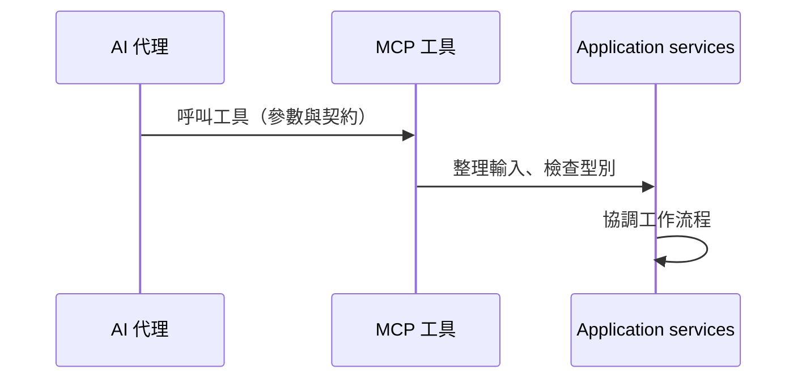
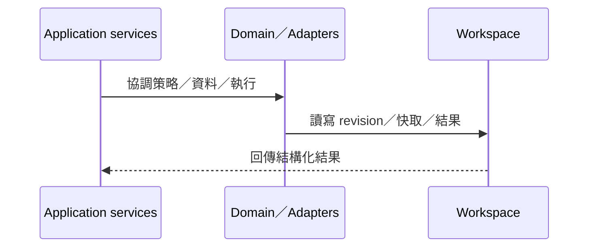
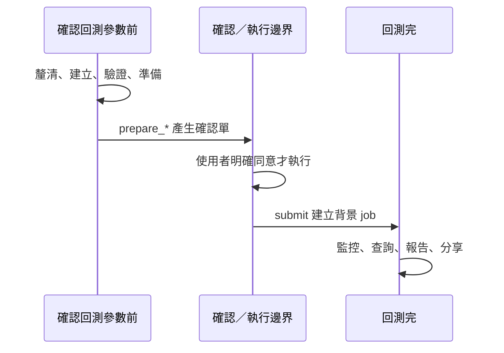
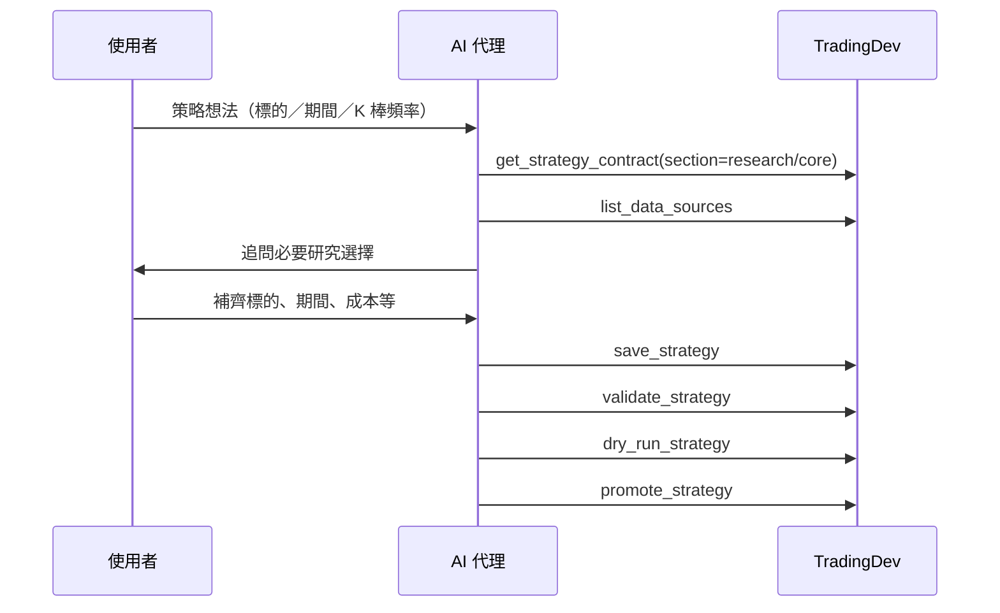
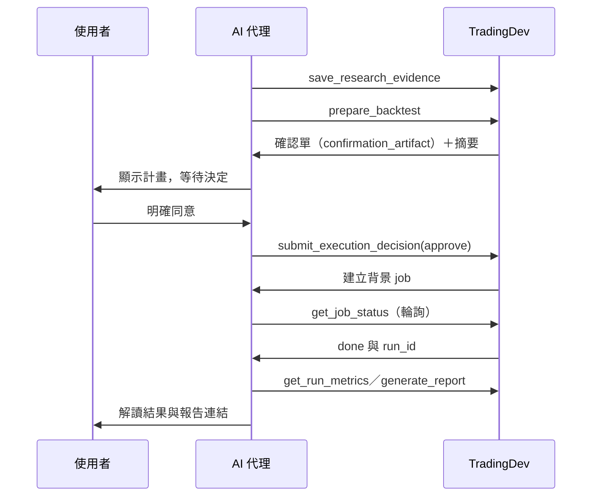
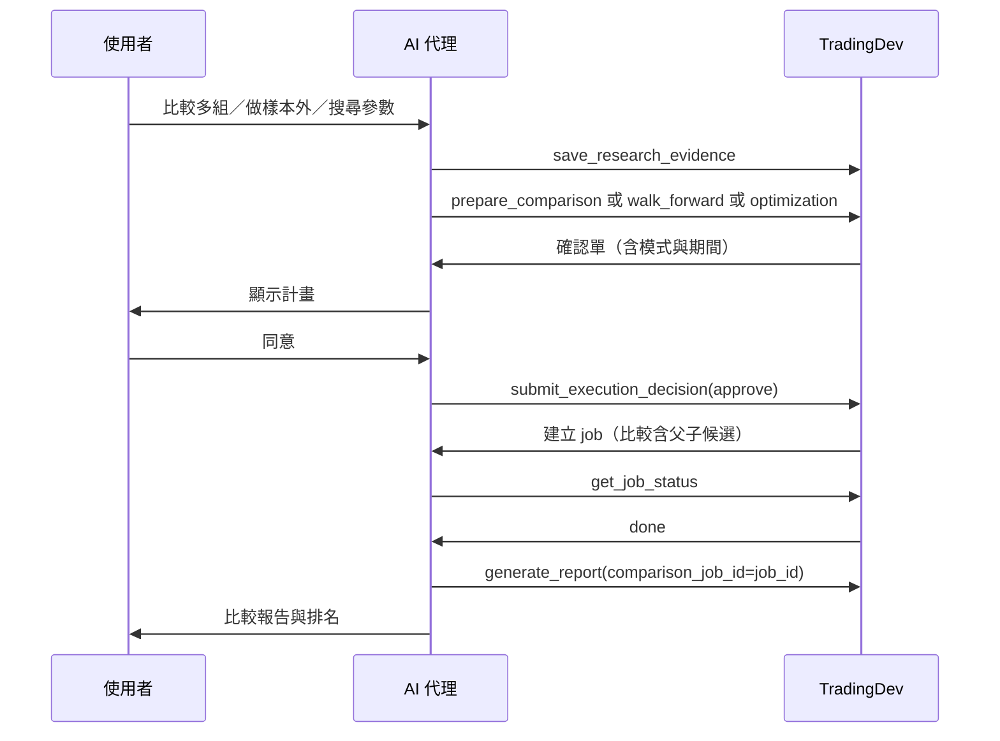
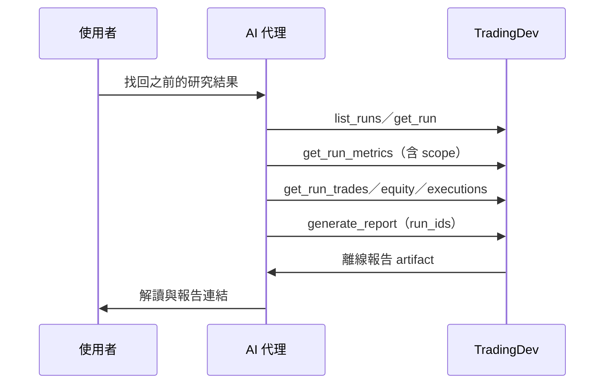
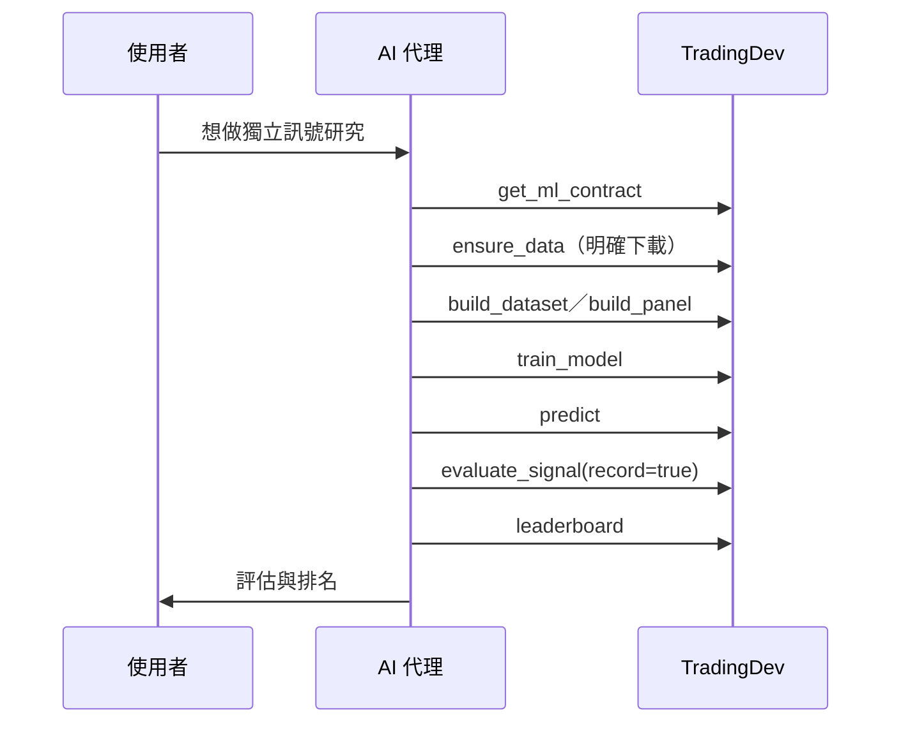
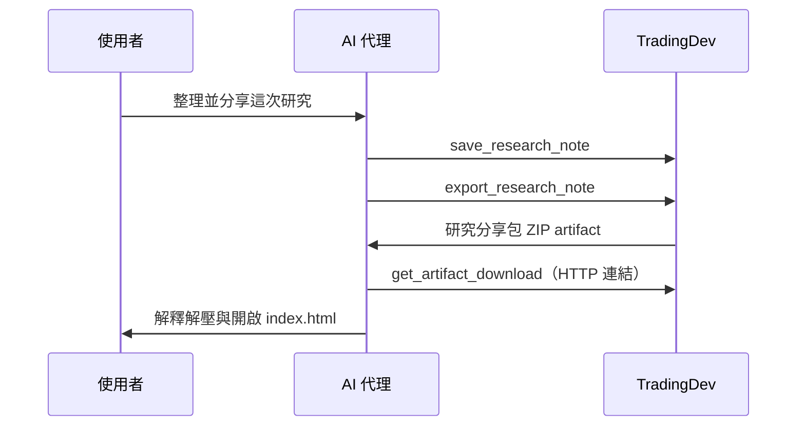

<!--
marp: true
theme: tradingdev
size: 16:9
paginate: true
lang: zh-Hant
title: TradingDev MCP 工具導覽｜AI 代理調用的工具、階段與目的
description: 工具分類、對話觸發的流程與執行階段對應
-->

<!-- _class: cover -->

# TradingDev MCP 工具導覽

AI 代理會調用哪些工具、在哪個研究階段、基於什麼目的

**永豐 x CCNS** 合作專案

<!--
_footer: |-
  GitHub: [TradingDev](https://github.com/Kuan-Lun/tradingdev)\
  簡報網址：本機預覽 / `docs/talks/tradingdev-mcp-tools/`
-->

---

<!-- _class: compact -->

## 閱讀路線

| 章節 | 主題 | 內容 |
| --- | --- | --- |
| 01 | **工具介面與總覽** | MCP 介面、工具數與讀寫分類 |
| 02 | **依目的分類** | 11 個工具群、各自的研究目的 |
| 03 | **研究階段與工具** | 確認前／後分期與各階段工具 |
| 04 | **對話觸發的工具流程** | UC-01～UC-05 的逐輪工具呼叫 |
| 05 | **工具語意與邊界** | 註解語意、產品限制 |

<!-- _footer: "方向鍵換頁，P 開啟講者模式。" -->

---

<!-- header: "01　工具介面與總覽" -->
<!-- _class: chapter -->
<!-- _header: "" -->

## 01　工具介面與總覽

TradingDev 以標準 MCP 作為主要介面，讓 AI 代理在對話中調用研究後端。

<!--
來源：https://github.com/Kuan-Lun/tradingdev/blob/main/docs/requirements.md
來源：https://github.com/Kuan-Lun/tradingdev/blob/main/src/tradingdev/mcp/server.py
-->

<!--
隱藏頁（2026-11-10 依朋友建議）：原本的「AI 代理透過 MCP 工具與後端互動」暫不顯示。
還原方式：移除本註解包裹、在上方補回一行 `---` 分頁線，並把下列兩條原指令改回
HTML 註解形式的 `_class` 與 `_footer` 指令（此處以條列保存，避免被當成指令解析）。

- 原 `_class` 指令：`compact`
- 原 `_footer` 指令：來源：[軟體需求規格](https://github.com/Kuan-Lun/tradingdev/blob/main/docs/requirements.md#3-產品觀與名詞) · [MCP server 註冊](https://github.com/Kuan-Lun/tradingdev/blob/main/src/tradingdev/mcp/server.py)

## AI 代理透過 MCP 工具與後端互動

> **MCP 是主要產品介面；後端不綁定特定 LLM 供應商。**

- **探索**：列出與閱讀策略、資料、結果與契約（`list_*`、`get_*`）。
- **操作**：建立策略、準備執行、提交決策、產生報告（`save_*`、`prepare_*`）。
- **按需契約**：先用 `get_strategy_contract` 等讀取撰寫與驗證規則，再動手。

對話可留在筆電，回測與訓練交給另一台主機；同一套工具由任何支援 MCP 的客戶端呼叫。
-->

---

## 一次工具呼叫的內部路徑（1/2）

<!-- _class: compact diagram-short -->

MCP 工具負責協定與資料轉換；工作流程與狀態轉移由 application 層服務協調。

<!--
來源：https://github.com/Kuan-Lun/tradingdev/blob/main/ARCHITECTURE.md
來源：https://github.com/Kuan-Lun/tradingdev/blob/main/src/tradingdev/mcp/server.py
-->

---

## 一次工具呼叫的內部路徑（2/2）

<!-- _class: compact diagram-short -->

**Workspace 是獨立於程式之外的外部存放空間**（策略修訂、行情快取、執行結果），與前面各層的程式內運算層類型不同；Domain／Adapters 讀寫它，再由 MCP 回傳給 AI 代理。

<!--
來源：https://github.com/Kuan-Lun/tradingdev/blob/main/ARCHITECTURE.md
來源：https://github.com/Kuan-Lun/tradingdev/blob/main/docs/run_artifacts.md#workspace-layout
來源：https://github.com/Kuan-Lun/tradingdev/blob/main/src/tradingdev/mcp/server.py
-->

---

<!-- _class: statement -->

## 目前共 52 個 MCP 工具

> **29 個唯讀工具、23 個會建立或變更狀態的工具。**

工具依責任分成 11 群；同一群內同時有讀取與寫入，方便代理在對話中反覆查詢與遞進修改。

<!--
數量依 src/tradingdev/mcp/tools/ 各模組的 @mcp.tool 裝飾函式統計；隨版本增減。
來源：https://github.com/Kuan-Lun/tradingdev/blob/main/src/tradingdev/mcp/tools/
-->

---

<!-- _class: compact -->

## 這 52 個工具分在哪裡（1/2）

| 模組 | 工具數 | 主要責任 |
| --- | ---: | --- |
| `strategy` | 7 | 建立、修訂、查詢與驗證策略 |
| `execution` | 8 | 準備回測、比較、Walk-forward、最佳化與確認 |
| `data` | 4 | 探索、查詢與快取行情 |
| `jobs` | 3 | 查詢與管理背景工作 |
| `runs` | 5 | 查詢回測結果、指標與比較 |
| `history` | 8 | 交易紀錄、診斷與報告 |

<!-- _footer: "來源：https://github.com/Kuan-Lun/tradingdev/blob/main/src/tradingdev/mcp/tools/" -->

---

<!-- _class: compact -->

## 這 52 個工具分在哪裡（2/2）

| 模組 | 工具數 | 主要責任 |
| --- | ---: | --- |
| `artifacts` | 3 | 列出與交付已保存產物 |
| `research_notes` | 4 | 保存與匯出研究筆記 |
| `feature_requests` | 2 | 記錄未支援能力 |
| `strategy_cleanup` | 1 | 預覽與清理草稿 |
| `ml` | 7 | 獨立資料集、模型、訊號評估與排名 |

前 6 群負責「把構想與研究條件變成可執行物件」；後 5 群負責「把結果留下並可分享」。共 11 群、52 個工具。

<!-- _footer: "來源：https://github.com/Kuan-Lun/tradingdev/blob/main/src/tradingdev/mcp/tools/" -->

---

<!-- header: "02　依目的分類" -->
<!-- _class: chapter -->
<!-- _header: "" -->

## 02　依目的分類

把 52 個工具依「研究目的」歸納成 11 群，說明每一群為了解決什麼而存在。

<!--
分類依 src/tradingdev/mcp/tools/ 各工具 docstring 與 SERVER_INSTRUCTIONS。
來源：https://github.com/Kuan-Lun/tradingdev/blob/main/src/tradingdev/mcp/prompts.py
-->

---

<!-- _class: compact -->

## 依研究目的劃分的工具群（1/2）

| 工具群 | 研究目的 | 工具數 | 讀寫 |
| --- | --- | ---: | --- |
| Strategy | 把構想寫成可檢查、可執行的策略 | 7 | 3 讀 / 4 寫 |
| Execution | 固定研究條件並產生可確認的計畫 | 8 | 1 讀 / 7 寫 |
| Data | 取得或確認行情與特徵資料 | 4 | 3 讀 / 1 寫 |
| Jobs | 追蹤與管理背景工作 | 3 | 1 讀 / 2 寫 |
| Runs | 查詢已保存的回測結果與指標 | 5 | 5 讀 |
| History | 讀取交易紀錄、診斷與組裝報告 | 8 | 7 讀 / 1 寫 |

<!-- _footer: "數量依 @mcp.tool 裝飾函式統計；讀寫以 ToolAnnotations.read_only_hint 為準。" -->

---

<!-- _class: compact -->

## 依研究目的劃分的工具群（2/2）

| 工具群 | 研究目的 | 工具數 | 讀寫 |
| --- | --- | ---: | --- |
| Artifacts | 列出與交付已保存產物 | 3 | 3 讀 |
| Research Notes | 留下可續讀的研究筆記 | 4 | 2 讀 / 2 寫 |
| Feature Requests | 記錄暫不支援的能力 | 2 | 1 讀 / 1 寫 |
| Strategy Cleanup | 預覽並清理未用草稿 | 1 | 1 寫 |
| ML | 獨立訓練與評估訊號 | 7 | 3 讀 / 4 寫 |
| **合計** | — | **52** | **29 讀 / 23 寫** |

<!-- _footer: "數量依 @mcp.tool 裝飾函式統計；讀寫以 ToolAnnotations.read_only_hint 為準。" -->

---

<!-- _class: compact -->

## 五個研究目的，對應不同工具群

- **把構想變成可執行策略**：`strategy` 群（建立、修訂、驗證、提升）。
- **把策略跑成可信實驗**：`execution` 與 `jobs` 群（準備、確認、執行、監控）。
- **把結果看清楚並能比較**：`runs`、`history`、`artifacts` 群（查詢、分析、報告、交付）。
- **把行情與特徵準備好**：`data` 與 `ml` 群（快取、獨立訊號研究）。
- **把研究留下來並能分享**：`research_notes`、`feature_requests`、`strategy_cleanup` 群。

**代理在每個目的下都先看再寫：先用唯讀工具確認，再用寫入工具推進。**

<!-- _footer: "來源：[SERVER_INSTRUCTIONS 九步流程](https://github.com/Kuan-Lun/tradingdev/blob/main/src/tradingdev/mcp/prompts.py)" -->

---

<!-- header: "03　研究階段與工具" -->
<!-- _class: chapter -->
<!-- _header: "" -->

## 03　研究階段與工具

以「確認回測參數」為分界，看工具如何落在執行前、執行中與執行後。

<!--
階段對應參考 requirements.md 的使用案例 UC-01～UC-05 與 SERVER_INSTRUCTIONS 流程。
來源：https://github.com/Kuan-Lun/tradingdev/blob/main/docs/requirements.md#5-使用案例
-->

---

<!-- _class: compact diagram-slim -->

## 研究生命週期以「確認」為分界

三個分期以**確認回測參數**為界；前與後是兩個工具截然不同的世界。

分界之前只做合成檢查、不下載正式行情、不跑回測；分界之後才讀取真實結果。修改或拒絕則回到準備，需重新確認。

<!-- _footer: "來源：[SERVER_INSTRUCTIONS 步驟 4–6](https://github.com/Kuan-Lun/tradingdev/blob/main/src/tradingdev/mcp/prompts.py)" -->

---

<!-- _class: compact stage-tbl -->

## 分期與階段：執行前（1/2）

| 分期 | 研究階段 | 主要工具 |
| --- | --- | --- |
| 執行前 | 需求釐清 | `get_strategy_contract`、`list_data_sources`、`list_strategies`、`get_strategy` |
| 執行前 | 策略建立與驗證 | `save_strategy`、`validate_strategy`、`dry_run_strategy`、`promote_strategy` |

取得確認回測參數前，代理交錯呼叫多個階段；**只做合成檢查，不下載正式行情、不跑回測**。

`get_strategy_contract`、`list_data_sources`、`get_artifact`(_download) 為跨鄰近階段重複呼叫的參考與交付工具；其餘工具依主要階段歸屬，各階段不會完全重疊。

<!-- _footer: "來源：[requirements.md 使用案例](https://github.com/Kuan-Lun/tradingdev/blob/main/docs/requirements.md#5-使用案例) · [SERVER_INSTRUCTIONS](https://github.com/Kuan-Lun/tradingdev/blob/main/src/tradingdev/mcp/prompts.py)" -->

---

<!-- _class: compact stage-tbl -->

## 分期與階段：執行前（2/2）

| 分期 | 研究階段 | 主要工具 |
| --- | --- | --- |
| 執行前 | 資料準備 | `list_available_data`、`inspect_dataset`、`ensure_data` |
| 執行前 | 執行準備與確認 | `save_research_evidence`、`prepare_backtest` / `comparison` / `walk_forward` / `optimization`、`get_execution_plan`、`submit_execution_decision`、`cancel_execution_plan` |

這一階段以 `prepare_*` 產生確認單，等待使用者明確同意；**準備本身不執行回測**。

<!-- _footer: "來源：[requirements.md 使用案例](https://github.com/Kuan-Lun/tradingdev/blob/main/docs/requirements.md#5-使用案例) · [SERVER_INSTRUCTIONS](https://github.com/Kuan-Lun/tradingdev/blob/main/src/tradingdev/mcp/prompts.py)" -->

---

<!-- _class: compact stage-tbl -->

## 分期與階段：執行中／後（1/2）

| 分期 | 研究階段 | 主要工具 |
| --- | --- | --- |
| 執行中 | 執行監控 | `get_job_status`、`list_jobs`、`cancel_job` |
| 執行後 | 結果查詢與分析 | `list_runs`、`get_run`、`get_run_metrics`、`get_metric_catalog`、`compare_runs`、`find_runs`、`get_run_trades` / `equity` / `executions` / `account_history`、`get_run_diagnostics` |

確認後才讀取真實結果；此分期的工具多為唯讀，與執行前以寫入為主明顯不同。

<!-- _footer: "來源：[requirements.md 使用案例](https://github.com/Kuan-Lun/tradingdev/blob/main/docs/requirements.md#5-使用案例) · [SERVER_INSTRUCTIONS](https://github.com/Kuan-Lun/tradingdev/blob/main/src/tradingdev/mcp/prompts.py)" -->

---

<!-- _class: compact stage-tbl -->

## 分期與階段：執行後（2/2）與獨立軌道

| 分期 | 研究階段 | 主要工具 |
| --- | --- | --- |
| 執行後 | 報告與交付 | `get_report_sections`、`generate_report`、`list_artifacts`、`get_artifact`(_download) |
| 執行後 | 保存與分享 | `save_research_note`、`get_research_notes`、`export_research_note`、`get_research_archive`、`record_feature_request`、`list_feature_requests`、`cleanup_strategy_drafts` |
| 獨立軌道 | ML 訊號研究 | `get_ml_contract`、`build_dataset` / `build_panel`、`train_model`、`predict`、`evaluate_signal`、`leaderboard` |

<!-- _footer: "來源：[requirements.md 使用案例](https://github.com/Kuan-Lun/tradingdev/blob/main/docs/requirements.md#5-使用案例) · [SERVER_INSTRUCTIONS](https://github.com/Kuan-Lun/tradingdev/blob/main/src/tradingdev/mcp/prompts.py)" -->

---

<!-- _class: compact -->

## 確認前：代理在執行前交錯呼叫多群工具

以 UC-01「從構想到回測」為例，代理在**確認回測參數之前**依序穿過多個階段：

1. **釐清**：`get_strategy_contract`、`list_data_sources` 確認選擇與能力。
2. **建立與驗證**：`save_strategy` → `validate_strategy` → `dry_run_strategy` → `promote_strategy`。
3. **準備與確認**：`save_research_evidence` → `prepare_backtest` → `get_execution_plan`。
4. **執行與監控**：`submit_execution_decision` → `get_job_status`。
5. **查詢與報告**：`get_run_metrics` → `generate_report` → `get_artifact_download`。

**寫入工具一律在前一步的唯讀確認之後才呼叫。**

<!-- _footer: "來源：[UC-01 正常流程](https://github.com/Kuan-Lun/tradingdev/blob/main/docs/requirements.md#5-使用案例)" -->

---

<!-- header: "04　對話觸發的工具流程" -->
<!-- _class: chapter -->
<!-- _header: "" -->

## 04　對話觸發的工具流程

把每個使用案例拆成「逐輪對話 → 工具呼叫」的順序圖；參與者為使用者、AI 代理與 TradingDev。

<!--
流程依 requirements.md 的 UC-01～UC-05 與 SERVER_INSTRUCTIONS 整理。
來源：https://github.com/Kuan-Lun/tradingdev/blob/main/docs/requirements.md#5-使用案例
-->

---

<!-- _class: compact -->

## 五個使用案例對應的工具流程（1/2）

| 案例 | 觸發的階段 | 關鍵寫入工具 |
| --- | --- | --- |
| UC-01 從構想到回測 | 釐清 → 建立 → 驗證 → 準備 → 確認 → 執行 → 查詢 | `save_strategy`、`prepare_backtest`、`submit_execution_decision` |
| UC-02 比較與樣本外研究 | 準備比較／Walk-forward／最佳化 → 確認 → 執行 | `prepare_comparison` / `walk_forward` / `optimization` |
| UC-03 找回歷史研究 | 查詢 → 報告（不重跑） | `generate_report`（run_ids） |

<!-- _footer: "來源：https://github.com/Kuan-Lun/tradingdev/blob/main/docs/requirements.md#5-使用案例" -->

---

<!-- _class: compact -->

## 五個使用案例對應的工具流程（2/2）

| 案例 | 觸發的階段 | 關鍵寫入工具 |
| --- | --- | --- |
| UC-04 獨立 ML 訊號研究 | 合約 → 資料 → 資料集 → 訓練 → 評估 → 排名 | `build_dataset`、`train_model`、`evaluate_signal` |
| UC-05 保存與分享 | 筆記 → 匯出 → 交付 | `save_research_note`、`export_research_note` |

五個案例都遵循「先唯讀確認、再明確同意後寫入」；UC-03 不重跑回測，UC-04 走獨立 ML 軌道。

<!-- _footer: "來源：https://github.com/Kuan-Lun/tradingdev/blob/main/docs/requirements.md#5-使用案例" -->

---

<!-- _class: compact diagram-tight -->

## UC-01（1/2）：釐清、建立與驗證策略

缺項先追問；每個 `save_strategy` 回傳 `revision_id`，驗證與執行都綁定它。

<!--
來源：[SERVER_INSTRUCTIONS 步驟 1–3](https://github.com/Kuan-Lun/tradingdev/blob/main/src/tradingdev/mcp/prompts.py)
來源：https://github.com/Kuan-Lun/tradingdev/blob/main/src/tradingdev/mcp/tools/strategy.py
-->

---

## UC-01（2/2）：準備、確認、執行與查詢

<!-- _class: compact diagram-tight -->

準備本身不執行回測；只有使用者明確同意後才提交並建立背景工作。

<!--
來源：[SERVER_INSTRUCTIONS 步驟 4–8](https://github.com/Kuan-Lun/tradingdev/blob/main/src/tradingdev/mcp/prompts.py)
來源：https://github.com/Kuan-Lun/tradingdev/blob/main/src/tradingdev/mcp/tools/execution.py
-->

---

<!-- _class: compact diagram-dense -->

## UC-02：比較、Walk-forward 與最佳化

三種 `prepare_*` 回答不同問題；最佳化結果不直接等同樣本外保證。

<!--
來源：[UC-02](https://github.com/Kuan-Lun/tradingdev/blob/main/docs/requirements.md#5-使用案例)
來源：https://github.com/Kuan-Lun/tradingdev/blob/main/src/tradingdev/mcp/tools/execution.py
-->

---

<!-- _class: compact diagram-mid -->

## UC-03：找回歷史研究（不重跑）

以保存內容產生報告；缺少或損壞證據會明示，不悄悄重建歷史。

<!--
來源：[UC-03](https://github.com/Kuan-Lun/tradingdev/blob/main/docs/requirements.md#5-使用案例)
來源：https://github.com/Kuan-Lun/tradingdev/blob/main/src/tradingdev/mcp/tools/history.py
-->

---

<!-- _class: compact diagram-mid -->

## UC-04：獨立 ML 訊號研究

ML 研究是同步獨立介面，不會自動轉成交易策略或建立一般回測 run。

<!--
來源：[UC-04](https://github.com/Kuan-Lun/tradingdev/blob/main/docs/requirements.md#5-使用案例)
來源：https://github.com/Kuan-Lun/tradingdev/blob/main/src/tradingdev/mcp/tools/ml.py
-->

---

<!-- _class: compact diagram-mid -->

## UC-05：保存與分享研究

研究筆記為摘要，非逐字紀錄；分享包完整解壓後離線可讀。

<!--
來源：[UC-05](https://github.com/Kuan-Lun/tradingdev/blob/main/docs/requirements.md#5-使用案例)
來源：https://github.com/Kuan-Lun/tradingdev/blob/main/src/tradingdev/mcp/tools/research_notes.py
-->

---

<!-- header: "05　工具語意與邊界" -->
<!-- _class: chapter -->
<!-- _header: "" -->

## 05　工具語意與邊界

AI 代理能叫到哪些「種類」的工具，以及工具不能保證什麼。

<!--
註解語意來自 mcp_types.ToolAnnotations；限制來自 requirements.md 與架構文件。
-->

---

<!-- _class: compact -->

## 工具註解告訴代理「這是哪一類工具」

每個工具帶有四個 hint，協助代理決定呼叫時機與風險：

- **read_only_hint**：只讀取、不變更伺服器狀態（`list_*`、`get_*`）。
- **destructive_hint**：可能建立、覆寫或刪除（`save_strategy`、`ensure_data`、`cleanup_strategy_drafts`）。
- **idempotent_hint**：重複呼叫結果一致（`get_*`、`promote_strategy`、`generate_report`）。
- **open_world_hint**：可能執行生成程式或存取外部資料（`validate_strategy`、`ensure_data`）。

**hint 是對代理的提示，不代表後端已證明行為；權限仍由後端強制。**

<!-- _footer: "來源：https://github.com/Kuan-Lun/tradingdev/blob/main/src/tradingdev/mcp/tools/" -->

---

<!-- _class: compact -->

## 工具能做的與不能保證的

- TradingDev 研究歷史資料，**不提供真實下單**。
- 生成程式的檢查在 Linux 容器中執行，**不是完整安全 sandbox**。
- `prepare_*` 只做合成檢查，**不預測真實績效、不下載正式行情**。
- 確認單的「初始請求」不代表同意；**只有明確同意才提交執行**。
- 指標受資料頻率、成本假設限制；**缺失值不是零，也不重建歷史**。

<!--
來源：[requirements.md 限制](https://github.com/Kuan-Lun/tradingdev/blob/main/docs/requirements.md#10-限制與假設)
來源：[架構保證與限制](https://github.com/Kuan-Lun/tradingdev/blob/main/ARCHITECTURE.md)
-->

---

<!-- _class: closing -->
<!-- _header: "" -->

## TradingDev 的工具設計

把工具分成 **11 群、52 個 MCP 工具**，對應從構想到分享的 **三個分期、九個研究階段**；
AI 代理依對話觸發對應工具，先以唯讀確認、再於明確同意後執行。

<!--
以明確輸入、確認計畫、固定 manifest 及保存的 artifacts 支援重現與後續比較；
這不代表策略結果已被證明有效。
-->

---

<!-- _class: references -->

## 參考資料

- [軟體需求規格（SRS）](https://github.com/Kuan-Lun/tradingdev/blob/main/docs/requirements.md)
- [MCP server 註冊與服務組裝](https://github.com/Kuan-Lun/tradingdev/blob/main/src/tradingdev/mcp/server.py)
- [工具模組（strategy / execution / data / jobs / runs / history / artifacts / research_notes / feature_requests / strategy_cleanup / ml）](https://github.com/Kuan-Lun/tradingdev/blob/main/src/tradingdev/mcp/tools/)
- [SERVER_INSTRUCTIONS 九步工作流](https://github.com/Kuan-Lun/tradingdev/blob/main/src/tradingdev/mcp/prompts.py)
- [系統架構](https://github.com/Kuan-Lun/tradingdev/blob/main/ARCHITECTURE.md)

<!--
投影片版型參考 docs/talks/tradingdev-introduction/theme.css。本檔使用同一 Marp theme 名稱及 cover、chapter、compact、statement、closing、references class。
-->
